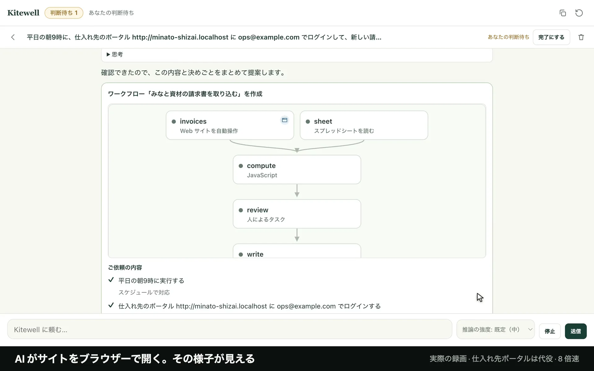
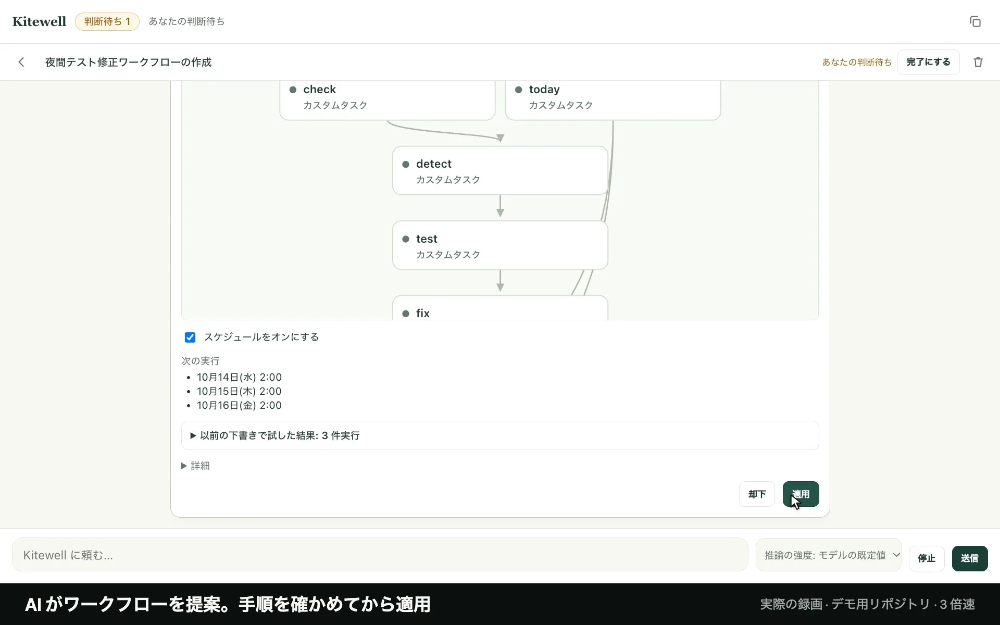
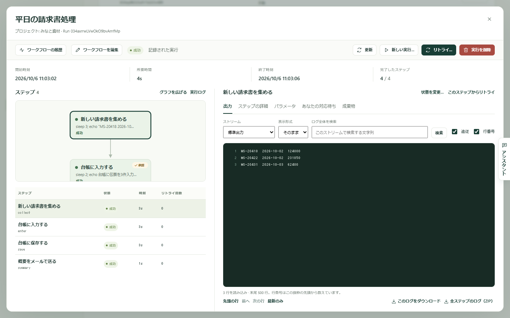

  <a href="README.md">English</a> · <strong>日本語</strong>

  

<h1 align="center">AI は一度で覚える。 あとは迷わず、速く動く。</h1>

  やってほしい仕事を伝えれば、AI が目の前のブラウザーで自動化をつくり、サイトが変わったら直します。デスクトップアプリ、Excel、メール、Claude Code などのコーディングエージェントも同じように、スケジュールや Webhook で、大事なところはあなたの OK を待って動きます。外出先からも、スマホで見守れます。

  <a href="https://kitewell.app/ja/#film"><strong>▶ 映像を見る（74 秒）</strong></a> ·
  <a href="https://kitewell.app/ja/download/">ダウンロード</a> ·
  <a href="https://kitewell.app/ja/docs/getting-started/">はじめかた</a> ·
  <a href="https://kitewell.app/ja/docs/">ドキュメント</a> ·
  <a href="https://kitewell.app/ja/examples/">活用例</a> ·
  <a href="https://kitewell.app/ja/pricing/">料金</a>

  macOS 13 以降 · Windows 10 以降 · 14 日間無料、カード登録不要

---

## 実際の動き

Kitewell のチャット画面の実際の録画です。編集はせず、一定の速さで早送りしています。ふだんの言葉で 1 回頼んだあと、AI とアプリが行ったことのすべてです。

<table>
  <tr>
    <td width="50%" valign="top">
      
      
<strong>Web サイト。</strong>仕入れ先ポータルの新しい請求書を平日ごとに Excel に追加するよう頼むと、AI はチャットに映るブラウザーで代役のポータルを開き、パスワードはカードであなたが入力します。AI はログインして下書きを試し、ワークフローを提案します。実行は、見つけた請求書を見せて、あなたの返信を待ちます。

    </td>
    <td width="50%" valign="top">
      
      
<strong>コーディングエージェント。</strong>デモ用リポジトリの失敗しているテストを毎晩 Claude Code に直させ、その変更を Codex にレビューさせるよう頼むと、アシスタントがスケジュール付きのワークフローを提案して実行します。実行は 2 つの要約を見せて待ち、返信で進めると、修正がローカルの新しいブランチにコミットされます。

    </td>
  </tr>
</table>

## しくみ

1. **AI がつくる。** やってほしい仕事を、ふだんの言葉で伝えるだけ。アシスタントが手順を並べて見せ、目の前のブラウザーでサイトを操作し、外部に何も送らずに試します。適用するまで、何も動きません。
2. **パソコンが動かす。** スケジュールで、Webhook で、スマホから。指定した所では、あなたの OK を待ちます。
3. **AI が保守する。** サイトやアプリが変われば、AI が新しい手順を見つけて覚え直し、何を直したかを実行の記録に残します。失敗したときは、理由を AI が伝えます。

## ブラウザーの自動化は、AI がつくり、AI が保守する

やってほしい仕事を、ふだんの言葉で伝えるだけ。AI が、見守ったり代わったりできるブラウザーでログインし、クリックし、入力し、情報を集め、うまくいった操作から手順を書きます。以降の実行はそれを繰り返し、サイトが変われば、AI が新しい手順を見つけて覚え直します。

| ステップ | ブラウザーが行ったこと | 結果 |
| --- | --- | --- |
| ページを開く | `127.0.0.1:4322/billing/invoices` | 完了 |
| 操作 | メールアドレス欄に ops@example.com と入力する | 再生 |
| 操作 | パスワード欄に `%password%` と入力する | 再生 |
| 操作 | ログインをクリックする | **復旧** |
| 確認 | text "請求書" | 完了 |
| 収集 | 前営業日以降に発行された請求書すべて | 完了 |

代役の仕入れ先ポータルに対する、実際の実行の記録です。表示は Kitewell の画面のとおり。ポータルのログインボタンが動いたため、AI が新しいボタンを見つけて覚え直し、次の実行はそれを再生しました。

- **ログインが必要なサイトも。** サインインは、コンピューター上の Kitewell 専用のブラウザープロファイルに残ります。電子証明書が必要なサイトにも対応します。
- **パスワードはモデルに見せない。** パスワードはステップに名前で書き、コンピューターのシークレットから入力します。モデルに見えるのは名前だけです。
- **何を直したかが見える。** 実行ごとに、繰り返したステップと AI が直したステップを、スクリーンショット付きで記録します。

[Web サイトの自動化のしくみ →](https://kitewell.app/ja/docs/browser/)

## コーディングエージェント：Claude Code、Codex ほか 13 種類を、あなたのスケジュールで

いつも使っているコーディングエージェントを、いまのサインインのまま、あなたがいない間も働かせます。

**Claude Code · Codex · Cursor · Gemini · GitHub Copilot · Aider · Amp · Cline · DeepSeek · Droid · Goose · Kiro · OpenCode · Pi · Qwen**、ほかの CLI もカスタムコマンドで。

- **つなげる。** 1 つが書き、もう 1 つがレビュー。並べて動かすことも、シートからリポジトリごとに動かすこともできます。
- **上限でも止まらない。** エージェントが利用上限に達したり失敗したりしたら、次に挙げたエージェントが引き継ぎます。
- **確認なしには出さない。** 承認するまでプッシュを止めます。「差し戻し」なら、メモを添えてエージェントがやり直します。
- **GitHub から始まる。** Issue やプルリクエストの Webhook で実行が始まります。ポート開放は不要です。

ワークフローは素の YAML です。[失敗したテストを夜のうちに直すワークフローの全文 →](https://kitewell.app/ja/examples/fix-failing-tests/)

各社の利用規約に従ってお使いください。[Kitewell のコーディングエージェント →](https://kitewell.app/ja/docs/ai/)

## ブラウザーの外も

- **[API のないデスクトップアプリ。](https://kitewell.app/ja/docs/desktop/)** モデルが画面を読んでアプリを操作します。以降の実行は、Windows ではアプリ自身のボタンや入力欄を、macOS では画面を頼りに再生します。
- **[Excel を 1 行ずつ。](https://kitewell.app/ja/docs/spreadsheets/)** いまのブックのまま 1 行ごとに実行し、結果を同じ行に書き戻します。結合ヘッダー、和暦、全角数字もそのまま。
- **[メール。](https://kitewell.app/ja/docs/email/)** Microsoft 365、アプリパスワードを使う Gmail、任意の IMAP のメールを、検索、整理、送信します。
- **[スクリプト、サーバー、API。](https://kitewell.app/ja/docs/workflow-builder/)** コマンド、Docker、数台ずつ進める SSH のロールアウト、OpenAPI の取り込み。次の道を選ぶ判定ステップも。

## 勝手に始まる

- **[スケジュール。](https://kitewell.app/ja/docs/scheduling/)** 毎日、平日、どんな間隔でも、あなたのタイムゾーンで。パソコンが眠っていて逃した開始は、起きたときに追いかけます。
- **[Webhook。](https://kitewell.app/ja/docs/webhooks/)** GitHub、Stripe、Slack などのサービスが、Kitewell のリレーを通じてあなたのパソコンのワークフローを始めます。署名を確認し、ポートは開かず、リクエストは最大 7 日間待ちます。
- **[どこからでも。](https://kitewell.app/ja/docs/mcp/)** スマホの ChatGPT や Claude から、MCP で Claude Code や Codex から、または REST で。

## スマホから承認も確認も。失敗の理由もわかる。

- **承認と差し戻し。** どのステップでも OK を待てます。実行の画面、通知、スマホの ChatGPT や Claude から、承認やメモ付きの差し戻しができます。
- **[ブラウザーで実行を確認。](https://kitewell.app/ja/docs/console/)** 同期したプロジェクトの実行と、それを動かしたパソコンを Dagu Console で確認できます。スマホからも開けます。どのプランでも使えます。
- **アラート。** 実行の失敗、あなたの対応待ち、スケジュールの取りこぼしを、Slack、Microsoft Teams、PagerDuty、メール、デスクトップ通知で知らせます。Personal と Team で使えます。
- **パソコンが止まったら。** パソコンからの報告が 10 分途絶えると、Dagu Console がメールで知らせます。スリープ、オフライン、Kitewell の終了も見逃しません。動かし続けるパソコンでオンにします。
- **失敗の診断。** AI が失敗した実行を読み、やり直すか、対応するか、ワークフローを変えるかを伝えます。
- **実行の記録。** 各ステップの出力、スクリーンショット、判断。失敗したステップからやり直せます。
- **先に試す。** 保存の前に実際の入力で 1 ステップを試し、外部に何も送らずに下書きを試せます。
- **残るメモ。** アシスタントが覚えたことをナレッジのページに残します。あなたにも、引き継ぐ人にも。

ChatGPT Plus と Pro では、実行を読めますが承認はできません。

## どのパソコンで動かしても、ひとつの画面で見守る

- **[すべてのパソコンを一覧で。](https://kitewell.app/ja/docs/console/)** Dagu Console に、各パソコンの状態、Kitewell のバージョン、今日の実行が並びます。アラートはワークフローごとに 1 件。何台で動かしても増えず、どのパソコンでも次に成功すれば閉じます。
- **[同期とロール。](https://kitewell.app/ja/docs/cloud-sync/)** 閲覧・編集・管理のロールでプロジェクトを共有。サインインとシークレットの値は、それぞれのパソコンに残ります。
- **[リリース。](https://kitewell.app/ja/docs/releases/)** Dev から Staging、本番へ。差分を確かめて反映し、ロールバックもできます。
- **ロボット管理台帳。** すべてのワークフローを 1 行ずつ、FISC の項目順で台帳に書き出せます。
- **共有のコンピューター（Enterprise）。** 自社の Azure や AWS の VM など、組織が持つコンピューターが、誰もサインインしていなくても昼夜ワークフローを動かします。ノート PC のスリープや担当者の異動で止まりません。
- **ブラウザーから作る（Enterprise）。** 会社のアカウントでサインインし、ワークフローが動くコンピューターの上で、そのブラウザーを見ながら作って試せます。修正の承認はスマホから。リモートデスクトップは要りません。

## RPA の考え方は正しかった。問題は、手でつくることだった。

| 手でつくる RPA | Kitewell |
| --- | --- |
| 専門の担当者が、クリックを一つずつ記録して組む | あなたの言葉から、AI が組む |
| 画面が変わるたびに、誰かがロボットを直す | AI が新しい手順を見つけて、覚え直す |
| ロボット用の PC と、ロボットごとのライセンス | いまあるパソコンで。14 日間無料で試せる |
| システムの種類ごとに、別のツール | Web サイト、デスクトップアプリ、Excel、メールを 1 つのワークフローに |
| ロボットが何をしたか、見えにくい | すべてのステップ、スクリーンショット、承認が実行の記録に |

[Kitewell と、ほかの選択肢 →](https://kitewell.app/ja/compare/)

## あなたのパソコン、あなたの鍵、あなたのファイル

- **シークレットの値**は、パソコン内で暗号化。同期、エクスポート、バックアップには入りません。
- **AI は自由に。** Anthropic、OpenAI、Gemini、OpenRouter、Kitewell の付属モデル、または社内のネットワークから何も出さないローカルモデル。
- **囲い込みなし。** ワークフローはオープンソースの [Dagu](https://github.com/dagucloud/dagu) エンジンで動く素の YAML。いつでもエクスポートできます。
- **裏で静かに。** メニューバーやタスクトレイから動きます。毎晩のバックアップと編集履歴、失敗したら戻るエンジン更新。
- **外に出るものは正確に。** 同期したプロジェクトが送るのは、実行の状態と失敗したステップの名前だけ。ログ、出力、シークレットの値は送りません。
- **6 つの言語。** アプリは日本語、英語、中国語、韓国語、フランス語、ドイツ語に対応しています。

[外に出るものと、そのタイミングのすべて →](https://kitewell.app/ja/docs/data-flow/)

## 活用例

| 業務 | コーディング |
| --- | --- |
| [仕入れ先ポータルの請求書ダウンロード](https://kitewell.app/ja/examples/supplier-invoices/)：平日の朝 | [失敗したテストを Claude Code で夜のうちに修正](https://kitewell.app/ja/examples/fix-failing-tests/)：平日の 2:00 |
| [Excel の一覧から Web サイトへの発注](https://kitewell.app/ja/examples/excel-orders/)：受注が入るたびに | [Codex と Claude Code でプルリクエストをレビュー](https://kitewell.app/ja/examples/review-every-pr/)：プルリクエストが開くたびに |
| [メールで届く請求書の転記](https://kitewell.app/ja/examples/invoice-intake/)：数日おきに | [GitHub の Issue の仕分け](https://kitewell.app/ja/examples/triage-issues/)：Issue が開くたびに |
| [毎朝のメールのダイジェスト](https://kitewell.app/ja/examples/inbox-digest/)：毎朝 | [Codex で依存関係を定期的に更新](https://kitewell.app/ja/examples/dependency-update/)：毎週月曜 |

[すべての活用例 →](https://kitewell.app/ja/examples/)

## 料金

| | 無料トライアル | Personal | Team |
| --- | --- | --- | --- |
| 料金 | 14 日間無料（カード登録不要） | 月額 3,000 円（税込 3,300 円） | 1 台につき月額 14,800 円（税込 16,280 円）、年払いは 10 か月分 |
| 対象 | 自分の仕事で Kitewell を試す | 1 人がコンピューターの前で自分の仕事に使う（有償の仕事にも） | 25 人までの組織 |
| コンピューター | 3 台まで | 1 台 | 1〜100 台 |
| メンバー | 25 人まで | 1 人 | 25 人まで（追加料金なし） |
| プロジェクト | 最大 15 個（各 100 ワークフロー） | 最大 5 個（各 100 ワークフロー） | 最大 15 個（各 100 ワークフロー） |
| API キーと接続済みのアプリ | 無制限 | 無制限 | 無制限 |
| 誰もサインインしていないときの実行（Windows） | あり | | あり |
| Dagu Console での実行の確認とアラート | あり | あり | あり |
| Kitewell のアラート、Webhook、MCP Events | あり | あり | あり |
| ロールつきのプロジェクト共有 | あり | | あり |
| 付属モデルのクレジット | 1 回 100 | 毎月 500 | コンピューター 1 台につき毎月 500 |
| クレジットパック | | 1,000 クレジット 1,800 円（税込 1,980 円） | 1,000 クレジット 1,800 円（税込 1,980 円） |

価格は税抜です。日本国外からのお申し込みは米ドルでの決済となり、Personal は月額 20 ドル、Team は 1 台につき月額 99 ドル（いずれも税抜）です。どのプランにも Dagu Cloud アカウントが必要です。Kitewell からサインインするとトライアルが始まり、終了後は契約するまで何も実行されず、プロジェクトは読み取り専用で、開いたり書き出したりできます。Personal はサインインしている間に動きます。組織の共有の仕事に使う場合、つまり複数の人のコンピューターや、そのために用意したコンピューターで動かす場合は Team が必要で、[Dagu Console](https://console.dagu.sh/kitewell) で申し込めます。クレジットパックに期限はなく、その月のクレジットのあとに使われます。25 人・100 台を超える場合や、共有のコンピューター、ブラウザーのワークスペース、SSO、監査ログの書き出し、閉域網での同期、SLA が必要な場合は、Enterprise 契約でご用意します。お見積りは [company@descarty.com](mailto:company@descarty.com) までご連絡ください。業務自動化の支援会社様は、[パートナープログラム](https://descarty.com/partners/)で Kitewell を Team の 30% 引きで再販できます。AI プロバイダーの利用料は別途かかります。

[料金の詳細 →](https://kitewell.app/ja/pricing/)

## インストール

Kitewell は、macOS 13 以降（Apple シリコンと Intel）と、Windows 10 バージョン 1809 以降および Windows 11（x64）で動きます。Web サイトの自動化には Chrome を使います。Windows では Edge も使えます。

インストーラーは[ダウンロードのページ](https://kitewell.app/ja/download/)または [GitHub Releases](https://github.com/dagucloud/kitewell/releases) から入手できます。インストールしたら、[最初のワークフロー](https://kitewell.app/ja/docs/getting-started/)に進んでください。

## ドキュメント

- **はじめる：** [Kitewell をインストールする](https://kitewell.app/ja/docs/install/) · [最初のワークフロー](https://kitewell.app/ja/docs/getting-started/) · [ワークフローを組み立てる](https://kitewell.app/ja/docs/workflow-builder/)
- **自動化する：** [Web サイト](https://kitewell.app/ja/docs/browser/) · [デスクトップアプリ](https://kitewell.app/ja/docs/desktop/) · [Excel](https://kitewell.app/ja/docs/spreadsheets/) · [メール](https://kitewell.app/ja/docs/email/) · [API のインポート](https://kitewell.app/ja/docs/apis/) · [AI エージェントとモデル](https://kitewell.app/ja/docs/ai/) · [シートでワークフローを一括実行](https://kitewell.app/ja/docs/batches/)
- **動かす：** [スケジュール](https://kitewell.app/ja/docs/scheduling/) · [Webhook](https://kitewell.app/ja/docs/webhooks/) · [実行とログ](https://kitewell.app/ja/docs/runs/) · [アラート](https://kitewell.app/ja/docs/alerts/) · [シークレット](https://kitewell.app/ja/docs/secrets/) · [ナレッジ](https://kitewell.app/ja/docs/knowledge/)
- **つなぐ・共有する：** [MCP と API アクセス](https://kitewell.app/ja/docs/mcp/) · [Dagu Cloud で同期](https://kitewell.app/ja/docs/cloud-sync/) · [チームで共有](https://kitewell.app/ja/docs/sharing/) · [リリースと段階的なプロジェクト](https://kitewell.app/ja/docs/releases/)
- **運用する：** [コンピューターの外に出るもの](https://kitewell.app/ja/docs/data-flow/) · [バックアップと復旧](https://kitewell.app/ja/docs/backups/) · [更新](https://kitewell.app/ja/docs/updates/) · [トラブルシューティング](https://kitewell.app/ja/docs/troubleshooting/) · [アンインストール](https://kitewell.app/ja/docs/uninstall/)

## サポート

- 質問と不具合の報告：[GitHub の Issue](https://github.com/dagucloud/kitewell/issues)
- セキュリティの脆弱性：[SECURITY.md](SECURITY.md) の手順で非公開でご報告ください
- リリースノート：[GitHub Releases](https://github.com/dagucloud/kitewell/releases)
- Team、Enterprise、そのほかのビジネスに関するご質問：[company@descarty.com](mailto:company@descarty.com)

Kitewell は [Descarty株式会社](https://descarty.com/) の製品です。
