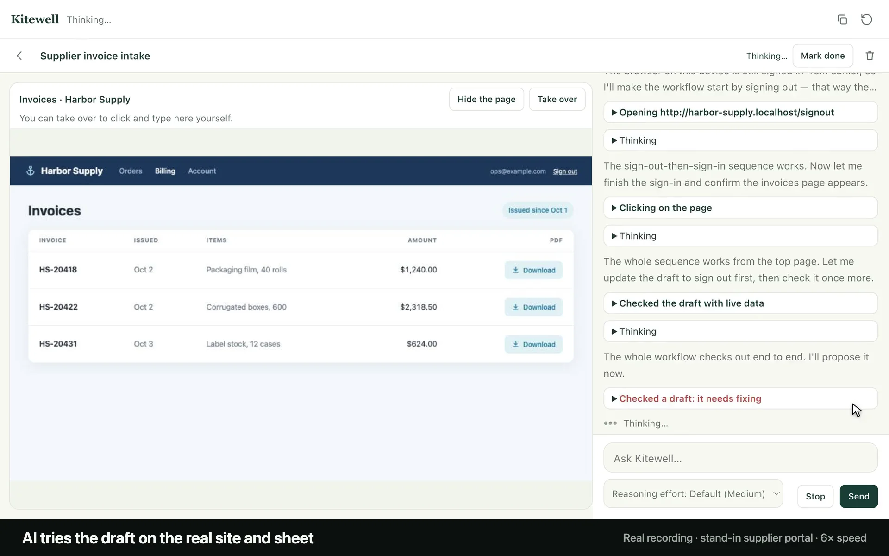
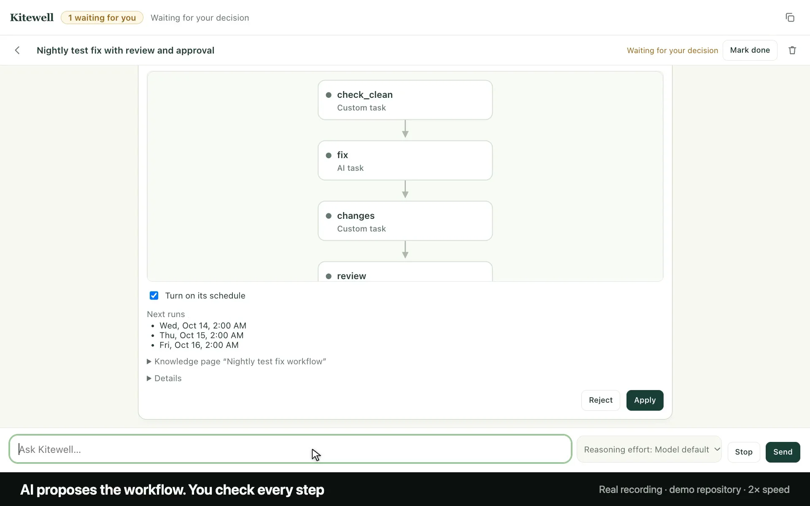
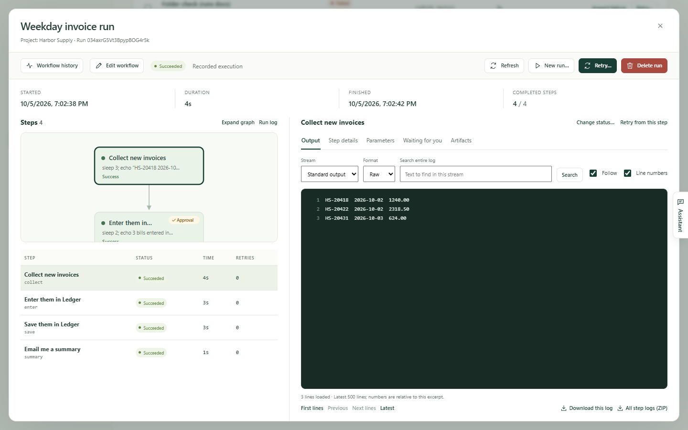

<p align="center">
  <strong>English</strong> · <a href="README.ja.md">日本語</a>
</p>

<p align="center">
  <a href="https://kitewell.app/#film">
    
  </a>
</p>

<h1 align="center">AI builds the automation.<br>Your computer runs it.</h1>

<p align="center">
  Describe the job, and AI builds the automation in a browser you can watch,
  then fixes it when the site changes. Desktop apps, Excel, email, and coding
  agents like Claude Code run the same way: on a schedule or a webhook, with
  your OK where it matters.
</p>

<p align="center">
  <a href="https://kitewell.app/#film"><strong>▶ Watch the 74-second film</strong></a> ·
  <a href="https://kitewell.app/download/">Download</a> ·
  <a href="https://kitewell.app/docs/getting-started/">Get started</a> ·
  <a href="https://kitewell.app/docs/">Docs</a> ·
  <a href="https://kitewell.app/examples/">Examples</a> ·
  <a href="https://kitewell.app/pricing/">Pricing</a>
</p>

<p align="center">
  <sub>macOS 13+ · Windows 10+ · Free for one project, no account needed</sub>
</p>

---

## See it work

Real recordings of Kitewell's chat window, unedited and sped up evenly: one
request in plain words, then everything the AI and the app did.

<table>
  <tr>
    <td width="50%" valign="top">
      <a href="https://kitewell.app/"></a>
      <p><strong>Websites.</strong> Asked to add a supplier portal's new
      invoices to an Excel file every weekday, the AI signs in to a stand-in
      portal in a browser shown in the chat, while you type the password into
      a card. It tries its draft and proposes the workflow. The run waits with
      the invoices it found until you say go.</p>
    </td>
    <td width="50%" valign="top">
      <a href="https://kitewell.app/"></a>
      <p><strong>Coding agents.</strong> Asked to have Claude Code fix a demo
      repository's failing tests every night and Codex review the change, the
      assistant proposes the scheduled workflow and runs it. The run waits
      with both summaries until you say go, then commits the fix to a new
      local branch.</p>
    </td>
  </tr>
</table>

## How it works

1. **AI builds it.** Describe the job in plain words. The assistant lays out
   every step for you to check, works the site in a browser you can watch, and
   tries the draft without sending anything out. Nothing runs until you apply
   it.
2. **Your computer runs it.** On a schedule, from a webhook, or from your
   phone. It stops for your OK wherever you put a gate.
3. **AI maintains it.** When a site or app changes, AI finds the new way,
   keeps it, and the run shows what it fixed. When a run fails, AI tells you
   why.

## Browser automation, built by AI and maintained by AI

Tell Kitewell the job in plain words. AI signs in, clicks, types, and collects
in a browser you can watch and take over, and writes the steps from what
worked. Later runs repeat them, and when the site changes, AI finds the new
way and keeps it.

| Step | What the browser did | Result |
| --- | --- | --- |
| Open page | `127.0.0.1:4320/billing/invoices` | Completed |
| Do | Type ops@example.com into the email field | Replayed |
| Do | Type `%password%` into the password field | Replayed |
| Do | Click Sign in | **Recovered** |
| Make sure | text "Invoices" | Completed |
| Collect | Every invoice issued since the last weekday | Completed |

<sub>From a real run against a stand-in supplier portal, as Kitewell shows it.
The portal had moved its sign-in button, so AI found the new one and kept it;
the next run replayed it.</sub>

- **Behind any sign-in.** Sign-ins stay in Kitewell's own browser profile on
  the computer. Sites that ask for a client certificate work too.
- **Passwords stay out of the model.** A password is named in the step and
  typed from the computer's secrets; the model sees only the name.
- **It shows what it fixed.** Each run marks the steps it repeated and the
  ones AI fixed, with screenshots.

<details>
<summary><strong>The workflow behind it, in plain YAML</strong>: a supplier
portal, a desktop accounting app, an approval, and an email</summary>

```yaml
type: graph
schedule: "0 9 * * 1-5"
secrets:
  - name: PORTAL_PASSWORD
    ref: harbor-supply/password
llm:
  model: kitewell-agent-computer
steps:
  - id: collect
    name: Collect new invoices
    action: browser.run
    with:
      url: https://portal.harborsupply.example/billing/invoices
      variables:
        password: ${env.PORTAL_PASSWORD}
      do:
        - act: If a sign-in form is shown, type ops@example.com into the email field and %password% into the password field, then sign in
        - expect: The invoice list is shown
        - extract:
            instruction: Every invoice issued since the last weekday, with its number, date, item, and amount
            schema:
              type: object
              properties:
                invoices:
                  type: array
                  items:
                    type: object
                    properties:
                      number: {type: string}
                      date: {type: string}
                      item: {type: string}
                      amount: {type: string}
      browser:
        profile: harbor-supply
  - id: enter
    name: Enter them in Ledger
    depends: [collect]
    action: computer.run
    with:
      variables:
        invoices: ${steps.collect.outputs.invoices}
      do:
        - launch: {command: open, args: [-a, Ledger]}
        - act: For each invoice in %invoices%, add a new bill from Harbor Supply Co. with its number, date, and amount, but do not save
        - expect: The new bills are listed with their amounts
        - screenshot: before-save
    approval:
      prompt: Save these bills in Ledger? Check the before-save screenshot.
  - id: save
    name: Save them in Ledger
    depends: [enter]
    action: computer.run
    with:
      do:
        - act: Save the new bills
        - expect: The bill list shows the new bills as saved
  - id: summary
    name: Email me a summary
    depends: [save]
    action: mail.send
    with:
      mailbox: me@example.com
      to: me@example.com
      subject: Invoices entered in Ledger
      message: |
        Entered in Ledger today:
        ${steps.collect.outputs.invoices}
```

[See this example in full →](https://kitewell.app/examples/supplier-invoices/)

</details>

[How website automation works →](https://kitewell.app/docs/browser/)

## Coding agents: Claude Code, Codex, and 13 more, on your schedule

Put the coding agents you already use to work while you're away, on the
sign-in you already have.

**Claude Code · Codex · Cursor · Gemini · GitHub Copilot · Aider · Amp · Cline
· DeepSeek · Droid · Goose · Kiro · OpenCode · Pi · Qwen**, and any other CLI
as a custom command.

- **Chain them.** One writes, another reviews. Run them side by side, or once
  per repository from a sheet.
- **Keep going at the limit.** When an agent hits its usage limit or fails,
  the next one you listed takes over.
- **Nothing ships unchecked.** A gate holds the push until you approve. Send
  it back, and the agent runs again with your notes.
- **Started by GitHub.** An issue or pull request can start the run through a
  webhook, with no open ports.

<details>
<summary><strong>Fix failing tests overnight</strong>: Claude Code fixes,
Codex takes over if it can't, and nothing is pushed until you approve</summary>

```yaml
type: graph
schedule: "0 2 * * 1-5"
# Replace this with a clone of your repository that nobody works in, and
# make test with the command that runs your tests.
working_dir: /absolute/path/to/repo
steps:
  - id: test
    name: Run the tests
    run: |
      git switch main >&2
      git pull --ff-only >&2
      if make test >&2; then echo passed; else echo failed; fi
    output:
      result: {from: stdout}
  - id: fix
    name: Fix what failed
    depends: [test]
    preconditions:
      - condition: ${steps.test.outputs.result}
        expected: failed
    action: harness.run
    with:
      provider: kitewell-agent-claude
      fallback:
        - provider: kitewell-agent-codex
      prompt: |
        The test suite on main fails. Create or reset a branch named
        fix/nightly-tests from main, run make test, and find the cause. Fix
        the code; change a test only when the test itself is wrong, and say
        so. Run the tests until they pass, then commit. Do not push. End with
        what failed, why, and what you changed.
    output: NOTES
    approval:
      prompt: Push fix/nightly-tests and open a pull request?
  - id: push
    name: Push and open the PR
    depends: [fix]
    run: |
      git push -u origin fix/nightly-tests --force-with-lease
      gh pr create --fill --base main --head fix/nightly-tests
```

[See this example in full →](https://kitewell.app/examples/fix-failing-tests/)

</details>

Each vendor's terms apply. [Coding agents in Kitewell →](https://kitewell.app/docs/ai/)

## Beyond the browser

- **[Desktop apps with no API.](https://kitewell.app/docs/desktop/)** A model
  reads the screen and works the app. Later runs replay on Windows by the
  app's own buttons and fields, and on macOS from the screen.
- **[Excel, row by row.](https://kitewell.app/docs/spreadsheets/)** Runs once
  per row of the workbook you already have and writes each result back beside
  it. Merged headers, era dates, and full-width digits included.
- **[Email.](https://kitewell.app/docs/email/)** Find, read, file, and send
  mail in Microsoft 365, Gmail with an app password, or any IMAP mailbox.
- **[Scripts, servers, and APIs.](https://kitewell.app/docs/workflow-builder/)**
  Commands, Docker, SSH rollouts a few machines at a time, and any OpenAPI,
  with decision steps that choose the next path.

## It starts on its own

- **[Schedules.](https://kitewell.app/docs/scheduling/)** Daily, on weekdays,
  or any schedule, in your time zone. Starts a sleeping computer missed are
  caught up when it wakes.
- **[Webhooks.](https://kitewell.app/docs/webhooks/)** GitHub, Stripe, Slack,
  or any service starts a workflow on your computer through Kitewell's relay.
  Signatures are checked, no port is opened, and a request waits up to 7 days.
- **[From anywhere.](https://kitewell.app/docs/mcp/)** From ChatGPT or Claude
  on your phone, from Claude Code or Codex over MCP, or with a REST call.

## Approve from your phone. Know why a run failed.



- **Approve or send back.** Any step can wait for your OK. Approve it, or send
  it back with a note, from the run, a notification, or ChatGPT and Claude on
  your phone.
- **Failure diagnosis.** AI reads a failed run and says whether to try again,
  step in, or change the workflow.
- **Alerts.** Slack, Microsoft Teams, PagerDuty, or email name the step that
  failed.
- **Run record.** Every step's output, screenshots, and decisions. Retry from
  the step that failed.
- **Test first.** Run one step with real inputs before you save, and try a
  draft without sending anything out.
- **Notes that stay.** The assistant keeps what it learns in knowledge pages,
  for you and whoever takes over.

<sub>ChatGPT Plus and Pro can read runs but not approve them.</sub>

## Run it on every computer. Watch them all from one place.

- **Dagu Console.** Every computer's runs in one place, one alert per workflow
  across computers, and an alert when a computer stops reporting.
- **[Sync and roles.](https://kitewell.app/docs/cloud-sync/)** Share projects
  with Viewer, Editor, and Admin roles. Each computer keeps its own sign-ins
  and secret values.
- **[Releases.](https://kitewell.app/docs/releases/)** Promote workflows from
  Dev to Staging to Prod, with a diff and rollback.
- **Robot ledger.** Export a ledger of every workflow for audits, one row
  each.

## RPA was the right idea. Building it by hand was the problem.

| Hand-built RPA | Kitewell |
| --- | --- |
| A specialist records and scripts every click | AI builds it from your words |
| A changed screen means someone repairs the robot | AI finds the new way and keeps it |
| A robot PC and a license per robot | The computer you have, free for one project |
| One tool per kind of system | Websites, desktop apps, Excel, and email in one workflow |
| Hard to see what a robot did | Every step, screenshot, and approval in the run record |

[How Kitewell compares →](https://kitewell.app/compare/)

## Your computer, your keys, your files

- **Secret values** are encrypted on the computer, and never synced,
  exported, or backed up.
- **Your choice of AI:** Anthropic, OpenAI, Gemini, OpenRouter, Kitewell's
  included model, or a local model that keeps everything inside your network.
- **No lock-in.** Workflows are plain YAML on the open-source
  [Dagu](https://github.com/dagucloud/dagu) engine. Export a project any time.
- **Quiet in the background.** Runs from the menu bar or tray, with nightly
  backups, edit history, and engine updates that roll back if they fail.
- **What leaves, exactly.** A synced project sends run status and the names of
  failed steps, never logs, output, or secret values.
- **Six languages.** The app speaks English, Japanese, Chinese, Korean,
  French, and German.

[Everything that leaves, and when →](https://kitewell.app/docs/data-flow/)

## Examples

| Everyday work | Coding |
| --- | --- |
| [Supplier invoice downloads](https://kitewell.app/examples/supplier-invoices/), every weekday morning | [Fix failing tests overnight with Claude Code](https://kitewell.app/examples/fix-failing-tests/), every weekday at 2:00 |
| [Website orders from an Excel list](https://kitewell.app/examples/excel-orders/), whenever new orders come in | [Pull request reviews with Codex and Claude Code](https://kitewell.app/examples/review-every-pr/), on every new pull request |
| [Invoice data entry from email](https://kitewell.app/examples/invoice-intake/), every few days | [GitHub issue triage](https://kitewell.app/examples/triage-issues/), on every new issue |
| [A daily email digest](https://kitewell.app/examples/inbox-digest/), every morning | [Dependency updates with Codex](https://kitewell.app/examples/dependency-update/), every Monday |

[All examples →](https://kitewell.app/examples/)

## Pricing

| | Free | Personal | Team |
| --- | --- | --- | --- |
| Price | $0 | $20 a month (¥3,000 in Japan) | Quote: an annual contract, priced per computer |
| For | One person's own work | One person's own work, paid work included | An organization of up to 25 people |
| Computers | 1 | 1 | 1 to 100 |
| Projects | 1, with up to 10 workflows | Up to 5, with 100 workflows each | Up to 15, with 100 workflows each |
| API keys and connected apps | 1 | Any number | Any number |
| Alerts, webhooks, MCP Events | | Included | Included |
| Shared projects with roles | | | Included |
| Included model credits | 100 once, signed in | 500 a month | 500 a month per computer |

Prices exclude tax. Free needs no account; Personal and Team need a Dagu Cloud
account. An organization that runs Kitewell for shared work, on several
people's computers or on a computer set aside for it, needs Team. For more than
25 people or 100 computers, SSO, audit-log export, closed-network sync, or an
SLA, Enterprise is arranged under a contract. Email
[company@descarty.com](mailto:company@descarty.com) for a Team or Enterprise
quote. AI provider usage is separate.

[Pricing details →](https://kitewell.app/pricing/)

## Install

Kitewell runs on macOS 13 or later, on Apple silicon and Intel, and on Windows
10 version 1809 or later and Windows 11, on x64. Website automation uses
Chrome, or Edge on Windows.

Installers are published on the [download page](https://kitewell.app/download/)
and [GitHub Releases](https://github.com/dagucloud/kitewell/releases); the
first release is not out yet. Then follow
[Your first workflow](https://kitewell.app/docs/getting-started/).

## Documentation

- **Start:** [Install Kitewell](https://kitewell.app/docs/install/) ·
  [Your first workflow](https://kitewell.app/docs/getting-started/) ·
  [Build a workflow](https://kitewell.app/docs/workflow-builder/)
- **Automate:** [A website](https://kitewell.app/docs/browser/) ·
  [A desktop app](https://kitewell.app/docs/desktop/) ·
  [Excel](https://kitewell.app/docs/spreadsheets/) ·
  [Email](https://kitewell.app/docs/email/) ·
  [Import an API](https://kitewell.app/docs/apis/) ·
  [AI agents and models](https://kitewell.app/docs/ai/) ·
  [Run a workflow over a sheet](https://kitewell.app/docs/batches/)
- **Run:** [Schedules](https://kitewell.app/docs/scheduling/) ·
  [Webhooks](https://kitewell.app/docs/webhooks/) ·
  [Runs and logs](https://kitewell.app/docs/runs/) ·
  [Alerts](https://kitewell.app/docs/alerts/) ·
  [Secrets](https://kitewell.app/docs/secrets/) ·
  [Knowledge](https://kitewell.app/docs/knowledge/)
- **Connect and share:** [MCP and API access](https://kitewell.app/docs/mcp/) ·
  [Sync with Dagu Cloud](https://kitewell.app/docs/cloud-sync/) ·
  [Share with your team](https://kitewell.app/docs/sharing/) ·
  [Releases and staged projects](https://kitewell.app/docs/releases/)
- **Operate:** [What leaves your computer](https://kitewell.app/docs/data-flow/) ·
  [Backups](https://kitewell.app/docs/backups/) ·
  [Updates](https://kitewell.app/docs/updates/) ·
  [Troubleshooting](https://kitewell.app/docs/troubleshooting/) ·
  [Uninstall](https://kitewell.app/docs/uninstall/)

## Support

- Questions and bug reports:
  [GitHub issues](https://github.com/dagucloud/kitewell/issues)
- Security vulnerabilities: report privately as described in
  [SECURITY.md](SECURITY.md)
- Release notes: [GitHub Releases](https://github.com/dagucloud/kitewell/releases)
- Team, Enterprise, and business questions:
  [company@descarty.com](mailto:company@descarty.com)

Kitewell is made by [Descarty, Inc.](https://descarty.com/en/)

## About this repository

This repository holds the kitewell.app website, customer documentation,
release notes, and public releases. The application source is not published
here.

### Website development

Requires Node 24 and npm. From this checkout:

```sh
cd website
npm ci
npm run dev
```

Before pushing:

```sh
npm run check
npm test
npm run build
```

The website uses Astro for marketing pages and Starlight for documentation.
Docs are Markdown under `website/src/content/docs/docs/`; the nested `docs`
segment preserves the public `/docs/` route. Published Markdown notes live in
`releases/`. The build checks internal links, including documentation anchors.
The README's animated loops live in `.github/readme/`.
