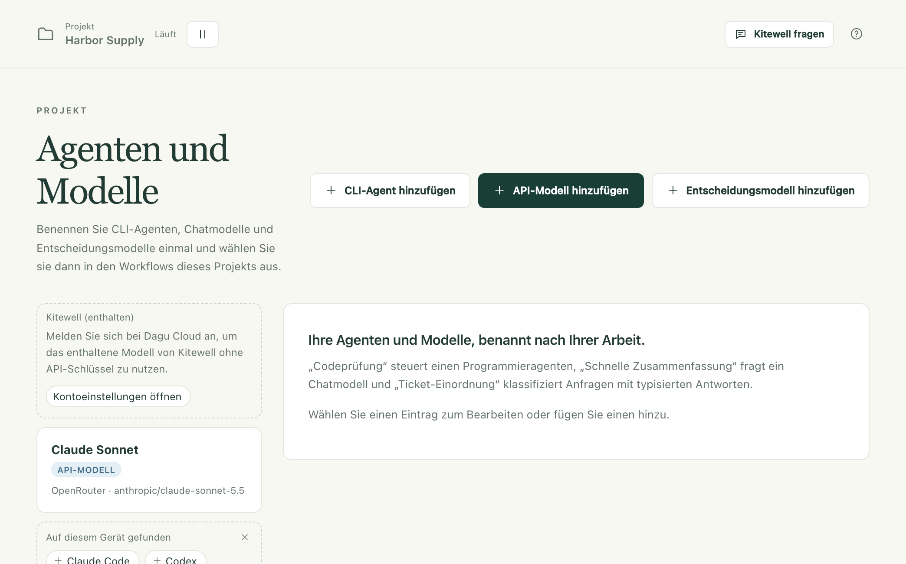
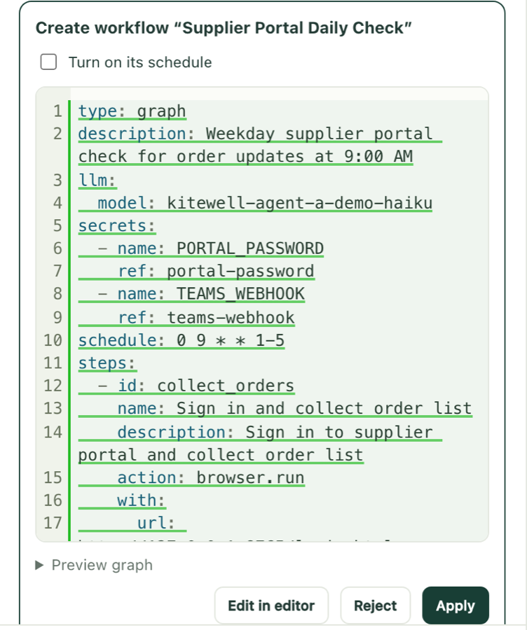

Die KI-Funktionen von Kitewell brauchen ein Modell: eines, das Sie mit dem
API-Schlüssel eines Anbieters hinzufügen, ein Coding-Tool, das bereits auf
diesem Computer installiert ist, oder das enthaltene Modell von Kitewell auf
einem Computer, der bei Dagu Cloud angemeldet ist.

Mit einem Modell erstellt und repariert Kitewell Workflows gemeinsam mit Ihnen
im Chat, eine fehlgeschlagene Ausführung kann sich selbst erklären, eine
Tabelle kann aus jeder Ausführung einen Wert auslesen, und ein Workflow kann
mitten in seiner Arbeit einem Modell eine Frage stellen.

## Was Sie brauchen

- Den API-Schlüssel eines Anbieters für alles, was ein Modell über das
  Internet aufruft. Hat das Projekt bereits einen, finden Sie ihn unter
  **Agenten und Modelle** in der Seitenleiste.
  [Das enthaltene Modell von Kitewell](#use-kitewells-included-model) braucht
  keinen.
- Für einen Coding-Agenten auf der Kommandozeile das Tool selbst, installiert
  auf diesem Computer und dort angemeldet. Kitewell startet es; es meldet sich
  nie für Sie an.
- Die Seite **Agenten und Modelle** ist für Administratoren und Bearbeiter.
  Was der Anbieter für eine Anfrage berechnet, zahlen Sie selbst.

## Ein Modell für das Projekt hinzufügen

1. Wählen Sie in der Seitenleiste **Agenten und Modelle** und dann
   **API-Modell hinzufügen**.
2. Wählen Sie den **Anbieter**: Anthropic, OpenAI, Google Gemini, OpenRouter,
   Z.ai, OpenCode Zen oder Local server (Ollama, vLLM). Ein lokaler Server
   braucht keinen Schlüssel.
3. Wählen Sie unter **API-Schlüssel** das [Secret](/de/docs/secrets/) des
   Projekts, das den Schlüssel enthält. Ein Secret ist ein Passwort oder
   Schlüssel, der so gespeichert ist, dass er nie in einem Log erscheint.
   Administratoren können hier auch **Neuer Schlüssel…** wählen und den
   Schlüssel unter **API-Schlüssel einfügen** eingeben; er wird dann in einem
   Schritt als Secret gespeichert. Der Schlüssel wird an jede Ausführung
   gebunden, die dieses Modell nutzt; der Workflow selbst enthält ihn nie.
4. Geben Sie die **Modell-ID** ein. Bei OpenRouter, OpenCode Zen und einem
   laufenden lokalen Server listet das Feld jedes Modell des Anbieters auf,
   sodass Sie zum Suchen einen Teil des Namens eintippen können. Bei den
   anderen macht es Vorschläge, und jede ID, die Ihr Anbieter akzeptiert,
   funktioniert.
5. Geben Sie dem Modell einen eigenen Namen, etwa „Schnelle Zusammenfassung“
   oder „Rechnungsleser“, und wählen Sie **Modell testen**. Bevor etwas
   gesendet wird, zeigt der Bereich den genauen Prompt, wohin er geht, welchen
   Schlüssel er nutzt und was zurückbleibt.

Die Seite enthält drei Arten von Einträgen, die Sie unter **Art** wählen:

- **API-Modell** fragt das Modell eines Anbieters direkt und gibt seine
  Antwort zurück. Es bedient Aufgaben vom Typ **Ein Modell fragen**, den
  Assistenten, die Fehlerdiagnose, die Ergebnisspalten einer Tabelle sowie
  die Aufgaben **Eine Website automatisieren** und
  **Eine Desktop-App automatisieren**.
- **Entscheidungsmodell** klassifiziert, bewertet und beantwortet
  Ja-oder-Nein-Fragen, mit einer Wahrscheinlichkeit zu jeder Antwort.
  **Entscheidungsmodell hinzufügen** bietet OpenRouter oder TypeSafe an. Eine
  Aufgabe vom Typ **KI-Entscheidung treffen** nutzt es, um etwas einzuordnen
  oder zu bewerten, damit ein späterer Schritt anhand der Antwort verzweigen
  kann. Eine [Tabelle](/de/docs/batches/) nutzt es, um Spalten der Arten
  Ja oder Nein, Auswahl und Stufe zu beurteilen.
- **CLI-Agent** steuert einen Coding-Agenten, der auf diesem Gerät
  installiert ist.

Ein Eintrag kann bei einem Fehlschlag auf andere ausweichen: Seine Karte
zeigt dann „Ausweichen auf“ und nennt sie. Jeder Versuch ist eine neue
Anfrage und wird erneut berechnet.

## Das enthaltene Modell von Kitewell verwenden

Auf einem Computer, der bei [Dagu Cloud](/de/docs/cloud-sync/#sign-in)
angemeldet ist, listet **Agenten und Modelle** den Eintrag
**Kitewell (enthalten)**. Dieses Modell braucht keinen API-Schlüssel: Jede
Anfrage geht
über Dagu Cloud an OpenRouter und wird aus den Dagu-Cloud-Credits des
Arbeitsbereichs bezahlt.

- Wählen Sie es als **Modell** einer Aufgabe vom Typ **Ein Modell fragen**
  oder **Eine Website automatisieren**, für die Ergebnisspalte einer Tabelle
  oder für die Fehlerdiagnose. Im YAML eines Workflows heißt es
  `kitewell-agent-included`.
- **Eine Desktop-App automatisieren** liest den Bildschirm in jedem Tarif
  damit, sofern das Projekt unter **Projekteinstellungen →
  Bildschirmschritte** kein anderes Modell wählt. Für Screenshots setzt Dagu
  Cloud ein Vision-Modell ein, das für Computer-Use gebaut ist.
  **KI-Entscheidung treffen** kann es nicht nutzen.
- Der Chat von Kitewell antwortet damit, bis ein Administrator unter
  **Geräteeinstellungen → KI-Modell von Kitewell** ein Modell einrichtet.

Ein kostenloses Konto erhält einmalig 100 Credits. Kitewell Personal und Team
erhalten 500 Credits pro Monat für jeden Computer, den der Tarif bezahlt; der
Arbeitsbereich teilt sie, und sie werden am Ersten jedes Monats (UTC)
erneuert. Die Websuchen des Assistenten verbrauchen dieselben Credits.

Ein Administrator sieht unter **Dagu-Cloud-Konto** in den
**Geräteeinstellungen**, wie viele noch übrig sind. Sind die Credits
aufgebraucht, wird das enthaltene Modell abgelehnt, bis sie erneuert werden,
im kostenlosen Tarif, bis Sie ein Abo abschließen. Ein eigenes Modell
funktioniert weiter.

Dagu Cloud bittet OpenRouter, diese Anfragen nur an Anbieter weiterzuleiten,
die sie weder speichern noch damit trainieren. Dagu Cloud speichert keinen
Prompt-Text, sondern nur den Arbeitsbereich, das Gerät, das Modell und die
verbrauchten Credits.

## Einen Coding-Agenten auf diesem Computer verwenden

Installieren Sie zuerst das Tool und melden Sie sich dort an. Kitewell kennt
15 Tools (Aider, Amp, Claude Code, Cline, Codex, Cursor, DeepSeek, Droid,
Gemini, GitHub Copilot, Goose, Kiro, OpenCode, Pi und Qwen) und führt jedes
andere als **Eigener Befehl** aus. Tools, die Kitewell auf diesem Computer
findet und die noch kein Agent nutzt, erscheinen unter
**Auf diesem Gerät gefunden**, nur einen Klick von einem eigenen Eintrag
entfernt.

1. Wählen Sie **CLI-Agent hinzufügen** und dann den **Harness**. Die Liste
   zeigt, welche auf diesem Gerät installiert sind und welche nicht.
2. Bei Claude Code, Codex und OpenCode trägt **Modelle laden** ein, was das
   Tool anbietet. Bei den anderen tippen Sie einen Modellnamen ein.
3. Wählen Sie **Agent testen**. Vor dem Start zeigt der Bereich den Prompt,
   den der Agent senden wird, den Ordner, in dem er arbeiten wird (einen
   neuen, leeren temporären Ordner, den er danach entfernt), und alles, was er
   umgehen würde.
4. Fügen Sie in einem Workflow eine Aufgabe vom Typ
   **Einen KI-Agenten beauftragen** hinzu, wählen Sie den **Agent** und füllen
   Sie **Prompt · Aufgabe beschreiben** aus. Legen Sie unter
   **Agent-Einstellungen und Kontext** den **Projektordner** fest, in dem er
   arbeitet.

Kitewell führt das Tool mit der Anmeldung aus, die es auf diesem Computer
bereits hat. Bei Tools, die das unterstützen, etwa Claude Code, Codex und
GitHub Copilot, legt **Reasoning-Aufwand** am Agenten fest, wie viel das Tool
nachdenkt; ein Schritt kann diesen Wert überschreiben.

**Bei einem Fehlschlag** am Agenten nennt bis zu drei weitere CLI-Agenten.
Sie werden der Reihe nach versucht, wenn das Tool dieses Agenten mit einem
Fehler endet, etwa wegen eines Rate-Limits, einer fehlenden Anmeldung oder
eines Absturzes. Eine schwache Antwort ist kein Fehlschlag. Jeder Versuch
führt den Prompt von vorn aus, die Arbeit wird also erneut bezahlt.

Gibt ein Prüfer die Arbeit eines Agenten-Schritts zurück, läuft der Agent
erneut, mit dem Feedback des Prüfers im Prompt. Siehe
[Anhalten und eine Person fragen](/de/docs/workflow-builder/#stop-and-ask-a-person).

Ein Coding-Agent ist ein Programm, das auf diesem Computer unter Ihrem Konto
läuft, mit allen Zugriffsrechten, die Sie dem Tool selbst gegeben haben. Er
kann Dateien lesen und ändern und Befehle ausführen.
**Berechtigungsabfragen überspringen** am Agenten schaltet die eigenen
Bestätigungen des Tools ab, und ein Agent, bei dem eine solche Option gesetzt
ist, trägt auf seiner Karte die Kennzeichnung **Umgeht Genehmigungen**. Geben
Sie einem solchen Agenten nie Text, der von außen kommt. Der Workflow-Editor
warnt Sie, wenn der Text einer E-Mail einen solchen Agenten erreichen würde,
denn wer die E-Mail geschickt hat, könnte ihm dann Anweisungen geben.
Verwenden Sie dafür **Ein Modell fragen**, das nichts ausführen kann.

## Der Assistent

Kitewell hat einen Chat für diesen Computer, über alle Projekte hinweg.
Bitten Sie ihn, einen Workflow zu erstellen oder zu reparieren, etwas
auszuführen oder herauszufinden, warum eine Ausführung fehlgeschlagen ist.
Öffnen Sie ihn mit **Kitewell fragen** oben im Kitewell-Fenster oder mit ⌘J
auf einem Mac bzw. Strg+J unter Windows. Er steht Administratoren und
Bearbeitern zur Verfügung.

Der Chat öffnet sich rechts im Kitewell-Fenster angedockt.
**In eigenem Fenster öffnen** löst ihn heraus, **Im Vordergrund halten** hält
dieses Fenster über den anderen, und **Im Kitewell-Fenster andocken** holt
ihn zurück. Auf einem Mac zeigt ihn **Chat öffnen** im Menü der Menüleiste an;
unter Windows blendet ihn ein Klick auf das Symbol im Infobereich ein oder
aus.

Er antwortet mit dem **KI-Modell von Kitewell**, das einmal in den
**Geräteeinstellungen** für alle Projekte festgelegt wird. Bis ein
Administrator eines festlegt, nutzt ein bei Dagu Cloud angemeldeter Computer
[das enthaltene Modell von Kitewell](#use-kitewells-included-model);
andernfalls kann ein Administrator direkt im Chat eines einrichten.

Arbeit, die mehr als eine kurze Antwort erfordert, landet in einem Thread,
der mit dem betreffenden Workflow oder der betreffenden Ausführung verknüpft
ist. Kitewell beginnt einen Thread, wenn aus einer Anfrage Arbeit wird, und
**Im Thread antworten** beginnt einen von jeder Nachricht aus.
**Zurück zum Hauptgespräch** kehrt zurück, **Als erledigt markieren** schließt
einen Thread, und **Wieder öffnen** öffnet ihn erneut. Mehrere Threads können
gleichzeitig arbeiten.

Sie können weitertippen, während Kitewell arbeitet: Es liest eine neue
Nachricht bei seinem nächsten Schritt, und **Jetzt unterbrechen** stoppt die
Arbeit, um zuerst diese Nachricht zu beantworten. Ist das Kitewell-Fenster
geöffnet, weiß der Chat, was es zeigt; „dieser Workflow“ meint also den im
Editor, einschließlich ungespeicherter Änderungen.

Nichts, was Kitewell vorschlägt, wird gespeichert, und nichts, was es tun
will, läuft, bis Sie die Schaltfläche auf seiner Karte drücken.

- Ein neuer oder geänderter Workflow kommt als Karte mit seinem Diagramm und
  **Details**. Wählen Sie **Übernehmen** oder **Ablehnen**; bei Letzterem
  werden Sie nach dem Grund gefragt. Eine Planung wird eingeschaltet
  angeboten, mit ihren nächsten Ausführungen; entfernen Sie das Häkchen bei
  **Zeitplan einschalten**, um sie pausiert zu speichern. Nach dem Übernehmen
  öffnet **Öffnen** den Workflow und **Jetzt ausführen** führt ihn aus. Eine
  Änderung an einem bestehenden Workflow lässt sich mit **Rückgängig**
  zurücknehmen.
- Zeilen und Spalten für eine [Tabelle](/de/docs/batches/) schlägt er als
  Karte vor. Das Übernehmen kann auch die Ausführungen der betroffenen Zeilen
  starten und lässt sich dann nicht rückgängig machen.
- Er kann einen Workflow ausführen, einen wartenden Schritt genehmigen,
  ablehnen oder zurückgeben, eine Ausführung stoppen und eine Planung
  pausieren oder fortsetzen. Jede dieser Aktionen ist eine Karte mit dem
  Diagramm des Workflows, die erst handelt, wenn Sie ihre Schaltfläche
  drücken, etwa **Ausführen** oder **Genehmigen**; **Nicht jetzt** lehnt ab.
- Er kann einen Entwurf wirklich laufen lassen, um zu sehen, ob er
  funktioniert. Beim ersten Mal in einem Thread fragt er mit
  **Testläufe erlauben** nach. Ein Testlauf führt Befehle, Browser-Schritte,
  Lesevorgänge und Modellaufrufe mit den Secrets des Projekts aus. Alles, was
  anderswo etwas senden oder ändern würde, etwa ein POST, eine E-Mail oder ein
  Befehl auf einem anderen Rechner, meldet nur, was es gesendet hätte.
- Nachdem Sie **Erlauben** gewählt haben, kann er eine Website in seinem
  eigenen Browser bedienen, um zu lernen, wie ein Workflow sie nutzen sollte.
  Sie sehen im Chat zu und können jederzeit mit **Übernehmen** selbst die
  Steuerung übernehmen. Er kann eine öffentliche Webseite lesen, aber keine
  Adresse auf diesem Gerät oder in dessen eigenem Netzwerk. Auf einem bei Dagu
  Cloud angemeldeten Computer kann er im Web suchen.
- Er kann Ihnen bis zu sechs kurze Fragen auf einer Karte stellen, die Sie
  mit **Antworten senden** beantworten oder mit **Überspringen** übergehen. Er
  kann ein Secret mit Namen anfordern: Sie tippen den Wert in seine Karte und
  wählen **Speichern**, und der Assistent sieht ihn nie. Nur ein
  Administrator kann auf diese Weise eines hinzufügen oder die Namen der
  Secrets auflisten.
- Er liest bei jeder Nachricht das [Wissen](/de/docs/knowledge/) des
  Projekts und schreibt auf, was er bei der Arbeit lernt. Sagen Sie ihm, wie
  er arbeiten soll, merkt er sich das sofort, mit **Rückgängig**. Sobald das
  Gespräch eine Webseite oder die Ausgabe einer Ausführung gelesen hat,
  [fragt er zuerst](/de/docs/knowledge/#what-the-assistant-does).

Kitewell postet in jedem Tarif auch eigene Karten. Eine Ausführung, die auf
Sie wartet, bekommt eine, mit **Genehmigen**, **Ablehnen** oder einer Antwort
direkt auf der Karte. Was die Benachrichtigungseinstellungen an dieses Gerät
senden, bekommt ebenfalls eine: ein fehlschlagender Workflow mit
**Wiederholen**, eine Planung, die nicht gestartet ist, mit
**Jetzt ausführen**, und eine Zeile für eine Ausführung, die erfolgreich war,
abgebrochen wurde oder zu lange läuft, oder für eine fertige Tabelle. Jede
Karte erscheint außerdem als Desktop-Benachrichtigung, sofern der Chat nicht
im Vordergrund ist.

**Kitewell fragen** an einer fehlgeschlagenen Ausführung bittet Kitewell,
den Grund herauszufinden und eine Korrektur vorzuschlagen.

Das Gespräch bleibt auf diesem Computer und ist nicht in Backups enthalten.
**Löschen** entfernt eine Nachricht und **Thread löschen** einen ganzen
Thread; **Die Unterhaltung jedes Projekts löschen** unter
**Geräteeinstellungen → KI-Modell von Kitewell** entfernt alles. Workflows
und andere Änderungen, die Kitewell gespeichert hat, bleiben erhalten.

## Warum eine Ausführung fehlgeschlagen ist

Kitewell kann eine fehlgeschlagene Ausführung lesen und sagen, was zu tun
ist.

1. Öffnen Sie **Projekteinstellungen → Fehlerdiagnose** und schalten Sie
   **Fehlgeschlagene Ausführungen automatisch diagnostizieren** ein.
2. Wählen Sie das **Modell**, das genutzt werden soll.
3. Lassen Sie unter **Workflows** jeden Workflow auf **Projektstandard** oder
   stellen Sie ihn einzeln auf **An** oder **Aus**. Wählen Sie
   **Diagnoseeinstellungen speichern**.

Diagnostiziert wird nur der erste Fehlschlag einer Serie, nicht jede
fehlgeschlagene Ausführung danach; ein Erfolg beendet die Serie. Die Antwort
erscheint an der fehlgeschlagenen Ausführung als **Erneut versuchen**,
**Braucht Sie**, **Workflow ändern** oder **Unklar**, mit der Ursache und
einem nächsten Schritt. **Diagnostizieren** fordert für jede fehlgeschlagene
Ausführung eine Diagnose an, und **Erneut diagnostizieren** fordert eine neue
Antwort an.

Das Modell erhält die Ergebnisse der fehlgeschlagenen Schritte, das Ende
ihrer Logs, was ein Browser-, Desktop- oder Agenten-Schritt gerade tat, als
er stoppte, die Fehlschläge einer untergeordneten Ausführung und die
Definition, die die Ausführung tatsächlich verwendet hat. Es bekommt keine
Werkzeuge, sodass nichts, was eine Ausführung ausgegeben hat, etwas auslösen
kann. Diagnosen bleiben auf diesem Gerät und werden mit ihren Ausführungen
gelöscht.

## Was diesen Computer verlässt

Prompts und ihr Kontext gehen an den Anbieter oder das Tool, das Sie gewählt
haben, und dann gelten dessen Regeln zu Abrechnung, Aufbewahrung und
Datenschutz. Dass ein Arbeitsbereich auf Ihrem Computer liegt, heißt nicht,
dass jede Aufgabe dort bleibt.

- Vor dem Ausführen zeigt **Werkzeuge → KI-Prompts prüfen** im
  Workflow-Editor die Anweisungen, die jede KI-Aufgabe erhalten wird. Werte,
  die erst zur Laufzeit feststehen, werden beim Start der Ausführung
  eingesetzt.
- Nach dem Ausführen zeigt **Ausführungen & Logs** den Prompt, den die
  Ausführung aufgezeichnet hat, und was zurückkam.
- Der Chat sendet das jüngste Gespräch; was das Kitewell-Fenster zeigt,
  einschließlich des im Editor geöffneten Workflows; die Workflows, Modelle
  und das Wissen des Projekts; und was jedes genutzte Werkzeug zurückgegeben
  hat. Werte von Secrets werden nie gesendet.
- Ist das Modell des Chats ein OpenRouter-Modell unter der eigenen Adresse
  von OpenRouter, bitten seine Anfragen OpenRouter, sie nur an Anbieter
  weiterzuleiten, die das Empfangene weder speichern noch damit trainieren.
- Das enthaltene Modell von Kitewell sendet jede Anfrage an Dagu Cloud, das
  sie an OpenRouter weitergibt.

Das Gesamtbild finden Sie unter
[Was Ihren Computer verlässt](/de/docs/data-flow/).
