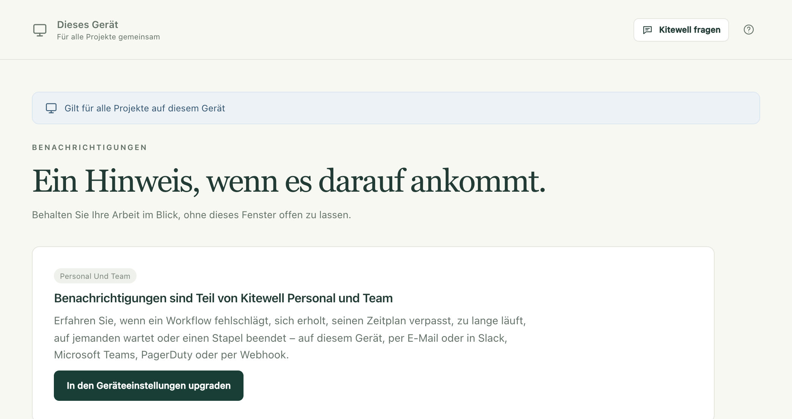

Eine Benachrichtigung meldet sich, wenn ein Workflow Sie braucht: wenn er
fehlgeschlagen ist, wenn er darauf wartet, dass jemand etwas genehmigt, oder
wenn er nicht gestartet ist, obwohl er hätte starten sollen. So müssen Sie
Kitewell nicht geöffnet lassen, um davon zu erfahren.

## Was Sie brauchen

Benachrichtigungen gehören zu Kitewell Personal und Team. Im kostenlosen Tarif
bietet die Seite **Benachrichtigungen** stattdessen das Upgrade an, und es
wird nichts gesendet: keine E-Mail, keine Nachricht, nicht einmal eine
Desktop-Benachrichtigung auf diesem Computer. Es wird auch nichts für später
aufgehoben; Benachrichtigungen beginnen also erst in dem Moment, in dem der
Tarif aktiv ist.

Diese Benachrichtigungen kommen vom Computer. In jedem Tarif, auch im
kostenlosen, kann Ihnen [Dagu Console](/de/docs/console/#alerts-from-dagu-console)
außerdem eine E-Mail schicken, wenn ein Workflow eines synchronisierten
Projekts fehlschlägt oder ein Computer keine Meldungen mehr sendet.

Ein Kanal, der unter einem früheren Tarif gespeichert wurde, bleibt unter
**Gespeicherte Kanäle** aufgeführt, wo Sie ihn entfernen können. Er sendet
nichts, bis der Tarif wieder aktiv ist.

## Festlegen, wohin Benachrichtigungen gehen

Öffnen Sie **Dieses Gerät → Benachrichtigungen**. Ein Kanal ist ein Ziel, an
dem Benachrichtigungen ankommen. Wählen Sie **Kanal hinzufügen**, wählen Sie
den **Typ**, tragen Sie unter **Name** einen Namen ein und füllen Sie aus,
was der Kanal braucht:

- **Dieses Gerät** zeigt eine Desktop-Benachrichtigung auf diesem Computer.
  Dieser Kanal ist von Anfang an vorhanden: Schalten Sie unter
  **Desktop-Benachrichtigungen** die Option **Auf diesem Gerät benachrichtigen**
  ein und erlauben Sie Benachrichtigungen, wenn das System danach fragt. Er
  braucht die installierte Kitewell-App, ein Browserfenster allein genügt
  nicht.
- **E-Mail** nimmt unter **Empfänger** eine Liste von Adressen. Der Server,
  über den die E-Mails gehen, wird einmal für das ganze Gerät unter
  **Mailserver** festgelegt: **SMTP-Server**, **Port**, **Benutzername**,
  **Passwort**, **Absender** und **Verbindungssicherheit** mit den Optionen
  **STARTTLS (meist Port 587)** und **TLS (meist Port 465)**. Eine
  verschlüsselte Verbindung ist Pflicht. Verwenden Sie ein App-Passwort, wenn
  Ihr Anbieter eines verlangt.
- **Slack** nimmt eine **URL des eingehenden Webhooks**. Fügen Sie dem Kanal
  in Slack einen eingehenden Webhook hinzu und fügen Sie dessen Adresse ein.
- **Microsoft Teams** nimmt eine **Workflow-URL**. Erstellen Sie in Teams
  einen Workflow aus der Vorlage, die in einem Kanal postet, wenn eine
  Webhook-Anfrage eingeht, und fügen Sie dessen Adresse ein.
- **PagerDuty** nimmt einen **Integrationsschlüssel** aus einer
  Events-API-v2-Integration und eine **Dienstregion**: **Vereinigte Staaten**
  oder **Europäische Union**. Eine Benachrichtigung öffnet einen Incident, die
  zugehörige Entwarnung schließt ihn.
- **Webhook** nimmt eine **Empfänger-URL** und sendet signiertes JSON im
  Format [Standard Webhooks](https://www.standardwebhooks.com/) dorthin. Ein
  **Signaturgeheimnis** wird beim Speichern des Kanals erstellt und einmal
  angezeigt; geben Sie es an die Stelle weiter, die die Nachrichten empfängt.

**Test senden** stellt eine Beispielbenachrichtigung mit den eingegebenen
Werten zu, noch bevor Sie sie speichern, sodass ein Fehler sofort auffällt.
Ein PagerDuty-Test öffnet einen Incident und schließt ihn gleich wieder, damit
niemand alarmiert wird.

Jeder Kanal zeigt, ob seine letzte Zustellung angekommen ist, und
**Letzte Benachrichtigungen** listet, was gesendet wurde und was noch erneut
versucht wird. **Workflow-Benachrichtigungen senden** schaltet alle
Benachrichtigungen dieses Geräts ab. Schalten Sie es wieder ein, geht es ab
diesem Zeitpunkt weiter; was in der Zwischenzeit geschah, wird nicht
nachgeliefert.

## Festlegen, worüber Sie informiert werden

Regeln entscheiden in drei Ebenen, welche Ereignisse welche Kanäle erreichen:

1. **Standardregeln für Benachrichtigungen** auf der Seite
   **Benachrichtigungen** gelten für jedes Projekt ohne eigene Regeln. Ab Werk
   senden sie **Schlägt fehl**, **Benötigt Eingabe**,
   **Verpasst einen Zeitplan** und **Beendet einen Stapel** an
   **Dieses Gerät**.
2. **Projekteinstellungen → Benachrichtigungen** gibt einem Projekt eigene
   Regeln: Wählen Sie **Eigene Regeln für dieses Projekt verwenden** statt
   **Den Standardregeln dieses Geräts folgen**. Die Regeln eines Projekts
   ersetzen die Standardregeln, statt sie zu ergänzen.
3. Die Glocke an einem Workflow, im Editor oder in der Liste **Workflows**,
   gilt für diesen einen Workflow. Unter **Stummschalten** wählen Sie
   **Für 1 Stunde**, **Für 1 Tag**, **Für 1 Woche** oder
   **Bis ich es wieder einschalte**. Mit
   **Eigene Regeln für diesen Workflow verwenden** bekommt er eigene Regeln.
   **Gilt als zu lang** setzen Sie auf **Automatisch anhand letzter Läufe**,
   **Nach einer festen Zeit** oder **Nie**. Wählen Sie
   **Benachrichtigungen speichern**. Diese Einstellungen gelten sofort auf
   diesem Gerät und lassen den Workflow selbst unverändert; sie wandern also
   nie mit ihm mit.

**Verpasst nach** in den Standard- und Projektregeln gibt an, wie viele
Minuten eine geplante Ausführung zu spät starten darf, bevor sie als verpasst
gilt. Voreingestellt sind 5.

## Was die Ereignisse bedeuten

- **Schlägt fehl**: Die Ausführung ist nach ihrer letzten automatischen
  Wiederholung fehlgeschlagen. Sie werden benachrichtigt, wenn eine Serie von
  Fehlschlägen beginnt, nicht bei jeder fehlgeschlagenen Ausführung, und
  erneut, wenn die nächste Ausführung erfolgreich ist. Eine Entwarnung geht
  immer an dieselben Kanäle wie der Fehlschlag.
- **Benötigt Eingabe**: Eine Aufgabe für eine Person oder eine Genehmigung
  wartet auf jemanden. Ein Schritt, der nach einer Antwort erneut wartet, wird
  erneut gemeldet.
- **Verpasst einen Zeitplan**: Geplante Ausführungen sind nicht gestartet,
  mit Anzahl und Grund, etwa weil der Computer im Ruhezustand war, Kitewell
  nicht lief oder die Engine des Projekts gestoppt war. Eine zweite Nachricht
  folgt, sobald der Workflow wieder pünktlich läuft.
- **Läuft zu lange**: Die Ausführung läuft noch, deutlich länger, als ihre
  letzten erfolgreichen Ausführungen gedauert haben, oder über eine Grenze
  hinaus, die Sie mit der Glocke festgelegt haben. Sie werden einmal pro
  Ausführung benachrichtigt.
- **Wird abgebrochen** und **Ist erfolgreich**: aus, solange Sie diese
  Ereignisse nicht an einen Kanal leiten.
- **Beendet einen Stapel**: Jede Zeile eines [Stapels](/de/docs/batches/) ist
  fertig und ihre Werte wurden gelesen. Gemeldet werden die Zahl der nicht
  erfolgreichen Zeilen und die Änderungen je Spalte, etwa „Price: 9 dropped,
  3 rose“. Ein Stapel, den Sie abgebrochen haben, wird nicht gemeldet, ebenso
  wenig ein geplanter, bei dem jede Zeile erfolgreich war und sich nichts
  geändert hat. Ein geplanter Stapel, der nicht starten konnte, wird mit Grund
  gemeldet. Die Zeilen eines Stapels lösen die anderen Ereignisse nicht
  einzeln aus.

PagerDuty nimmt nur **Schlägt fehl**, **Verpasst einen Zeitplan** und
**Läuft zu lange** an: Ein Incident braucht etwas, das ihn später schließt,
und nur diese drei Ereignisse haben ein Ende.

## Was eine Benachrichtigung enthält

Eine Benachrichtigung nennt das Projekt, den Workflow, was die Ausführung
gestartet hat, wann sie begann und wie lange sie dauerte. Ist etwas
fehlgeschlagen, nennt sie auch den Schritt und die Art des Fehlschlags, mit
Exit-Code oder Zeitlimit. Sie enthält nie, was ein Schritt ausgegeben hat,
und nie die Werte, die die Ausführung erhalten hat: Eine Benachrichtigung
verlässt diesen Computer, und eine Ausgabe kann alles Mögliche enthalten.

Ihr Link öffnet die Ausführung in Kitewell auf dem Computer, der sie
ausgeführt hat. Er funktioniert also für die Person, die dort sitzt. Eine
Benachrichtigung über eine verpasste Planung öffnet die Seite **Workflows** des
Projekts, eine Benachrichtigung über einen Stapel die zugehörige Tabelle.

Die Benachrichtigungstexte selbst sind auf Englisch, unabhängig davon, auf
welche Sprache Kitewell eingestellt ist.

## Wann Benachrichtigungen gesendet werden

Der Hintergrunddienst sendet sie, solange der Computer wach ist und Kitewell
läuft. Eine Benachrichtigung, die sich nicht zustellen lässt, wird bis zu
einen Tag lang erneut versucht, in immer größeren Abständen. Solange der
Computer im Ruhezustand oder ausgeschaltet ist, sendet er nichts; die
verpassten Planungen werden gemeldet, sobald er aufwacht. Eine Ausführung, die
vor mehr als einem Tag beendet wurde, wird nicht mehr gemeldet, wenn Kitewell
sie erst spät bemerkt. Um zu erfahren, dass ein Computer, der eingeschaltet
bleiben soll, verstummt ist, schalten Sie seine
[Benachrichtigung bei ausbleibenden Meldungen in Dagu Console](/de/docs/console/#alerts-from-dagu-console)
ein.

## Benachrichtigungen statt Ereignis-Handler

[Ereignis-Handler](/de/docs/workflow-builder/#run-a-task-when-the-workflow-ends)
sind Aufgaben, die laufen, wenn ein Workflow erfolgreich ist, fehlschlägt,
abgebrochen wird oder endet. Sie dienen zum Aufräumen und Wiederherstellen.
Um Personen zu informieren, nutzen Sie Benachrichtigungen.

Ein Workflow kann selbst niemandem eine E-Mail schicken: `mail_on`, `smtp`,
`error_mail`, `info_mail` und `mail_on_error` werden beim Speichern
abgelehnt. Eine so gesendete Nachricht unterläge keiner Regel, keiner
Stummschaltung und keinem Zustellprotokoll.

## Wenn etwas nicht klappt

- **Es kommt überhaupt nichts an.** Prüfen Sie den Tarif, dann
  **Workflow-Benachrichtigungen senden**, dann die Regeln: Ein Projekt mit
  eigenen Regeln folgt nicht den Standardregeln.
- **Auf diesem Computer kommt nichts an.** **Dieses Gerät** braucht die
  installierte Kitewell-App und die Erlaubnis des Systems, Benachrichtigungen
  anzuzeigen. Prüfen Sie es mit **Testbenachrichtigung senden**.
- **Ein Kanal meldet Fehler.** Seine Karte zeigt den Fehler und seit wann er
  auftritt. Wählen Sie **Bearbeiten** und probieren Sie die Korrektur mit
  **Test senden** aus, bevor Sie speichern.
- **Ein Workflow ist verstummt.** Achten Sie auf die Glocke in seiner Zeile
  unter **Workflows**: Er ist vielleicht stummgeschaltet oder hat eigene
  Regeln.

## Details

- Diese Benachrichtigungen erfordern Kitewell Personal oder Team; die von
  Dagu Console funktionieren in jedem Tarif. Die Einstellungen ansehen und
  einen Kanal entfernen können Sie in jedem Tarif.
- Ein Gerät kann bis zu 50 Kanäle haben.
- Eine nicht zugestellte Benachrichtigung wird nach einer Minute erneut
  versucht, dann nach zwei, vier, acht, sechzehn und dreißig Minuten, und nach
  einem Tag aufgegeben. Antwortet der Empfänger, dass er die Nachricht
  verstanden und abgelehnt hat, gibt es keinen weiteren Versuch.
- **Letzte Benachrichtigungen** speichert die letzten 200 Zustellungen und
  zeigt die neuesten 20.
- **Verpasst nach** erlaubt 1 bis 1.440 Minuten. Die eigene Grenze eines
  Workflows für zu lange Läufe erlaubt bis zu einer Woche.
- „Läuft zu lange“ ergibt sich aus den letzten erfolgreichen Ausführungen
  dieses Workflows und braucht mindestens fünf davon, bevor es etwas meldet.
- Ein Webhook-Kanal kann an eine `http`-Adresse ebenso wie an eine
  `https`-Adresse senden. Slack nimmt nur Adressen unter `hooks.slack.com`
  an, Teams nur `https`.
