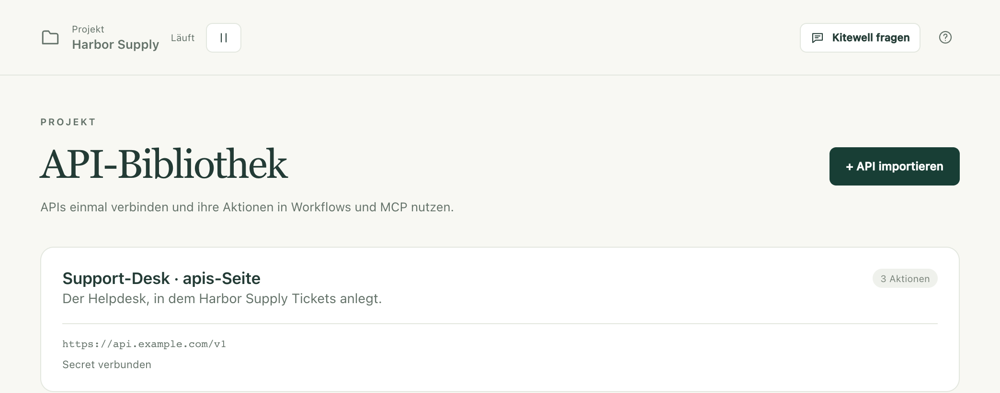
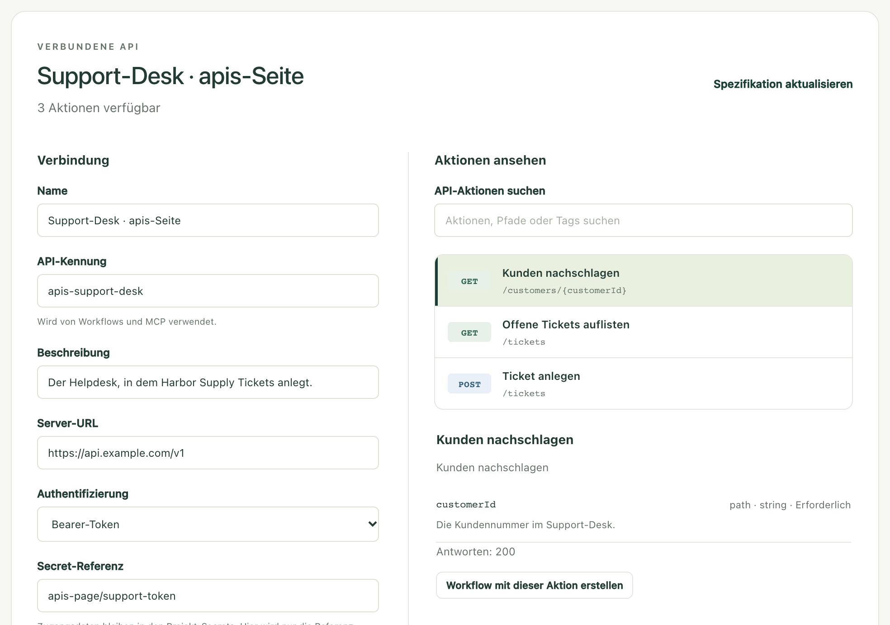

Machen Sie aus dem, was ein anderer Dienst bereits kann, Schritte, die Sie
aus einer Liste auswählen: einen Kunden nachschlagen, ein Ticket anlegen, eine
Bestellung erfassen. Sie importieren die Beschreibung des Dienstes einmal, und
Kitewell erstellt die Formulare. Ein Workflow-Schritt besteht dann aus ein
paar Feldern zum Ausfüllen statt aus einer Anfrage, die Sie selbst schreiben
müssen.

## Was Sie brauchen

- Ein OpenAPI-Dokument für den Dienst: eine JSON- oder YAML-Datei in
  OpenAPI 3.0 oder 3.1. Der Betreiber des Dienstes veröffentlicht es, oft als
  Link auf seiner Entwicklerseite mit dem Namen „OpenAPI“ oder
  „openapi.json“. Fragen Sie dort nach, wenn Sie es nicht finden.
- Das Token, den Schlüssel oder das Passwort, das der Dienst erwartet, falls
  er so etwas braucht. Halten Sie es bereit, aber tippen Sie es nicht in einen
  Workflow: Es gehört in ein [Secret](/de/docs/secrets/).
- Für einen Dienst, bei dem Sie sich per OAuth 2.0 anmelden, etwa viele
  Buchhaltungs- und CRM-Dienste, stattdessen eine App, die auf seiner
  Entwicklerseite registriert ist. Siehe
  [Mit OAuth 2.0 anmelden](#sign-in-with-oauth-20).

Eine Verbindung gehört zu einem Projekt, und jeder Workflow in diesem Projekt
kann sie nutzen.

## Einen Dienst importieren

1. Öffnen Sie in der Seitenleiste des Projekts **Mehr → API-Bibliothek** und
   wählen Sie **API importieren**.
2. Wählen Sie, wie das Dokument zu Kitewell kommt: **Datei hochladen**,
   **Von URL** oder **Spezifikation einfügen**.
3. Wählen Sie **Aktionsvorschau**. Kitewell liest das Dokument und öffnet
   **Prüfen und verbinden** mit allem, was der Dienst kann.
4. Suchen Sie unter **Aktionen ansehen** nach Name, Pfad oder Tag und wählen
   Sie eine Aktion aus, um ihre Eingaben und Antworten zu lesen. Kann Kitewell
   eine Aktion nicht als Schritt ausführen, steht der Grund direkt dort.
5. Prüfen Sie unter **Verbindung** die Felder **Name**, **API-Kennung** und
   **Server-URL**. Enthält das Dokument keine Serveradresse, tragen Sie sie
   selbst ein.
6. Wählen Sie **Authentifizierung** und verbinden Sie ein Secret, falls der
   Dienst eines braucht. Siehe unten
   [Zugangsdaten verbinden](#connect-credentials) oder, für einen Dienst mit
   Anmeldung, [Mit OAuth 2.0 anmelden](#sign-in-with-oauth-20).
7. Wählen Sie **API verbinden**.

Die Verbindung erscheint dann als Karte in der **API-Bibliothek**, mit der
Zahl ihrer Aktionen und der Angabe, ob ein Secret hinterlegt ist oder, bei
OAuth 2.0, ob dieses Gerät angemeldet ist.

Wählen Sie die Karte, um jederzeit zu demselben Bildschirm zurückzukehren:
links die Einstellungen, rechts die Aktionen.

**API-Kennung** ist der Name, unter dem Workflows diese Verbindung finden; sie
bleibt deshalb nach dem Speichern unverändert. Das Dokument selbst wird im
Projekt gespeichert, auch wenn es von einer URL kam, sodass zur Laufzeit
nichts erneut abgerufen wird. Vorschau und Verbinden rufen den Dienst nie
auf.

Verlangt die URL des Dokuments eine eigene Anmeldung, laden Sie die Datei
zuerst im Browser herunter und verwenden Sie **Datei hochladen** oder
**Spezifikation einfügen**.

## Zugangsdaten verbinden

Wählen Sie unter **Authentifizierung**, was der Dienst erwartet:
**Keine Authentifizierung**, **Bearer-Token**, **API-Schlüssel**,
**Benutzername und Passwort** oder **OAuth-2.0-Anmeldung**. Für die letzte
Option gibt es unten einen eigenen Abschnitt. Bei **API-Schlüssel** tragen Sie
außerdem unter **Schlüsselname** seinen Namen ein und wählen unter
**Schlüssel senden in** eine der Optionen **Header**, **Abfrageparameter**
oder **Cookie**.

Nennen Sie dann das Secret, das den Wert enthält. Geben Sie unter
**Secret-Referenz** ein vorhandenes Secret aus demselben Projekt ein oder
wählen Sie es aus, etwa `services/support-token`. Um hier eines anzulegen,
öffnen Sie **Neues Secret speichern**, geben Sie den Wert unter
**Passwort oder Zugriffstoken** ein und wählen Sie **Secret speichern**.

Bei einem Bearer-Token oder einem API-Schlüssel enthält das Secret das Token
oder den Schlüssel selbst. Bei **Benutzername und Passwort** tragen Sie den
Benutzernamen unter **Benutzername** in der Verbindung ein und bewahren das
Passwort im Secret auf.

Die Verbindung speichert nur den Verweis. Kitewell schlägt den Wert nach und
fügt ihn jeder Anfrage hinzu, die die Verbindung nutzt; der Wert selbst
erscheint nie in einem Workflow oder einem Log. Wie Sie einen Wert später
ersetzen, steht unter [Secrets](/de/docs/secrets/).

## Mit OAuth 2.0 anmelden

Manche Dienste geben kein Token aus, sondern lassen Sie sich anmelden und den
Zugriff erlauben. Kitewell meldet sich auf jedem Gerät einmal bei ihnen an und
hält den Zugriff danach aktuell, sodass ein Workflow nie mit einem Token
umgeht.

1. Registrieren Sie auf der Entwicklerseite des Dienstes eine App. Wo nach
   einer Weiterleitungs-URL gefragt wird (manchmal Callback-URL genannt),
   geben Sie die **Weiterleitungs-URL** an, die Kitewell unter
   **Authentifizierung** anzeigt, etwa
   `http://127.0.0.1:19741/oauth/callback`. Der Dienst leitet Sie nach der
   Anmeldung dorthin zurück. Notieren Sie die Client-ID und, falls der Dienst
   eines ausgibt, das Client-Secret.
2. Wählen Sie unter **Authentifizierung** die Option **OAuth-2.0-Anmeldung**.
   Beschreibt das Dokument des Dienstes seine Anmeldung, füllt Kitewell
   **Autorisierungs-URL**, **Token-URL** und **Bereiche** aus. Andernfalls
   übernehmen Sie diese Angaben von der Entwicklerseite.
3. Geben Sie die **Client-ID** ein. Hat der Dienst ein Client-Secret
   ausgegeben, nennen Sie unter **Referenz auf das Client-Secret** das Secret,
   das es enthält, oder legen Sie eines mit **Neues Secret speichern** an.
   Gibt es keines, lassen Sie das Feld leer.
4. Wählen Sie **API verbinden**. Kitewell speichert die Verbindung und startet
   die Anmeldung: Wählen Sie **Im Browser fortfahren**, melden Sie sich beim
   Dienst an und erlauben Sie Kitewell den Zugriff. Zurück in Kitewell zeigt
   **Anmeldung auf diesem Gerät** den Hinweis **Verbunden seit** mit dem
   Zeitpunkt Ihrer Anmeldung.

Kitewell erneuert den Zugriff, bevor er abläuft, auch bei Diensten, die jedes
Mal ein neues Refresh-Token ausgeben. Akzeptiert der Dienst die Anmeldung
nicht mehr, weil jemand sie widerrufen hat oder weil sie zu lange ungenutzt
war, zeigt die Karte in der **API-Bibliothek** **Erneute Verbindung nötig**,
und die Verbindung nennt den Grund, den der Dienst angibt. Wählen Sie
**Neu verbinden** und melden Sie sich erneut an.

Die Anmeldung gehört zu dem Gerät, auf dem sie erfolgt ist. Jede Person, die
diese Workflows auf einem anderen Gerät ausführt, wählt dort einmal
**Verbinden**. Bis dahin wird eine Ausführung, die die API nutzt, schon vor
dem Start abgelehnt, und die Übersicht des Projekts nennt die API, die
verbunden werden muss. Backups und Projektexporte enthalten die Anmeldung
nicht. **Trennen** entfernt sie von diesem Gerät. Auch wenn Sie eine andere
Client-ID, andere Endpunkte oder andere Bereiche speichern, endet die
Anmeldung; verbinden Sie danach erneut.

## Eine Aktion in einem Workflow verwenden

1. Öffnen Sie den Workflow, gehen Sie zu **Aufbauen** und wählen Sie
   **Schritt hinzufügen**.
2. Wählen Sie **Eine API-Aktion verwenden**.
3. Wählen Sie eine **Verbundene API**, suchen Sie dann unter
   **API-Aktion suchen** und wählen Sie die gewünschte Aktion aus.
4. Füllen Sie die Eingaben aus, die Kitewell erzeugt hat. Die Pflichtfelder
   kommen zuerst; die übrigen finden Sie unter **Optionale Parameter**. Ein
   Formular **Anfrageinhalt** erscheint, wenn die Aktion einen Inhalt
   erwartet. Für eine Datei, die die Aktion hochlädt, geben Sie ihren
   vollständigen Pfad auf diesem Gerät an, etwa `~/Documents/receipt.pdf`,
   oder wählen Sie die Ausgabe eines früheren Schritts, die eine Datei nennt.
5. Mit **Variablen** neben einer Eingabe fügen Sie eine Workflow-Eingabe oder
   einen Wert aus einem früheren Schritt ein.
6. Wählen Sie **Werkzeuge → Workflow prüfen**, speichern Sie den Workflow,
   führen Sie ihn aus und lesen Sie das Ergebnis unter
   **Ausführungen & Logs**.

Sie können auch beim Dienst beginnen: Öffnen Sie seine Karte in der
**API-Bibliothek**, wählen Sie unter **Aktionen ansehen** eine Aktion aus und
wählen Sie **Workflow mit dieser Aktion erstellen**.

## Ein Ergebnis an den nächsten Schritt weitergeben

Öffnen Sie im API-Schritt **Antwortfelder**, um die Felder zu sehen, die das
Dokument beschreibt. Öffnen Sie in einem späteren Schritt **Variablen** neben
einer Eingabe und wählen Sie eines davon. Kitewell fügt die Zuordnung hinzu
und verbindet die beiden Schritte, sodass der spätere Schritt wartet, bis der
API-Aufruf fertig ist.

Eine Kundensuche kann zum Beispiel ihre `id` an einen Schritt übergeben, der
ein Ticket anlegt. Welche Felder angeboten werden, hängt davon ab, was laut
Dokument in der Antwort steht. Beschreibt es nichts im Detail, steht die ganze
Antwort als ein einziger Wert zur Verfügung.

## Die Beschreibung eines Dienstes aktualisieren

Kitewell bewahrt das Dokument so auf, wie es beim Import war. Eine Änderung
an der ursprünglichen URL erreicht das Projekt nicht von selbst.

1. Öffnen Sie die Verbindung in der **API-Bibliothek** und wählen Sie
   **Spezifikation aktualisieren**.
2. Laden Sie das neue Dokument hoch, rufen Sie es ab oder fügen Sie es ein,
   und wählen Sie dann **Aktionsvorschau**.
3. Prüfen Sie die Aktionen und wählen Sie **Verbindung speichern**.

Kitewell prüft vor dem Speichern die Workflows des Projekts. Würde das neue
Dokument einen gespeicherten Workflow beschädigen, weil eine Aktion, die er
nutzt, verschwunden ist oder sich ihre Eingaben geändert haben, wird die
Aktualisierung abgelehnt, und die alte Verbindung bleibt bestehen. Korrigieren
Sie zuerst diese Workflows, oder importieren Sie das neue Dokument unter einer
anderen **API-Kennung** und stellen Sie die Workflows einzeln um.

Aus demselben Grund lässt sich eine Verbindung nicht löschen, solange ein
gespeicherter Workflow sie nutzt. **API löschen** nennt den Workflow, der sie
noch verwendet.

## Eine Verbindung ohne ihre Zugangsdaten teilen

Ein [Projektexport](/de/docs/sharing/) enthält das importierte Dokument und
die Einstellungen der Verbindung: die Serveradresse, die Art der
Authentifizierung und den Namen des Secrets. Werte von Secrets sind nicht
enthalten. Auf dem empfangenden Gerät zeigt das Secret unter **Secrets** den
Hinweis **Wert erforderlich**, bis jemand dort den Wert setzt oder Sie die
Verbindung auf ein anderes Secret in diesem Projekt umstellen.

Eine OAuth-2.0-Verbindung enthält ihre Client-ID, Endpunkte, Bereiche und den
Namen des Client-Secrets, aber nicht die Anmeldung. Jedes Gerät, das ihre
Workflows ausführt, verbindet sich einmal.

Der Export behält auch die Adresse, von der das Dokument stammt. Zugangsdaten,
die direkt in das Dokument, in eine Serveradresse oder in eine
Workflow-Eingabe getippt wurden, entfernt Kitewell nicht für Sie. Sehen Sie
sich diese Felder an, bevor Sie die Datei teilen.

## Was der Import annimmt

- Ein JSON- oder YAML-Dokument bis 8 MiB. Ein Swagger-2-Dokument muss zuerst
  in OpenAPI 3.0 oder 3.1 umgewandelt werden; Kitewell weist darauf hin, wenn
  Sie es trotzdem versuchen.
- Verweise müssen innerhalb desselben Dokuments bleiben. Führen Sie externe
  Verweise vor dem Import in einem Dokument zusammen.
- Ein Anfrageinhalt kann JSON, ein URL-codiertes Formular, Text oder ein
  Multipart-Formular sein. Eine Datei, die ein Multipart-Formular hochlädt,
  wird über ihren Pfad auf diesem Gerät angegeben, bis 100 MB. Andere binäre
  Inhalte stehen als API-Schritte nicht zur Verfügung; verwenden Sie dafür
  einen Webdienst-Schritt.
- Eine Aktion, die zwei Zugangsdaten gleichzeitig braucht, oder ein
  Authentifizierungsverfahren, das Kitewell nicht unterstützt, ist in der
  Aktionsliste mit dem Grund gekennzeichnet.
- Seitenweises Abrufen geschieht nicht automatisch. Geben Sie die Seiten- oder
  Cursor-Eingabe selbst an und wiederholen Sie die Anfrage im Workflow.

Dieselben importierten Aktionen und Schemas stehen auch einem KI-Assistenten
mit Bearbeitungszugriff offen. Siehe [MCP und API-Zugriff](/de/docs/mcp/).
