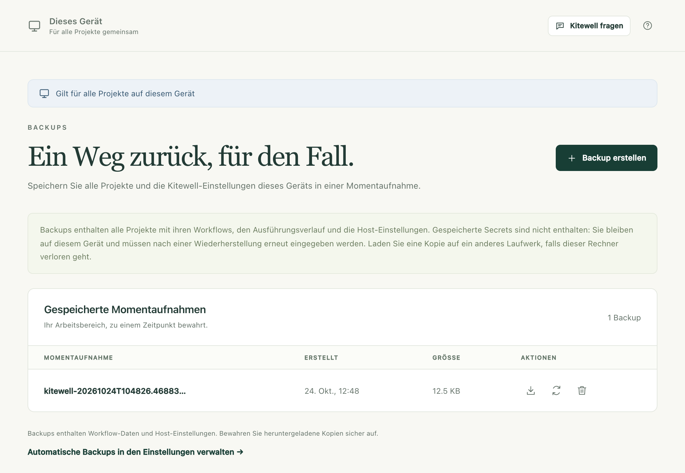
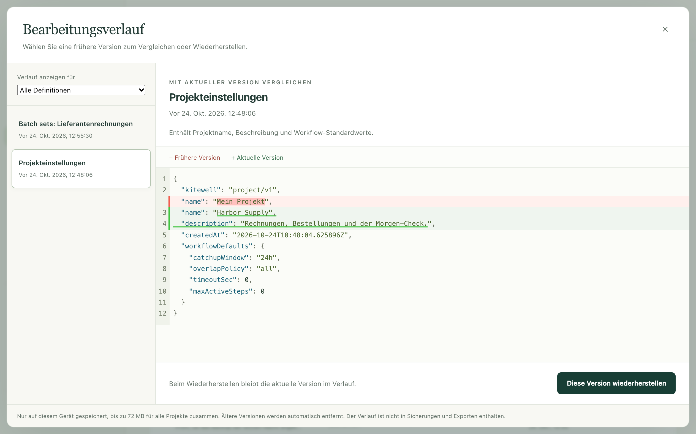

Eine Momentaufnahme fasst jedes Projekt auf diesem Gerät – Workflows,
Ausführungsverlauf, Einstellungen, Tabellen und Wissen – in einer Datei
zusammen, die Sie an einem sicheren Ort aufbewahren und später zurückspielen
können. Kitewell kann jede Nacht von selbst eine erstellen. Außerdem behält es
die früheren Versionen von allem, was Sie bearbeiten, sodass sich eine Änderung
an einem einzelnen Workflow rückgängig machen lässt, ohne alles
wiederherzustellen.

## Was Sie brauchen

Administratorzugriff auf diesem Gerät. **Backups** erscheint in der
Seitenleiste unter **Dieses Gerät**.

## Jetzt ein Backup erstellen

1. Öffnen Sie **Dieses Gerät → Backups** und wählen Sie **Backup erstellen**.
2. Warten Sie einen Moment. Die Engine jedes Projekts hält an, während die
   Momentaufnahme entsteht, und startet danach wieder.
3. Die Momentaufnahme erscheint unter **Gespeicherte Momentaufnahmen** mit ihrer
   Zeit unter **Erstellt** und ihrer **Größe**.
4. Wählen Sie **Backup herunterladen**, den Pfeil neben der Momentaufnahme, und
   speichern Sie die Datei an einem Ort, über den Sie selbst verfügen.



Eine Momentaufnahme, die nur auf diesem Gerät liegt, hilft, eine Änderung
rückgängig zu machen. Geht das Gerät selbst verloren oder wird es gestohlen,
nützt sie nichts; bewahren Sie deshalb eine heruntergeladene Kopie auf einem
anderen Laufwerk oder in einem Speicher auf, den Ihr Team schützt.

## Jeden Tag sichern

Schalten Sie **Geräteeinstellungen → Automatische Backups → Tägliche Backups**
ein und wählen Sie die **Backup-Uhrzeit**. Kitewell erstellt dann einmal am Tag
eine Momentaufnahme, kurz nach dieser Uhrzeit, in der Zeitzone dieses Geräts.
Ist das Gerät zu diesem Zeitpunkt im Ruhezustand, entsteht die Momentaufnahme
nach dem Aufwachen.

Kitewell behält die 10 neuesten automatischen Momentaufnahmen und entfernt
ältere. Eine Momentaufnahme, die Sie selbst angefordert haben, und die
Sicherheitsmomentaufnahme vor einer Wiederherstellung bleiben, bis Sie sie
löschen.

Zwei Dinge verhindern eine automatische Momentaufnahme. Ein Workflow, der
läuft, in der Warteschlange steht oder wartet – auch einer, der auf eine
Genehmigung wartet –, hält sie auf, und Kitewell versucht es alle 15 Minuten
erneut. Und ein Gerät, auf dem alle Projekte gestoppt sind, erstellt gar keine,
weil nichts läuft, das zu schützen wäre.

## Stattdessen eine einzelne Änderung rückgängig machen

Jedes Mal, wenn Sie einen Workflow, eine Tabelle oder eine Projekteinstellung
speichern, behält Kitewell die ersetzte Version. Wählen Sie
**Bearbeitungsverlauf** auf der Seite **Workflows**, in den
**Projekteinstellungen** oder in der Werkzeugleiste des Workflow-Editors.

1. Wählen Sie eine Version in der Liste. Jede ist mit der Zeit beschriftet, zu
   der Sie sie überschrieben haben.
2. Lesen Sie den Vergleich. **Frühere Version** ist, was Sie gerade ansehen,
   **Aktuelle Version** ist, was jetzt gespeichert ist.
3. Wählen Sie **Diese Version wiederherstellen** und bestätigen Sie mit
   **Wiederherstellen**.



Beim Wiederherstellen bleibt die aktuelle Version im Verlauf, sodass Sie wieder
zurückkönnen. **Verlauf anzeigen für** beschränkt die Liste auf einen Workflow
oder eine Einstellung. Auch ein gelöschter Workflow ist hier noch vorhanden:
Stellen Sie ihn wieder her, kommt er mit pausierten Planungen zurück.

Dieser Verlauf existiert nur auf diesem Gerät. Er ist weder in einer
Momentaufnahme noch in einem Projektexport enthalten, und das Wiederherstellen
einer Momentaufnahme löscht ihn.

## Alles aus einer Momentaufnahme wiederherstellen

1. Lassen Sie laufende Arbeit zu Ende laufen. Eine Wiederherstellung wird
   abgelehnt, solange ein Workflow läuft, in der Warteschlange steht oder
   wartet.
2. Öffnen Sie **Dieses Gerät → Backups** und wählen Sie
   **Backup wiederherstellen**, die kreisenden Pfeile neben der Momentaufnahme.
3. Lesen Sie die Warnung und bestätigen Sie mit **Backup wiederherstellen**.
   Kitewell speichert zuerst eine Sicherheitsmomentaufnahme, ersetzt jedes
   Projekt und die Einstellungen dieses Geräts und lädt neu.
4. Lesen Sie, was die Wiederherstellung meldet, und arbeiten Sie es ab.

Die Wiederherstellung nennt für jedes Projekt die Secrets, die neu einzugeben
sind, die Postfächer, die neu zu verbinden sind, und die Website-Schritte, die
sich bei ihrer nächsten Ausführung neu anmelden. Anmeldungen bei
Container-Registries werden gelöscht; geben Sie auch diese erneut ein.

Dieses Gerät behält, was ihm selbst gehört: seine Anmeldung, seine
API-Schlüssel und welche Projekte gestoppt waren. Keine Momentaufnahme kann Sie
aussperren, und keine bringt die Schlüssel anderer auf Ihr Gerät.

Eine Wiederherstellung schreibt nie in Dagu Cloud. Ein
[synchronisiertes Projekt](/de/docs/cloud-sync/) kommt so zurück, wie die
Momentaufnahme es enthielt, und sein nächstes Update übernimmt die Kopie aus
Dagu Cloud.

## Was eine Momentaufnahme enthält

| In der Momentaufnahme | Nicht enthalten |
| --- | --- |
| Geräteeinstellungen, Benachrichtigungskanäle und -regeln | Werte von Secrets und die Schlüssel, die sie entschlüsseln |
| Projekte, Workflow-Definitionen, Workflow-Standardwerte | Passwörter von Benachrichtigungskanälen, Webhook-Adressen und -Schlüssel |
| Importierte OpenAPI-Dateien und Einstellungen von API-Verbindungen | Anmeldungen für Postfächer |
| Stapeltabellen, Releases, Wissensseiten | Gespeicherte Website-Anmeldungen und Wiedergabe-Caches |
| Namen und Beschreibungen von Secrets | Was Desktop-Schritte vom Bildschirm aufgezeichnet haben |
| Ausführungsverlauf und Artefakte | Ausgabelogs der Ausführungen |
| Gespräche mit dem Assistenten und Fehlerdiagnosen | Bearbeitungsverlauf, Benachrichtigungsverlauf |
| Für „Rückgängig“ aufbewahrte Kopien einer verknüpften Excel-Datei | Anmeldung und API-Schlüssel dieses Geräts |
| Was dieses Gerät pro Projekt festgelegt hat: bestätigte SSH-Hosts, Schlüsselpfade, welche Workflows hier laufen | Die Verbindung zu Dagu Cloud, eine Datei auf oberster Ebene des Datenordners |

Was fehlt, fehlt mit Absicht. Eine Momentaufnahme mit einem Secret und dem
Schlüssel, der es entschlüsselt, enthielte dieses Secret offen; deshalb fragt
ein wiederhergestelltes Gerät stattdessen erneut nach den Zugangsdaten.

Die Datei ist nicht verschlüsselt, und manches darin sind Ihre eigenen
Geschäftsdaten: die Ausgabe und die Artefakte einer Ausführung, was mit dem
Assistenten besprochen wurde, und bis zu zehn Kopien jeder Excel-Datei, in die
eine Tabelle zurückschreibt. Zugangsdaten, die direkt in einen Workflow, eine
OpenAPI-Datei oder eine Quell-URL geschrieben wurden, stehen darin so, wie sie
geschrieben wurden. Behandeln Sie eine heruntergeladene Momentaufnahme als
vertraulich und verschlüsseln Sie sie selbst, bevor Sie sie in einen
gemeinsamen Speicher legen.

Kitewell sichert nur, was es selbst aufbewahrt. Skripte, die Ihre Schritte
aufrufen, die Dateien, die sie lesen, Docker-Volumes, eingebundene Ordner und
die Dienste, die Ihre Workflows erreichen, sind nicht enthalten. Sichern Sie
diese so, wie Sie den Rest des Computers sichern.

## Wenn etwas nicht klappt

- **„has a workflow running, queued, or waiting“.** Es läuft noch etwas. Lassen
  Sie es zu Ende laufen oder beantworten Sie die Genehmigung, auf die es
  wartet, und versuchen Sie es dann erneut.
- **Das Backup scheitert an der Größe.** Eine Momentaufnahme fasst höchstens
  2 GiB Daten und 100.000 Dateien. Löschen Sie zuerst Ausführungsverlauf, den
  Sie nicht mehr brauchen.
- **Die Wiederherstellung meldet, dass das Backup ein Format verwendet, das diese Version nicht liest.**
  Die Momentaufnahme stammt von einem anderen Kitewell. Installieren Sie die
  Version, die sie geschrieben hat, oder stellen Sie eine neuere Momentaufnahme
  wieder her.
- **Ein Workflow kommt nach einer Wiederherstellung angehalten zurück.** Die
  Definition bleibt erhalten und wird gemeldet, damit Sie sie an Ort und Stelle
  korrigieren können; die anderen Workflows laufen.

Alles andere finden Sie unter [Fehlerbehebung](/de/docs/troubleshooting/).

## Den Speicherplatz im Blick behalten

**Projekteinstellungen → Speicher** zeigt, wie viel das Projekt belegt und wie
viel auf der Festplatte noch frei ist, und warnt Sie, wenn der Platz knapp
wird. Aufgeführt sind:

- der Ausführungsverlauf jedes Workflows, mit **Verlauf löschen…**
- gespeicherte Website-Anmeldungen, mit **Anmeldung vergessen…**
- die Wiedergabe-Caches, die Website- und Desktop-Schritte anlegen, mit
  **Leeren**
- alles andere, was das Projekt enthält, als eine Zahl

Einmal am Tag, zur **Backup-Uhrzeit**, entfernt Kitewell Ausführungsverlauf,
der älter ist als **Geräteeinstellungen → Aufbewahrung des Ausführungsverlaufs**,
die zugehörigen abgeschlossenen Tabellenstarts und Dateien von Ausführungen,
die es nicht mehr gibt. Wenn Sie die Aufbewahrung verkürzen, wird der alte
Verlauf sofort entfernt, statt bis zur Nacht zu warten.

Ausführungslogs haben keine eigene Größengrenze. Eine einzige Ausführung mit
sehr viel Ausgabe kann eine Festplatte trotzdem füllen, bevor ihr Verlauf an
der Reihe ist.

## Wo die Daten liegen

```text
macOS:    ~/Library/Application Support/Kitewell
Windows:  %LOCALAPPDATA%\Kitewell
```

`data` enthält die Projekte und Einstellungen, `backups` die Momentaufnahmen,
`runtime` die heruntergeladenen Engine-Versionen und `logs`, was der Dienst
geschrieben hat. Beenden Sie Kitewell, bevor Sie etwas davon von Hand
verschieben, und löschen Sie den Ordner nie, um ein Installationsproblem zu
beheben, solange Sie keine heruntergeladene Momentaufnahme haben.

## Details

- Momentaufnahmen sind `kitewell-<timestamp>.tar.gz` unter `backups`,
  gzip-komprimiertes tar, nur für den Besitzer lesbar, mit `-auto` im Namen bei
  denen, die Kitewell selbst erstellt hat. Beim Aufräumen zählen nur diese.
- Die Grenze liegt bei 2 GiB unkomprimierten Daten und 100.000 Dateien pro
  Archiv.
- Der Bearbeitungsverlauf ist auf 64 MB über alle Projekte begrenzt, 1.000
  Versionen insgesamt und 100 Versionen pro Workflow oder Einstellung; die
  ältesten gehen zuerst. Er liegt in `data/history/<project>`.
- Ein Backup lässt `credentials.json`, `state.json`, `mail.key`,
  `data/history`, die `mail.json` jedes Projekts, jedes `logs`-Verzeichnis und
  die Verzeichnisse `auth`, `secrets`, `browser` und `computer` unter der Engine
  jedes Projekts weg. Die drei Gerätedateien werden bei einer Wiederherstellung
  übernommen, statt aus dem Archiv genommen zu werden.
- Die tägliche Bereinigung entfernt auch Fehlerdiagnosen und bittet die Engine,
  Artefakte freizugeben, die keine Ausführung mehr beansprucht. Ein Workflow
  kann mit `hist_retention_days` oder `hist_retention_runs` in seinem YAML
  einen eigenen Verlauf behalten; das hat Vorrang vor der Geräteeinstellung.
  Die Bereinigung entfällt, solange ein Engine-Update in Quarantäne ist.
- Eine Wiederherstellung ersetzt den laufenden MCP-Listener durch die
  Einstellungen aus dem Archiv. Bereits laufende Ausführungen werden weder
  abgewartet noch beendet.
