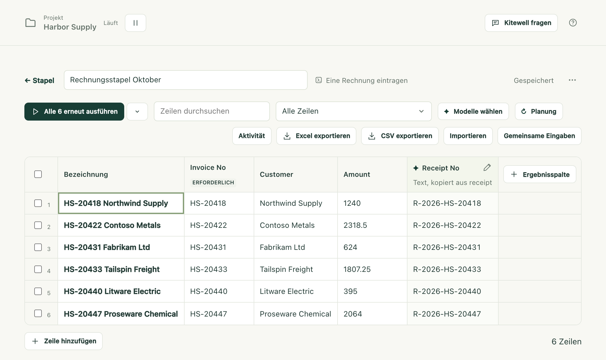

Sie haben eine Liste abzuarbeiten, etwa die Rechnungen dieses Monats, hundert
Lieferanten, die zu prüfen sind, oder jedes Objekt aus einer Suche, und einen
Workflow, der einen dieser Einträge erledigt. Eine Tabelle legt die Liste in
Zeilen an und führt diesen Workflow einmal für jede Zeile aus, mit den Werten
dieser Zeile. Was jede Ausführung gefunden hat, kommt in Ergebnisspalten
daneben zurück. So liegt die ganze Arbeit als Tabelle vor, die Sie sortieren,
filtern und exportieren können.

Fehlgeschlagene Zeilen lassen sich gezielt erneut ausführen. Bereits erledigte
Zeilen bleiben unberührt. Niemand muss dasitzen und klicken.

## Was Sie brauchen

- Einen Workflow, der die Arbeit für einen Eintrag erledigt, mit benannten
  Eingaben für das, was sich von Eintrag zu Eintrag ändert. Ein Workflow ohne
  Eingaben lässt sich ebenfalls über eine Tabelle ausführen, aber dann würde
  jede Zeile dasselbe tun.
- Sonst nichts, wenn die Spalten der Tabelle einen Wert übernehmen, den ein
  Schritt bereits sammelt. Soll stattdessen ein Modell etwas aus jeder
  Ausführung herauslesen, braucht das Projekt ein API-Modell unter
  [Agenten und Modelle](/de/docs/ai/).

## Eine Tabelle anlegen

1. Öffnen Sie in der Seitenleiste **Mehr** und wählen Sie **Stapel**, dann
   **Neue Tabelle**.
2. Wählen Sie den **Workflow**, tragen Sie unter **Tabellenname** einen Namen
   ein und wählen Sie dann **Tabelle erstellen**.
3. Die Tabelle öffnet sich mit einer Spalte für jede Eingabe des Workflows,
   samt deren Typen, Standardwerten und zulässigen Werten, und ganz links mit
   **Bezeichnung**. **Bezeichnung** benennt eine Zeile für Sie und wird nie an
   den Workflow übergeben.
4. Tragen Sie die Zeilen ein (siehe unten) und wählen Sie die
   Ausführen-Schaltfläche.

Sie können auch im Ausführungsformular eines Workflows beginnen: Wechseln Sie
von **Einzelausführung** zu **Stapeltabelle**. Was Sie bereits eingegeben
hatten, wird dann zu den gemeinsamen Werten der neuen Tabelle. Diesen Wechsel
gibt es nur in einem neuen Ausführungsformular, nicht bei einer Wiederholung.

Eine Tabelle fasst bis zu 5.000 Zeilen und 30 Ergebnisspalten.

## Die Zeilen eintragen

- Tippen Sie in das Raster, oder fügen Sie aus einer Tabellenkalkulation
  kopierte Zellen ab der Zelle ein, in der Sie stehen. Zeilen kommen nach
  Bedarf hinzu. **Zeile hinzufügen** fügt eine von Hand hinzu.
- **Importieren** Sie eine Excel-Arbeitsmappe oder eine CSV-Datei, ziehen Sie
  eine Datei irgendwo auf die Tabelle, oder fügen Sie die Zeilen in das Feld
  **Zeilen** des Bereichs ein und wählen Sie **Spaltenvorschau**. Die Vorschau
  zeigt die ersten Zeilen, und die Zeile mit den Spaltennamen ist schon für Sie
  ausgewählt. Eine andere wählen Sie mit
  **Zeile 3 als Spaltennamen verwenden**, oder Sie wählen
  **Keine Spaltennamen**. Ordnen Sie dann jede Spalte einer Eingabe zu, der
  **Bezeichnung** oder **Spalte überspringen**. Über **Trennzeichen** lesen Sie
  auch eine Datei ein, die nicht durch Kommas getrennt ist.
- **Gemeinsame Eingaben** sind Werte, die jede Zeile verwendet, sofern die
  Zeile keinen eigenen Wert hat. Eine leere Zelle zeigt in grauer Kursivschrift
  den gemeinsamen Wert oder den Standardwert des Workflows, den sie verwenden
  wird.
- **Zeilen aus dem Lauf eines Workflows füllen** lässt eine Ausführung die
  Einträge finden, etwa die Inserate, die eine Suche liefert, und hält die
  Zeilen aktuell.
- **Eine Arbeitsmappe auf diesem Gerät verknüpfen** hält die Verbindung zu
  einer Excel-Datei, statt die Zeilen hineinzukopieren. So wird das Ergebnis
  jeder Zeile in die Zeile zurückgeschrieben, aus der sie stammt. Siehe
  [Excel automatisieren](/de/docs/spreadsheets/).
- Der Assistent kann Zeilen und Spalten vorschlagen. Sie erscheinen in der
  geöffneten Tabelle, bis Sie entscheiden.

Zeilen oberhalb der Spaltennamen, leere Zeilen und Summenzeilen wie „Summe“
oder „Subtotal“ lässt der Import aus. Jede dieser Gruppen wird gezählt, und mit
einem Kästchen nehmen Sie die Summenzeilen doch auf. Eine Arbeitsmappe öffnet
sich auf dem Blatt, auf dem Excel sie öffnet, und bietet ihre anderen Blätter
an. Ausgeblendete Zeilen werden importiert, es sei denn, Sie haken das
Kästchen an, das sie auslässt. Der Import liest die Datei nur und verändert sie
nie.

Jeder Wert wird nach dem Typ seiner Eingabe gelesen: Text so, wie er
eingegeben ist, Zahlen, `true` oder `false` sowie Listen oder Objekte als JSON.
Ein Wert, der nicht passt, wird beim Eintippen abgelehnt und beim Einfügen
übersprungen. Kommt er aus einer Datei, wird er behalten, aber markiert. Eine
markierte Zelle trägt einen roten Ring und den Grund, und nichts startet, bis
Sie sie korrigieren: Eine einzige unpassende Zelle in den Zeilen, die Sie
gerade ausführen wollen, hält den ganzen Durchlauf auf und nennt die Zeile.

Die Zellen einer Arbeitsmappe kommen so an, wie Excel sie anzeigt:

- Datumsangaben als `2026-10-01`, Datum mit Uhrzeit als `2026-10-01 12:00:00`,
  Uhrzeiten als `09:30:00`;
- Zahlen ohne Trennzeichen oder Währungssymbole und nie in wissenschaftlicher
  Schreibweise, Prozentwerte als Dezimalbruch, 12 % also als `0.12`;
- `TRUE` und `FALSE` (im deutschen Excel WAHR und FALSCH) als
  kleingeschriebenes `true` und `false`, so wie es eine Ja-oder-Nein-Eingabe
  erwartet;
- Codes wie `00123` mit ihren Nullen, egal ob die Zelle Text enthält oder eine
  Zahl, die mit führenden Nullen formatiert ist;
- eine Zelle, die über mehrere Zeilen verbunden ist, wiederholt sich in jeder
  dieser Zeilen; eine Verbindung innerhalb einer Zeile bleibt in ihrer ersten
  Zelle;
- eine Formel liefert das Ergebnis, das Excel zuletzt gespeichert hat;
- eine Zelle mit einem Excel-Fehler wie `#N/A` (im deutschen Excel `#NV`)
  kommt leer an und wird gezählt.

Eine ältere `.xls`-Datei und eine mit Passwort geschützte Arbeitsmappe werden
abgelehnt. Speichern Sie die Datei zuerst als `.xlsx`, oder entfernen Sie das
Passwort. Eine Datei darf bis zu 16 MiB groß sein. `.csv`, `.tsv` und `.txt`
funktionieren ebenfalls.

Die Tabelle speichert schon während der Bearbeitung und zeigt dann
**Gespeichert** an.

## Die Zeilen ausführen

Die Ausführen-Schaltfläche startet die naheliegende Gruppe von Zeilen und sagt,
welche. Ist noch nichts gelaufen, lautet sie
**6 noch nicht ausgeführte ausführen**. Sind einige fehlgeschlagen, lautet sie
**2 fehlgeschlagene oder gestoppte erneut ausführen**. Am Ende führt sie alle
erneut aus. Der Pfeil daneben öffnet **Weitere Ausführungsoptionen**, wo Sie
die Gruppe selbst wählen. Zeilen mit der Markierung **Nicht mehr gelistet**
gehören zu keiner Gruppe, außer zu einer Auswahl.

Jede Zeile wird zu einer eigenen Ausführung in der Warteschlange des Workflows.
Das Banner zeigt, wie viele fertig sind, wie viele gleichzeitig laufen, den
Namen der Warteschlange und, sobald drei Zeilen fertig sind, ungefähr, wie
lange es noch dauert. Die Warteschlange **default** führt projektweit 5
gleichzeitig aus. Wenn eine Website viele Anfragen auf einmal abweist, wählen
Sie im Banner **Anzahl gleichzeitiger Läufe ändern**. Das öffnet diese
Warteschlange auf der Seite **Warteschlangen**. Dort setzen Sie
**Gleichzeitige Ausführungen** herab.

In der Standardwarteschlange kommen die Zeilen etwa zehn auf einmal in die
Warteschlange. Die übrigen zeigen **Ausstehend**, bis Platz ist, und dann
**In Warteschlange**, sobald die Engine sie übernommen hat. Eine geplante
Ausführung eines anderen Workflows, der dieselbe Warteschlange nutzt, wartet
daher höchstens eine Runde von Zeilen ab, nie die ganze Tabelle.

- **Wartende Zeilen abbrechen** bricht Zeilen ab, die noch warten. Laufende
  Zeilen laufen weiter.
- **Alle stoppen** stoppt auch die laufenden Zeilen. Fertige Ergebnisse
  bleiben erhalten.

Jeder Durchlauf behält seine eigene Kopie des Workflows und der Werte jeder
Zeile. Spätere Änderungen an Tabelle oder Workflow ändern also keine
Ausführungen, die schon in der Warteschlange stehen. Eine Zeile, deren
Eingaben sich seit ihrer Ausführung geändert haben, zeigt **Geändert**, und der
Filter **Seit der letzten Ausführung geändert** listet solche Zeilen auf. Wenn
Sie eine gemeinsame Eingabe ändern, wird jede Zeile markiert, die sie
verwendet.

### Wenn eine Zeile fehlschlägt

Wählen Sie die Zeile aus. Dann sehen Sie den Schritt, an dem sie angehalten
hat, und den Fehler dieses Schritts.
**Wiederholungen für Im Portal eintragen einrichten** öffnet diesen Schritt im
Workflow-Editor, und **Wiederholungsgrenze** ist bereit zum Einstellen: Eine
Website, die viele Anfragen auf einmal abweist, lässt einen späteren Versuch
meist durch. Neue Wiederholungsregeln gelten, wenn die Zeilen erneut laufen,
nicht für Ausführungen, die schon in der Warteschlange stehen.

## Ein Ergebnis aus jeder Ausführung sammeln

Eine Ergebnisspalte sammelt einen Wert aus jeder Ausführung. Wie, wählen Sie
beim Hinzufügen der Spalte unter **Herkunft des Werts**.

**Ein Wert, den der Workflow veröffentlicht** übernimmt ihn unverändert aus
jeder Ausführung: ohne Modell, ohne Kosten und genau so, wie der Schritt ihn
gefunden hat, sobald die Ausführung fertig ist. Auch Zeilen, die liefen, bevor
es die Spalte gab, werden ausgefüllt. Wählen Sie den Wert unter **Ausgabe**.

- Eine neue Tabelle, deren Workflow Werte veröffentlicht, bietet diese
  angehakt an, unter „Dieser Workflow veröffentlicht diese Werte. Als Spalten
  hinzufügen?“
- **Ergebnisspalte** rechts im Raster fügt eine Spalte hinzu.
- Ein Wert, der nicht zum Typ der Spalte passt, etwa `¥12,800` in einer
  Zahlenspalte, wird so angezeigt, wie er veröffentlicht wurde, und markiert.
  Seine Details bieten **Spalte in Text ändern** oder
  **Von einem Modell lesen lassen** an.
- Eine Spalte, deren Wert der Workflow nicht mehr veröffentlicht, wird in ihrem
  Spaltenkopf markiert.

Übernehmen lassen sich nur Werte, die in die Ausgaben einer Ausführung
gelangen: Extraktionen aus Website- und Desktop-Schritten, Werte aus
E-Mail-Schritten und Ergebnisse, die ein Befehlsschritt deklariert. Die
Formularantworten einer Person und die Schritte innerhalb einer Schleife
gehören nicht dazu. Veröffentlichen zwei Schritte denselben Namen, gilt der
Schritt, der zuletzt gelaufen ist.

**Ein Modell liest den Lauf** deckt alles andere ab. Benennen Sie die Spalte,
wählen Sie einen Typ (**Text**, **Zahl**, **Ja oder Nein**, **Auswahl** oder
**Stufe**) und beschreiben Sie unter
**Was gelesen wird (Anweisung an das Modell)**, wonach gesucht werden soll,
etwa die Einheit und welcher Wert zu nehmen ist, wenn es mehrere gibt.
**Auswahl** und **Stufe** erhalten ihre **Optionen** bzw.
**Stufen, niedrigste zuerst**.

Diese Spalten füllen API-Modelle aus **Agenten und Modelle**, gewählt unter
**Modelle wählen**:

- Das **Extraktionsmodell** liest Text- und Zahlenspalten und, wenn es kein
  Entscheidungsmodell gibt, auch die anderen Spalten. Jeder Wert kommt mit
  einem Zitat, **Aus der Ausführung zitiert**. Es wird markiert, wenn das Zitat
  nicht wortwörtlich in dem gefunden wurde, was gesendet wurde.
- Ein **Entscheidungsmodell** ist optional. Es beurteilt Ja-oder-Nein-,
  Auswahl- und Stufenspalten mit einer Wahrscheinlichkeit, schneller und
  günstiger, aber ohne Zitat.
  **Urteile unter diesem Wert als unsicher markieren** legt die Konfidenz fest,
  unterhalb derer ein Urteil zur Prüfung durch eine Person gekennzeichnet wird,
  standardmäßig 70 %.

Werte werden gelesen, nachdem eine Ausführung erfolgreich war, sofern die
Tabelle beim Start der Zeilen bereits eine Spalte und ein Modell hatte.
**4 Zeilen füllen** im Banner liest fertige Zeilen, denen Werte fehlen, und
**Erneut lesen** in den Details einer Zelle liest eine Ausführung erneut.
Keines von beiden führt den Workflow erneut aus. Ein Wert, der gelesen wurde,
bevor Sie die Definition seiner Spalte geändert haben, wird als veraltet
markiert. Ein Wechsel des Modells markiert nichts.

Das Modell erhält die Eingaben der Zeile, die Schrittergebnisse der Ausführung,
ihre veröffentlichten Ausgaben, bis zu fünf Textdateien, die sie erzeugt hat,
und das Ende der Logs von bis zu vier Schritten, aber keine Bildschirmfotos.
Wählen Sie einen Anbieter, dem Sie das anvertrauen.

## Eine Ausführung die Zeilen finden lassen

Zeilen können aus einer Liste stammen, die die Ausführung eines Workflows
findet. So werden neue Einträge zu Zeilen, ohne dass jemand sie hinzufügt.
Wählen Sie unter **Importieren** oder unter der leeren Zeile einer neuen
Tabelle **Zeilen aus dem Lauf eines Workflows füllen**.

1. Wählen Sie den **Workflow**, der auch der Workflow der Tabelle selbst sein
   kann, und die **Liste**, die seine Ausführungen veröffentlichen: die
   **Liste von Einträgen** eines [Website-](/de/docs/browser/) oder
   [Desktop-Schritts](/de/docs/desktop/), die E-Mails, die ein Schritt
   **E-Mails finden** findet, oder jede Ausgabe, die ein Schritt als Liste
   veröffentlicht.
2. Prüfen Sie die ersten Einträge seiner letzten Ausführung. Ist er noch nicht
   gelaufen, oder sind seine Felder erst aus einer Ausführung bekannt, wählen
   Sie **Jetzt ausführen**.
3. Unter **Was jede Eingabe füllt** übernimmt jede Eingabe das gleichnamige
   Feld des Eintrags. Wählen Sie mit **Zeilen hierüber zuordnen** das Feld, das
   die Einträge unterscheidet, und legen Sie die Eingaben fest, die die
   Ausführung der Liste selbst erhält.
4. Wählen Sie **Zeilen füllen**. Der Workflow läuft einmal und fügt für jeden
   Eintrag eine Zeile hinzu.

Die Symbolleiste zeigt dann, woher die Zeilen kommen, und **Zeilen aktualisieren**
führt den Workflow erneut aus. Wenn die Ausführung erfolgreich ist:

- Ein Eintrag füllt die Zeile mit demselben Schlüssel. Eine Zeile, die Sie mit
  diesem Schlüssel von Hand hinzugefügt haben, wird übernommen statt verdoppelt.
  Ein Schlüssel wird als Text verglichen. Was sich als Zahl lesen lässt, wird
  jedoch als Zahl verglichen.
- Ein neuer Eintrag fügt eine Zeile hinzu, die bis zu ihrer Ausführung als
  **Neu** markiert ist.
- Eine Zeile, deren Eintrag verschwunden ist, bleibt, ausgegraut als
  **Nicht mehr gelistet**, und kommt zurück, wenn ihr Eintrag zurückkommt. Der
  Filter **Nicht mehr gelistet** zeigt solche Zeilen an, mit einer
  Schaltfläche, um alle auf einmal zu entfernen.
- Einträge ohne Schlüssel, Einträge, die den Schlüssel eines anderen
  wiederholen, und Einträge jenseits der Grenze von 5.000 Zeilen werden
  übersprungen und gezählt.

Eine fehlgeschlagene Ausführung ändert nichts und sagt, warum. Dasselbe gilt
für eine Liste, die leer zurückkam oder keinen einzigen Eintrag mit Schlüssel
enthält: Eine fehlerhafte Ausführung graut nie die ganze Tabelle aus. Eine
Liste, die tatsächlich kürzer geworden ist, markiert dagegen ihre fehlenden
Zeilen.

Wenn die Quelle nicht mehr passt, weil der Workflow gelöscht wurde oder die
Liste nicht mehr veröffentlicht, eine Eingabe umbenannt wurde, die sie füllt,
oder den Einträgen der Liste ein Feld fehlt, sagt die Tabelle das, und die
Liste der Stapel markiert sie. **Quelle ändern** öffnet den Bereich mit
angepasster Zuordnung.

## Geplant ausführen und sehen, was sich geändert hat

Um Werte über die Zeit zu verfolgen, etwa Preise oder Inserate, die jeden
Morgen geprüft werden, wählen Sie in der Symbolleiste der Tabelle **Planung**
und setzen **Jede Zeile erneut ausführen** auf **Jede Stunde**,
**Jeden Tag**, **Wochentags**, **Jede Woche** oder eine **Eigene Planung** in
Cron-Form. **Aus** entfernt die Planung. Eine Tabelle läuft höchstens einmal
pro Stunde. Die Symbolleiste und die Liste der Tabellen zeigen die nächste
Ausführung.

- Die Planung gehört zu diesem Gerät. Sie wird nie mit der Tabelle
  synchronisiert. Eine Tabelle, die ein Teammitglied teilt, läuft also nur
  dort, wo jemand sie plant, und nie versehentlich auf zwei Computern.
- Sie läuft, solange dieser Computer wach ist und die Engine dieses Projekts
  läuft. Für eine Ausführung, die verpasst wurde, während der Computer aus war
  oder schlief, wählen Sie, was passiert, wenn er wieder da ist:
  **Beim Zurückkommen ausführen, außer der nächste Lauf ist näher** (die
  Voreinstellung), **Beim Zurückkommen immer ausführen** oder
  **Überspringen**. In jedem Fall wird höchstens eine verpasste Ausführung
  nachgeholt.
- Ein fälliger Zeitpunkt, zu dem die letzte Ausführung noch läuft, wird
  übersprungen, und die Tabelle zeigt das an.
- Eine Tabelle, deren Zeilen aus der Ausführung eines Workflows stammen,
  aktualisiert diese Zeilen zuerst. Neue Einträge laufen dann als neue Zeilen,
  und nicht mehr gelistete Zeilen werden ausgelassen. Entfernen Sie den Haken
  bei **Zuerst Zeilen aus Neue Inserate suchen aktualisieren**, um die Zeilen
  so auszuführen, wie sie sind.

Jede Zeile behält die Werte, die ihre vorherige Ausführung mit denselben
Eingaben gelesen hat. Ein Ergebnis, das sich seitdem geändert hat, wird in
seiner Zelle markiert: mit einem Pfeil, wenn alter und neuer Wert beide Zahlen
sind, mit einem Punkt bei allem anderen. Den früheren Wert sehen Sie, wenn Sie
mit der Maus darauf zeigen, und in den Details der Zelle. Ein Banner zählt die
Änderungen, und **Anzeigen** wendet den Filter **Geänderte Ergebnisse** an.

Nur Textspalten ignorieren Unterschiede bei Leerzeichen und Groß- und
Kleinschreibung. Andere Typen werden exakt verglichen. Ein Modell kann
denselben Wert von Ausführung zu Ausführung anders formulieren. Übernehmen Sie
daher, wo immer es geht, was ein Schritt veröffentlicht.

## Sehen, was jede Ausführung geändert hat

**Aktivität** in der Symbolleiste der Tabelle listet die letzten 50
abgeschlossenen Durchläufe der Tabelle auf, die neuesten zuerst. Jeder Eintrag
sagt, wie viele Zeilen liefen und fehlschlugen, was in jeder Spalte gestiegen,
gefallen oder anders geworden ist, welche Zeilen neu, wieder in der Liste oder
nicht mehr gelistet sind, und zeigt bis zu 20 der geänderten Werte mit ihrem
früheren Wert. Wählen Sie einen geänderten Wert, um seine Zeile zu öffnen.

Wählen Sie einen Wert aus, und sein **Verlauf** zeigt jeden Zeitpunkt im
vergangenen Jahr, an dem er sich geändert hat, bei Zahlen auch als Linie.

Dieser Verlauf bleibt auf dem Gerät, das die Tabelle ausgeführt hat: eine
Datei pro Monat, komprimiert, sobald der Monat vorbei ist, und nach zwölf
Monaten entfernt.

## Exportieren, duplizieren und löschen

- **Excel exportieren** und **CSV exportieren** speichern die Eingaben, die
  Werte, die Wahrscheinlichkeit jedes Urteils, den früheren Wert jedes
  geänderten Ergebnisses sowie **Status**, **Ausführungs-ID** und **Fehler**
  jeder Zeile in einer Datei, die nach der Tabelle und dem Tag benannt ist. Die
  Arbeitsmappe öffnet sich mit fixierter Kopfzeile und Filtern, Zahlen und
  Datumswerte sind Zellen, die Excel sortieren kann, und der Status jeder Zeile
  ist farbig markiert. Importieren Sie die Datei erneut, werden ihre Eingaben
  automatisch zugeordnet. Bei einer Tabelle, die aus der Ausführung eines
  Workflows gefüllt wird, gibt eine Spalte **Listenstatus** an, welche Zeilen
  neu oder nicht mehr gelistet sind.
- Das Tabellenmenü **Tabellenaktionen** bietet **Duplizieren** an, eine Kopie
  mit denselben Zeilen, Eingaben, Ergebnisspalten und Modellen, und
  **Ohne Zeilen duplizieren**, dieselbe Einrichtung mit einer leeren Zeile.
  Kopien beginnen ohne Ergebnisse, da Werte zu den Ausführungen gehören, die
  sie erzeugt haben, und ohne die Planung.
- **Tabelle löschen** entfernt die Tabelle und die auf diesem Gerät gelesenen
  Werte. Die Ausführungen bleiben unter **Ausführungen & Logs**. Eine Tabelle
  lässt sich nicht löschen, solange ihre Zeilen noch laufen.

## Details

- Die [Benachrichtigung](/de/docs/alerts/) **Beendet einen Stapel** meldet
  sich, sobald jede Zeile eines Durchlaufs fertig ist und ihre Werte gelesen
  wurden. Sie sagt, wie viele Zeilen nicht erfolgreich waren und was sich pro
  Spalte geändert hat, und, wenn die Zeilen zuerst aktualisiert wurden, wie
  viele neu, wieder in der Liste oder nicht mehr gelistet sind. Eine geplante
  Ausführung, bei der jede Zeile erfolgreich war und sich nichts geändert hat,
  bleibt still. Eine manuelle meldet sich trotzdem. Eine geplante Ausführung,
  die nicht starten konnte, sagt, warum. Stapelzeilen lösen keine einzelnen
  Benachrichtigungen pro Ausführung aus, außer wenn eine Zeile auf eine Person
  wartet.
- [MCP-Clients](/de/docs/mcp/) können Tabellen auflisten und lesen, samt dem,
  was jeder Workflow veröffentlicht, und dem früheren Wert jedes geänderten
  Werts. Sie können Tabellen erstellen, ersetzen und löschen, Zeilen aus der
  Ausführung eines Workflows füllen und aktualisieren, Tabellen auf diesem
  Gerät planen, Zeilen ausführen, Werte erneut lesen und Ausführungen
  abbrechen sowie eine Arbeitsmappe verknüpfen oder die Verknüpfung lösen. Das
  Ersetzen einer Tabelle ersetzt sie vollständig. Eine weggelassene Zeile oder
  Spalte wird also samt ihren Werten gelöscht.
- Die Tabelle selbst gehört zum Projekt. Sie reist daher mit Projektexporten
  und [wird mit Dagu Cloud synchronisiert](/de/docs/cloud-sync/), einschließlich
  der Werte ihrer Zeilen, der Herkunft ihrer Zeilen und der Angabe, welche
  Zeilen nicht mehr gelistet sind. Der Status der Zeilen, die aus Ausführungen
  gelesenen Werte, ihre früheren Werte, die letzte Aktualisierung, der
  Aktivitäts- und Werteverlauf sowie die Planung der Tabelle bleiben auf dem
  Gerät, das sie ausgeführt hat.
