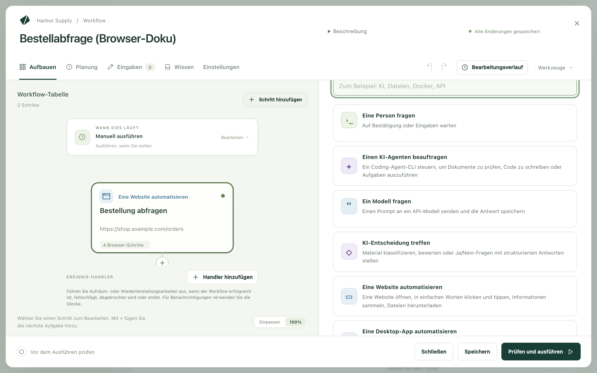
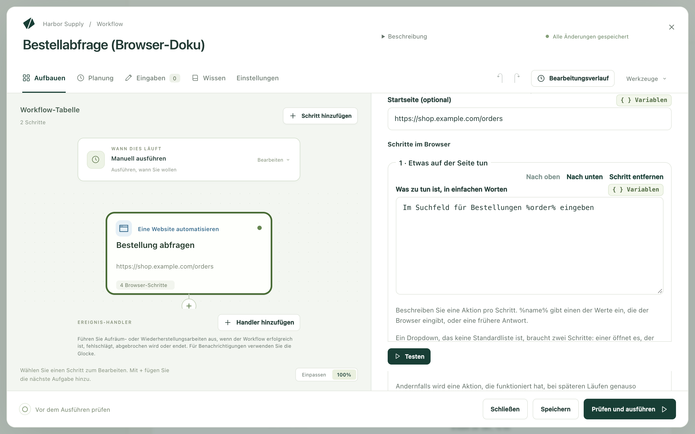

Kitewell kann eine Website für Sie bedienen: Seiten öffnen, sich anmelden,
klicken und tippen, Dateien hochladen, lesen, was eine Seite zeigt, und das
Gefundene an den nächsten Schritt weitergeben. Sie schreiben in gewöhnlichen
Worten auf, was zu tun ist, und ein Modell findet auf jeder Seite heraus, wie
es geht. Sie müssen nichts aufzeichnen und keine Selektoren schreiben.

Arbeit, die es Ihnen abnimmt:

- Die Rechnungen dieses Monats aus einem Lieferantenportal herunterladen.
- Belege, die per E-Mail gekommen sind, in Ihre Buchhaltungssoftware
  hochladen.
- Den Status jeder Bestellung aus einer Tabelle nachschlagen.
- Zahlen aus einem Web-Dashboard in einen Tagesbericht übertragen.
- Dasselbe Webformular für jede Zeile einer Liste ausfüllen.
- Nach einem Release prüfen, ob Anmeldung und Bestellvorgang einer Website
  noch funktionieren.

Der Browser läuft auf Ihrem eigenen Computer, und eine Anmeldung, die er
vornimmt, bleibt auf diesem Computer.

## Was Sie brauchen

Einen Browser auf diesem Computer. Installieren Sie auf dem Mac Google Chrome
in `/Applications`. Unter Windows verwendet Kitewell das bereits installierte
Chrome oder Microsoft Edge. Um Chromium, Brave, Edge auf dem Mac oder ein
Chrome an einem anderen Ort zu verwenden, geben Sie seinen vollständigen Pfad
unter **Geräteeinstellungen → Browser → Browser-Programmdatei** an. Der Schritt
zeigt an, ob ein Browser gefunden wurde und welchen er öffnen wird.

Ein Modell. Ein Website-Schritt fragt auf jeder Seite ein API-Modell, was zu
tun ist. [Fügen Sie eines hinzu](/de/docs/ai/) unter **Agenten und Modelle**
und wählen Sie es dann im Feld **Modell** des Schritts aus. Oder legen Sie eines
für den ganzen Workflow fest, unter
**Einstellungen → Ausführung und Wiederholungen → Standardmodell für Browser- und Desktop-Schritte**.
Verwenden Sie ein Modell von Anthropic, OpenAI oder Gemini. Kleine lokale
Modelle können einen Browser meist nicht steuern.

Wählen Sie dann **Browser prüfen**, im Schritt oder in den
**Geräteeinstellungen**. Das öffnet den Browser einmal aus dem
Hintergrunddienst von Kitewell heraus, genau wie eine Ausführung es tut. So
fällt ein Browser, der nicht starten kann, schon jetzt auf und nicht erst
mitten in einer geplanten Ausführung. Auf dem Mac kann macOS dabei auch seine
Rückfragen stellen, während Sie da sind, um sie zu beantworten.

## Ihren ersten Website-Schritt erstellen

Dieses Beispiel schlägt eine Bestellung auf der Website eines Shops nach und
gibt ihren Status an den nächsten Schritt weiter.

1. Öffnen Sie einen Workflow und wählen Sie **Schritt hinzufügen**. Die
   Aufgabenauswahl öffnet sich.

   

2. Wählen Sie **Eine Website automatisieren**. Tragen Sie unter
   **Schrittname** einen Namen wie `Bestellung abfragen` ein. Unter
   **Technische Einstellungen** ist **Schritt-Kennung** der kurze Name, über
   den spätere Schritte lesen, was dieser Schritt sammelt. Wählen Sie etwas
   Einfaches wie `order`.
3. Wählen Sie das **Modell** und setzen Sie **Startseite (optional)** auf die
   Seite, auf der es beginnen soll, etwa `https://shop.example.com/orders`.
4. Wählen Sie unter **Werte, die der Browser eingibt** die Option
   **Wert hinzufügen**, nennen Sie den Wert `order` und setzen Sie sein Feld
   **Wert** auf die Bestellnummer. Das kann eingetippter Text sein, eine
   Workflow-Eingabe oder ein Secret, also ein Passwort oder Schlüssel, der so
   gespeichert ist, dass er nie in einem Log erscheint.
5. Fügen Sie unter **Schritte im Browser** mit **Browser-Schritt hinzufügen**
   der Reihe nach hinzu:
   - **Etwas auf der Seite tun**, mit **Was zu tun ist, in einfachen Worten**
     gesetzt auf `Im Suchfeld für Bestellungen %order% eingeben`
   - **Etwas auf der Seite tun**, mit `Auf die Schaltfläche „Suchen“ klicken`
   - **Sicherstellen, dass…**, mit **Die Seite sollte…** gesetzt auf
     `Die Bestelldetails werden angezeigt`
   - **Informationen sammeln**, mit **Wonach gesucht wird** gesetzt auf
     `Der Status der Bestellung und das voraussichtliche Lieferdatum` und zwei
     Werten unter **Was gesammelt wird**: `status` und `delivery`, jeweils mit
     **Typ** auf **Text**

   

6. Öffnen Sie **Browser-Einstellungen**, schalten Sie
   **Browserfenster anzeigen** ein und wählen Sie dann **Testen**. So sehen Sie
   zu, wie der Schritt für sich allein arbeitet.
7. Fügen Sie einen späteren Schritt hinzu, der das Gesammelte verwendet,
   geschrieben als `${steps.order.outputs.status}`.

In einem neuen Workflow bietet **Oder mit einem Beispiel beginnen** stattdessen
zwei Website-Beispiele zum Kopieren an: **Daten von einer Website sammeln** und
**Einmal anmelden, dann sammeln**.

## Anweisungen schreiben, denen das Modell folgen kann

Eine Anweisung, eine Aktion. Ein Schritt **Etwas auf der Seite tun** führt nur
seine erste Aktion aus. `Code eingeben und auf „Weiter“ klicken` hört also nach
dem Eintippen auf. Schreiben Sie stattdessen zwei Schritte.

Ein Dropdown, das keine einfache Liste ist, braucht ebenfalls zwei Schritte:
Einer öffnet es, der nächste wählt die Option.

Benennen Sie, was auf der Seite steht, so wie Sie es einer Kollegin oder einem
Kollegen sagen würden:

- `Neben der neuesten Rechnung auf „Herunterladen“ klicken`
- `%customer% in das Feld „Kunde“ eingeben`
- `Das Menü „Berichte“ öffnen`

Ein Schritt, der sammelt, beschreibt keine Aktion, sondern das, was Sie haben
möchten: `Die Bestellnummer und der Gesamtbetrag auf der Bestätigungsseite`.
Sagen Sie, was der Wert ist, nicht, wo er auf dem Bildschirm steht.

## Was ein Website-Schritt kann

Die Schritte darin laufen der Reihe nach in einem einzigen Browser.

- **Eine Seite öffnen** ruft eine **Webadresse** auf.
- **Etwas auf der Seite tun** tut eine Sache, beschrieben unter
  **Was zu tun ist, in einfachen Worten**. `%name%` gibt einen der Werte ein,
  die der Browser eingibt, oder eine Antwort, die Sie zuvor gegeben haben.
- **Dateien hochladen** übergibt Dateien von diesem Computer an die Seite.
  Siehe [Dateien hochladen](#upload-files).
- **Informationen sammeln** liest **Wonach gesucht wird** und füllt die Werte
  unter **Was gesammelt wird** aus. Jeder Wert hat die Felder **Name**,
  **Typ** (**Text**, **Zahl**, **Ja oder Nein**, **Liste** oder
  **Liste von Einträgen**) und **Beschreibung (optional)**, die dem Modell
  sagt, was der Wert bedeutet. Eine **Liste von Einträgen** legt fest, was
  **Jeder Eintrag enthält**, etwa `url`, `title` und `price` eines Inserats.
  Spätere Schritte lesen jeden Wert als
  `${steps.<identifier>.outputs.<name>}`.
- **Sicherstellen, dass…** lässt den Schritt fehlschlagen, wenn die Seite
  nicht richtig aussieht. **Prüfmethode** legt fest, wie geprüft wird.
  **In einfachen Worten (das Modell entscheidet)** liest **Die Seite sollte…**
  und fragt das Modell. **Die Seite enthält den Text**, **Die Adresse enthält**
  und **Ein Element erscheint (CSS-Selektor)** lesen die Seite selbst, ohne
  Modell und mit derselben Antwort bei jeder Ausführung.
  **Weiter prüfen für (optional)** gibt der Seite Zeit, diesen Zustand zu
  erreichen.
- **Warten** wartet **Für eine feste Zeit**, angegeben unter **Wie lange**,
  oder **Bis ein Element erscheint (CSS-Selektor)**.
- **Bildschirmfoto aufnehmen** speichert ein PNG bei den Dateien der
  Ausführung, unter dem Namen, den Sie in **Name des Bildschirmfotos**
  vergeben.
- **Mich um eine Eingabe bitten** zeigt den Text aus
  **Frage, die Ihnen angezeigt wird** und hält die Ausführung an, bis Sie
  antworten, etwa für einen Einmalcode. **Antwort verwenden als** benennt die
  Antwort, damit spätere Schritte sie eingeben können.

Jeder Schritt hat außerdem **Bedingung und Zeitlimit**. Damit läuft er nur,
wenn eine Bedingung erfüllt ist, und darf höchstens eine bestimmte Zeit
dauern. Ein Schritt, bei dem beides nicht gesetzt ist, dauert höchstens zwei
Minuten.

## Passwörter vom Modell fernhalten

**Werte, die der Browser eingibt** enthält alles, was der Schritt eintippt:
eine Kundennummer, eine Workflow-Eingabe, ein Passwort. Die Anweisungen nennen
jeden Wert als `%name%`, und das Modell sieht immer nur diesen Namen.

Wählen Sie für alles Vertrauliche ein Secret als Wert. Es bleibt aus den
Anweisungen, aus dem Modell und aus den Logs heraus. Eine Anweisung, die den
Wert eines Secrets ausschreibt, schlägt fehl, statt ihn zu senden, und
**Prüfen und ausführen** weist Sie schon vor der Ausführung darauf hin.

## Dateien hochladen

**Dateien hochladen** legt Dateien von diesem Computer in das Dateifeld einer
Seite, so als würden Sie sie in einem Dateiauswahldialog wählen. So kommen etwa
Belege in das Dateifeld einer Buchhaltungssoftware oder ein unterschriebenes
Formular in ein Portal.

- **Hochzuladende Dateien · eine pro Zeile** nimmt vollständige Pfade wie
  `~/Documents/invoice.pdf`, Muster wie `~/Downloads/*.pdf` oder ein Ergebnis
  eines früheren Schritts, das Dateien auflistet. Ein E-Mail-Schritt, der
  Nachrichten findet und bei dem
  **Anhänge in den Dateien des Laufs speichern** eingeschaltet ist, listet
  deren Anhänge auf. Mit `${steps.<identifier>.outputs.messages}` laden Sie
  also hoch, was die E-Mails mitgebracht haben.
- **Upload-Ziel (optional)** benennt in einfachen Worten das Dateifeld oder
  die Schaltfläche bzw. Ablagefläche, die den Dateiauswahldialog öffnet:
  `Die Ablagefläche für Belege`. Das Modell sucht das Ziel einmal, und spätere
  Ausführungen verwenden das Gefundene wieder. Lassen Sie das Feld leer, wenn
  die Seite nur ein Dateifeld hat. Dann wird überhaupt kein Modell gefragt.
- **Bei jedem Lauf neu suchen** fragt stattdessen jedes Mal das Modell, für
  eine Seite, deren Upload-Bereich seinen Platz wechselt.

Der Dateiauswahldialog öffnet sich nie auf dem Bildschirm, und das Modell
sieht weder die Dateien noch ihre Namen noch ihren Speicherort. Eine Website,
die nur eine Datei auf einmal annimmt, lässt den Schritt fehlschlagen, wenn sie
mehrere erhält. Laden Sie die Dateien dann in getrennten Schritten hoch, oder
führen Sie den Schritt einmal pro Datei aus. Jede Datei darf bis zu 50 MB groß
sein. Websites senden das Erhaltene im Hintergrund. Lassen Sie auf den Upload
daher eine Prüfung **Sicherstellen, dass…** folgen, die erkennt, was die
Website anzeigt, wenn sie fertig ist, etwa **Die Seite enthält den Text**
`Hochgeladen`, mit **Weiter prüfen für (optional)** auf eine Minute.

Wenn der Assistent einen Upload aufbaut, probiert er ihn zuerst in seinem
eigenen Browser aus. Bevor eine Datei an eine Website geht, fragt er Sie und
nennt dabei die Website und jede Datei. Dasselbe gilt für einen Probelauf eines
Workflows, der etwas hochlädt.

## Einmal anmelden und angemeldet bleiben

Schalten Sie in den **Browser-Einstellungen** die Option
**Zwischen Läufen angemeldet bleiben** ein. Cookies und Anmeldestatus bleiben
auf diesem Computer. Die nächste Ausführung öffnet die Website also bereits
angemeldet. Das Beispiel **Einmal anmelden, dann sammeln** beginnt so: Sein
erster Schritt zeigt das Fenster und wartet, während Sie sich selbst anmelden.
Jeder Schritt und jede Ausführung danach verwendet diese Anmeldung wieder.

**Projekteinstellungen → Speicher → Anmeldungen** listet auf, was gespeichert
ist und welche Workflows welche Anmeldung verwenden. Mit
**Anmeldung vergessen…** entfernen Sie eine. Backups enthalten keine
Anmeldung. Ein wiederhergestellter Computer meldet sich also erneut an, so wie
er auch erneut nach Ihren Secrets fragt.

Eine Schleife, die ihre Elemente gleichzeitig ausführt, kann keine gemeinsame
Anmeldung nutzen. Stellen Sie die Schleife auf ein Element nach dem anderen um,
oder schalten Sie **Zwischen Läufen angemeldet bleiben** aus.

## Websites, die ein Zertifikat verlangen

Manche Websites, etwa Firmen- oder Behördenportale, verlangen vom Browser ein
Client-Zertifikat, bevor sie sich öffnen. Fügen Sie das Zertifikat einmal zu
Kitewell hinzu. Dann legen jeder Website-Schritt und der Browser des
Assistenten auf diesem Computer es den Websites vor, die Sie nennen, ohne dass
das System nach dem Passwort des Zertifikats fragt.

1. Öffnen Sie **Geräteeinstellungen → Browser → Client-Zertifikate**.
2. Wählen Sie **Aus einer Datei hinzufügen…** für eine `.pfx`- oder
   `.p12`-Datei und geben Sie ihr **Passwort** ein. In der Kitewell-App wählen
   Sie mit **Von diesem Computer hinzufügen…** stattdessen eines aus dem
   macOS-Schlüsselbund oder dem Windows-Zertifikatspeicher. Das System fragt
   dann womöglich einmal, ob Kitewell es kopieren darf.
3. Wählen Sie unter **Verwenden für** die Option **Nur diese Websites** und
   listen Sie die Websites unter **Websites, eine pro Zeile** auf, etwa
   `portal.example.com`, oder `*.example.com` für jede Website darunter. Mit
   **Jede Website, die ein Zertifikat verlangt** geht es an jede Website, die
   danach fragt.
4. Wählen Sie **Zertifikat hinzufügen** und dann **Website prüfen**, um eine
   Website damit zu öffnen.

Ein Schritt braucht keine eigene Einstellung. Schlägt eine Ausführung fehl,
weil eine Website ein Zertifikat verlangt hat, bietet die fehlgeschlagene
Ausführung einer Person mit Administratorrechten an, eines für diese Website
hinzuzufügen oder ein bereits hinzugefügtes zu verwenden, und danach
**Lauf wiederholen**.

Nur Website-Schritte und der Browser des Assistenten legen das Zertifikat vor.
Ein [Desktop-Schritt](/de/docs/desktop/) bedient den Browser auf Ihrem
Bildschirm. Dieser Browser fordert Sie selbst auf, ein Zertifikat zu wählen,
und wartet auf eine Antwort. Automatisieren Sie eine solche Website daher mit
einem Website-Schritt.

Kitewell bewahrt das Zertifikat auf diesem Computer unter einem eigenen
Passwort auf, nie unter Ihrem, und nimmt es nicht in Backups auf. Wenn Sie ein
Zertifikat hinzufügen oder ändern, starten die Projekt-Engines neu. Laufende
Ausführungen laufen weiter. Der Chat von Kitewell warnt einen Monat und eine
Woche, bevor ein Zertifikat abläuft, und wenn es abgelaufen ist.

## Wie eine Ausführung aussieht

Öffnen Sie die Ausführung unter **Ausführungen & Logs**.
**Was der Browser getan hat** listet die Schritte der Reihe nach mit den
Bildschirmfotos auf, die sie aufgenommen haben. Daneben stehen das **Modell**,
das gefragt wurde, und die **Modellnutzung**, also die Tokens, die hinein- und
hinausgingen.

**Ohne KI ausgeführt** sagt, wie viele Operationen des Schritts ohne das
Modell liefen: eine wiederholte Aktion, eine Prüfung, die die Seite selbst
liest, oder eine Operation wie das Öffnen einer Seite. Eine Aktion, die einmal
funktioniert hat, wird gemerkt und beim nächsten Mal genauso wiederholt. Eine
wiederholte Aktion sendet nichts an das Modell.

Ändert sich die Website und funktioniert eine gemerkte Aktion nicht mehr, wird
das Modell erneut gefragt. **Bei jedem Lauf neu entscheiden** schaltet das für
einen einzelnen Schritt ab.
**Projekteinstellungen → Speicher → Wiedergabe-Cache** löscht, was sich ein
Workflow gemerkt hat, nachdem eine Website neu gestaltet wurde.
**Informationen sammeln** und Prüfungen in einfachen Worten fragen bei jeder
Ausführung das Modell.

Wenn ein Schritt **Mich um eine Eingabe bitten** erreicht, wartet die
Ausführung. Öffnen Sie sie unter **Ausführungen & Logs → Wartet** oder über die
Benachrichtigung, tippen Sie in **Ihre Antwort** und wählen Sie **Antwort**.
Mit **Ablehnen** lassen Sie den Schritt stattdessen fehlschlagen. Die Antwort
wird mit der Ausführung gespeichert. Verwenden Sie sie also für Codes, die
ablaufen, nicht für Passwörter. Wurde der Browser geschlossen, bevor Sie dazu
kamen, führt **Browser-Schritt neu starten** den Schritt ab seinem ersten
Schritt erneut aus.

## Für viele Elemente ausführen

- Eine Liste in einer Tabelle: Geben Sie dem Workflow eine Eingabe wie die
  Bestellnummer und führen Sie ihn dann aus einer
  [Stapeltabelle](/de/docs/batches/) aus, eine Zeile pro Element. Die Tabelle
  zeigt Fortschritt, Fehlschläge und die verbleibende Zeit.
- Eine Liste, die die Website zeigt: Sammeln Sie eine **Liste von Einträgen**,
  etwa alle Ergebnisse einer Suche, und
  [lassen Sie damit die Zeilen einer Tabelle füllen](/de/docs/batches/#let-a-run-find-the-rows).
  Beim Aktualisieren kommen neue Einträge hinzu, und verschwundene werden
  markiert.
- Eine Liste innerhalb einer Ausführung: Setzen Sie den Schritt in eine
  Schleife **Für jedes Element**.
- Geplant: Fügen Sie eine [Planung](/de/docs/scheduling/) hinzu, lassen Sie
  **Browserfenster anzeigen** ausgeschaltet, damit sich Chrome nicht öffnet,
  während Sie arbeiten, und lassen Sie sich von
  [Benachrichtigungen](/de/docs/alerts/) informieren, wenn eine Ausführung
  fehlschlägt oder auf eine Antwort wartet.

## Wenn etwas nicht klappt

Sehen Sie sich zuerst die Bildschirmfotos des Schritts an: Eine Anmeldeseite,
ein Cookie-Banner oder eine Bot-Prüfung erklären die meisten Fehlschläge.
Dann:

- Der Schritt meldet, dass nichts auf der Seite zur Anweisung passt.
  Formulieren Sie die Anweisung so um, dass sie benennt, was auf der Seite
  steht, oder teilen Sie sie in zwei.
- Ein Upload meldet, dass sich kein Dateiauswahldialog geöffnet hat. Nennen
  Sie unter **Upload-Ziel (optional)** das Dateifeld selbst oder die
  Schaltfläche, die den Dialog öffnet. Liegt der Upload hinter einem Menü oder
  einem Dialog, öffnen Sie diesen in einem Schritt davor.
- Der Browser startet nicht. Führen Sie **Browser prüfen** aus. Wurde kein
  Browser gefunden, setzen Sie
  **Geräteeinstellungen → Browser → Browser-Programmdatei**.
- Eine Website, die der Schritt braucht, lädt nicht. Wenn Sie
  **Erlaubte Websites · eine pro Zeile (optional)** ausgefüllt haben, muss
  jeder Host dort stehen, den die Website nutzt, einschließlich ihrer Anmelde-
  und Bildserver.

Alles Weitere steht unter
[Fehlerbehebung](/de/docs/troubleshooting/#a-website-step-fails).

## Details

**Browser-Einstellungen** im Schritt enthält außerdem
**Bildschirmfotos speichern** mit **Wenn ein Schritt fehlschlägt**,
**Wenn ein Schritt fehlschlägt, und am Ende**, **Nach jedem Schritt** oder
**Nie**, sowie **Fensterbreite** und **Fensterhöhe** in Pixeln.
**Erlaubte Websites · eine pro Zeile (optional)** nimmt Hostnamen wie
`example.com` oder `*.example.com` an. Lokale Adressen, Ports und Pfade werden
abgelehnt.

Beim Modell kommen der sichtbare Text und das Layout der Seite an, einmal für
jede Aktion, die es entscheidet, abgerechnet vom Anbieter Ihrer Wahl.
Wiederholte Aktionen und Prüfungen, die die Seite direkt lesen, senden nichts.
Ebenso wenig gesendet werden die Werte, die der Browser eingibt, die Dateien,
die er hochlädt, und Ihre Secrets. Hochgeladene Dateien gehen an die Website,
so als hätten Sie sie selbst ausgewählt. Siehe
[Was Ihren Computer verlässt](/de/docs/data-flow/).

Manche Websites lehnen automatisierte Browser ab. Eine gespeicherte Anmeldung
und eine Startseite hinter dem Cookie-Banner helfen in den üblichen Fällen.
CAPTCHAs werden nicht gelöst. Für eine geplante Ausführung muss der Computer
wach sein.

Der Workflow aus
[Ihren ersten Website-Schritt erstellen](#build-your-first-website-step)
besteht aus zwei Schritten: **Eine Website automatisieren** mit einer
Startseite, einem Wert namens `order`, zwei Schritten
**Etwas auf der Seite tun**, einer Prüfung **Sicherstellen, dass…** und einem
Schritt **Informationen sammeln**, der den Status und das Lieferdatum liest;
danach ein späterer Schritt, der diese beiden Werte verwendet.
