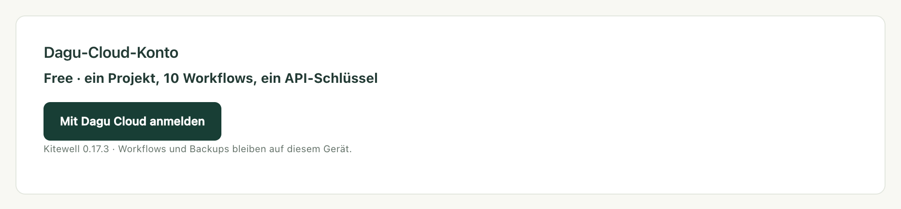

Sie bearbeiten einen Workflow auf Ihrem Laptop, und der Computer im Büro führt
die neue Version aus, ohne dass Sie jemandem eine Datei schicken.
[Dagu Cloud](https://console.dagu.sh) bewahrt die Definitionen des Projekts
auf. Die Arbeit selbst erledigt weiterhin jeder Computer, mit seinen eigenen
Passwörtern, und die Werte von Secrets verlassen nie das Gerät, auf dem sie
eingegeben wurden.

Ob synchronisiert wird, entscheiden Sie für jedes Projekt einzeln. Ein Projekt
bleibt auf seinem Computer, bis Sie es synchronisieren, und vorher erreicht
nichts Dagu Cloud.

## Was Sie brauchen

- Ein Dagu-Cloud-Konto. Es ist kostenlos, und mit einem kostenlosen Konto
  synchronisieren Sie ein Projekt.
- Um mit anderen Personen zu teilen: Kitewell Team. Das ist ein Jahresvertrag
  für bis zu 25 Personen; der Preis richtet sich nach der Zahl der Computer,
  die der Arbeitsbereich verbindet. Ein Angebot erhalten Sie über
  company@descarty.com, und für ein größeres Team gibt es
  [Enterprise](/de/pricing/#enterprise). Der Inhaber des Teams bezahlt den
  Arbeitsbereich, Mitglieder brauchen kein eigenes Abonnement. Kitewell
  Personal für 20 $ pro Monat ist für die eigene Arbeit einer Person auf einem
  Computer gedacht und kann niemanden einladen. Siehe [Preise](/de/pricing/).

## Anmelden

1. Öffnen Sie **Dieses Gerät → Geräteeinstellungen** und suchen Sie
   **Dagu-Cloud-Konto**. Dort steht, welchen Tarif dieser Computer hat.
2. Wählen Sie **Mit Dagu Cloud anmelden**.
3. Kitewell zeigt einen kurzen Code und die Schaltfläche
   **Im Browser fortfahren**. Wählen Sie sie, melden Sie sich im Browser an,
   prüfen Sie, ob der Code dort mit dem in Kitewell übereinstimmt, und
   verbinden Sie den Computer.

Ein Computer synchronisiert mit genau einem Arbeitsbereich, dessen Name nach
dem Verbinden unter **Dagu-Cloud-Konto** steht. Ein Arbeitsbereich fasst so
viele Computer, wie sein Tarif vorsieht: einen bei einem kostenlosen Konto und
bei Kitewell Personal, bei Kitewell Team die gekaufte Anzahl. Verbinden Sie
einen weiteren, wird Ihr eigener ältester Computer im Arbeitsbereich getrennt.
Gehören alle anderen Computer anderen Personen, wird die Verbindung abgelehnt,
bis einer davon getrennt ist oder der Tarif mehr Computer umfasst.

Durch die Anmeldung allein wird nichts gesendet. Ein angemeldeter Computer
prüft seinen Tarif und meldet seine Kitewell-Version sowie seinen eigenen
Namen und seine ID. Workflows und Ausführungsstatus werden nur für ein Projekt
übertragen, das Sie synchronisieren, Logs und Werte von Secrets nie. Nach der
Anmeldung kann der Computer außerdem das
[enthaltene Modell von Kitewell](/de/docs/ai/#use-kitewells-included-model)
nutzen, dessen Anfragen über Dagu Cloud laufen.

## Ein Projekt synchronisieren

1. Öffnen Sie die Projektauswahl und wählen Sie **Verwalten**.
2. Wählen Sie in **Projekte verwalten** neben dem Projekt
   **Mit Dagu Cloud synchronisieren** und bestätigen Sie.

Das Projekt wird hochgeladen und als **Synchronisiert** markiert. Ab dann geht
jedes Speichern zuerst an Dagu Cloud.

:::caution
Workflow-YAML, Stapeleingaben und API-Adressen werden genau so geteilt, wie sie
geschrieben sind. Entfernen Sie vor dem Synchronisieren jedes Passwort, das Sie
dort eingetragen haben, und bewahren Sie es stattdessen in einem
[Secret](/de/docs/secrets/) auf.
:::

Bricht ein Upload ab, zeigt das Projekt **Upload unvollständig** und bietet
**Upload fortsetzen** an. Speichervorgänge warten, bis der Upload
abgeschlossen ist.

Ein kostenloses Konto synchronisiert ein Projekt. Kitewell Personal
synchronisiert bis zu fünf Projekte und Kitewell Team bis zu 15, jedes mit bis
zu 100 Workflows. Ein Arbeitsbereich fasst so viele Computer, wie sein Tarif
vorsieht: einen bei einem kostenlosen Konto und bei Kitewell Personal, bei
Kitewell Team die gekaufte Anzahl. Verbinden Sie einen weiteren, wird Ihr
eigener ältester Computer im Arbeitsbereich getrennt; gehören alle anderen
Computer anderen Personen, wird die Verbindung abgelehnt, bis einer davon
getrennt ist oder der Tarif mehr Computer umfasst. Ein Projekt, für das der
Tarif keinen Platz hat, lässt sich nicht synchronisieren, und Kitewell nennt
den Grund. Synchronisierte Projekte zählen zum Tarif des Arbeitsbereichs, nicht
zum eigenen Projektlimit des Computers.

Für einen Wechsel von Personal zu Team oder um die Computer bei Team zu
ändern, schreiben Sie an company@descarty.com. Um zu Personal zurückzukehren,
entfernen Sie zuerst die anderen Personen, widerrufen Sie ihre Einladungen und
lassen Sie nur einen Computer verbunden.

## Auf einem anderen Computer am Projekt arbeiten

1. Melden Sie diesen Computer beim selben Arbeitsbereich an.
2. Öffnen Sie **Projekte verwalten** und wählen Sie
   **Aus Dagu Cloud herunterladen**.
3. Wählen Sie in **Projekte in Dagu Cloud** neben dem Projekt
   **Herunterladen**.

Die Liste kennzeichnet, was schon **Auf diesem Gerät** ist, und markiert jedes
Projekt mit **Nur ansehen**, das Sie mit Ihrer Rolle nur lesen dürfen. Ein
Projekt mit demselben Namen wie ein Projekt auf dem Computer wird abgelehnt,
bis Sie eines davon umbenennen.

Heruntergeladene Workflows kommen pausiert an. Führen Sie einen von Hand aus und
aktivieren Sie dann die, die dieser Computer ausführen soll.

Eine Ausnahme ist ein Workflow, der ein Postfach bearbeitet: Er läuft immer nur
auf einem Computer, weil zwei Computer dieselbe E-Mail doppelt lesen würden.
Aktivieren Sie einen solchen Workflow, während ihn schon ein anderer Computer
ausführt, weist Kitewell darauf hin und bietet **Hier ausführen** an, um ihn
hierher zu holen.

## Auf dem neuesten Stand bleiben

Kitewell übernimmt Änderungen von anderswo beim Start, beim Öffnen des Projekts
und wenn Sie einen Workflow zum Bearbeiten öffnen; Dagu Cloud wird dabei
höchstens einmal pro Minute gefragt. Bei Personal und Team prüft ein Computer
zusätzlich von selbst etwa alle fünf Minuten, sodass auch ein Computer, an dem
niemand sitzt, eine neue Version erhält. Ein kostenloses Konto prüft nur zu
diesen drei Zeitpunkten und wenn Sie es anstoßen.

Um zu einem anderen Zeitpunkt zu prüfen, wählen Sie in **Projekte verwalten**
**Aus Dagu Cloud aktualisieren**. Ein im Editor geöffneter Workflow übernimmt
das Update direkt, solange Sie nichts eingegeben haben.

Das Übernehmen einer Änderung startet die Engine des Projekts neu. Bereits
laufende Ausführungen arbeiten mit der Definition weiter, mit der sie gestartet
sind. Ein Workflow, der für diesen Computer neu ist, kommt pausiert an; ein
schon vorhandener behält, ob er eingeschaltet ist, wo er läuft und seine
Benachrichtigungen.

Hat jemand dasselbe Element gespeichert, seit Sie es geöffnet haben, wird Ihr
Speichern angehalten, und Kitewell zeigt **In Dagu Cloud geändert**. Wählen Sie
**Überschreiben**, um die Änderung der anderen Person durch Ihre zu ersetzen,
oder **Abbrechen**, um Ihre Bearbeitung zu behalten, ohne sie zu speichern.

Die Dateien eines synchronisierten Projekts verwaltet Kitewell. Was außerhalb
von Kitewell daran geändert wird, wird ersetzt, sobald eine Änderung aus Dagu
Cloud eintrifft oder das Element das nächste Mal in Kitewell gespeichert wird.

## Was synchronisiert wird und was bleibt

Ein synchronisiertes Projekt enthält dasselbe wie ein
[Projektexport](/de/docs/sharing/): Workflow-Definitionen und Planungen,
Agenten und Modelle, API-Verbindungen und ihre importierten Dokumente, Server
und Servergruppen, Warteschlangen, Image-Registries, Stapeltabellen, die Namen
und Beschreibungen der Secrets, die Workflow-Standardwerte des Projekts und sein
[Wissen](/de/docs/knowledge/). Außerdem enthält es die
[Releases](/de/docs/releases/) des Projekts, die in Exporten fehlen.

:::note[Werte von Secrets bleiben auf Ihrem Computer]
Ein synchronisiertes Projekt führt die Secrets, die es verwendet, nur mit Namen
auf. Jeder Computer hat seinen eigenen Wert, der auf diesem Computer festgelegt
wird; bis dahin zeigt **Secrets** **Wert erforderlich**.
:::

Jeder Computer behält außerdem für sich: seine Anmeldungen bei Registries,
SSH-Schlüssel und bestätigte Hostschlüssel, Arbeitsverzeichnisse, welche
Workflows aktiviert sind, seine Benachrichtigungen, seinen Ausführungsverlauf
und seine Logs. Nichts davon erreicht Dagu Cloud, abgesehen vom Status jeder
Ausführung (siehe unten).

## Ausführungen in Dagu Cloud verfolgen

Ein synchronisiertes Projekt meldet, wie seine Ausführungen verlaufen. Alle
zwei Minuten, oder früher, wenn sich die laufenden Ausführungen ändern, sendet
jeder Computer an Dagu Cloud: Workflow, Status und Auslöser jeder Ausführung,
wann sie in die Warteschlange kam, startete und endete, sowie die Namen der
fehlgeschlagenen Schritte. Dazu kommen seine Kitewell-Version, sein
Betriebssystem und wann er gestartet wurde.

Parameter, Logs, Ausgaben und Tabellenwerte bleiben auf dem Computer, und ein
nicht synchronisiertes Projekt wird nie gemeldet. Personen im Arbeitsbereich
sehen in Dagu Cloud die Ausführungen der Projekte, die sie öffnen können.

Welcher Fall gilt, steht unter **Dagu-Cloud-Konto** in den
**Geräteeinstellungen**:
**Der Ausführungsstatus wird mit Dagu Console geteilt** oder
**Die Freigabe des Ausführungsstatus ist für diesen Arbeitsbereich deaktiviert**.

Der Inhaber des Arbeitsbereichs schaltet die Freigabe in Dagu Cloud unter
**Settings** aus, indem er das Häkchen bei **Share Kitewell run status**
entfernt und **Save changes** wählt. Die Computer melden dann nur noch, dass
sie laufen, und Ausführungen, die in dieser Zeit enden, werden nie gesendet.

[Dagu Console](/de/docs/console/) beschreibt, was die Konsole anzeigt und
welche Benachrichtigungen sie sendet.

## Im Team arbeiten

Der Inhaber des Arbeitsbereichs verwaltet das Team auf der Seite **Kitewell**
in Dagu Cloud:

- **Invite** lädt eine Person über ihre E-Mail-Adresse ein. Die Einladung zählt
  zu den 25 Personen, bis sie angenommen oder widerrufen wird oder nach sieben
  Tagen abläuft. Die Person meldet sich mit dieser Adresse bei Dagu Cloud an, um
  sie anzunehmen.
- **Synced projects** listet jedes Projekt, das das Team synchronisiert, und
  gibt jedem Mitglied für jedes Projekt eine Rolle:
  - **Viewer** liest das Projekt und lädt es herunter.
  - **Editor** kann zusätzlich Änderungen daran speichern.
  - **Admin** kann es außerdem aus Dagu Cloud löschen.
  - **No access** blendet es aus.

Der Inhaber kann jedes Projekt öffnen. Ein Mitglied, das ein Projekt
synchronisiert, wird dessen Admin. Ein Mitglied verbindet einen Computer auf
dieselbe Weise wie Sie und wählt den Arbeitsbereich des Teams, wenn Dagu Cloud
danach fragt.

:::caution
Eine gespeicherte Änderung eines Editors läuft auf jedem Computer, der das
Projekt synchronisiert, sobald dieser Computer das Update übernimmt. Vergeben
Sie die Rolle Editor nur an Personen, denen Sie zutrauen würden, Befehle auf
den Computern Ihres Teams auszuführen.
:::

Ein Projekt, in dem Ihre Rolle **Viewer** ist, zeigt im Seitenkopf und in der
Download-Liste **Nur ansehen**. Sie können seine Workflows trotzdem ausführen,
die Werte seiner Secrets auf Ihrem Computer festlegen und die Workflows
aktivieren, die dieser Computer ausführen soll. Kitewell blendet die
Bearbeitungen aus, die Dagu Cloud ablehnen würde: Workflows ändern, Releases
erstellen oder anwenden und Secrets deklarieren.

## Wenn ein Tarif endet

Endet ein kostenpflichtiger Tarif, stoppen Benachrichtigungen, MCP Events und
Webhooks. Alles andere läuft 7 Tage weiter, und ein Banner auf jeder Seite
nennt den Tag, an dem die Projekte, Workflows und API-Schlüssel oder
verbundenen Apps stoppen, die über den kostenlosen Tarif hinausgehen.

- **Auswählen, was bleibt.** Legen Sie im Banner oder in den
  **Geräteeinstellungen** fest, welche Projekte, Workflows und Schlüssel oder
  Apps aktiv bleiben, bis zu den Grenzen des Tarifs. Wählen Sie nichts, bleiben
  die, die zuletzt gelaufen sind oder benutzt wurden.
- **Nicht im Tarif.** Alles über den Grenzen wird als **Nicht im Tarif**
  markiert. Es läuft nicht, weder nach Planung noch von Hand, und lässt sich
  nicht bearbeiten. Sie können es aber weiterhin öffnen, seinen
  Ausführungsverlauf lesen, es exportieren oder löschen. Bereits laufende
  Ausführungen laufen zu Ende.
- **Nichts wird gelöscht.** Schließen Sie erneut ein Abonnement ab, und alles
  läuft wie zuvor, mit seinen Planungen.

Dasselbe gilt, wenn Sie zu einem Tarif mit niedrigeren Grenzen wechseln. Ein
Gerät, das Dagu Cloud nicht erreicht, behält seinen letzten kostenpflichtigen
Tarif, bis diese Lizenz abläuft, und hat danach dieselben 7 Tage.

## Synchronisierung beenden

- **Synchronisierung beenden** in **Projekte verwalten** behält das Projekt
  sowohl auf diesem Computer als auch in Dagu Cloud. Was Sie danach hier
  speichern, bleibt lokal.
- **Aus Dagu Cloud löschen** wird in der Download-Liste angeboten, wo Ihre
  Rolle **Admin** ist. Es entfernt ein Projekt, das dieser Computer nicht
  synchronisiert, und gibt seinen Platz im Tarif frei. Kopien auf anderen
  Computern können dann nicht mehr in Dagu Cloud speichern.
- Ein Projekt, das mit einem anderen Arbeitsbereich synchronisiert ist, zeigt
  **Anderer Arbeitsbereich** und bietet nur **Synchronisierung beenden** an.

Wird ein Projekt aus Dagu Cloud gelöscht oder verlieren Sie den Zugriff darauf,
bleibt es als lokales Projekt auf Ihrem Computer.

Solange ein Computer offline ist, wird das Speichern in seinen synchronisierten
Projekten abgelehnt. Änderungen, die auf dem Computer bleiben, funktionieren
weiterhin – einen Workflow aktivieren, den Wert eines Secrets festlegen –, und
aktivierte Workflows laufen aus der vorhandenen Kopie weiter. Akzeptiert Dagu
Cloud die Verbindung des Computers nicht mehr, wählen Sie
**Konto erneut verbinden** in den **Geräteeinstellungen**.
