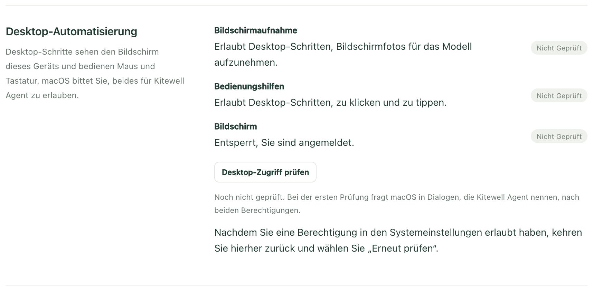
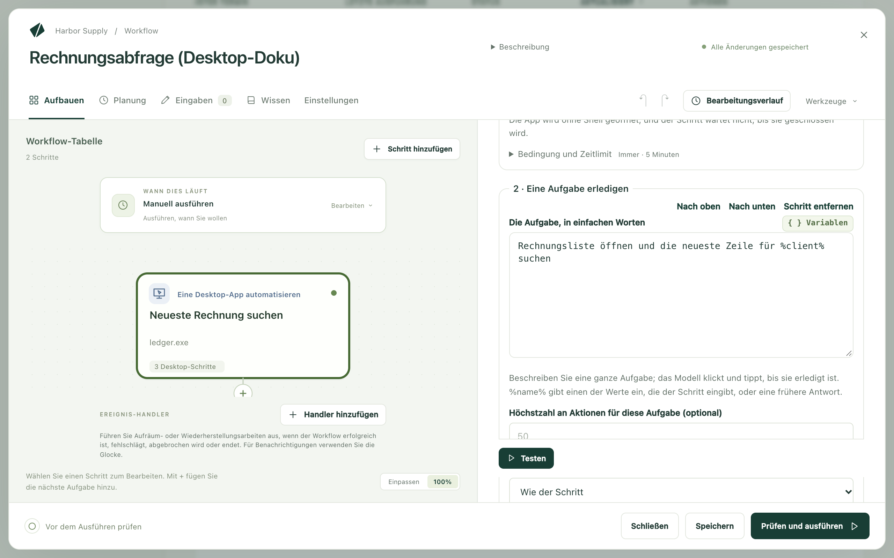

Kitewell kann die Apps auf Ihrem Computer so bedienen, wie ein Mensch es tut:
Es schaut auf den Bildschirm, dann klickt und tippt es. Sie beschreiben die
Aufgabe in gewöhnlichen Worten, etwa „Eine Rechnung für %client% anlegen und
speichern“, und ein Modell arbeitet, bis sie erledigt ist.

Das ist die Arbeit, die Desktop-RPA-Werkzeuge erledigen, nämlich eine App ohne
API zu steuern. Hier wird aber nichts von Hand aufgezeichnet, und es gibt keine
Selektoren, die gepflegt werden müssen. Ein Modell erarbeitet die Aufgabe beim
ersten Mal. Spätere Ausführungen wiederholen ohne Modell, was es getan hat,
solange die App noch übereinstimmt: unter Windows anhand der eigenen Elemente
der App, unter macOS durch Abgleich des Bildschirms. Stimmt die App nicht mehr
überein, wird das Modell erneut gefragt, was sich geändert hat.

Damit erreichen Sie auch die Buchhaltungssoftware oder den ERP-Client, die
weder eine API noch eine Webversion haben:

- Jede Zeile einer Tabelle in eine Buchhaltungs- oder Vertriebs-App
  übertragen.
- Eine Zahl aus einem Desktop-Dashboard lesen und an den nächsten Schritt
  weitergeben.
- Einen Bericht aus einer App exportieren, die nur über ihre Menüs
  exportiert.
- Nach einem Update prüfen, ob eine App anzeigt, was sie anzeigen soll.

Es funktioniert unter macOS und Windows, auf dem Bildschirm vor Ihnen. Während
es läuft, übernimmt es Maus und Tastatur und gibt sie zurück, sobald Sie sie
berühren.

## Was Sie brauchen

Ein Modell, das den Bildschirm liest. Jedes Projekt hat eines, unter
**Projekteinstellungen → Bildschirmschritte**. Solange Sie kein anderes
wählen, ist es
[das enthaltene Modell von Kitewell](/de/docs/ai/#use-kitewells-included-model):
Es braucht keinen API-Schlüssel und wird in jedem Tarif aus den
Dagu-Cloud-Credits des Arbeitsbereichs bezahlt; die Credits des kostenlosen
Tarifs reichen für einen kurzen Test.

Für ein eigenes Modell, etwa Claude Sonnet 5, GPT-5.4 oder Gemini 3.6 Flash,
[fügen Sie es](/de/docs/ai/) unter **Agenten und Modelle** hinzu und wählen es
dann unter **Bildschirmschritte** oder mit
**Für Bildschirmschritte verwenden** auf seiner Seite. Kitewell lässt es
zuerst einen Test-Screenshot lesen.

Ein Desktop-Schritt verwendet das Modell des Projekts, sofern weder sein
**Modell** noch
**Einstellungen → Ausführung und Wiederholungen → Standardmodell für Browser- und Desktop-Schritte**
des Workflows ein anderes nennt. Modelle von Anthropic, OpenAI und Gemini
nutzen das Computer-Use-Werkzeug ihres Anbieters; andere Vision-Modelle, die
Werkzeuge aufrufen können, nutzen einfache Werkzeuge zum Klicken und Tippen,
allerdings langsamer und weniger zuverlässig.

**Wie das Modell den Desktop bedient** unter **Desktop-Einstellungen** steht
normalerweise auf **Automatisch**; mit
**Einfache Werkzeuge, für jedes Vision-Modell** arbeitet jedes Modell über die
einfachen Werkzeuge.

Die Berechtigung, den Bildschirm zu nutzen. Öffnen Sie
**Geräteeinstellungen → Desktop-Automatisierung**. Jede Zeile zeigt
**Nicht geprüft**, bis Sie **Desktop-Zugriff prüfen** wählen, und danach
**Bereit** oder **Erfordert Aufmerksamkeit**.

- Auf dem Mac heißen die Zeilen **Bildschirmaufnahme** und
  **Bedienungshilfen**. Bei der ersten Prüfung fragt macOS nach beidem, in
  Dialogen, die **Kitewell Agent** nennen. Das ist der Hintergrunddienst von
  Kitewell, der den Bildschirm tatsächlich steuert. Erlauben Sie beides.
  Haben Sie einen Dialog geschlossen, bringt Sie **Systemeinstellungen öffnen**
  zum richtigen Bereich.
- Unter Windows heißt die Zeile **Angemeldete Sitzung**: Desktop-Schritte
  laufen, während Sie angemeldet sind, auf Ihrem Bildschirm. Ist
  **Ausführen, wenn niemand angemeldet ist** eingeschaltet, läuft die Engine
  auch im Hintergrund, ein Desktop-Schritt wartet aber trotzdem auf Sie. Sein
  Workflow zeigt **Läuft nur, während Sie angemeldet sind**. Außerdem kann ein
  Desktop-Schritt nicht in eine App klicken oder tippen, die als Administrator
  läuft, es sei denn, Kitewell läuft ebenfalls als Administrator.

Ein entsperrter Bildschirm, an dem Sie angemeldet sind. Desktop-Schritte nutzen
den Bildschirm, den Sie sehen. Ein gesperrter oder schlafender Computer kann
sie also nicht ausführen, auch nicht nach Planung.

## Ihren ersten Desktop-Schritt erstellen

Dieses Beispiel öffnet die Buchhaltungs-App, sucht die neueste Rechnung eines
Kunden und gibt deren Nummer an den nächsten Schritt weiter.

1. Öffnen Sie einen Workflow, wählen Sie **Schritt hinzufügen** und dann
   **Eine Desktop-App automatisieren**. Tragen Sie unter **Schrittname** einen
   Namen wie `Neueste Rechnung suchen` ein. Unter **Technische Einstellungen**
   ist **Schritt-Kennung** der kurze Name, über den spätere Schritte lesen,
   was dieser Schritt ausliest. Wählen Sie etwas Einfaches wie `invoice`.
2. Lassen Sie das **Modell** auf **Projektstandard** oder wählen Sie für diesen Schritt ein anderes Modell.
3. Wählen Sie unter **Werte, die der Schritt eingibt** die Option
   **Wert hinzufügen**, nennen Sie den Wert `client` und setzen Sie sein Feld
   **Wert** auf den Namen des Kunden. Das kann eingetippter Text sein, eine
   Workflow-Eingabe oder ein Secret, also ein Passwort oder Schlüssel, der so
   gespeichert ist, dass er nie in einem Log erscheint.
4. Fügen Sie unter **Schritte auf dem Desktop** mit
   **Desktop-Schritt hinzufügen** der Reihe nach hinzu:
   - **Eine App öffnen**. Füllen Sie auf dem Mac **App** aus oder wählen Sie
     die App über **App auswählen…**. Füllen Sie unter Windows **Programm**
     mit dem Pfad des Programms aus oder wählen Sie es über
     **Programm auswählen…**.
   - **Eine Aufgabe erledigen**, mit **Die Aufgabe, in einfachen Worten**
     gesetzt auf `Rechnungsliste öffnen und die neueste Zeile für %client% suchen`
   - **Vom Bildschirm lesen**, mit
     **Was gelesen wird (Anweisung an das Modell)** gesetzt auf
     `Die Rechnungsnummer und der Gesamtbetrag in dieser Zeile` und zwei Werten
     unter **Zu lesende Werte**: `number` mit **Typ** auf **Text** und `total`
     mit **Typ** auf **Zahl**

   

5. Wählen Sie **Testen**, nehmen Sie die Hände von Maus und Tastatur und sehen
   Sie zu.
6. Fügen Sie einen späteren Schritt hinzu, der das Gelesene verwendet,
   geschrieben als `${steps.invoice.outputs.number}`.

In einem neuen Workflow bietet **Oder mit einem Beispiel beginnen** das
Beispiel **Daten aus einer Desktop-App übernehmen** an. Es öffnet eine App, die
auf diesem Computer schon vorhanden ist, und liest, was sie anzeigt.

## Eine Aufgabe schreiben, die das Modell zu Ende bringen kann

Ein Website-Schritt führt eine Aktion nach der anderen aus. Ein Desktop-Schritt
nimmt eine ganze Aufgabe an. Das Modell klickt und tippt so lange, bis die
Aufgabe erledigt ist. Schreiben Sie also auf, was am Ende fertig sein soll,
nicht jeden einzelnen Klick:

- `Rechnungsliste öffnen und die neueste Zeile für %client% suchen`
- `Eine neue Rechnung für %client% über %amount% anlegen und als Entwurf speichern`
- `Den Umsatzbericht dieses Monats als CSV in den Ordner „Dokumente“ exportieren`

**Höchstzahl an Aktionen pro Aufgabe** unter **Desktop-Einstellungen**
begrenzt, wie viele Klicks und Tastenanschläge eine Aufgabe brauchen darf. Der
Standardwert ist 50, und **Höchstzahl an Aktionen für diese Aufgabe (optional)**
legt für eine einzelne Aufgabe eine andere Grenze fest. Eine Aufgabe, die mehr
braucht, schlägt fehl. Teilen Sie sie also auf, oder erhöhen Sie die Grenze.

## Wie viel die KI entscheidet

Ein Desktop-Schritt muss nicht jedes Mal das Modell fragen.
**Wie viel die KI entscheidet** unter **Desktop-Einstellungen** legt das für
den ganzen Schritt fest, und eine einzelne Aufgabe kann eine eigene Einstellung
haben:

- **Wiederholen; KI behebt Änderungen** (die Voreinstellung) zeichnet eine
  Aufgabe auf, die funktioniert hat, und spielt sie bei späteren Ausführungen
  erneut ab. Passt ein Bildschirm nicht mehr zur Aufzeichnung, übernimmt das
  Modell ab dort, und die Aufzeichnung wird repariert.
- **KI entscheidet bei jedem Lauf** fragt das Modell bei jeder Aktion. So passt
  sich der Schritt an alles an, was der Bildschirm zeigt, sendet aber bei jeder
  Ausführung für jede Aktion ein Bildschirmfoto.
- **Nur wiederholen, ohne KI** läuft allein aus der Aufzeichnung. Nichts wird
  an einen Anbieter gesendet, und kein Modell wird aufgerufen. Ein Schritt, der
  nicht mehr findet, was er aufgezeichnet hat, hält an und sagt, was sich
  geändert hat, statt zu improvisieren.

Eine Aufzeichnung bleibt auf dem Computer, der sie erstellt hat. Unter Windows
schreibt **Diese Schritte fixieren** in der Ausführung, die eine Aufgabe
gelernt hat, die Aufgabe in den Schritt. Dann kann jeder Windows-Computer sie
wiederholen.

Ein Schritt, der durchgehend **Nur wiederholen, ohne KI** verwendet und keine
als Satz formulierte Prüfung enthält, braucht überhaupt kein Modell.
**Vom Bildschirm lesen** braucht das Modell beim ersten Mal. Unter Windows
lesen spätere Ausführungen dieselben Elemente nach Möglichkeit ohne Modell
erneut. Unter macOS fragt es bei jeder Ausführung das Modell. Stellen Sie es
dort also nicht auf **Nur wiederholen, ohne KI**.

## Was ein Desktop-Schritt kann

Die Schritte darin laufen der Reihe nach auf dem Bildschirm dieses Computers.

- **Eine App öffnen** startet eine App oder ein Programm. Es wartet nicht, bis
  sie geschlossen wird. Auf dem Mac nimmt **Stattdessen einen Befehl ausführen**
  einen **Befehl** und **Argumente · eines pro Zeile (optional)** an.
- **Eine Aufgabe erledigen** führt **Die Aufgabe, in einfachen Worten** aus.
  `%name%` gibt einen der Werte ein, die der Schritt eingibt, oder eine
  Antwort, die Sie zuvor gegeben haben.
- **Vom Bildschirm lesen** liest
  **Was gelesen wird (Anweisung an das Modell)** und füllt die Werte unter
  **Zu lesende Werte** aus, jeweils mit **Name**, **Typ** und
  **Beschreibung (optional)**, die dem Modell sagt, was der Wert bedeutet.
  Spätere Schritte lesen jeden Wert als
  `${steps.<identifier>.outputs.<name>}`.
- **Sicherstellen, dass…** lässt den Schritt fehlschlagen, wenn der Bildschirm
  nicht richtig aussieht. **Prüfmethode** legt fest, wie geprüft wird.
  **KI beurteilt einen Satz** liest **Der Bildschirm sollte zeigen…** und fragt
  das Modell anhand eines Bildschirmfotos. **Text ist auf dem Bildschirm**,
  **Ein Element ist vorhanden** und **Der Fenstertitel enthält** lesen die
  Elemente des vorderen Fensters ohne Modell. Sie setzen Windows voraus.
  **Weiter prüfen für (optional)** gibt der App Zeit, diesen Zustand zu
  erreichen.
- **Warten** wartet so lange, wie Sie unter **Wie lange** angeben.
- **Bildschirmfoto aufnehmen** speichert ein PNG des ganzen Bildschirms bei den
  Dateien der Ausführung, unter dem Namen, den Sie in
  **Name des Bildschirmfotos** vergeben.
- **Mich um eine Eingabe bitten** zeigt den Text aus
  **Frage, die Ihnen angezeigt wird** und hält an, bis Sie antworten.
  **Antwort verwenden als** benennt die Antwort, damit spätere Schritte sie
  eingeben können. Während der Schritt wartet, dürfen andere Desktop-Schritte
  den Bildschirm nutzen.

Jeder Schritt hat außerdem **Bedingung und Zeitlimit**. Damit läuft er nur,
wenn eine Bedingung erfüllt ist, und darf höchstens eine bestimmte Zeit
dauern. Ein Schritt, bei dem beides nicht gesetzt ist, dauert höchstens fünf
Minuten.

## Passwörter vom Modell fernhalten

**Werte, die der Schritt eingibt** enthält alles, was der Schritt eintippt. In
der Aufgabe heißt jeder Wert `%name%`. Das Modell sieht immer nur den Namen.

Wählen Sie für alles Vertrauliche ein Secret als Wert. Es bleibt aus der
Aufgabe, aus dem Modell und aus den Logs heraus. Eine Aufgabe, die den Wert
eines Secrets ausschreibt, schlägt fehl, statt ihn zu senden, und
**Prüfen und ausführen** weist Sie schon vor der Ausführung darauf hin.

## Den Bildschirm mit Ihnen teilen

Desktop-Schritte laufen nacheinander: Es gibt nur einen Bildschirm, also
wartet ein zweiter Schritt auf den ersten. Das gilt auch innerhalb einer
Schleife **Für jedes Element** und innerhalb einer
[Stapeltabelle](/de/docs/batches/). Die Elemente kommen nacheinander an die
Reihe, statt gleichzeitig zu laufen.

Bevor ein Schritt klickt oder tippt, wartet er, bis fünf Sekunden lang niemand
Maus oder Tastatur benutzt hat. Sobald Sie sie wieder benutzen, hält er an. So
nimmt er Ihnen nie die Eingabe aus der Hand.
**Warten, bis niemand Maus oder Tastatur benutzt hat seit** unter
**Desktop-Einstellungen** ändert diese Wartezeit. `0` schaltet sie ab, für
einen Computer, an dem niemand arbeitet.

Während ein Desktop-Schritt läuft, wird das Kitewell-Symbol in der Menüleiste
oder im Infobereich zu einem Mauszeiger. Ganz oben im Menü steht jeder
laufende Schritt, mit seinem Zustand: Er benutzt Ihren Computer, er pausiert,
weil Sie ihn benutzen, oder er wartet auf einen anderen Desktop-Schritt.
Darunter folgt **Stoppen**. Das beendet nur die Ausführungen, zu denen diese
Schritte gehören. Über den Bildschirm wird nichts gezeichnet, denn das Modell
würde es auf seinen Bildschirmfotos sehen und könnte darauf klicken.

## Wie eine Ausführung aussieht

Öffnen Sie die Ausführung unter **Ausführungen & Logs**.
**Was auf dem Desktop passiert ist** listet die Schritte der Reihe nach mit
ihren Bildschirmfotos auf. Es zeigt auch, wo der Schritt gewartet hat, bis Sie
Maus und Tastatur nicht mehr benutzt haben, oder wo er auf einen anderen
Desktop-Schritt gewartet hat. Daneben stehen das **Modell**, das gefragt wurde,
und die **Modellnutzung**, also die Tokens, die hinein- und hinausgingen.

**Ohne KI ausgeführt** sagt, wie viele Operationen des Schritts ohne das
Modell liefen: eine wiederholte Aufgabe, eine Prüfung, die das Fenster selbst
liest, oder eine Operation wie das Öffnen einer App. Eine wiederholte Aktion
sendet nichts an das Modell.

Wie eine Aufgabe wiederholt wird, hängt vom System ab:

- Unter Windows wird eine Aktion, die eine Schaltfläche, ein Feld oder ein Menü
  getroffen hat, auf genau diesem Element wiederholt, wo auch immer es jetzt
  ist. Ein verschobenes Fenster oder ein geänderter Titel hält sie also nicht
  auf. Alles andere wird vom Bildschirm aus wiederholt, wie unter macOS.
- Unter macOS arbeitet eine Wiederholung vom Bildschirm selbst aus. Sie
  braucht dieselbe Bildschirmgröße, und jeder Bildschirm muss so aussehen wie
  bei der Aufzeichnung der Aufgabe.

Bevor eine Wiederholung als Fehltreffer gilt, wartet sie darauf, dass ein
aufgezeichnetes Element erscheint oder der Bildschirm übereinstimmt. Sie wartet
so lange, wie **Auf Elemente warten bis zu** unter **Desktop-Einstellungen**
angibt: 10 Sekunden, sofern nichts anderes eingestellt ist.

Geht eine Wiederholung daneben, übernimmt das Modell ab dort. Bei
**Nur wiederholen, ohne KI** hält der Schritt stattdessen an und sagt, was sich
geändert hat. **Projekteinstellungen → Speicher → Wiedergabe-Cache** löscht,
was sich ein Workflow gemerkt hat, nachdem eine App neu gestaltet wurde. Der
Cache bleibt auf diesem Computer und ist nicht in Backups enthalten.

## Wenn der Anbieter um Bestätigung bittet

Manche Modellanbieter halten an und bitten eine Person, eine Aktion zu
genehmigen, etwa einen Kauf. Der Schritt hält dann ebenfalls an.
**Wenn der Modellanbieter eine Aktion bestätigen lassen will** unter
**Desktop-Einstellungen** steht auf **Schritt anhalten**. **Fortfahren** lässt
solche Aktionen ohne Genehmigung laufen. Sicherer ist ein Schritt
**Mich um eine Eingabe bitten** vor der Aufgabe: So treffen Sie die
Entscheidung selbst, und sie wird mit der Ausführung festgehalten.

## Wenn etwas nicht klappt

Sehen Sie sich zuerst die Bildschirmfotos des Schritts an. Dann:

- Der Schritt meldet, dass er eine Berechtigung braucht. Führen Sie
  **Desktop-Zugriff prüfen** erneut aus und erlauben Sie, was die Zeile nennt.
- Der Bildschirm war gesperrt, oder jemand anderes war angemeldet.
  Desktop-Schritte brauchen den Bildschirm dieses Computers, entsperrt und mit
  Ihnen angemeldet.
- Der Aufgabe sind die Aktionen ausgegangen. Teilen Sie sie in zwei Aufgaben
  auf, oder erhöhen Sie **Höchstzahl an Aktionen pro Aufgabe**.
- Jemand hat während des gesamten Zeitlimits Maus oder Tastatur benutzt, sodass
  der Schritt nie an den Bildschirm kam. Führen Sie ihn aus, wenn der Computer
  frei ist, oder geben Sie dem Schritt ein längeres Zeitlimit.
- Der Browser fordert Sie auf, ein Zertifikat zu wählen. Ein Desktop-Schritt
  bedient den Browser auf Ihrem Bildschirm, und dort kommen die zu Kitewell
  hinzugefügten Client-Zertifikate nicht an. Automatisieren Sie die Website
  stattdessen mit einem
  [Website-Schritt](/de/docs/browser/#sites-that-ask-for-a-certificate).

Alles Weitere steht unter
[Fehlerbehebung](/de/docs/troubleshooting/#a-desktop-step-fails).

## Details

Jede Aktion, die das Modell entscheidet, sendet ein Bildschirmfoto des gesamten
Bildschirms an den Anbieter des Modells, andere geöffnete Fenster
eingeschlossen, und wird von diesem Anbieter abgerechnet. Schließen Sie vor
einer Ausführung, was nicht gesehen werden soll, oder verwenden Sie einen
Computer, an dem sonst niemand arbeitet. Aktionen, die aus dem Gedächtnis
wiederholt werden, und Prüfungen, die die Elemente des Fensters lesen, senden
nichts. Ebenso wenig gesendet werden die Werte, die der Schritt eingibt, und
Ihre Secrets. Mit der Ausführung gespeicherte Bildschirmfotos bleiben auf
diesem Computer, so lange, wie die Ausführung aufbewahrt wird. Siehe
[Was Ihren Computer verlässt](/de/docs/data-flow/).

Desktop-Schritte laufen nur unter macOS und Windows, auf dem eigenen
Bildschirm dieses Computers. Eine App, die Bildschirmaufnahmen blockiert, lässt
sich nicht bedienen. Dasselbe gilt unter Windows für eine App, die als
Administrator läuft, während Kitewell das nicht tut.

Der Workflow aus
[Ihren ersten Desktop-Schritt erstellen](#build-your-first-desktop-step)
besteht aus zwei Schritten: **Eine Desktop-App automatisieren** mit einem Wert
namens `client`, einem Schritt **Eine App öffnen**, der Numbers startet, einem
Schritt **Eine Aufgabe erledigen**, der die neueste Zeile für diesen Kunden
sucht, und einem Schritt **Vom Bildschirm lesen**, der Rechnungsnummer und
Gesamtbetrag liest; danach ein späterer Schritt, der diese beiden Werte
verwendet.

Unter Windows nimmt **Eine App öffnen** stattdessen den Namen des Programms an,
etwa `notepad.exe`, oder das Programm und das, was ihm übergeben werden soll.
