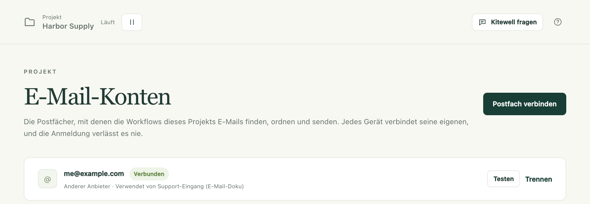
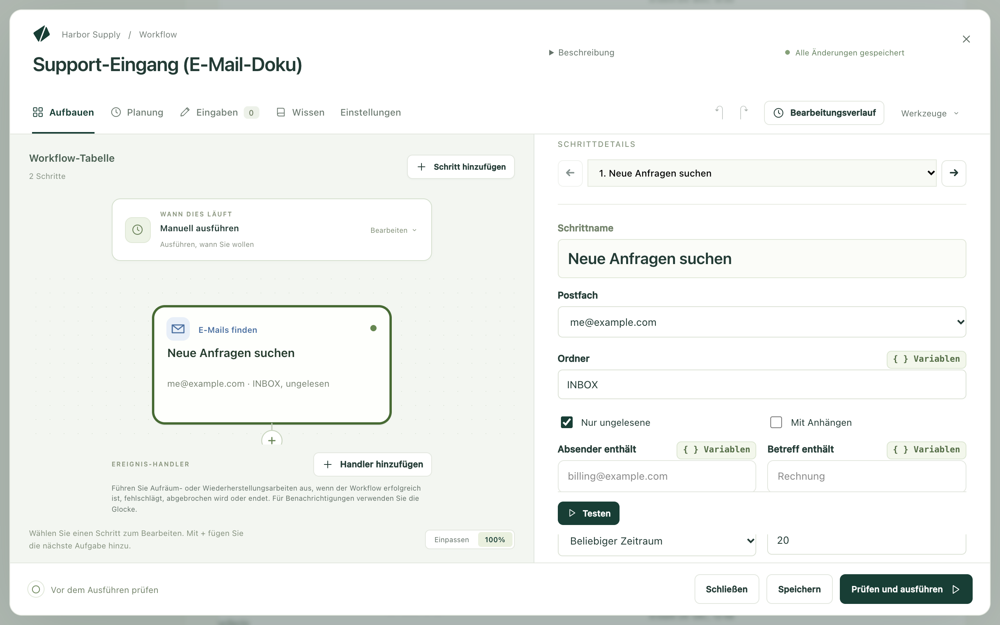

Kitewell kann Ihren Posteingang für Sie bearbeiten: die E-Mail finden, auf die
es ankommt, etwas damit tun und sie ablegen, oder selbst E-Mails schreiben und
senden. Es arbeitet in einem Postfach, das Sie auf diesem Computer verbinden,
und die Anmeldung verlässt den Computer nie.

Arbeit, die in einem Posteingang beginnt oder endet:

- Den Anhang jeder ungelesenen Rechnung ablegen und ihren Gesamtbetrag
  festhalten.
- Supportanfragen über eine verbundene API in Tickets verwandeln.
- Zusammenfassen, was in den letzten 24 Stunden eingegangen ist, und die
  Übersicht verschicken.
- Eingehende E-Mails in Ordner sortieren, wobei ein Modell entscheidet, wohin
  jede gehört.
- Für jede Anfrage eine Antwort entwerfen, sie von jemandem genehmigen lassen
  und sie dann senden.

## Was Sie brauchen

Ein auf diesem Computer verbundenes Postfach: Gmail oder Google Workspace,
Microsoft 365 oder Outlook.com, iCloud, Yahoo, Fastmail oder ein beliebiges
IMAP-Postfach. **E-Mail-Konten** im Projekt listet die Postfächer auf, die die
Workflows des Projekts verwenden, und den Zustand jedes Postfachs auf diesem
Computer.

Um ein Postfach hinzuzufügen, wählen Sie dort **Postfach verbinden** oder im
Feld **Postfach** einer beliebigen E-Mail-Aufgabe **Postfach verbinden…** und
geben die Adresse ein. Kitewell erkennt den Anbieter an der Adresse oder bei
einer eigenen Domain daran, wohin deren E-Mails gehen. Liegt es falsch,
korrigieren Sie das über die Liste **Anbieter**.

| Anbieter | Verbindung über |
| --- | --- |
| Gmail, Google Workspace | Ein App-Passwort, solange Google Kitewell prüft |
| Microsoft 365, Outlook.com | Eine Anmeldung in Ihrem Browser |
| iCloud, Yahoo, Fastmail | Ein App-Passwort, erstellt auf der Website des Anbieters, auf die der Dialog verlinkt; die Server sind schon eingetragen |
| Jedes andere Postfach | IMAP- und SMTP-Server, Port, Sicherheit, Benutzername und Passwort |

Eine Anmeldung im Browser öffnet die Seite des Anbieters, wartet und macht von
selbst weiter, sobald Sie zustimmen. Kitewell meldet sich dann einmal an,
listet die Ordner auf und meldet, wie viele ungelesene E-Mails im Posteingang
liegen, oder warum die Anmeldung fehlgeschlagen ist. Erst wenn diese Prüfung
erfolgreich ist, wird etwas gespeichert.

Je nach Anbieter:

- Google blockiert die Browser-Anmeldung von Kitewell für die meisten Konten,
  bis Google die Prüfung des Gmail-Zugriffs von Kitewell abgeschlossen hat.
  Die Seite meldet dann „Diese App wurde blockiert“ und bietet keinen Weg
  daran vorbei. Bis dahin richtet der Dialog ein Gmail-Postfach mit einem
  App-Passwort ein: Schalten Sie die Bestätigung in zwei Schritten ein,
  erstellen Sie ein App-Passwort namens Kitewell und fügen Sie es ein. Eine
  Browser-Anmeldung, die funktioniert, muss die eingegebene Adresse verwenden,
  und das Kästchen für Gmail muss angehakt sein. Schränkt ein
  Google-Workspace-Administrator Apps von Drittanbietern ein, muss er Kitewell
  unter „API-Steuerung“ zulassen.
- Ein Postfach in Microsoft 365 braucht eingeschaltetes IMAP und
  authentifiziertes SMTP. Das erledigt ein Administrator im Microsoft 365 Admin
  Center, beim Benutzer unter „E-Mail“ und dann „E-Mail-Apps verwalten“. Eine
  Organisation, die nur genehmigte Apps zulässt, erhält einen Link, über den
  ihr Administrator Kitewell einmalig genehmigt. Ein freigegebenes Postfach
  verbinden Sie, indem Sie sich als Mitglied anmelden, das es öffnen kann.
- Ein App-Passwort wird auf der Website des Anbieters erstellt und kann dort
  widerrufen werden.

Eine Verbindung hält, bis der Anbieter sie beendet: Kitewell hält eine
Browser-Anmeldung aktuell, solange der Computer eingeschaltet ist. Funktioniert
die Anmeldung eines Postfachs nicht mehr, erscheint **Neu verbinden** unter
**E-Mail-Konten**, in der **Übersicht** und neben jeder Ausführung, die deshalb
fehlgeschlagen ist.

## Ihren ersten E-Mail-Workflow erstellen

Dieses Beispiel sucht ungelesene E-Mails in einem Support-Posteingang, legt für
jede über eine verbundene API ein Ticket an und markiert jede E-Mail als
gelesen, sobald ihr Ticket existiert.

1. Öffnen Sie einen Workflow, wählen Sie **Schritt hinzufügen** und dann
   **E-Mails finden**. Wählen Sie das **Postfach**, lassen Sie **Ordner** auf
   `INBOX` und **Nur ungelesene** eingeschaltet, und tragen Sie unter
   **Schrittname** einen Namen wie `Neue Anfragen suchen` ein. Wählen Sie
   **Testen**, um zu sehen, welche E-Mails passen. Ein Test markiert nie etwas
   als gelesen.

   

2. Wählen Sie **Für jede E-Mail…**. Kitewell fügt eine Schleife
   **Für jedes Element** über das Gefundene hinzu. Am Ende der Schleife steht
   ein Schritt **E-Mails ordnen**, der die aktuelle E-Mail als gelesen
   markiert.
3. Fügen Sie innerhalb der Schleife, vor diesem Schritt,
   **Eine API-Aktion verwenden** mit der Operation „Create issue“ des
   Ticketsystems hinzu. In ihren Feldern bietet die Variablenauswahl Absender,
   Betreff, Datum und Text der aktuellen E-Mail an.
4. Fügen Sie eine [Planung](/de/docs/scheduling/) hinzu, etwa alle fünf
   Minuten.

In einem neuen Workflow bietet **Oder mit einem Beispiel beginnen** das
Beispiel **Jede neue E-Mail bearbeiten** an. Es hat genau diese Form, und die
eigentliche Arbeit tragen Sie selbst ein.

## Was die E-Mail-Schritte tun

**E-Mails finden** listet passende E-Mails in einem **Ordner** auf, die älteste
zuerst, jeweils mit Absender, Betreff, Datum und Text. Eingrenzen lässt sich
das mit **Nur ungelesene**, **Mit Anhängen**, **Absender enthält**,
**Betreff enthält** und **Empfangen**: **Beliebiger Zeitraum**,
**Letzte Stunde**, **Letzte 24 Stunden**, **Letzte 7 Tage** oder
**Letzte 30 Tage**. **Anhänge in den Dateien des Laufs speichern** legt die
Dateien zu den Artefakten der Ausführung. **Höchstens** begrenzt, wie viele
E-Mails übernommen werden, standardmäßig 20 und maximal 50. So wird ein
Rückstau über mehrere Ausführungen der Reihe nach abgearbeitet. Das Finden
markiert E-Mails nie als gelesen. Spätere Schritte lesen die Liste als
`${steps.<identifier>.outputs.messages}`.

**E-Mails ordnen** wirkt auf die **E-Mails**, die Sie ihm übergeben: was ein
Schritt **E-Mails finden** gefunden hat, eine einzelne davon oder die Antwort
einer KI-Aufgabe, die jede E-Mail und ihr Ziel nennt. **Markieren** setzt
**Als gelesen markieren**, **Als ungelesen markieren**, **Kennzeichnen**,
**Kennzeichnung entfernen** oder **Unverändert lassen**. **Verschieben** setzt
**Nicht verschieben**, **In einen Ordner verschieben**, **Archivieren** oder
**In den Papierkorb**. Den Zielordner nennen Sie unter **Ordner**. Hat das
Postfach keinen Ordner mit diesem Namen, wird er angelegt. Nichts wird je
endgültig gelöscht. Eine E-Mail, die jemand bereits verschoben hat, wird als
fehlend gemeldet, ohne dass der Schritt fehlschlägt. **Testen** zeigt die
Änderung nur als Vorschau.

**E-Mail senden** sendet aus dem Postfach unter **Absender**, mit **An**,
**Betreff**, **Nachricht** und **Anhänge · ein Dateipfad pro Zeile**. Innerhalb
einer Schleife über gefundene E-Mails ordnet
**Auf die aktuelle E-Mail antworten** die Antwort in deren Verlauf ein. Sie
geht an den Absender, mit `Re:` und dem ursprünglichen Betreff, sofern **An**
und **Betreff** nichts anderes angeben. Gmail und Microsoft 365 legen eine
Kopie unter „Gesendet“ ab. Andere Anbieter tun das womöglich nicht.

## Jede E-Mail nur einmal bearbeiten

Lassen Sie **Nur ungelesene** eingeschaltet und markieren Sie jede E-Mail
innerhalb der Schleife als gelesen, oder verschieben Sie sie, und zwar direkt
nach den Schritten für genau diese E-Mail. Eine E-Mail, deren Bearbeitung
fehlgeschlagen ist, bleibt dann ungelesen, und die nächste Ausführung versucht
nur diese erneut.

Würden Sie stattdessen nach der Schleife markieren, würde auch die
fehlgeschlagene E-Mail markiert. Denn die Schritte nach einer Schleife laufen
auch dann, wenn einzelne Elemente fehlschlagen. Die E-Mail würde also nie
erneut versucht. Für Arbeit am ganzen Stapel, etwa eine Zusammenfassung, ist
ein einzelner Schritt **E-Mails ordnen** am Ende richtig.

**Prüfen und ausführen** warnt, wenn gefundene E-Mails nie markiert werden,
wenn sie erst nach der Schleife markiert werden und wenn der Text einer E-Mail
einen Befehl oder einen KI-Agenten erreicht, der Befehle ausführen kann. Diesen
Text hat die Person geschrieben, die die E-Mail gesendet hat. Behandeln Sie ihn
also als den Text dieser Person: Verwenden Sie für ein Modell, das E-Mails
liest, einen Schritt **Ein Modell fragen**, der keine Befehle ausführen kann.

## Im Team ausführen

Eine Postfachadresse reist wie jeder andere Text im Workflow mit, eine
Verbindung nie. Ein Projekt, das von einem Teammitglied oder aus
[Dagu Cloud](/de/docs/cloud-sync/) kommt, listet in seiner **Übersicht** die
Postfächer auf, die zu verbinden sind. Eine Ausführung, die eines davon
braucht, wird abgelehnt, bis es auf diesem Computer verbunden ist.

In einem synchronisierten Projekt läuft ein geplanter Workflow, der ein
Postfach bearbeitet, immer nur auf einem Computer. So verarbeiten nie zwei
Computer dieselbe E-Mail. Schalten Sie ihn dort ein, wo ein anderer Computer
ihn bereits ausführt, werden Sie gefragt, ob er hierher wechseln soll. Der
andere Computer schaltet ihn bei der nächsten Synchronisierung aus. Die
Workflow-Liste zeigt, welcher Computer ihn ausführt.

## Wenn etwas nicht klappt

- Eine Ausführung wird abgelehnt, weil hier kein Postfach verbunden ist.
  Öffnen Sie **E-Mail-Konten** und wählen Sie **Verbinden** oder
  **Neu verbinden**. Der Dialog sagt, was der Anbieter abgelehnt hat.
- Google meldet „Diese App wurde blockiert“. Schließen Sie diese Seite, kehren
  Sie zu Kitewell zurück und wählen Sie
  **Stattdessen ein App-Passwort verwenden**.
- Jede Ausführung findet dieselben E-Mails erneut. Die E-Mails werden nie
  markiert: Fügen Sie innerhalb der Schleife einen Schritt **E-Mails ordnen**
  hinzu, der **Markieren** auf **Als gelesen markieren** setzt.

Alles Weitere steht unter
[Fehlerbehebung](/de/docs/troubleshooting/#a-mailbox-needs-reconnecting).

## Details

Zugangsdaten kommen nicht in Backups, Exporte und die Synchronisierung. Ein
wiederhergestellter Computer bittet Sie, das Postfach erneut zu verbinden.
E-Mails, die ein Schritt liest, werden mit der Ausführung auf diesem Computer
gespeichert, so lange, wie die Ausführung aufbewahrt wird. Sie gehen nur
dorthin, wohin Ihr Workflow sie schickt, etwa an das Modell, das Sie in einer
KI-Aufgabe wählen. Siehe [Was Ihren Computer verlässt](/de/docs/data-flow/).

Eine Gmail-Anmeldung im Browser bittet um die Berechtigung, E-Mails zu lesen,
mit Labels zu versehen, in den Papierkorb zu verschieben und zu senden
(`gmail.modify`), aber nie darum, sie endgültig zu löschen. Das sagen auch die
Zustimmungsseite und die [Datenschutzerklärung](/privacy/). Ein App-Passwort
dagegen gibt IMAP- und SMTP-Zugriff auf das gesamte Postfach.

Ein Schritt **E-Mails finden** übernimmt höchstens 50 E-Mails pro Ausführung.
Es gibt kein Weiterleiten, keine Entwürfe und keinen Auslöser, der beim
Eintreffen einer einzelnen E-Mail startet. Diese Aufgabe erledigt eine Planung
mit **Nur ungelesene**. Ein Microsoft-365-Mandant, in dem IMAP oder
authentifiziertes SMTP ausgeschaltet ist, kann überhaupt keine Verbindung
herstellen.

Der Workflow aus
[Ihren ersten E-Mail-Workflow erstellen](#build-your-first-email-workflow)
besteht aus drei Schritten: **E-Mails finden** mit eingeschaltetem
**Nur ungelesene**, eine Schleife **Für jedes Element** über das Gefundene, bei
der **Gleichzeitige Elemente** auf 1 steht, und innerhalb der Schleife
**Eine API-Aktion verwenden** mit der Operation „Create issue“ des
Ticketsystems, gefolgt von **E-Mails ordnen**, das die aktuelle E-Mail als
gelesen markiert.
