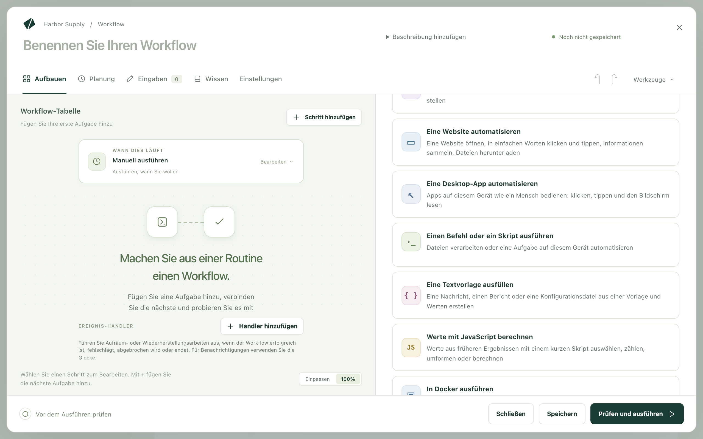
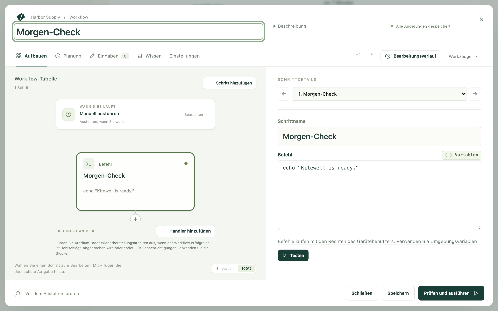
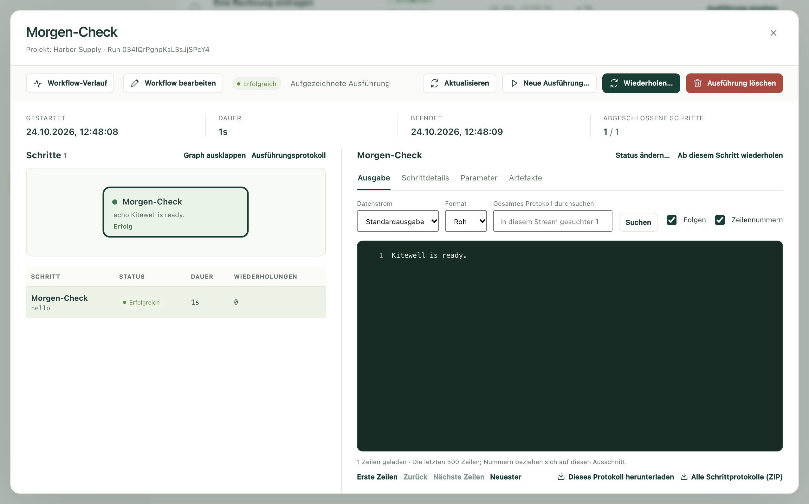

Beschreiben Sie Kitewell eine Routineaufgabe in einfachen Worten. Die KI
erledigt sie einmal, während Sie zusehen, und schlägt dann einen Workflow vor,
der sie nach Planung wiederholt. Diese Seite führt Sie durch diese erste
Aufgabe, vom leeren Chat bis zu einer Ausführung, die von allein läuft.

## Was Sie brauchen

Kitewell, [installiert](/de/docs/install/) und geöffnet. Wählen Sie beim
ersten Öffnen **Anmelden und die KI von Kitewell nutzen**. Ihr Browser öffnet
Dagu Cloud mit einem Code, den Sie abgleichen. Danach ist die enthaltene KI von
Kitewell einsatzbereit, ohne API-Schlüssel und mit den 100 Credits der
14-tägigen Testphase. Um stattdessen Ihr eigenes Modell zu verwenden, wählen
Sie **Auf diesem Gerät starten** und verbinden es im Chat. Siehe
[KI-Agenten und Modelle](/de/docs/ai/).

Für eine Aufgabe auf einer Website brauchen Sie außerdem Google Chrome oder,
unter Windows, Microsoft Edge.

## Kitewell die Aufgabe nennen

1. Öffnen Sie den Chat. Solange er leer ist, fragt er
   **Was erledigen Sie immer wieder von Hand?** und schlägt ein paar Aufgaben
   für den Einstieg vor.
2. Wählen Sie eine davon, oder schreiben Sie Ihre eigene Anfrage: was zu tun
   ist, wo und wann. Zum Beispiel:

   > Jeden Werktag um 9:00 bei [Adresse des Lieferantenportals] mit
   > [E-Mail-Adresse für die Anmeldung] anmelden und alle neuen Rechnungen in
   > meine Tabelle [Pfad der Arbeitsmappe] eintragen.

3. Senden Sie die Anfrage ab.

Nennen Sie die Website, die Datei und die Uhrzeit. Lassen Sie das Passwort
weg: Der Assistent fragt in einer eigenen Karte danach.

## Der KI bei der Arbeit zusehen

Der Assistent sieht sich erst um, bevor er schreibt, und fragt in Karten nach
dem, was er braucht:

- **Erlauben** lässt ihn die Website im Browser von Kitewell öffnen, der oben
  im Chat erscheint. Mit **Übernehmen** klicken und tippen Sie dort selbst,
  für einen Schritt, den nur Sie erledigen können.
- Ein Passwort geben Sie in eine Karte ein, die es als Secret speichert. Der
  Assistent sieht es nie.
- Fragen, die er durch Hinsehen nicht beantworten kann, stellt er in einem
  kurzen Formular.

## Prüfen, dann übernehmen

Der Assistent schlägt den Workflow als Karte vor, mit den Schritten in ihrer
Reihenfolge und dem Zeitpunkt, zu dem er läuft. Lesen Sie ihn und wählen Sie
dann **Übernehmen**. Bis dahin wird nichts gespeichert und nichts ausgeführt.

Was der Assistent in seinem Browser getan hat, gehört zum Workflow dazu. Seine
Klicks sind aufgezeichnet. Die erste Ausführung wiederholt sie also, statt sie
neu zu erarbeiten.

## Ausführen

Bitten Sie den Chat, ihn jetzt auszuführen, oder öffnen Sie den Workflow und
wählen Sie **Jetzt ausführen**. Öffnen Sie dann **Ausführungen & Logs** und
wählen Sie **Ausführung ansehen**.

Wählen Sie den Browser-Schritt aus. Dann sehen Sie jede Operation, die der
Browser ausgeführt hat:

- **Wiederholt**: ein aufgezeichneter Klick oder Tastendruck, ohne KI
  wiederholt.
- **Wiederhergestellt**: Die Seite hatte sich geändert. Die KI hat den neuen
  Weg gefunden und ihn für die nächste Ausführung behalten.
- Um Werte von einer Seite zu lesen, etwa die neuen Rechnungen, wird bei jeder
  Ausführung die KI gefragt.

**Ohne KI ausgeführt** zählt beim Schritt die Operationen, die kein Modell
brauchten.

## Geplant ausführen

Eine Anfrage, die sagt, wann, etwa jeden Werktag um 9:00, bringt ihre Planung
gleich mit. Kitewell führt den Workflow zu dieser Zeit aus. Sie können das
Fenster ruhig schließen: Kitewell läuft in der Menüleiste oder im Infobereich
weiter. Lesen Sie [Planungen](/de/docs/scheduling/), bevor Sie sich auf
Ausführungen ohne Aufsicht verlassen.

## Wenn etwas nicht klappt

- Die Ausführung ist fehlgeschlagen. Öffnen Sie sie unter
  **Ausführungen & Logs**. Die Zusammenfassung oben nennt den fehlgeschlagenen
  Schritt und bietet **Fehlschlag untersuchen** an. Das zeigt das Log dieses
  Schritts.
- Der Workflow passt nicht zur Website. Sagen Sie im Chat, was anders ist. Der
  Assistent ändert den Workflow und schlägt ihn erneut vor.

## Ohne KI

Einen Workflow können Sie auch von Hand aufbauen, Schritt für Schritt. Der
kleinste besteht aus einem einzigen Befehl:

1. Wählen Sie **Workflow erstellen** und geben Sie unter **Workflow-Name**
   `Morgen-Check` ein.
2. Klicken Sie auf **Wählen Sie Ihre erste Aufgabe** und dann auf
   **Einen Befehl oder ein Skript ausführen**.

   

3. Geben Sie unter **Befehl** `echo "Kitewell is ready."` ein.

   

4. Wählen Sie **Prüfen und ausführen**, dann **Speichern und ausführen…** und
   dann **Ausführung starten**.

Die fertige Ausführung zeigt die Zeile in ihrer Ausgabe.

[Einen Workflow erstellen](/de/docs/workflow-builder/) behandelt jede Art von
Schritt.

## Details

- Befehle laufen mit den Berechtigungen des Benutzerkontos, unter dem Kitewell
  läuft.
- `echo "…"` gehört zu den wenigen Befehlen, die sich in der PowerShell unter
  Windows und in einer Shell auf dem Mac gleich verhalten. Ein Befehl, der für
  das eine System geschrieben ist, läuft nicht immer auch auf dem anderen.
