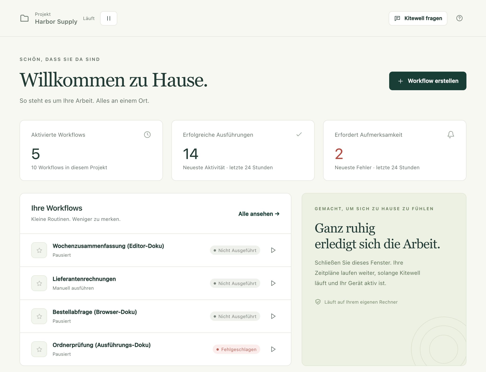

Kitewell erledigt die Routinearbeiten, die Ihr Team bisher von Hand macht. Sie
beschreiben eine Routine einmal. Danach läuft sie auf Ihrem eigenen Computer zu
den Zeiten, die Sie wählen, und jede Ausführung wird mit ihrem Ergebnis und
ihrer Ausgabe aufbewahrt.

## Erste Schritte

1. [Installieren Sie Kitewell](/de/docs/install/) auf einem Mac oder einem
   Windows-PC.
2. [Erstellen Sie Ihren ersten Workflow](/de/docs/getting-started/). Ein
   Workflow ist eine Routine, die aus Schritten besteht.
3. [Legen Sie eine Planung fest](/de/docs/scheduling/) und erfahren Sie, was
   Kitewell braucht, um ohne Aufsicht zu laufen.
4. [Teilen Sie Workflows mit Ihrem Team](/de/docs/sharing/).

Für den Einstieg brauchen Sie kein Konto.

## Was ein Workflow kann

- **[Aus Schritten aufbauen](/de/docs/workflow-builder/)**: Befehle und
  Skripte, Container, ein anderer Rechner über SSH, Webanfragen, KI und eine
  Pause, in der eine Person genehmigt.
- **[Per Webhook starten](/de/docs/webhooks/)**: Eine Ausführung beginnt, wenn
  GitHub, Stripe, ein Formular oder Zapier eine Anfrage sendet. Sie müssen
  dafür keinen Port und keinen Tunnel einrichten.
- **[Websites](/de/docs/browser/)**, **[Desktop-Apps](/de/docs/desktop/)** und
  **[E-Mails](/de/docs/email/)** automatisieren, in einfachen Worten
  beschrieben statt in Code.
- **[Excel automatisieren](/de/docs/spreadsheets/)**: die Arbeitsmappen lesen,
  die Ihr Büro schon hat, und jedes Ergebnis in die Zeile zurückschreiben, aus
  der es stammt.
- **[Pro Tabellenzeile ausführen](/de/docs/batches/)**: einmal für jede Zeile,
  und einsammeln, was jede Ausführung gefunden hat.
- **[Den Assistenten fragen](/de/docs/ai/#the-assistant)**, damit er einen
  Workflow entwirft oder repariert, und eine fehlgeschlagene Ausführung
  [diagnostizieren lassen](/de/docs/ai/#failure-diagnosis).
- **[Eine OpenAPI-Beschreibung importieren](/de/docs/apis/)** und die
  Anfrageformulare ausfüllen, die Kitewell daraus erstellt.
- **[Ein Projekt teilen](/de/docs/sharing/)** mit Kolleginnen und Kollegen oder
  es **[mit Dagu Cloud synchronisieren](/de/docs/cloud-sync/)**, damit alle
  Kopien übereinstimmen. Jedes Gerät bringt seine eigenen Zugangsdaten mit und
  aktiviert nur, was es ausführen soll.

:::note[Frühe Versionen]
Kitewell ist neu. Funktionen und Grenzen können sich also noch ändern. Die
öffentlichen Installationsprogramme gibt es für macOS und Windows. Linux ist
geplant. Was derzeit verfügbar ist, sehen Sie unter [Downloads](/de/download/).
:::

## Was es kostet

Ein Projekt mit bis zu 10 Workflows sowie ein API-Schlüssel oder eine
verbundene App sind kostenlos und brauchen kein Kitewell-Konto. Jedes Projekt
hat seine eigenen Workflows, seinen eigenen Verlauf und seine eigenen Secrets.

Kitewell Personal kostet 20 $ pro Monat für eine Person auf einem Computer:
fünf Projekte mit je 100 Workflows, beliebig viele API-Schlüssel und verbundene
Apps, [Benachrichtigungen](/de/docs/alerts/) und [Webhooks](/de/docs/webhooks/).
Kitewell Team richtet sich an Organisationen mit bis zu 25 Personen. Den Preis
erhalten Sie als Angebot nach der Zahl der Computer: 15 Projekte und ein Team,
das sie synchronisiert. Siehe [Preise](/de/pricing/).

## Was wo läuft

Ihre Projekte bleiben auf Ihrem Gerät, es sei denn, Sie
[synchronisieren eines mit Dagu Cloud](/de/docs/cloud-sync/). Die Werte von
Secrets verlassen das Gerät nie. Gespräche mit dem Assistenten,
Fehlerdiagnosen und die in Tabellen eingelesenen Werte bleiben ebenfalls dort.

KI-Schritte senden, was sie lesen, an den Modellanbieter Ihrer Wahl: Ausgaben
von Ausführungen, Workflow-Definitionen, den Text einer Seite.
[Was Ihren Computer verlässt](/de/docs/data-flow/) listet jedes Ziel auf.

Wenn Sie das Fenster schließen, hält nichts an. Kitewell läuft auf dem Mac in
der Menüleiste und unter Windows im Infobereich der Taskleiste weiter, und Ihre
Planungen werden weiter ausgelöst. Erst **Kitewell beenden** in diesem Menü
beendet den Dienst und die Workflow-Engines.

Auf dem Mac muss Ihr Computer wach sein und Sie müssen angemeldet sein, damit
geplante Arbeit läuft. Unter Windows läuft geplante Arbeit auch, wenn niemand
angemeldet ist, sobald der Anmeldedienst eingeschaltet ist, den das
Installationsprogramm anbietet. Der PC wacht dafür auf. Kitewell stellt keinen
Rechner in der Cloud bereit. KI-Anbieter, entfernte Server, Container und
externe Dienste haben ihre eigenen Anforderungen und Kosten.

## Details

Kitewell betreibt für jedes Projekt eine lokale Dagu-Workflow-Engine. Jede
Engine hat ihr eigenes Datenverzeichnis, ihren eigenen Scheduler und ihren
eigenen Schlüssel für die Verschlüsselung. Schritte laufen mit den
Berechtigungen des Benutzerkontos, unter dem Kitewell läuft. Führen Sie daher
nur Workflow-Definitionen und Befehle aus, denen Sie vertrauen.
