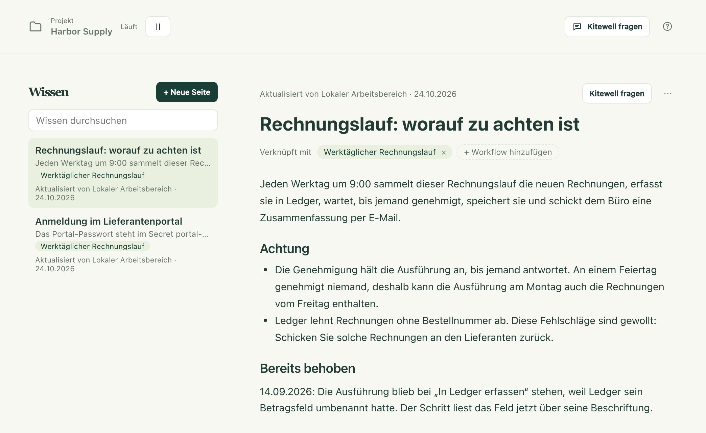
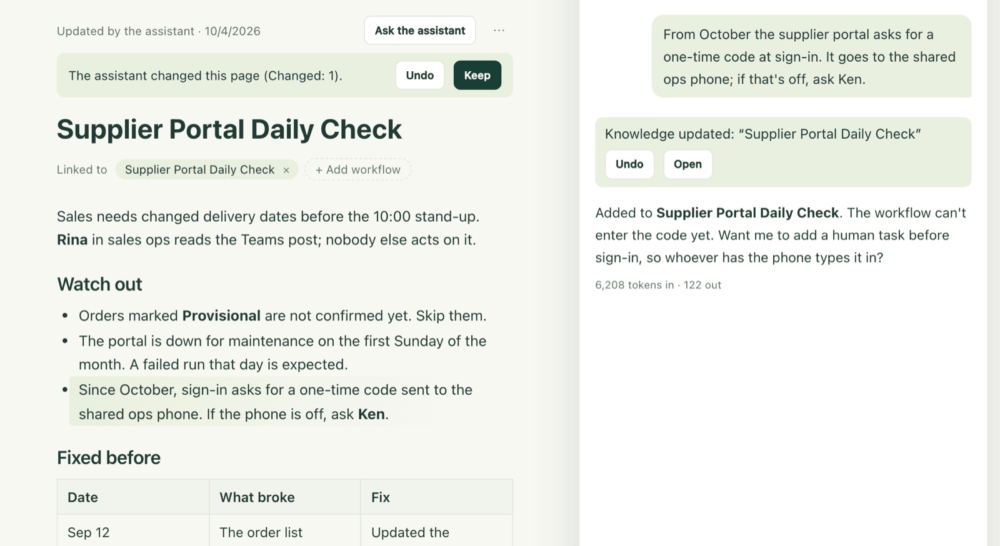

Jedes Team weiß Dinge, die es nie aufschreibt: warum das Portal am
Monatsanfang einen Code verlangt, welche Rechnungen fehlschlagen sollen, was im
letzten September kaputtging und wie es behoben wurde. Unter Wissen hält ein
Projekt solche Notizen fest. Der Assistent liest sie, bevor er Ihnen
antwortet, und ergänzt sie während der Arbeit. So beginnen das nächste
Gespräch und die nächste Person im Team bei dem, was das Team schon weiß.

Eine Seite sagt, was die Definition eines Workflows nicht sagen kann. Die
Schritte, die Planung und die Eingaben stehen im Workflow; die Seite sagt,
warum.

## Eine Seite schreiben

1. Wählen Sie in der Seitenleiste **Wissen**. Die Seiten des Projekts stehen
   in einer Liste, die neueste zuerst, und die geöffnete Seite erscheint
   daneben.
2. Wählen Sie **Neue Seite** und geben Sie einen Titel ein. Die Seite wird
   angelegt, sobald sie einen Titel hat.
3. Schreiben Sie die Notiz. Tippen Sie `/` für Überschriften, Listen,
   Checklisten, Zitate, Code, Tabellen und Trennlinien, oder markieren Sie
   Text, um eine kleine Werkzeugleiste mit **Fett**, **Kursiv**,
   **Durchgestrichen**, **Code** und **Link** zu erhalten. `## ` beginnt beim
   Tippen eine Überschrift, `- ` eine Liste, `1. ` eine nummerierte Liste.
4. Wählen Sie **Workflow hinzufügen** und dann den Workflow, um den es auf
   der Seite geht. Sein Name erscheint danach unter **Verknüpft mit**, und ein
   Klick darauf öffnet den Workflow. Auch eine Seite, die zu keinem Workflow
   gehört, etwa über die Website eines Lieferanten oder eine Teamregel, ist in
   Ordnung.
5. Speichern müssen Sie nicht. Einen Moment, nachdem Sie aufgehört haben zu
   tippen, zeigt die Zeile über der Seite **Wird gespeichert…** und dann
   **Gespeichert**. ⌘S auf einem Mac bzw. Strg+S unter Windows speichert
   sofort, und auch beim Verlassen der Seite wird gespeichert.

Jede Seite in der Liste zeigt ihre erste Zeile, die Workflows, um die es
geht, und wer sie zuletzt geändert hat. Eine Seite, die der Assistent
geschrieben hat, trägt eine KI-Kennzeichnung. **Wissen durchsuchen** findet
eine Seite über jedes Wort in ihrem Titel oder Text, auch wenn Sie es in
vollbreiten oder halbbreiten Zeichen eingeben.

Dieselben Seiten begegnen Ihnen dort, wo sie helfen:

- Der Reiter **Wissen** im Workflow-Editor zeigt die Seiten zu diesem
  Workflow, und **Seite hinzufügen** beginnt eine Seite, die bereits mit ihm
  verknüpft ist.
- Eine fehlgeschlagene Ausführung zeigt unter ihrem Fehler
  **Zugehöriges Wissen**. Was schon einmal kaputtging und wie es behoben
  wurde, steht oft dort.

## Was der Assistent tut

Der Assistent liest vor jeder Nachricht das Wissen des Projekts: eine
einzeilige Zusammenfassung jeder Seite und vollständig die Seite, die Sie
geöffnet haben, sowie bis zu drei Seiten zu dem Workflow, den Sie gerade
ansehen. Jede andere Seite kann er lesen, oder er durchsucht alle, wenn er das
braucht.

Er schreibt sie auch. Wenn Sie ihm eine dauerhafte Tatsache, eine Regel oder
eine Korrektur mitteilen, wenn er einen Workflow aus einem Grund ändert, den
die Definition nicht zeigt, oder wenn ein Fehlschlag behoben ist, speichert er
das sofort auf einer Seite. In seinem Bereich zeigt er dann eine Bestätigung,
„Wissen hinzugefügt“ für eine neue Seite oder „Wissen aktualisiert“ für eine
Änderung, mit **Rückgängig** und **Öffnen**. Erstellt er einen Workflow, kommt
die Seite dazu auf derselben Karte, und **Übernehmen** speichert beides.

Haben Sie die Seite geöffnet, während er schreibt, sind die geänderten
Stellen markiert, mit **Rückgängig** und **Behalten** darüber. Die
Markierungen verschwinden, sobald Sie zu tippen beginnen.

Zwei Regeln sorgen dafür, dass Sie das bedenkenlos eingeschaltet lassen
können:

- Er fragt zuerst, sobald ein Gespräch etwas von außen gelesen hat. Nachdem
  der Assistent eine Webseite abgerufen oder das Log einer Ausführung, ein
  Artefakt oder eine Tabelle gelesen hat, speichert er nicht mehr von selbst:
  Die Änderung wird zu einer Karte, die genau zeigt, was er hinzufügen würde,
  und nichts wird gespeichert, bis Sie **Übernehmen** wählen. Text auf einer
  Webseite oder in einem Log gelangt so nicht unbemerkt in das Wissen aller.
- Er schreibt nur, was stimmt: was Sie gesagt oder entschieden haben oder was
  eine Ausführung belegt hat, und zwar in der Sprache, in der Sie schreiben.
  Widerspricht eine Seite dem Workflow selbst, gilt der Workflow, und der
  Assistent korrigiert die Seite.

Seiten erreichen den Assistenten als Referenzmaterial. Nichts, was auf einer
Seite steht, wird als Anweisung an ihn behandelt.

## Wenn jemand anderes dieselbe Seite ändert

Ändert jemand aus dem Team, ein anderes Gerät oder der Assistent eine Seite,
während Sie darin tippen, geht nichts von dem verloren, was Sie getippt haben.
Die Seite zeigt, wer sie geändert hat, und bietet **Meine Version behalten**
oder **Deren Version verwenden** an. Wenn Sie die andere Version verwenden,
können Sie das mit ⌘Z auf einem Mac bzw. Strg+Z unter Windows rückgängig
machen. Wurde die Seite gelöscht, während Sie darin waren, wählen Sie
zwischen **Als neue Seite behalten** und **Meine Änderungen verwerfen**.

## Wenn etwas nicht klappt

- Der Status zeigt **Nicht gespeichert**. Die Seite hat keinen Titel, oder
  sie ist länger als 2.000 Zeichen. Beheben Sie das und wählen Sie
  **Erneut versuchen**. Änderungen, die nicht gespeichert werden konnten,
  bleiben auf der Seite und sind wieder da, wenn Sie sie erneut öffnen,
  solange Kitewell noch läuft; einen Neustart überstehen sie nicht.
- Die Seite öffnet sich als Markdown. Sie enthält ein Bild, etwas HTML oder
  einen Link, der nicht mit `https://` beginnt, und der formatierte Editor
  kann das nicht anzeigen, ohne es zu verlieren. Bearbeiten Sie die Seite
  dort, oder verschieben Sie diesen Teil an eine andere Stelle.

## Details

- Eine Seite hat einen Titel mit bis zu 60 Zeichen und bis zu 2.000 Zeichen
  Text und nennt bis zu 20 Workflows; ein Projekt hat bis zu 100 Seiten. Ab
  1.800 Zeichen erscheint über der Seite ein Zähler. Über der Grenze
  verweigert sie das Speichern und bittet Sie, den Rest auf eine eigene Seite
  zu verschieben.
- **⋯** → **Als Markdown bearbeiten** zeigt das Markdown der Seite für alle,
  die das bevorzugen, und **Als formatierten Text bearbeiten** wechselt
  zurück. **⋯** → **Seite löschen** löscht die Seite nach einer Bestätigung
  für alle im Projekt.
- Beim Einfügen bleibt erhalten, was eine Seite aufnehmen kann: Eine aus
  einer Tabellenkalkulation kopierte Tabelle bleibt eine Tabelle mit der
  ersten Zeile als Kopfzeile, und Markdown-Text wird zu formatiertem Text.
  Nur `https://`-Links bleiben erhalten.
- Seiten gehören zu einem Projekt. Alle im Projekt lesen sie; Bearbeiter und
  der Assistent ändern sie. Sie werden
  [mit Dagu Cloud synchronisiert](/de/docs/cloud-sync/) und sind in
  [Projektexporten](/de/docs/sharing/) enthalten. Sie sind nicht Teil von
  [Releases](/de/docs/releases/), die nur Workflows und Namen von Secrets
  enthalten.
- [MCP-Clients](/de/docs/mcp/) lesen Seiten mit `read` und
  `target: "knowledge"`: den ganzen Index, eine Seite über ihre ID oder eine
  Suche. Mit der Berechtigung **Bearbeiten und ausführen** schreiben sie sie
  auch, mit `change` und dem Typ `upsert_knowledge` oder `delete_knowledge`.
  Wer einen Workflow liest, erhält auch die Seiten zu ihm.
