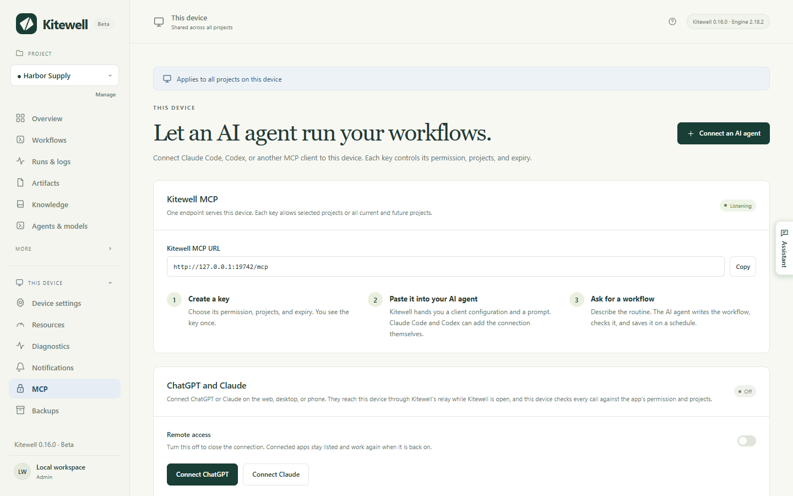
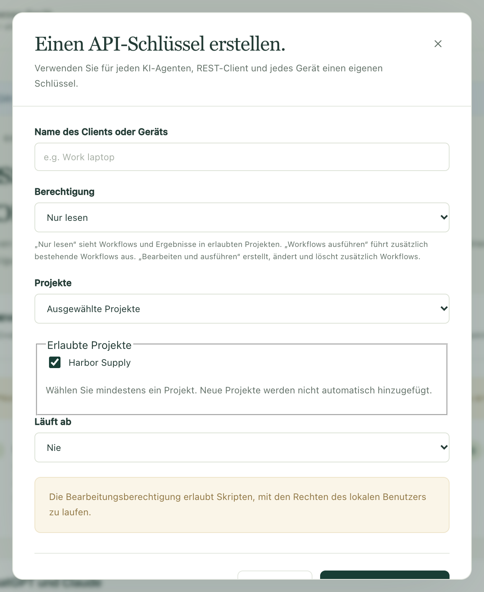
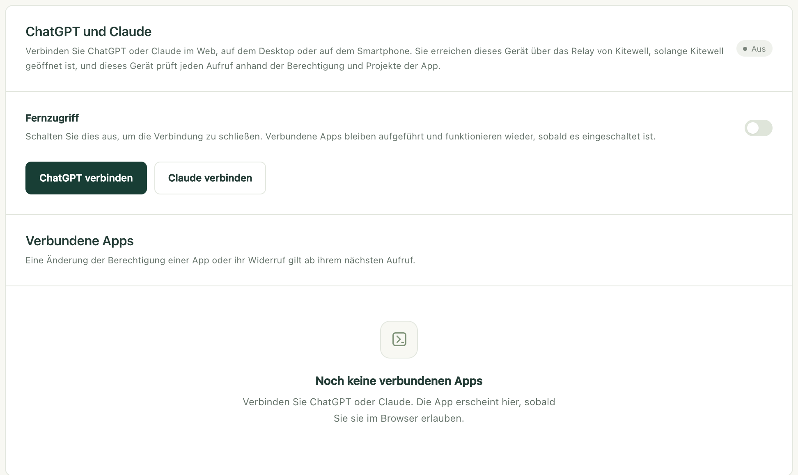

Bitten Sie ChatGPT, Claude oder Claude Code, einen Ihrer Workflows
auszuführen, nachzulesen, was eine Ausführung getan hat, oder einen neuen
Workflow für Sie zu schreiben. Die Arbeit geschieht weiterhin auf Ihrem
eigenen Computer, in den Projekten, die Sie freigeben, und Sie können den
Zugriff jederzeit wieder entziehen.

## Was Sie brauchen

- Kitewell, geöffnet auf dem Computer, auf dem die Workflows liegen, und
  dieser Computer wach. Kein Aufruf erreicht einen Computer im Ruhezustand.
- Für einen Assistenten auf demselben Computer, etwa Claude Code oder Codex,
  sonst nichts. Kitewell lauscht bereits unter `http://127.0.0.1:19742/mcp`.
- Für ChatGPT oder Claude im Web, auf dem Desktop oder auf dem Smartphone ein
  Dagu-Cloud-Konto, bei dem dieser Computer
  [angemeldet](/de/docs/cloud-sync/#sign-in) ist. Diese Apps rufen aus ihren
  eigenen Clouds an und erreichen Ihren Computer deshalb über das Relay von
  Kitewell statt über diese Adresse.

Alles befindet sich auf einer Seite: **Dieses Gerät → MCP**. Die
Statusanzeige neben **Kitewell MCP** zeigt **Lauscht**, wenn die Verbindung
bereit ist, und die **Kitewell-MCP-URL** darunter ist die Adresse, die Sie
einem Client geben.



Der kostenlose Tarif erlaubt insgesamt einen API-Schlüssel oder eine
verbundene App. Kitewell Personal und Team erlauben beliebig viele. Wenn Sie
einen Schlüssel oder eine App widerrufen, wird Platz für einen neuen frei.
Endet ein kostenpflichtiger Tarif, funktionieren Schlüssel und Apps über das
Limit des kostenlosen Tarifs hinaus 7 Tage später nicht mehr, und Sie wählen,
was bleibt; siehe [Wenn ein Tarif endet](/de/docs/cloud-sync/#when-a-plan-ends).

## Einen Assistenten auf diesem Computer verbinden

So verbinden Sie Claude Code, Codex und jeden anderen Client, den Sie selbst
ausführen. Dafür dient ein Schlüssel: ein langes Geheimnis, das der Client
bei jedem Aufruf mitsendet.

1. Öffnen Sie **Dieses Gerät → MCP** und wählen Sie **KI-Agenten verbinden**.
2. Füllen Sie **Name des Clients oder Geräts** aus, etwa „Claude Code auf dem
   Arbeitslaptop“. Der Name dient nur dazu, dass Sie den Schlüssel später
   wiedererkennen.
3. Wählen Sie eine **Berechtigung**: **Nur lesen**, **Workflows ausführen**
   oder **Bearbeiten und ausführen**. Der nächste Abschnitt erklärt, was jede
   erlaubt.
4. Wählen Sie **Projekte**. **Ausgewählte Projekte** erlaubt die Projekte,
   die Sie unter **Erlaubte Projekte** anhaken, und sonst nichts;
   **Alle aktuellen und zukünftigen Projekte** umfasst auch Projekte, die Sie
   später anlegen.
5. Wählen Sie **Läuft ab**: **Nie**, **30 Tage**, **90 Tage** oder
   **Eigenes Datum und Uhrzeit**.
6. Wählen Sie **API-Schlüssel erstellen**.



Kitewell zeigt den Schlüssel dann einmal unter **API-Schlüssel** an, mit drei
Möglichkeiten, ihn weiterzugeben:

- **Kitewell-MCP-URL** ist die Adresse, mit der sich der Client verbindet.
- **Kitewell-MCP-Client-Konfiguration** enthält dasselbe als Block von
  Einstellungen, den viele Clients unverändert übernehmen.
- **Prompt für einen KI-Agenten** ist eine Anfrage, die Sie in Claude Code
  oder Codex einfügen; der Agent richtet die Verbindung dann selbst ein. Sie
  enthält den Schlüssel, fügen Sie sie also nur in einen Assistenten ein, dem
  Sie vertrauen.

Kopieren Sie, was Sie brauchen, bevor Sie den Dialog schließen. Der Schlüssel
wird nie wieder angezeigt. Geht er verloren, widerrufen Sie ihn und erstellen
einen neuen.

Ein von Hand eingerichteter Client braucht die URL, Streamable HTTP und den
Header `Authorization: Bearer <Ihr Schlüssel>`. Der Client muss Zugangsdaten
unterstützen, die Sie selbst eingeben. ChatGPT und Claude können das nicht;
sie melden sich stattdessen an, wie unten beschrieben.

Zurück auf der Seite enthält **Wonach Sie fragen können** drei Anfragen, die
Sie in einen verbundenen Assistenten kopieren können, um ihn auszuprobieren:
**Einen Befehl planen**, **Einen KI-Agenten-Schritt planen** und
**Einem Fehlschlag nachgehen**. Jede nennt das Projekt, das Sie geöffnet
haben, und bittet den Assistenten, den Workflow zu prüfen und seine Planung
ausgeschaltet zu lassen, bis Sie ihn gelesen haben.

## Was jede Berechtigung erlaubt

| Berechtigung | Was der Assistent darf |
| --- | --- |
| **Nur lesen** | Ihre Projekte, Workflows, Ausführungen und deren Logs ansehen, dazu die Dateien, die eine Ausführung hinterlassen hat, und das Wissen des Projekts. Er ändert nichts. |
| **Workflows ausführen** | Alles oben Genannte, außerdem eine Ausführung starten, wiederholen, neu ausführen oder abbrechen; einen Schritt, der auf eine Person wartet, genehmigen, ablehnen, zurückgeben oder abschließen; einem wartenden Website- oder Desktop-Schritt antworten; und die Zeilen einer Tabelle ausführen. |
| **Bearbeiten und ausführen** | Alles oben Genannte, außerdem Workflows, Agenten und Modelle, Server, Warteschlangen, Workflow-Standardwerte, API-Verbindungen, Tabellen und Wissensseiten erstellen, ändern oder löschen. |

Beginnen Sie mit dem Minimum, das für die Aufgabe reicht. **Nur lesen**
genügt, um zu fragen, was letzte Nacht fehlgeschlagen ist.
**Workflows ausführen** genügt, um eine Ausführung anzufordern. Nur
**Bearbeiten und ausführen** lässt einen Assistenten einen Workflow
schreiben, und die Befehle eines Workflows laufen auf diesem Computer so, als
würden Sie sie selbst ausführen: Sie können Dateien ändern und andere Dienste
erreichen. Geben Sie **Bearbeiten und ausführen** nur einem Assistenten, dem
Sie auch zutrauen würden, dort selbst Befehle auszuführen.

Eine Berechtigung gilt nur innerhalb der erlaubten Projekte. Sie ist keine
Sperre für den Rest des Computers.

Eine Verbindung sieht alles, was in ihren Projekten liegt: den Text der
Workflow-Befehle, die Logs ihrer Ausführungen und die Werte, die eine
Ausführung erhalten hat. Nicht sehen kann sie die Werte Ihrer Secrets, Ihre
Postfachpasswörter, Ihre Dagu-Cloud-Anmeldung, andere API-Schlüssel und
alles in einem Projekt, das ihr nicht freigegeben wurde. Ein Secret bleibt
auf dem Gerät, und ein Workflow liest es während der Ausführung über seinen
Namen.

<a id="connect-chatgpt-or-claude"></a>

## ChatGPT oder Claude verbinden

ChatGPT und Claude erreichen Ihren Computer unter
`https://mcp.kitewell.app/mcp`, über eine Verbindung, die Ihr Computer
aufbaut. In Ihrem Netzwerk wird kein Port geöffnet, und Ihr Computer prüft
jeden Aufruf anhand der Berechtigung und der Projekte, die Sie genehmigt
haben, genau wie bei einem Schlüssel.

1. Öffnen Sie in Kitewell **Dieses Gerät → MCP** und wählen Sie
   **ChatGPT verbinden** oder **Claude verbinden**. Ein Computer, der noch
   nicht bei Dagu Cloud angemeldet ist, meldet sich zuerst an, und
   **Fernzugriff** wird eingeschaltet.
2. Wählen Sie **Berechtigung** und **Projekte** und dann
   **Speichern und Schritte anzeigen**. Kitewell zeigt die URL und die
   Schritte für diese App und merkt sich Ihre Auswahl für die nächste
   Verbindung.
3. Fügen Sie Kitewell mit dieser URL in der App hinzu, wie unten für
   [Claude](#claude) oder [ChatGPT](#chatgpt) beschrieben.
4. Die App öffnet Dagu Cloud. Melden Sie sich mit dem Konto an, bei dem
   dieser Computer angemeldet ist.
5. Die Zustimmungsseite öffnet sich mit Ihrer Auswahl bereits eingetragen.
   Prüfen Sie den Computer, die Berechtigung und die Projekte, ändern Sie, was
   Sie möchten, und wählen Sie dann **Allow**.



Die App erscheint dann unter **Verbundene Apps**, mit **Berechtigung**,
**Projekte**, dem Zeitpunkt der Verbindung und dem ihres letzten Aufrufs.

### Claude

1. Öffnen Sie in Claude **Customize → Connectors**, wählen Sie **+ Add** und
   dann **Add custom connector**.
2. Nennen Sie ihn Kitewell, fügen Sie die URL ein und wählen Sie
   **Continue**. Behalten Sie die vorgeschlagenen Anmeldeeinstellungen bei und
   wählen Sie **Add**.
3. Melden Sie sich bei Dagu Cloud an, prüfen Sie die Berechtigung und die
   Projekte und wählen Sie **Allow**.

In den Tarifen Team und Enterprise fügt zuerst ein Inhaber Kitewell unter
**Organization settings → Connectors** hinzu; danach wählen Mitglieder dort
**Connect**. Der Free-Tarif von Claude erlaubt einen benutzerdefinierten
Connector.

### ChatGPT

ChatGPT verbindet sich nur im Web, über den Developer mode. Damit der Eintrag
das Kitewell-Symbol bekommt,
<a href="/kitewell-icon-256.png" download>laden Sie zuerst das Kitewell-Symbol (PNG) herunter</a>.
Es misst 256 × 256 px und bleibt unter der Grenze von 10 KB, die ChatGPT
setzt.

1. Öffnen Sie in ChatGPT im Web **Plugins**, wählen Sie **Add** und dann
   **Create custom MCP server**. Fehlt diese Option, schalten Sie zuerst
   **Developer mode** unter **Settings → Security and login** ein, bei
   Business, Enterprise und Edu unter
   **Settings → Apps → Advanced settings**.
2. Nennen Sie ihn Kitewell, fügen Sie bei Bedarf das Kitewell-Symbol hinzu,
   fügen Sie die URL unter **Server URL** ein, behalten Sie **OAuth** bei,
   haken Sie **I understand and want to continue** an und wählen Sie
   **Create as a plugin**.
3. Wählen Sie **Proceed to Kitewell**, melden Sie sich bei Dagu Cloud an,
   prüfen Sie die Berechtigung und die Projekte und wählen Sie **Allow**.
4. Wählen Sie **Try in chat**. In jedem späteren Chat können Sie auch **@**
   tippen und Kitewell auswählen oder es im Werkzeugmenü **+** wählen.

Kitewell erscheint dann unter **Plugins → Personal → Created by you**, und
seine Seite zeigt das Konto, mit dem es sich angemeldet hat.

Zwei Grenzen setzt hier ChatGPT, nicht Kitewell:

- Mit Plus und Pro nutzt ChatGPT nur die Lesewerkzeuge von Kitewell.
  Ausführungen starten und Workflows bearbeiten erfordert ChatGPT Business,
  Enterprise oder Edu.
- Bei Business können nur Administratoren und Inhaber den Developer mode
  nutzen. Bei Enterprise und Edu muss ihn zuerst ein Administrator freigeben.

ChatGPT warnt außerdem, dass ein benutzerdefinierter MCP-Server ein Risiko
ist. Kitewell erhält nur die Berechtigung und die Projekte, die Sie
genehmigen.

### Wenn ein Aufruf meldet, dass der Computer nicht erreichbar ist

Der Computer muss eingeschaltet und wach sein, und Kitewell muss darauf
laufen. Andernfalls listet die App zwar weiterhin die Werkzeuge von Kitewell,
aber jeder Aufruf antwortet, dass Kitewell auf diesem Computer nicht
erreichbar ist, und nennt, wann es zuletzt erreichbar war. Öffnen Sie Kitewell
dort und fragen Sie erneut. Schlägt es weiterhin fehl, lesen Sie unter
[Fehlerbehebung](/de/docs/troubleshooting/#chatgpt-and-claude) weiter.

## Zugriff ändern oder entziehen

- Ein Schlüssel: **Bearbeiten** unter **API-Schlüssel** ändert Name,
  Berechtigung, Projekte oder Ablauf, ohne das Geheimnis zu ersetzen.
  **Widerrufen** beendet ihn.
- Eine verbundene App: **Ändern** und **Widerrufen** unter
  **Verbundene Apps**. Widerrufen Sie die Verbindung in ChatGPT oder Claude
  selbst, erreicht das Ihren Computer innerhalb von fünf Minuten.
- ChatGPT und Claude zusammen: Schalten Sie **Fernzugriff** aus. Die
  Verbindung wird geschlossen; verbundene Apps bleiben aufgeführt und
  funktionieren wieder, sobald der Fernzugriff wieder eingeschaltet ist.
  Schlüssel auf diesem Computer sind nicht betroffen.

Änderungen, Widerruf und Ablauf gelten ab dem nächsten Aufruf. Eine bereits
gestartete Ausführung läuft weiter. Ein abgelaufener Schlüssel funktioniert
wieder, wenn Sie seinen Ablauf verlängern oder entfernen.

Der Webhook eines Workflows nutzt dasselbe Relay, hat aber eine eigene URL
und funktioniert weiter, während **Fernzugriff** ausgeschaltet ist. Mehr dazu
unter [Einen Workflow per Webhook starten](/de/docs/webhooks/).

## ChatGPT informieren, wenn etwas passiert

Eine App, die MCP Events unterstützt, kann benachrichtigt werden, statt immer
wieder nachzufragen:

- `run.finished`: Eine Ausführung ist beendet. Das Abonnement kann eine
  einzelne Ausführung nennen oder die Ergebnisse, die gemeldet werden sollen.
- `run.needs_input`: Eine Ausführung wartet bei einer Genehmigung, einer
  Aufgabe für eine Person oder einer Frage.
- `batch.finished`: Ein [Stapel](/de/docs/batches/) mit Zeilen einer Tabelle
  ist fertig.
- `schedule.missed`: Eine geplante Ausführung wurde verpasst.

Die Abonnements jeder App stehen unter ihr in **Verbundene Apps**, mit dem
Zeitpunkt der letzten Zustellung, und **Entfernen** beendet eines. Widerrufen
Sie die App, enden alle. Sie pausieren, während **Fernzugriff** ausgeschaltet
ist, und gelten bis zu einer Woche, sofern die App sie nicht erneuert. Ihr
Computer erkennt die Ereignisse und sendet sie; sie kommen also nur an,
solange Kitewell läuft. MCP Events gehören wie
[Benachrichtigungen](/de/docs/alerts/) zu Kitewell Personal und Team.

## Details

### Die Werkzeuge, die eine Verbindung sieht

Eine Verbindung listet nur die Werkzeuge, die ihre Berechtigung erlaubt;
eine Verbindung mit reinem Lesezugriff sieht also nie ein Werkzeug, das
schreibt.

| Werkzeug | Berechtigung | Was es tut |
| --- | --- | --- |
| `read` | **Nur lesen** | Liest Projekte, Workflows und ihr Schema, Ausführungen mit ihren Logs und Artefakten, Agenten und API-Modelle, Server, Warteschlangen, Postfächer, Workflow-Standardwerte, importierte APIs, [Stapeltabellen](/de/docs/batches/) und ihre Werte sowie das [Wissen](/de/docs/knowledge/) des Projekts. Eine fehlgeschlagene Ausführung enthält ihre [Fehlerdiagnose](/de/docs/ai/#failure-diagnosis), wenn es eine gibt. `target: "reference"` liefert die Bedienungsanleitung. **Workflows ausführen** ergänzt eine Vorschau, welche Schritte eine erneute Ausführung wiederverwenden kann; **Bearbeiten und ausführen** ergänzt das Prüfen des YAML eines Workflows ohne Speichern und das Öffnen einer Excel-Arbeitsmappe auf diesem Computer. |
| `show` | **Nur lesen** | Zeichnet den Abhängigkeitsgraphen eines Workflows und, zusammen mit einer Ausführung, den Zustand jedes Schritts. ChatGPT und Claude zeigen ihn als Ansicht, die einer laufenden Ausführung folgt; andere Clients erhalten die Schritte der Reihe nach als Text. |
| `execute` | **Workflows ausführen** | `start`, `retry`, `rerun`, `cancel`, `approve`, `reject`, `push_back`, `complete`, `answer`, `restart`, `resume`, `run_sheet`, `read_sheet_values` und `cancel_sheet`. **Bearbeiten und ausführen** ergänzt `refresh_sheet`, `link_workbook` und `unlink_workbook`. |
| `change` | **Bearbeiten und ausführen** | Erstellt, ersetzt und löscht Workflows, Agenten, Server und Servergruppen, Warteschlangen, Workflow-Standardwerte, API-Verbindungen, Tabellen und die Planung, nach der eine Tabelle auf diesem Gerät läuft, sowie Wissensseiten. |
| `preview_api` | **Bearbeiten und ausführen** | Liest ein OpenAPI-Dokument, das Sie ihm geben, oder ruft eines von einer URL ab, und listet seine Operationen. Es speichert nichts, aber das Abrufen einer URL greift über Ihren Computer hinaus. |

Ein Aufruf, den eine Berechtigung nicht erlaubt, etwa aus einer Werkzeugliste,
die ein Client noch von einer früheren Berechtigung hat, wird abgelehnt und
nennt die Stelle in Kitewell, an der sich die Berechtigung ändern lässt.

Jedes Ersetzen oder Löschen braucht die `version` aus dem letzten
Lesevorgang, damit ein Client nie eine Änderung überschreibt, die er nicht
gesehen hat. Bei einem Konflikt lesen Sie erneut, prüfen und senden bewusst
noch einmal.

Um einer Ausführung zu folgen, ohne wiederholt nachzufragen, übergeben Sie
`wait` mit bis zu 60 Sekunden an `execute` beim Starten, Wiederholen oder
erneuten Ausführen oder an `read` mit `target: "run"`. Der Aufruf antwortet,
sobald die Ausführung endet oder an einem Schritt anhält, der auf eine Person
wartet. Läuft die Zeit vorher ab, antwortet er mit dem aktuellen Stand der
Ausführung.

Ergebnisse in eine verknüpfte Arbeitsmappe schreiben und ein solches
Schreiben rückgängig machen kann keine Verbindung. Beides erledigt eine Person
in der App.

### Das Projekt wählen

`read` mit `target: "projects"` listet nur die Projekte, die eine Verbindung
erreichen darf, und braucht selbst kein Projekt. Jeder andere Aufruf nennt
sein Projekt mit `projectId` bzw. auf einer REST-Route mit
`?projectId=<id>`. Eine Verbindung, die genau ein Projekt erreicht, kann die
Angabe weglassen; eine, die mehrere erreicht, muss eines nennen. Fragen Sie
zuerst die Projektliste ab und übergeben Sie dann die ID, deren Name zur
Anfrage passt.

Agenten, Server, Warteschlangen und Workflow-Standardwerte gehören zu einem
Projekt; derselbe Schlüssel ändert also je nach genanntem Projekt
unterschiedliche davon.

### Importierte APIs über MCP

Ein Assistent mit **Bearbeiten und ausführen** kann ein OpenAPI-Dokument
importieren und aus seinen Operationen Workflows erstellen:

1. Erstellen Sie eine Vorschau mit `preview_api` und entweder `spec`, dem
   Dokument als JSON- oder YAML-Text, oder `url`. Es wird nichts gespeichert
   und keine Operation aufgerufen.
2. Speichern Sie mit `change`, `type: "upsert_api"`, einer `id` und einer
   `api`-Definition. Geben Sie `api.spec` an, oder lassen Sie es weg, damit
   `api.sourceUrl` einmal abgerufen wird. Setzen Sie `api.auth.type` auf
   `none`, `bearer`, `apiKey` oder `basic` und nennen Sie mit
   `api.auth.secretRef` ein vorhandenes Secret des Projekts. Werte von
   Secrets werden in der App erstellt und ersetzt, nie über MCP.
3. Finden Sie Operationen mit `read`: `target: "apis"` listet Verbindungen,
   `target: "api_operations"` durchsucht eine Verbindung über `id` und eine
   optionale `query`, und `target: "api_operation"` mit `id` und
   `operationId` liefert die Eingaben einer Operation, ihre Antworten und
   einen Workflow-Schritt als Ausgangspunkt.
4. Fügen Sie `api.request`-Schritte hinzu, prüfen und speichern Sie den
   Workflow mit den üblichen Werkzeugen und führen Sie ihn aus. Der
   zurückgegebene Schritt ist eine Vorlage: Prüfen Sie seine Beispiele und
   ersetzen Sie die Platzhalter, bevor Sie ihn ausführen.

`upsert_api` ersetzt die ganze Verbindung. Lesen Sie deshalb zuerst
`target: "api"`, behalten Sie die Felder, die Sie noch brauchen, und
übergeben Sie ihre `definitionVersion` als `version`. `change` mit
`type: "delete_api"` entfernt eine Verbindung nur, wenn kein gespeicherter
Workflow sie nutzt. Was der Import annimmt, steht unter
[API importieren](/de/docs/apis/).

### REST für Skripte

Dieselben Schlüssel funktionieren auch für eine einfache HTTP-Schnittstelle,
für Skripte und andere Integrationen. Ihre Basisadresse ist der Ursprung der
MCP-URL plus `/api`. Jede Anfrage braucht
`Authorization: Bearer <Ihr Schlüssel>`, auch auf diesem Computer; die eigene
Anmeldung im Browser ist kein Schlüssel.

```http
GET /api/jobs HTTP/1.1
Host: your-host
Authorization: Bearer <Kitewell API key>
```

| Route | Mindestens nötige Berechtigung |
| --- | --- |
| `GET /api/projects`, `/api/jobs`, `/api/runs`, `/api/queues` | **Nur lesen** |
| `GET /api/runs/{jobId}/{id}`, `/api/jobs/{id}/graph` | **Nur lesen** |
| `GET /api/runs/{jobId}/{id}/logs` und `/logs/download` | **Nur lesen** |
| `GET /api/dags/schema`, `/api/harnesses`, `/api/data/usage` | **Nur lesen** |
| `POST /api/jobs/{id}/run` | **Workflows ausführen** |
| `POST /api/runs/{jobId}/{id}/resume` | **Workflows ausführen** |
| `POST /api/runs/{jobId}/{id}/approvals/{stepId}/approve`, `/reject`, `/push-back` | **Workflows ausführen** |
| `POST /api/runs/{jobId}/{id}/human-tasks/{stepId}/complete` | **Workflows ausführen** |
| `POST /api/jobs`, `PUT` und `DELETE /api/jobs/{id}` | **Bearbeiten und ausführen** |
| `POST /api/jobs/{id}/pause`, `POST /api/dags/validate` | **Bearbeiten und ausführen** |
| `POST /api/runs/delete`, `DELETE /api/run-history/{jobId}` | **Bearbeiten und ausführen** |

Log-Abfragen akzeptieren `stepId`, `stream=stdout`, `stderr` oder `run`,
`tail=500` oder `offset` und `limit` bis 500 Zeilen sowie `query=<text>` für
die Suche. Anfragen zum Ausführen akzeptieren einen Inhalt wie
`{"params":{"region":"west"}}`.

REST umfasst Workflows und Stapeltabellen. Geräteeinstellungen, Secrets, die
Verwaltung von API-Schlüsseln, das Dagu-Cloud-Konto, Backups und die
Steuerung der Engine bleiben in der App und sind darüber nicht zugänglich.
Importierte APIs werden in der App oder über das MCP-Werkzeug `change`
verwaltet.

### Ein Client auf einem anderen Computer

Der Listener nimmt nur lokale Verbindungen an, unter `127.0.0.1:19742`.
ChatGPT und Claude kommen stattdessen über das Relay und brauchen nichts von
dem, was folgt.

Ein Client auf einem anderen Computer braucht eine Adresse, die er über HTTPS
erreichen kann und die Sie selbst einrichten und betreiben. Lassen Sie unter
**Kitewell-MCP-Verbindung** die Option **Kitewell MCP aktivieren**
eingeschaltet, öffnen Sie **TLS und Remote-Verbindungen** und tragen Sie
unter **Öffentliche Kitewell-MCP-URL** eine Adresse ein, die auf `/mcp`
endet. Dann behalten Sie entweder **Lauschadresse** bei `127.0.0.1:19742`
und richten Ihren eigenen HTTPS-Proxy darauf aus, der `/mcp` und `/api/`
samt `Authorization`-Header weiterleitet, oder Sie setzen die Adresse auf
`0.0.0.0:19742` und geben absolute Pfade für **Zertifikatsdatei** und
**Datei mit privatem Schlüssel** an. Wählen Sie **Verbindung speichern**.

Bei einer Adresse, die andere Computer erreichen können, fragt die Firewall,
ob Kitewell Verbindungen annehmen darf; lehnen Sie dort ab, wartet jeder
Client vergeblich. Kitewell richtet weder DNS noch Zertifikate noch
Weiterleitungen am Router ein und stellt keinen Computer bereit, auf dem Ihre
Workflows laufen. Stellen Sie nie einen ungeschützten HTTP-Listener ins
Internet.

Zeigt die Statusanzeige **Nicht verfügbar** und meldet die Seite, dass ein
anderes Programm Port 19742 belegt, ist das meist eine zweite Kopie von
Kitewell, etwa ein Entwicklungs-Build neben der installierten App. Beenden
Sie dieses Programm und starten Sie Kitewell dann neu.

Schlüssel werden als Hashes gespeichert, nie im Klartext. Beim
Wiederherstellen eines [Backups](/de/docs/backups/) bleiben die Schlüssel
dieses Computers erhalten: Prüfen Sie sie und widerrufen Sie alle, die keinen
Zugriff mehr haben sollen. [Wenden Sie sich an den Support](/de/support/),
wenn die Einstellungen für die Zugangsdaten eines Clients unklar sind.
