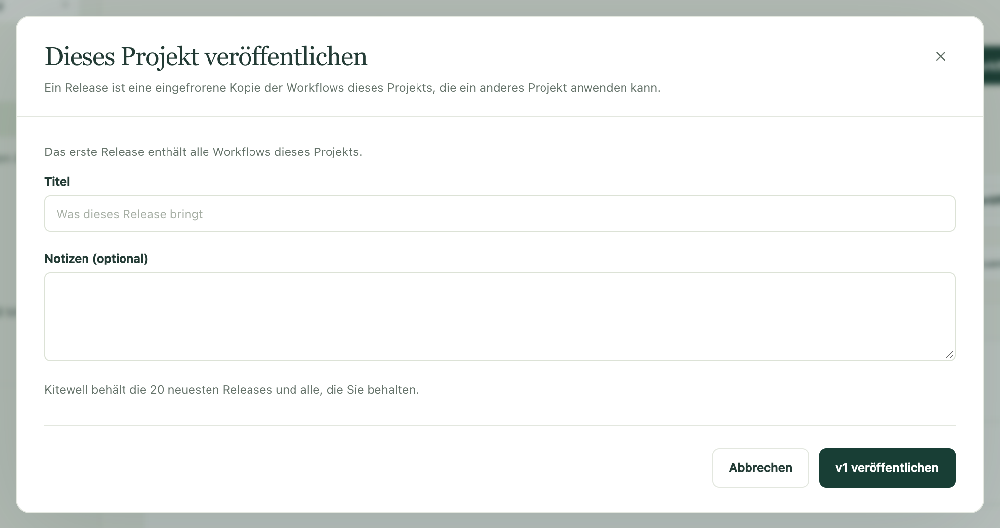

Testen Sie eine Änderung an einem sicheren Ort, bevor sie die Arbeit berührt,
auf die es ankommt. Halten Sie ein Projekt zum Aufbauen und ein anderes für den
echten Betrieb, frieren Sie die Workflows, mit denen Sie zufrieden sind, als
nummeriertes Release ein, und übergeben Sie dieses Release dem anderen Projekt,
wenn Sie so weit sind.

Jedes Projekt behält seine eigenen Server, Modelle, API-Verbindungen,
Warteschlangen und Werte von Secrets. So spricht derselbe Workflow im einen
Projekt mit dem Testsystem und im anderen mit dem echten System.

## Was Sie brauchen

Zwei oder mehr Projekte auf demselben Computer, beliebig benannt – **Dev**,
**Staging** und **Prod** ist die übliche Aufteilung. Kitewell Personal fasst
bis zu fünf Projekte auf einem Computer und Team 15; beide haben also Platz
dafür. Um ein Release zu erstellen und
anzuwenden, brauchen Sie Bearbeitungsrechte für das Projekt.

## Ein Release erstellen

1. Öffnen Sie **Workflows** im Projekt, in dem Sie aufbauen. Die Zeile über der
   Liste zeigt das neueste Release und wie viele Workflows sich seitdem
   geändert haben.
2. Wählen Sie **Veröffentlichen…**. Das erste Release enthält alle Workflows des
   Projekts, und der Dialog weist darauf hin; danach listet er auf, was sich
   geändert hat, mit **Vergleichen** neben jedem Workflow.
3. Füllen Sie **Titel** aus, ergänzen Sie bei Bedarf **Notizen (optional)** und
   wählen Sie die Schaltfläche mit der nächsten Nummer – beim ersten Mal
   **v1 veröffentlichen**.

Ein Release ist eine eingefrorene Kopie der Workflows des Projekts und der
Namen der Secrets, die sie lesen. Es ändert sich nie; alles, was Sie danach
bearbeiten, wartet auf das nächste. Hat sich seit dem neuesten Release nichts
geändert, wird kein Release erstellt, und Kitewell weist darauf hin.

Kitewell behält die 20 neuesten Releases und löscht ältere. **Löschen** entfernt
eines früher, außer dem neuesten, weil es die Nummer des nächsten bestimmt.
Projekte, die ein gelöschtes Release schon übernommen haben, behalten seine
Workflows; es lässt sich nur nicht mehr anwenden.

Um eine Version, der Sie vertrauen, zu behalten, egal wie viele Releases ihr
folgen, wählen Sie in **Releases** daneben **Behalten**. Ein behaltenes Release
wird nie entfernt, auf keinem Computer und nicht in Dagu Cloud, und lässt sich
erst löschen, wenn jemand **Nicht mehr behalten** wählt. Bis zu 20 Releases
können behalten werden.

In einem [synchronisierten Projekt](/de/docs/cloud-sync/) werden Releases wie
alles andere synchronisiert, sodass jedes Teammitglied dasselbe Release anwenden
kann. Releases fehlen in [Projektexporten](/de/docs/sharing/), sind aber in
[Backups](/de/docs/backups/) enthalten.

## Ein Release anwenden

1. Wählen Sie **Releases** und dann neben dem gewünschten Release
   **Anwenden auf…**.
2. Wählen Sie unter **Anwenden auf** das Zielprojekt – ein anderes Projekt auf
   diesem Computer. Ein Projekt, das Sie nur ansehen dürfen, lässt sich nicht
   wählen.
3. Lesen Sie die Vorschau. Für jeden Workflow sagt **Was passiert**, ob er
   **Neu · kommt pausiert an**, **Aktualisiert**, **Behalten** (weil er dort
   bearbeitet wurde und das Release ihn nicht geändert hat) oder
   **Unverändert** ist. **Vergleichen** zeigt den Unterschied. Wo Sie die Wahl
   haben, setzen Sie das Häkchen bei **Version aus Prod behalten** – mit dem
   Namen des Zielprojekts –, damit dessen eigene Kopie unangetastet bleibt.

   Die Vorschau warnt Sie außerdem, wenn ein Workflow in diesem Projekt nicht
   laufen würde, einen Workflow aufruft oder eine Warteschlange verwendet, die
   das Projekt nicht hat, einen Namen trägt, den dort schon ein anderer
   Workflow verwendet, oder eine Planung ändert, die in dem Moment wirksam
   wird, in dem Sie anwenden.
4. Wählen Sie die Schaltfläche, die nennt, wie viele Änderungen sie vornimmt,
   etwa **3 Änderungen anwenden**.

Nur Workflows wandern. Das andere Projekt behält seine eigenen Server, Modelle,
Warteschlangen und Werte von Secrets. Es erhält aber die Namen der Secrets, die
das Release liest; legen Sie ihre Werte auf jedem seiner Computer über
**Secrets** oder die **Übersicht** fest.

Neue Workflows kommen pausiert an. Schalten Sie die ein, die dieses Projekt
ausführen soll. Ein Workflow, der schon vorhanden war, behält, ob er
eingeschaltet ist, wo er läuft, seine Benachrichtigungen und seine Einstellung
zur Fehlerdiagnose.

Hat sich das Projekt geändert, seit die Vorschau erstellt wurde, bittet Kitewell
Sie, die Vorschau erneut anzusehen. Bricht das Anwenden mittendrin ab – etwa an
der Workflow-Grenze des Tarifs –, nennt die Vorschau, was noch nicht angewendet
wurde; wenden Sie erneut an, um es abzuschließen.

Hat das Release kein Ziel, fordert Kitewell Sie auf, zuerst das Zielprojekt zu
erstellen oder herunterzuladen.

## Sehen, was wo läuft

Ein Projekt, das ein Release übernommen hat, zeigt über seinen Workflows, woher
es stammt, etwa **v13 aus Dev**, und jeder Workflow zeigt das Release, mit dem
er kam. Das ist auf jedem Computer zu sehen, der das Projekt synchronisiert.

Bearbeiten Sie dort danach einen Workflow, wird er als **hier bearbeitet**
markiert. Das nächste Release behält diese Änderung standardmäßig, wenn es
denselben Workflow nicht angefasst hat. Hat es das, warnt die Vorschau Sie und
lässt Sie die eigene Version des Projekts behalten.

Ein Workflow, der im aufbauenden Projekt seit dem neuesten Release geändert
wurde, ist als **Nicht veröffentlicht** markiert. So sehen Sie auf einen Blick,
was das nächste Release mitbringen würde.

## Zurückrollen

Wenden Sie ein älteres Release auf dieselbe Weise an. Zwei Dinge sind anders:

- Workflows, die ein neueres Release hinzugefügt hat, stehen gesondert unter
  einer Überschrift, die das Release nennt, in dem sie fehlen. Sie werden nur
  entfernt, wenn Sie sie ankreuzen.
- Jeder Workflow, den das ältere Release ersetzt, bleibt außerdem im
  Bearbeitungsverlauf des Projekts auf diesem Computer, sodass sich ein
  einzelner für sich zurückholen lässt.

Sie können auch im Projekt beginnen, das das Release ausführt. Wählen Sie neben
**v13 aus Dev** **Releases von Dev…**, um die Releases dieses Projekts zu
sehen; das hier laufende ist mit **Hier im Einsatz** markiert. Wählen Sie beim
gewünschten Release **Hier anwenden**. Das funktioniert, solange das andere
Projekt auf demselben Computer ist.
