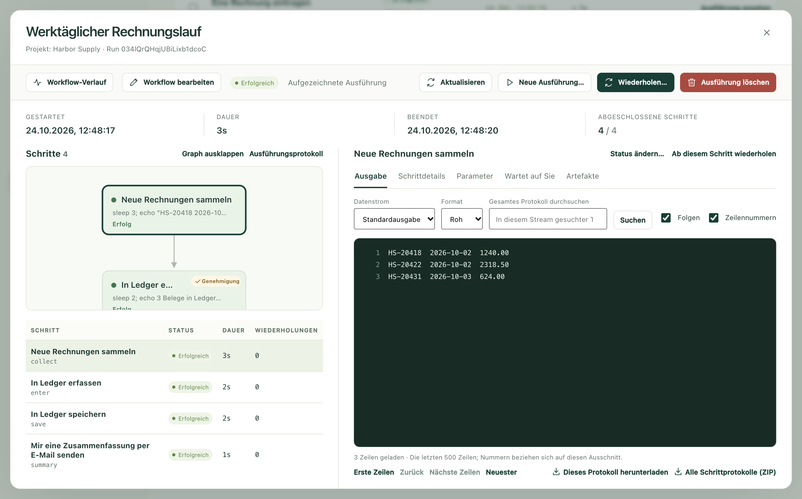
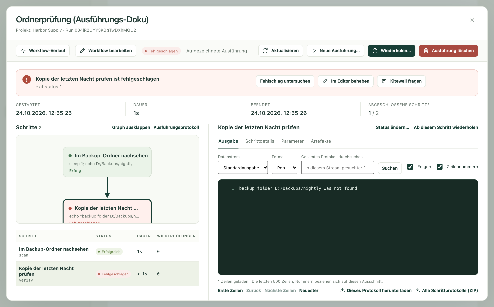

Jedes Mal, wenn ein Workflow läuft, hält Kitewell fest, was passiert ist:
welche Schritte gelaufen sind, was jeder ausgegeben hat, welche Dateien
entstanden sind und wie alles ausging. Hat eine Ausführung funktioniert,
müssen Sie selten hineinsehen. Hat sie es nicht, finden Sie hier heraus,
warum, und bringen es in Ordnung.

**Ausführungen & Logs** in der Seitenleiste öffnet diese Aufzeichnung unter
der Überschrift **Ausführungsverlauf**.

## Die gesuchte Ausführung finden

Die neuesten Ausführungen stehen oben. Sind es zu viele, grenzen Sie die Liste
ein:

- **Workflow** zeigt nur die Ausführungen eines Workflows. **Alle Workflows**
  zeigt alle.
- **Erstellt innerhalb** legt den Zeitraum fest. Voreingestellt ist
  **Letzte 7 Tage**; die weiteren Optionen reichen bis **Gesamter Zeitraum**.
- **Ausführungs-ID** findet eine einzelne Ausführung, wenn Sie ihre Kennung
  kennen. Das ist der kurze Code unter dem Namen des Workflows in der Liste;
  dort können Sie ihn auch kopieren.
- **Filter anwenden** wendet die Filter an, **Zurücksetzen** löscht sie.
  Zurücksetzen erweitert den Zeitraum auf **Gesamter Zeitraum**.

Oben in der Liste wechseln Sie mit **Alle Ausführungen**,
**Läuft / in Warteschlange**, **Wartet**, **Fehlgeschlagen**, **Verpasst**,
**Erfolgreich** und **Abgebrochen** zwischen den Ergebnissen. Eine Zeile
**Verpasst** ist keine Ausführung: Sie markiert einen geplanten Zeitpunkt, der
ohne Ausführung verstrichen ist, und nennt den Grund. Siehe
[Planungen](/de/docs/scheduling/#sleep-and-the-runs-that-were-missed).
Darüber zählen **Diese Seite**, **Läuft**, **Fehlgeschlagene Ausführungen**
und **Erfolgsquote**, was diese Seite an Ausführungen enthält.

Jede Zeile zeigt, welcher Workflow lief, wie er endete, was ihn gestartet hat,
wann das war und wie lange es dauerte. Als Auslöser steht dort Manuell,
Geplant, Zeitplantest, Nachholen, Wiederholen, API, Webhook oder
Unter-Workflow.

Außerdem finden Sie auf dieser Seite:

- **Warteschlangen** zeigt, wie viele Ausführungen jede Warteschlange gerade
  ausführt und wie viele warten. Eine wartende Ausführung können Sie dort
  herausnehmen.
- **Aktualisierung pausieren** hält die Liste an, während Sie lesen; danach
  steht dort **Aktualisierung fortsetzen**.
- **Seite exportieren** speichert die sichtbaren Zeilen als
  Tabellenkalkulationsdatei. Ausführungen auf anderen Seiten exportiert es
  nicht.
- **Stapel** öffnet die [Stapeltabellen](/de/docs/batches/).

## Eine Ausführung lesen

Wählen Sie am Ende einer Zeile **Ausführung ansehen** oder, wenn die
Ausführung fehlgeschlagen ist, **Fehlschlag untersuchen**.

Die Ausführung öffnet sich in einer eigenen Ansicht. Oben stehen
**Gestartet**, **Dauer**, **Beendet** und **Abgeschlossene Schritte**: wann
sie begann, wie lange sie dauerte, wann sie endete und wie viele Schritte sie
geschafft hat.

Links zeichnet **Schritte** die Ausführung als Diagramm und listet darunter
jeden Schritt mit **Status**, **Uhrzeit** und **Wiederholungen** auf.
**Graph ausklappen** gibt dem Diagramm mehr Platz, und
**Ausführungsprotokoll** zeigt die Aufzeichnung der Ausführung selbst statt
die eines Schritts.

Rechts steht, was Sie ausgewählt haben. Wählen Sie einen Schritt, dann gilt:

- **Ausgabe** zeigt, was er ausgegeben hat. **Datenstrom** wechselt zwischen
  **Standardausgabe** und **Fehler (stderr)**; ein fehlgeschlagener Schritt
  öffnet sich mit seinen Fehlern. Das **Ausführungsprotokoll** zeigt
  stattdessen **Ausführungsereignisse**.
- **Schrittdetails** zeigt, wie der Schritt endete und welchen Auftrag er
  hatte.
- **Parameter** zeigt die Werte, die diese Ausführung erhalten hat.
- **Artefakte** enthält die Dateien, die die Ausführung gespeichert hat.
- **Elemente** erscheint bei einem Schritt, der eine Liste abgearbeitet hat,
  mit einer Zeile pro Element.
- **Wartet auf Sie** erscheint, wenn jemand antworten muss.

## Ein Log durchsuchen oder aufbewahren

Logs können lang sein, und der Bereich zeigt jeweils den neuesten Teil.

- **Gesamtes Protokoll durchsuchen** durchsucht für den angezeigten
  Datenstrom die ganze Datei, nicht nur den sichtbaren Teil. Geben Sie den
  Text ein und wählen Sie **Suchen**. Bei einem langen Log erscheint
  **Suche fortsetzen**, wenn noch mehr zu durchsuchen ist.
- Mit **Erste Zeilen**, **Zurück**, **Nächste Zeilen** und **Neuester**
  bewegen Sie sich darin. **Folgen** hält während einer laufenden Ausführung
  die neuesten Zeilen im Blick; **Zeilennummern** blendet Nummern ein.
- **Dieses Protokoll herunterladen** speichert den Datenstrom, den Sie gerade
  lesen. **Alle Schrittprotokolle (ZIP)** speichert die Logs aller Schritte in
  einer Datei.

## Wenn jemand handeln muss

Wartet eine Ausführung auf eine Person, steht das oben, zusammen mit der Zahl
der wartenden Schritte und **Schritte prüfen**, das direkt dorthin führt.
Dieselben Ausführungen finden Sie in der Liste unter **Wartet**.

**Wartet auf Sie** enthält eine Karte pro wartendem Schritt. Eine Aufgabe für
eine Person bietet **Aufgabe abschließen**; eine Genehmigung bietet
**Genehmigen**, **Zurückgeben** oder **Ausführung ablehnen**; ein
automatischer Schritt, der eine Frage gestellt hat, nimmt **Ihre Antwort**
entgegen. Siehe
[Einen Workflow erstellen](/de/docs/workflow-builder/#stop-and-ask-a-person).

## Eine fehlgeschlagene Ausführung beheben

Eine fehlgeschlagene Ausführung öffnet sich mit dem Fehlschlag ganz oben:
welcher Schritt fehlgeschlagen ist und wie.

Von dort aus:

- **Fehlschlag untersuchen** wählt den fehlgeschlagenen Schritt aus, damit Sie
  seine Ausgabe lesen können.
- **Im Editor beheben** öffnet den Workflow auf dem Stand dieser Ausführung.
  Die Eingaben der Ausführung und die Werte, die ihre früheren Schritte
  gesammelt haben, sind bereits eingesetzt. Korrigieren Sie den Schritt,
  wählen Sie dann **Speichern und fortsetzen…** und legen Sie unter
  **Beginnen bei** fest, wo es weitergeht. Kitewell startet von dort eine neue
  Ausführung mit denselben Eingaben und Dateien. Die fehlgeschlagene
  Ausführung bleibt in der Aufzeichnung.
- **Den Assistenten fragen** übergibt den Fehlschlag an
  [den Assistenten](/de/docs/ai/#the-assistant), der die Ursache sucht und
  eine Korrektur vorschlägt.
- Ist die [Fehlerdiagnose](/de/docs/ai/#failure-diagnosis) eingeschaltet,
  sagt die Ausführung außerdem, was der Fehlschlag verlangt und welchen
  Schritt Sie sich ansehen sollten.

## Erneut ausführen

- **Wiederholen…** setzt dieselbe Ausführung unter derselben Ausführungs-ID
  fort, mit dem Workflow und den Eingaben, die zu ihr aufgezeichnet sind.
  Unter **Umfang der Wiederholung** wählen Sie
  **Fehlgeschlagene und unfertige Schritte** oder **Ein ausgewählter Schritt**.
  Wählen Sie **Wiederholung starten**. Frühere Versuche bleiben Teil der
  Ausführung.
- **Ab diesem Schritt wiederholen** über der Ausgabe eines Schritts öffnet
  dasselbe Formular bei diesem Schritt. Mit
  **Nachfolgende Schritte ebenfalls wiederholen** läuft auch die Arbeit, die
  danach kommt.
- **Neue Ausführung…** startet eine separate Ausführung mit einer neuen ID.
  Die aufgezeichneten Eingaben sind vorausgefüllt und lassen sich ändern.
  **Ausführen mit** wählt zwischen dem Workflow, wie er jetzt gespeichert ist,
  und dem Workflow, wie diese Ausführung ihn aufgezeichnet hat. Wählen Sie
  **Neue Ausführung starten**. Die ursprüngliche Ausführung bleibt in der
  Aufzeichnung.
- **Ausführung abbrechen** stoppt eine Ausführung, die noch läuft oder noch
  in der Warteschlange steht.
- **Status ändern…** über der Ausgabe eines Schritts verbucht einen Schritt
  als **Erfolgreich** oder **Fehlgeschlagen**, ohne ihn auszuführen. Das ist
  für den Fall gedacht, dass Sie das, was er bewirken sollte, von Hand
  erledigt haben. Das Ergebnis der Ausführung wird neu ermittelt. Die Option
  steht bereit, sobald die Ausführung beendet ist und keine automatische
  Wiederholung mehr aussteht.

## Ausführungen löschen

**Ausführung löschen** entfernt eine beendete Ausführung samt Logs, Ausgaben
und Dateien. In der Liste markieren Sie mehrere und wählen **Löschen…**. Eine
Ausführung, die noch läuft oder gerade erst beendet wurde, bleibt erhalten,
und Kitewell weist darauf hin.

Von Hand aufräumen müssen Sie nicht. Kitewell entfernt einmal täglich
Ausführungen, die älter sind als
**Geräteeinstellungen → Aufbewahrung des Ausführungsverlaufs → Ausführungsverlauf aufbewahren für**;
voreingestellt sind 30 Tage. **Projekteinstellungen → Speicher** zeigt, wie
viel Platz der Verlauf jedes Workflows belegt, mit **Verlauf löschen…** für
jeden Workflow.

## Die Dateien einer Ausführung

**Artefakte** in der Seitenleiste listet die Dateien, die jede beendete
Ausführung im Projekt gespeichert hat, die neuesten zuerst. Ein Schritt
speichert eine Datei, indem er sie nach `$DAG_RUN_ARTIFACTS_DIR` schreibt
oder indem Sie im Schritteditor **Artefaktname (optional)** ausfüllen.

Filtern Sie nach **Workflow**, **Erstellt innerhalb** oder **Dateiname** und
nach Art: **Alle Dateien**, **Markdown**, **Bilder**, **Daten**,
**Text und Protokolle**. Wählen Sie eine Datei, um eine Vorschau zu sehen.
**Vollansicht** füllt das Fenster, und **Ausführung öffnen →** führt zu der
Ausführung, die die Datei erstellt hat. **Ältere Dateien anzeigen** reicht
weiter zurück. Dateien werden mit ihren Ausführungen entfernt und sind in
[Backups](/de/docs/backups/) enthalten.

## Wenn etwas nicht klappt

- **Die gesuchte Ausführung fehlt in der Liste.** Der Zeitraum beginnt bei
  den letzten 7 Tagen. Erweitern Sie **Erstellt innerhalb** oder löschen Sie
  die Filter mit **Zurücksetzen**.
- **Eine Schaltfläche, die Sie erwarten, fehlt.** Wiederholen, Abbrechen, das
  Beantworten eines wartenden Schritts und das Ändern eines Status erfordern
  die Berechtigung, Workflows auszuführen. Das Löschen einer Ausführung,
  **Im Editor beheben** und **Den Assistenten fragen** erfordern die
  Berechtigung zum Bearbeiten.
- **Eine alte Ausführung ist verschwunden.** Ausführungen, die älter als die
  Aufbewahrungsdauer sind, werden einmal täglich entfernt, und mit einem
  gelöschten Workflow kann auch sein Verlauf verschwinden.

## Details

- Die Liste zeigt bis zu 50 Ausführungen pro Seite, die zuletzt erstellten
  zuerst. Zeiträume und Sortierung richten sich nach dem Zeitpunkt, zu dem
  eine Ausführung erstellt wurde; eine Wiederholung behält diesen Zeitpunkt.
- Eine geöffnete Ausführung lädt sich alle 3 Sekunden neu, solange sie noch
  läuft.
- Ein Log-Bereich lädt jeweils 500 Zeilen. Eine Ausführung öffnet sich mit
  den letzten 500 Zeilen eines Schritts und den letzten 200 Ereignissen der
  Ausführung selbst. Eine Suche liefert bis zu 100 passende Zeilen auf einmal,
  bricht nach 30 Sekunden ab und sagt, wo sie fortgesetzt werden kann.
- **Alle Schrittprotokolle (ZIP)** enthält Standardausgabe und Fehler jedes
  Schritts. Das Ereignisprotokoll der Ausführung selbst ist nicht enthalten;
  laden Sie es separat herunter.
- **Status ändern…** setzt immer einen Schritt, nie eine ganze Ausführung,
  und nur auf **Erfolgreich** oder **Fehlgeschlagen**.
