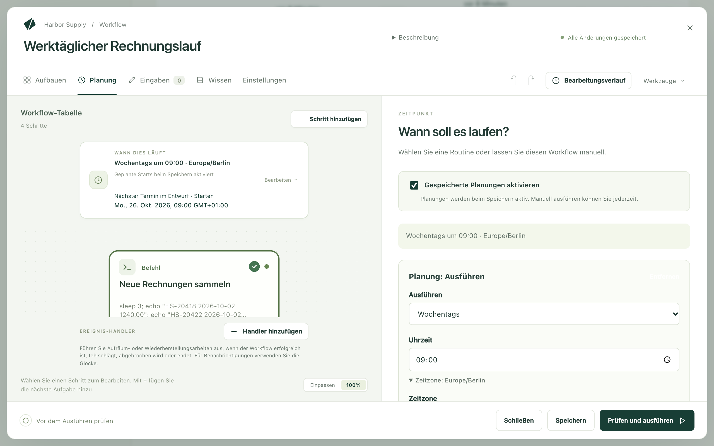

Kitewell kann einen Workflow für Sie starten: jeden Werktag um 9:00, einmal
pro Stunde oder wenn ein anderer Dienst eine Anfrage schickt. Die Arbeit läuft
auf diesem Computer. Unter Windows läuft sie, ob Sie angemeldet sind oder
nicht; auf einem Mac, solange Sie angemeldet sind.

## Eine Planung festlegen

1. Öffnen Sie den Workflow und wählen Sie **Planung**.
2. Achten Sie darauf, dass **Gespeicherte Planungen aktivieren** angehakt ist.
3. Wählen Sie unter **Ausführen**, wie oft: **Jeden Tag**, **Wochentags**,
   **Jede Woche**, **Jede Stunde** oder **Eigene Planung**.
4. Stellen Sie die Uhrzeit ein. Eine eigene Planung nimmt einen Cron-Ausdruck
   mit fünf Feldern an.
5. Öffnen Sie **Zeitzone**, wenn die Uhrzeit für einen bestimmten Ort gilt.
   Ohne Angabe folgt die Planung der Uhr dieses Computers, Sommerzeit
   eingeschlossen.
6. Wählen Sie **Speichern**.

**Die nächsten 5 geplanten Ereignisse** unter dem Formular zeigt, wann der
Workflow tatsächlich laufen würde. Darunter sagt eine Zeile, was die Planung
auf diesem Computer bedeutet: **Wird laufen, angemeldet oder nicht**,
**Läuft nur, während Sie angemeldet sind** oder **Wird nicht laufen**, mit dem
Grund und der Schaltfläche, die das Problem behebt.

**Zeitplan jetzt testen** führt den Workflow einmal genau so aus, wie es die
Planung täte, und öffnet die Ausführung. Nutzen Sie das, bevor Sie einer
Planung die Nacht anvertrauen.

## Prüfen, ob die Ausführungen heute Nacht stattfinden

Die Liste **Workflows** zeigt dieselbe Einschätzung unter dem nächsten Start
jedes Workflows. Ein Banner oben auf der Seite sagt in einer Zeile, was den
Ausführungen heute Nacht im Weg steht, und bietet die Lösung gleich daneben
an. Steht nichts im Weg, erscheint kein Banner.

Die Einschätzung berücksichtigt: ob der Computer angemeldet sein wird, das
Projekt und seine Engine, einen pausierten oder zurückgehaltenen Workflow,
einen Schritt, der den Bildschirm braucht, eine Browser-Anmeldung, die Ihr
Passwort braucht, und eine Planung, die in einer anderen Zeitzone angegeben
ist.

## Ausführen, wenn niemand angemeldet ist (Windows)

Schalten Sie **Geräteeinstellungen → Ausführen, wenn niemand angemeldet ist**
ein. Eine einzige Administratorabfrage, ohne Passwort, richtet einen kleinen
Windows-Dienst namens Kitewell sign-in ein. Er startet die Engine, wenn der PC
hochfährt, und führt Ihre Planungen unter Ihrem Konto aus, ob Sie angemeldet
sind oder nicht.

Die Karte dort zeigt das Ausführungskonto, die Anmeldung, die Engine, die
nächste geplante Ausführung und den Ruhezustand. Dort schalten Sie den Dienst
auch wieder aus.

Zwei Arten von Schritten brauchen Sie weiterhin am PC: einen Desktop-Schritt
und einen Website-Schritt, der sein Browserfenster anzeigt. Bei ihren
Workflows steht **Läuft nur, während Sie angemeldet sind**. Alles andere läuft
so oder so.

**Mein Passwort verwenden…** auf der Karte ist optional. Hinterlegen Sie Ihr
Passwort, wenn ein Workflow eine Netzwerkfreigabe braucht oder eine
Website-Anmeldung, die Windows mit Ihrem Passwort schützt.
**Passwort vergessen** entfernt es wieder. Bei einem Microsoft- oder
Arbeitskonto kann die Anmeldung selbst das Passwort brauchen; die Karte weist
dann darauf hin und fragt danach.

## Kitewell am Laufen halten

Wenn Sie das Fenster schließen, hält nichts an: Kitewell bleibt auf einem Mac
in der Menüleiste und unter Windows im Infobereich.
**Bei der Anmeldung öffnen**, unter Windows **Bei der Anmeldung starten**, öffnet
Kitewell, wenn Sie sich anmelden. **Kitewell beenden** stoppt auf einem Mac
die Engines; unter Windows mit eingeschaltetem Dienst läuft die Engine ohne
das Fenster weiter.

## Ruhezustand und verpasste Ausführungen

Unter Windows mit eingeschaltetem Dienst bleibt der PC rund um eine geplante
Ausführung wach und wacht für die nächste aus dem Ruhezustand auf, sofern der
Energiesparplan Zeitgeber zur Aktivierung erlaubt. Ein Mac im Ruhezustand
führt nichts aus; **Geräteeinstellungen → Ruhezustandsschutz** hält ihn wach,
solange Arbeit läuft.

Ein geplanter Zeitpunkt, der ohne Ausführung verstrichen ist, erscheint unter
**Ausführungen & Logs** als Zeile **Verpasst**, zusammen mit dem Grund: Das
Gerät war im Ruhezustand, Kitewell lief nicht, die Engine des Projekts lief
nicht, oder es startete keine Ausführung. Die Zeile sagt, ob das Nachholen
den verpassten Termin ausgleicht, und verlinkt auf die Ausführung, die ihn
nachgeholt hat.

Das Nachholen führt die verpassten Starts aus, sobald der Computer wieder
bereit ist, und blickt standardmäßig 24 Stunden zurück. Ändern lässt sich das
unter **Planung → Versäumte Planungen**.

## Wenn etwas nicht klappt

- **Zur geplanten Zeit lief nichts.** Öffnen Sie **Ausführungen & Logs** und
  suchen Sie nach einer Zeile **Verpasst**: Sie nennt den Grund. Prüfen Sie
  dann die Einschätzung unter dem nächsten Start des Workflows.
- **Es lief zur falschen Zeit.** Prüfen Sie **Zeitzone** in der Planung und
  die Zeiten unter **Die nächsten 5 geplanten Ereignisse**.
- **Nach dem Aufwachen des Computers starteten mehrere Ausführungen auf einmal.**
  Das ist das Nachholen. Setzen Sie **Regel für versäumte Planungen** auf
  **Nur den neuesten versäumten Termin ausführen** oder stellen Sie das
  Nachholen auf **Aus**.
- **Die Einschätzung lautet „Wird nicht laufen“.** Drücken Sie die
  Schaltfläche daneben. Je nach Grund schaltet sie den Dienst ein, fragt nach
  einem Passwort, startet die Engine oder öffnet den Editor.

Mehr dazu unter [Fehlerbehebung](/de/docs/troubleshooting/).

## Mehr über Planungen

Die [Referenz zu Planungen](/de/docs/reference/scheduling/) behandelt den
Rest: was jede Einschätzung bedeutet, was der Windows-Dienst tut und was
nicht, Einstellungen und Grenzen des Nachholens, Warteschlangen, Webhooks und
die Menüeinträge.
