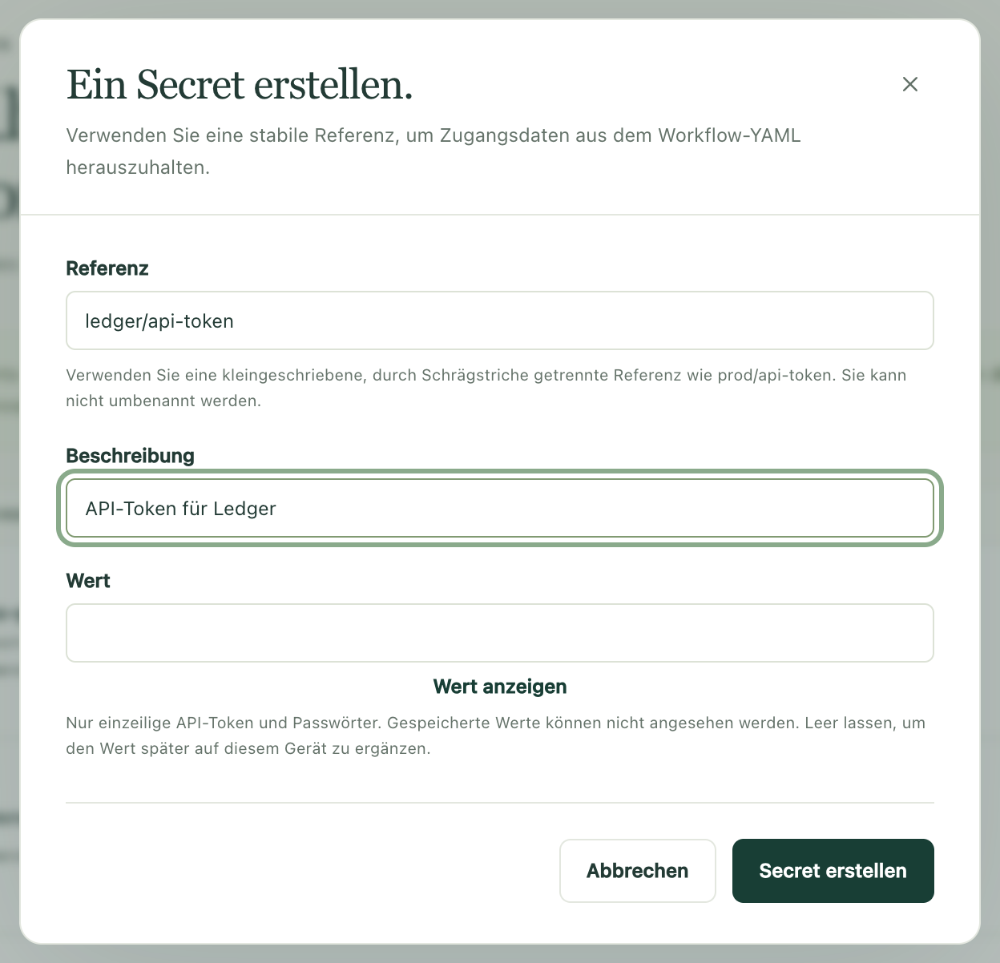
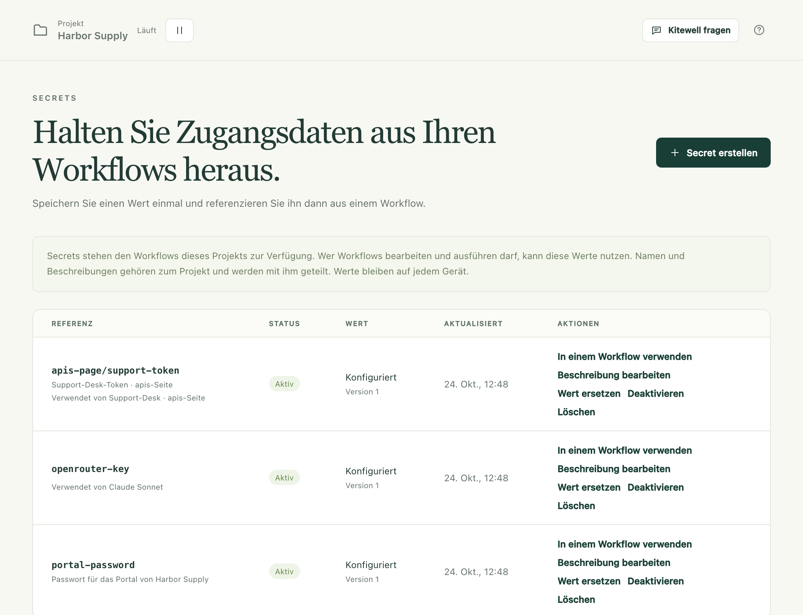

Ein Workflow braucht oft ein Passwort, ein API-Token oder einen Schlüssel.
Speichern Sie es einmal als Secret – Zugangsdaten, die Kitewell für Sie
aufbewahrt –, und der Workflow liest es über seinen Namen. Niemand muss es
erneut eingeben, es erscheint nie in einer Workflow-Definition, und Logs zeigen
`*******`, wo der Wert stünde.

## Was Sie brauchen

- Ein Projekt, das Sie bearbeiten dürfen. **Secrets** finden Sie in der
  Seitenleiste unter **Mehr**. In einem Projekt, das über Dagu Cloud zum
  Ansehen mit Ihnen geteilt wurde, können Sie die Werte dieses Geräts
  festlegen, aber kein Secret erstellen.
- Ein laufendes Projekt. Solange es pausiert ist, zeigt die Seite
  **Dieses Projekt ist pausiert**; wählen Sie **Fortsetzen**.

## Zugangsdaten speichern

1. Öffnen Sie **Mehr → Secrets** und wählen Sie **Secret erstellen**.
2. Geben Sie eine **Referenz** ein – den Namen, den der Workflow verwendet, etwa
   `services/api-token`. Verwenden Sie Kleinbuchstaben, Ziffern und
   Bindestriche, in Teilen, die durch Schrägstriche getrennt sind. Die Referenz
   lässt sich später nicht umbenennen.
3. Ergänzen Sie eine **Beschreibung**, damit die nächste Person weiß, wozu das
   Secret Zugang gibt.
4. Geben Sie die Zugangsdaten unter **Wert** ein. Mit **Wert anzeigen** prüfen
   Sie, was Sie eingefügt haben. Lassen Sie das Feld leer, um den Wert später
   auf diesem Gerät hinzuzufügen.
5. Wählen Sie **Secret erstellen**.

Das Secret erscheint in der Liste als **Aktiv**, sein Wert als **Konfiguriert**,
mit **Version** 1. Den Wert selbst zeigt Kitewell nie wieder an, weder hier
noch anderswo.

## In einem Workflow verwenden

Geben Sie im Workflow-Editor `${` in ein Feld eines Schritts ein und wählen Sie
das Secret unter **Secrets**. Kitewell bindet es an den Workflow und setzt
seinen Namen in das Feld; der Wert bleibt draußen.

Drei weitere Seiten nehmen ein Secret über seinen Namen statt über einen Wert:

- Der API-Schlüssel eines Modells, unter **Agenten und Modelle**.
- Das Passwort eines Servers oder Sprunghosts, unter **Server**.
- Die Zugangsdaten oder das Client-Secret einer importierten API, unter
  **API-Bibliothek**.

Um das YAML selbst zu schreiben, wählen Sie in der Zeile des Secrets
**In einem Workflow verwenden**. Kitewell zeigt einen `secrets:`-Block, den Sie
auf oberster Ebene einfügen. Er nennt die Umgebungsvariable, aus der die
Schritte den Wert lesen, etwa `SECRET_API_TOKEN` für `services/api-token`.

Wählen Sie in einem [Website-Schritt](/de/docs/browser/) oder einem
[Desktop-Schritt](/de/docs/desktop/) das Secret unter
**Werte, die der Browser eingibt** bzw. **Werte, die der Schritt eingibt**.
Die Anweisungen und das Modell sehen nur den Namen des Werts, geschrieben als
`%name%`; der Schritt gibt den Wert selbst ein.

[Der Assistent](/de/docs/ai/#the-assistant) kann beim Aufbau eines Workflows
nach einem Secret fragen. Es erscheint eine Karte, die anbietet, ein Secret mit
diesem Namen hinzuzufügen; Sie geben die Zugangsdaten unter **Wert** ein und
wählen **Speichern**, und der Assistent sieht nie, was Sie eingegeben haben.

## Wenn ein Gerät noch keinen Wert hat

Name und Beschreibung eines Secrets gehören zum Projekt. Sein Wert gehört zu
dem Gerät, auf dem Sie ihn eingegeben haben. Ein Projekt, das per Import oder
[Synchronisierung](/de/docs/cloud-sync/) ankommt, bringt die Namen mit und
braucht die Werte.

- **Wert erforderlich** kennzeichnet ein Secret, das das Projekt verwendet, für
  das es hier aber keinen Wert gibt. Wählen Sie **Wert festlegen**.
- Die **Übersicht** listet jedes Secret, das dieses Gerät noch braucht, mit
  **Wert festlegen** daneben.
- **Nur auf diesem Gerät** kennzeichnet ein Secret, das dieses Gerät hat, das
  Projekt aber nicht aufführt. Wählen Sie **Deklarieren**, um es dem Projekt
  hinzuzufügen.
- Eine Zeile, die mit **Verwendet von** beginnt, nennt, was das jeweilige
  Secret braucht – ein Modell, einen Workflow, einen Server oder eine API –,
  damit Sie wissen, welche Zugangsdaten Sie heraussuchen müssen.

Solange kein Wert festgelegt ist, lehnt Kitewell die Arbeit ab, statt sie auf
halbem Weg scheitern zu lassen. Eine Ausführung, die von Hand, per Webhook,
durch einen KI-Agenten oder durch den Assistenten gestartet wird, stoppt vor dem
Start mit „Legen Sie auf der Seite ‚Secrets‘ einen Wert für … fest und führen
Sie dann erneut aus.“ Ebenso abgelehnt werden das Wiederholen, erneute
Ausführen oder Fortsetzen einer Ausführung, das Starten eines Stapels, das
Aktualisieren der Zeilen einer Tabelle und das Testen eines einzelnen Schritts.
Die Planung einer Tabelle startet zu diesem Zeitpunkt nichts und nennt den
Grund. Die eigene Planung eines Workflows wird nicht abgelehnt: Ihre Ausführung
startet und schlägt fehl.

## Ändern oder entfernen

- **Wert ersetzen** speichert neue Zugangsdaten unter derselben Referenz. Die
  **Version** steigt, und nichts, was das Secret verwendet, muss bearbeitet
  werden.
- **Beschreibung bearbeiten** ändert die Beschreibung und sonst nichts.
- **Deaktivieren** verhindert, dass das Secret gelesen wird; der Wert bleibt.
  Eine Ausführung, die es braucht, startet und schlägt fehl. **Aktivieren**
  macht es wieder verfügbar.
- **Löschen** entfernt das Secret aus dem Projekt und seinen Wert von diesem
  Gerät. Andere Geräte, die das Projekt synchronisieren, verlieren den Namen.
  Ein Gerät, das einen Wert hatte, behält ihn, aufgeführt als
  **Nur auf diesem Gerät**, bis er auch dort gelöscht wird. Eine Referenz, die
  noch etwas verwendet, bleibt mit **Verwendet von** aufgeführt und braucht ein
  anderes Secret.

## Wenn etwas nicht klappt

- **„Legen Sie auf der Seite ‚Secrets‘ einen Wert für … fest und führen Sie dann erneut aus.“**
  Dieses Gerät hat keinen Wert für dieses Secret. Öffnen Sie **Secrets**,
  wählen Sie **Wert festlegen** und führen Sie erneut aus.
- **„Dieses Projekt ist pausiert“.** Wählen Sie **Fortsetzen** und versuchen
  Sie es dann erneut.
- **Ein Wert über mehrere Zeilen wird abgelehnt.** Unterstützt werden nur
  einzeilige Tokens und Passwörter. Ein Schlüssel über mehrere Zeilen muss den
  Schritt auf anderem Weg erreichen, etwa als Datei, die der Schritt liest.
- **„already has a value on this device“.** Das Erstellen eines Secrets
  überschreibt nie einen gespeicherten Wert. Verwenden Sie stattdessen
  **Wert ersetzen**.

## Was das schützt und was nicht

Secrets werden von der Engine des Projekts verschlüsselt auf der Festplatte
gespeichert. Der Schlüssel, der sie entschlüsselt, ist seinerseits mit einem
Geräteschlüssel versiegelt, den das Betriebssystem verwahrt: Unter Windows ist
das ein Schlüssel, den nur dieser PC öffnen kann, sodass eine Kopie des
Datenordners anderswo nichts preisgibt. Während eine Ausführung läuft, erhält
jeder ihrer Schritte die Secrets, die ihr Workflow bindet.

Es ist keine Sandbox. Wer die Workflows dieses Projekts bearbeiten und
ausführen kann, kann einen Schritt schreiben, der seine Secrets liest, und ein
Schritt läuft mit den Rechten der Person, die Kitewell ausführt. Getrennte
Projekte trennen Secrets; sie begrenzen nicht, was ein Befehl tun kann.

Kitewell zeigt in Logs, Ausführungsdetails und Ausgaben `*******` anstelle des
genauen Werts eines Secrets. Ein Wert, den ein Schritt vor der Ausgabe kodiert,
kürzt oder umwandelt, wird möglicherweise nicht maskiert, ebenso wenig einer,
den ein Schritt in eine Datei oder ein Artefakt schreibt. Geben Sie keine
Zugangsdaten aus.

## Exporte, Synchronisierung, Releases und Backups

| Wohin das Projekt geht | Namen und Beschreibungen | Werte |
| --- | --- | --- |
| Ein [Export](/de/docs/sharing/) des Projekts | Enthalten, samt Referenzen | Nicht enthalten |
| [Synchronisierung mit Dagu Cloud](/de/docs/cloud-sync/) | Mit dem Projekt synchronisiert | Nie gesendet |
| Ein [Release](/de/docs/releases/) | Die, die seine Workflows lesen | Nicht enthalten |
| Ein [Backup](/de/docs/backups/) des Geräts | Enthalten | Nicht enthalten, ebenso wenig ihre Schlüssel |

Wer das Projekt erhält, sieht jedes Secret als **Wert erforderlich** und legt
einen eigenen Wert fest.

Das Wiederherstellen eines Backups entfernt die Werte, die dieses Gerät hat,
selbst auf dem Gerät, das das Backup erstellt hat. Geben Sie die Zugangsdaten
erneut ein: Die Wiederherstellung nennt für jedes Projekt bis zu fünf davon,
und **Secrets** und **Übersicht** listen jedes, das noch fehlt. Bewahren Sie
die Zugangsdaten, die Sie für eine Wiederherstellung bräuchten, gesondert und
geschützt auf.

Akzeptiert Dagu Cloud ein neues Secret für das Projekt nicht, wird der Wert
trotzdem auf diesem Gerät gespeichert und als **Nur auf diesem Gerät**
aufgeführt. Andere, die das Projekt synchronisieren, sehen es erst, wenn es
deklariert ist – es sei denn, etwas Synchronisiertes verwendet diesen Namen
bereits.

Exporte und Backups sind nicht verschlüsselt. Zugangsdaten, die direkt in einen
Workflow, eine OpenAPI-Datei oder eine Quell-URL geschrieben wurden, stehen im
Archiv so, wie sie geschrieben wurden. Prüfen Sie ein Archiv, bevor Sie es
teilen, und verschlüsseln Sie es selbst, bevor Sie es in einen gemeinsamen
Speicher legen.

## Details

- Eine Referenz entspricht `^[a-z0-9][a-z0-9-]*(/[a-z0-9][a-z0-9-]*)*$` und hat
  höchstens 80 Zeichen. Eine Beschreibung ist eine Zeile mit höchstens 200
  Zeichen.
- Werte sind nur einzeilig, weil die Log-Maskierung der Engine Zeile für Zeile
  arbeitet.
- Der Speicher ist Dagus AES-256-GCM-Secret-Registry unter
  `engines/<project>/data/secrets`. Ihr Schlüssel liegt versiegelt in
  `engines/<project>/key.sealed`, unter dem Geräteschlüssel `device.key`, den
  Windows allein für diesen PC versiegelt; auf einem Mac ist der
  Geräteschlüssel eine Datei, die nur Ihr Benutzer lesen kann. Keine dieser
  Dateien ist in einem Backup.
- Ein Geräteschlüssel wird einmal im Jahr erneuert, und alles, was damit
  versiegelt ist, wird neu versiegelt; **Geräteeinstellungen → Gespeicherte Geheimnisse**
  zeigt, wann, und bietet **Jetzt neuen Schlüssel erstellen** an. Geht der
  Schlüssel je verloren, etwa nach einer Neuinstallation von Windows, weist
  derselbe Abschnitt darauf hin, und jeder gespeicherte Wert muss erneut
  eingegeben werden. Workflows und ihre Daten bleiben unberührt.
- Die Engine liest die Secrets einer Ausführung beim Start und gibt sie ihren
  Schritten als Umgebungsvariablen. Kitewell selbst liest einen Wert nur, um ihn
  für Sie zu verwenden: den Schlüssel eines Modells für den Assistenten oder
  eine Tabelle, das Client-Secret einer API, wenn Sie die API verbinden, einen
  Wert, den der Browser des Assistenten eingibt, und die Werte, die es aus den
  Berichten der Probeläufe des Assistenten heraushält.
- Die Liste zeigt 50 Secrets pro Seite, mit **Zurück** und **Weiter**.
- Anmeldungen bei Container-Registries, Postfächern und APIs werden als
  Engine-interne Werte gespeichert und hier nicht aufgeführt. Verwalten Sie sie
  unter **Projekteinstellungen**, **E-Mail-Konten** und **API-Bibliothek**.
