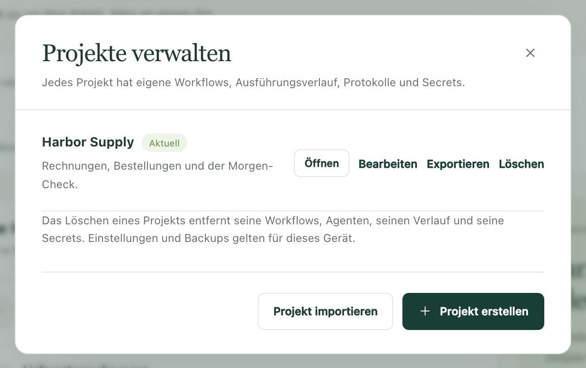

Bauen Sie einen Ablauf einmal auf und geben Sie das ganze Projekt an jemanden
aus Ihrem Team weiter oder an Ihren eigenen zweiten Computer. Dort kommen die
Workflows an und die Namen der Einstellungen, die diese Workflows brauchen,
aber nichts von Ihnen, was bleiben soll, wo es ist: keine Passwörter, kein
Ausführungsverlauf, keine Postfach-Anmeldungen.

Um alle Kopien gleich zu halten, während sich die Workflows ändern,
[synchronisieren Sie das Projekt stattdessen mit Dagu Cloud](/de/docs/cloud-sync/).
Ein Export ist eine Momentaufnahme und ist nicht mehr aktuell, sobald Sie
etwas bearbeiten.

## Ein Projekt an einen anderen Computer senden

1. Öffnen Sie die Projektauswahl oben in der Seitenleiste und wählen Sie
   **Verwalten**.
2. Wählen Sie unter **Projekte verwalten** neben dem Projekt **Exportieren**.
   Kitewell lädt eine Datei herunter,
   `kitewell-project-harbor-supply-20261005T091500.tgz`, mit dem Namen des
   Projekts und dem Zeitpunkt im Dateinamen.
3. Senden Sie die Datei auf dem Weg, auf dem Ihr Team sonst Dateien
   austauscht.
4. Öffnen Sie auf dem empfangenden Computer **Projekte verwalten**, wählen
   Sie **Projekt importieren** und dann die Datei.
5. Kitewell meldet „Den Rest muss dieses Gerät bereitstellen:“ und listet,
   was fehlt: jedes Secret, das einen Wert braucht, ein Postfach, das
   verbunden werden muss, einen Rechner, dessen Hostschlüssel noch niemand
   genehmigt hat, einen eigenen Befehl und die Workflows, die pausiert
   angekommen sind. Wählen Sie **Öffnen** und arbeiten Sie diese Liste ab.



Ein Import legt immer ein neues Projekt an; er ersetzt nie ein vorhandenes.
Gibt es bereits ein Projekt mit diesem Namen, fragt Kitewell nach einem
anderen Namen.

Das neue Projekt zählt zum Limit des empfangenden Computers: ein Projekt im
kostenlosen Tarif, bis zu fünf mit Kitewell Personal und bis zu 15 mit Team.
Ein Projekt mit mehr Workflows, als der Tarif erlaubt (10 im kostenlosen
Tarif, 100 mit Personal und Team), lässt sich gar nicht importieren. Die
Datei selbst darf bis zu 16 MiB groß sein.

## Was mitkommt und was nicht

Die Datei enthält das Projekt als Satz einfacher Dokumente:

- Workflow-Definitionen mit ihren Planungen;
- benannte Agenten und Modelle;
- importierte OpenAPI-Dokumente und die Einstellungen ihrer
  API-Verbindungen;
- Serveradressen und Servergruppen, Warteschlangen und Image-Registrys;
- Stapeltabellen;
- die Namen und Beschreibungen von Secrets, aber nie ihre Werte;
- die Workflow-Standardwerte des Projekts und sein
  [Wissen](/de/docs/knowledge/);
- welches Release das Projekt zuletzt übernommen hat.

Den Rest stellt der empfangende Computer selbst bereit:

- Werte von Secrets und Passwörter für Registrys;
- Pfade zu privaten SSH-Schlüsseln und genehmigte Hostschlüssel;
- eigene Agent-Befehle, installierte Tools und Anmeldungen von Agenten;
- Postfachverbindungen;
- externe Skripte, Eingabedateien und Daten, die in Docker eingebunden
  werden.

Gar nicht enthalten sind: Ausführungsverlauf, Logs, Artefakte, Releases, der
lokale Bearbeitungsverlauf, die Benachrichtigungsregeln des Projekts, die
Einstellungen der Fehlerdiagnose, Website-Anmeldungen, Geräteeinstellungen
und die API-Schlüssel dieses Computers.

:::caution
Die Datei ist nicht verschlüsselt. Alles, was direkt in einen Workflow-Befehl,
ein OpenAPI-Dokument, eine Serveradresse oder eine andere Projekteinstellung
getippt wurde, reist so mit, wie es dort steht. Lesen Sie diese Felder, bevor
Sie die Datei senden, und bewahren Sie Zugangsdaten in
[Secrets](/de/docs/secrets/) auf, damit sie zurückbleiben.
:::

## Festlegen, welcher Computer die Planungen ausführt

Importierte Workflows kommen absichtlich pausiert an. Führen Sie einen
zuerst von Hand aus, prüfen Sie, was er getan hat, und schalten Sie dann die
Planungen ein, die dieser Computer übernehmen soll.

Schalten zwei Computer dieselbe Planung ein, führen beide sie aus,
unabhängig voneinander. Für einen Ablauf, der nur einmal stattfinden darf,
wählen Sie einen Computer, der ihn ausführt, und lassen die anderen Kopien
pausiert. Dieser Computer muss zur geplanten Zeit eingeschaltet und wach
sein. Siehe [Planungen und Hintergrundbetrieb](/de/docs/scheduling/).

## Andere im Team die Workflows auf einem Computer steuern lassen

Manchmal soll die Arbeit auf einem Rechner bleiben, und die anderen im Team
müssen sie nur starten, beobachten oder ändern. Geben Sie dann jeder Person
einen Schlüssel statt einer Kopie des Projekts.

1. Öffnen Sie auf diesem Computer **Dieses Gerät → MCP**.
2. Wählen Sie **KI-Agenten verbinden** und erstellen Sie einen Schlüssel pro
   Person oder pro Client, mit der **Berechtigung**, die die jeweilige Rolle
   braucht: **Nur lesen** zum Ansehen, **Workflows ausführen** zum Starten von
   Arbeit, **Bearbeiten und ausführen** zum Ändern von Workflows.
3. Beschränken Sie jeden Schlüssel unter **Erlaubte Projekte** auf die
   Projekte, die die Person braucht.

Die Personen verwenden dann einen beliebigen MCP-Client oder einfache
HTTP-Anfragen an diesen Computer. Der kostenlose Tarif erlaubt insgesamt
einen API-Schlüssel oder eine verbundene App; Kitewell Personal und Team
erlauben beliebig viele. Wenn Personen einer Organisation einen Computer auf
diese Weise teilen, ist Kitewell Team erforderlich; siehe
[Preise](/de/pricing/). Jede Ausführung läuft weiterhin unter dem Benutzer
dieses Computers. Ein Schlüssel begrenzt also, welche Projekte eine Person
erreicht, nicht, was ein Workflow tun darf, sobald er läuft. Die optionale
Anmeldung an der App selbst ist davon getrennt; diese Schlüssel legen dafür
keine Logins an.

Ein Client auf einem anderen Computer braucht eine Adresse, die er über HTTPS
erreichen kann und die Sie einrichten. Mehr dazu und zu den Berechtigungen im
Einzelnen unter [MCP und API-Zugriff](/de/docs/mcp/).

## Die Definitionen in der Versionsverwaltung halten

Die Dokumente eines Projekts sind gewöhnliche JSON- und YAML-Dateien; ein
Team kann sie also in seinem eigenen Git-Repository prüfen und versionieren.
Kitewell übernimmt für dieses Repository weder Push noch Pull noch Merge.

Die Dateien liegen im Datenordner von Kitewell, auf einem Mac unter
`~/Library/Application Support/Kitewell` und unter Windows unter
`%LOCALAPPDATA%\Kitewell`.

```text
data/workspace/project-<id>/
  project.json
  workflows/
  batch-sets/
  knowledge/
  agents/  apis/  queues/  registries/  secrets/  server-groups/  servers/
  releases/
```

`project.json` enthält Namen, Beschreibung und Workflow-Standardwerte des
Projekts sowie das Release, das es zuletzt übernommen hat. `workflows`
enthält eine YAML-Datei pro Workflow, `batch-sets` eine Datei pro
Stapeltabelle, `knowledge` eine pro Wissensseite, `releases` eine pro
Release, und jeder übrige Ordner eine JSON-Datei pro Agent, API-Verbindung,
Warteschlange, Registry, Secret-Name, Servergruppe oder Server. Versionieren
Sie den ganzen Ordner `project-<id>`; den richtigen erkennen Sie am Namen in
seiner `project.json`. Lassen Sie die Dateistruktur und die Dokument-IDs, wie
sie sind.

Beenden Sie Kitewell, bevor Sie Dateien ersetzen oder Änderungen aus dem
Repository übernehmen, lösen Sie die Konflikte, öffnen Sie Kitewell dann
wieder und sehen Sie sich das Projekt an, bevor Sie etwas ausführen. Das
Beenden unterbricht laufende Ausführungen; warten Sie also zuerst, bis sie
fertig sind. Verwalten Sie ein [synchronisiertes Projekt](/de/docs/cloud-sync/)
nicht auf diese Weise: Kitewell verwaltet diese Dateien und ersetzt sie, wenn
eine Änderung von Dagu Cloud eintrifft.

Teilen Sie nur diesen einen Ordner, nicht den ganzen Datenordner.
Zugangsdaten des Geräts, Werte von Secrets und Ausführungsdaten gehören zu
jedem einzelnen Computer. Für jemanden, der neu dazukommt, sind
**Projekt importieren** und ein geprüfter Export der bessere Weg.

## Ein Roboterverzeichnis exportieren

Viele Teams führen ein Roboterverzeichnis: eine Zeile pro Automatisierung,
die sagt, was sie tut, worauf sie zugreift und wer sie betreut. Auf der Seite
**Workflows** lädt **Verzeichnis exportieren** ein solches Verzeichnis als
Excel-Arbeitsmappe herunter, mit einer Zeile pro Workflow und den Spalten in
der Reihenfolge, in der das Center for Financial Industry Information Systems
(FISC) die Verwaltungsangaben eines Roboters aufführt.

Kitewell füllt aus, was es aus jedem Workflow und seinem
[Wissen](/de/docs/knowledge/) lesen kann, ohne ein Modell zu fragen:
**Robotername** und **Roboter-ID**, **Ausführungszyklus** und **Status**,
**Folgebedingungen** für die Workflows, die er startet,
**Geschäftsbeschreibung**, **Ein- und Ausgabedaten** für die Arbeitsmappen,
die er öffnet, **Verbundene Systeme** für die Websites, APIs, Server,
Postfächer und Modelle, auf die er zugreift, und **Dokumente** mit seinen
Wissensseiten in voller Länge.

Sechs Spalten bleiben leer, damit Sie sie ausfüllen:
**Verantwortliche Person**, **Auftragnehmer**, **Vorgehen bei Fehlern**,
**Geschäftliche Bedeutung**, **Auswirkung auf Kunden** und
**Rechtliche und regulatorische Auswirkungen**. Die Spaltennamen folgen der
Sprache, in der Kitewell angezeigt wird.
