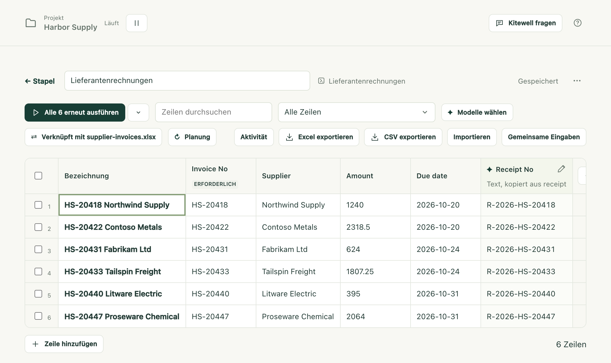
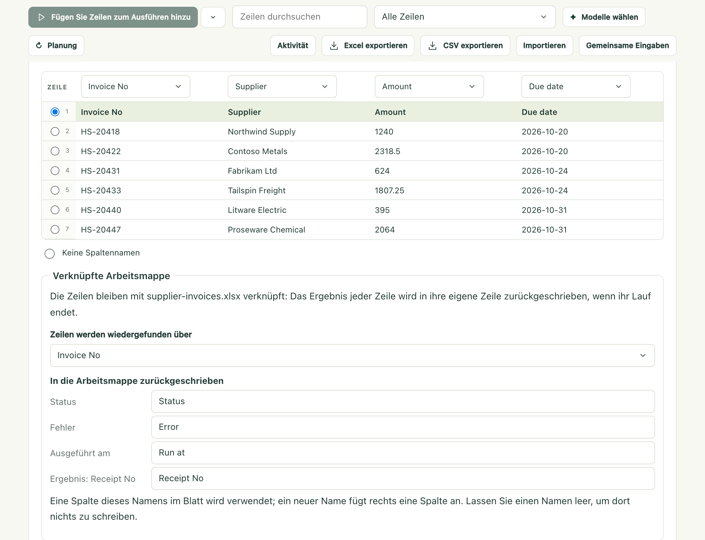

Sie haben eine Liste in Excel, etwa die Rechnungen dieses Monats, eine pro
Zeile, und mit jeder davon ist etwas zu tun. Kitewell führt Ihren Workflow
einmal für jede Zeile aus und schreibt jedes Ergebnis in die Zeile zurück, aus
der es stammt. Öffnen Sie danach dieselbe Datei, stehen die Eingangsnummern
neben den Rechnungen.

Excel öffnet sich dabei nie. Kitewell liest und schreibt die `.xlsx`-Datei
direkt und arbeitet deshalb auch nachts bei gesperrtem Bildschirm weiter.

## Ihre Arbeitsmappe verknüpfen

Sie brauchen die Kitewell-App auf dem Computer, auf dem die Datei liegt. Ein
Browser kann die Datei nicht erreichen und bietet das daher nicht an.

1. Legen Sie eine Tabelle für den Workflow an, der einmal pro Zeile laufen
   soll, wie unter [Workflow pro Tabellenzeile ausführen](/de/docs/batches/)
   beschrieben.
2. Wählen Sie in der Symbolleiste der Tabelle **Importieren**, dann
   **Eine Arbeitsmappe auf diesem Gerät verknüpfen**, und wählen Sie die
   `.xlsx`-Datei aus. Sie können die Datei auch auf das Kitewell-Fenster
   ziehen.
3. Prüfen Sie, was Kitewell gefunden hat: das **Blatt**, die Zeile mit den
   Spaltennamen und welche Spalte welche Eingabe füllt. Spalten, deren Name zu
   einer Eingabe passt, werden automatisch zugeordnet.
4. Wählen Sie unter **Zeilen werden wiedergefunden über** die Spalte, die die
   Zeilen voneinander unterscheidet, etwa die Rechnungsnummer.
5. Unter **In die Arbeitsmappe zurückgeschrieben** sehen Sie die Spalten, in
   die die Ergebnisse kommen: **Status**, **Fehler**, **Ausgeführt am** und
   eine Spalte pro Ergebnis. In der Arbeitsmappe heißen die ersten drei
   „Status“, „Error“ und „Run at“. Benennen Sie Spalten bei Bedarf um, oder
   leeren Sie einen Namen, damit dort nichts geschrieben wird.
6. Wählen Sie **Verknüpfen und 6 Zeilen hinzufügen**.

Die Tabelle zeigt jetzt die Zeilen der Arbeitsmappe, und die Symbolleiste
zeigt **Verknüpft mit** und den Namen der Datei.

## Die Zeilen ausführen

Führen Sie die Zeilen aus wie bei jeder anderen Tabelle. Eine Zelle, die nicht
zu dem werden kann, was ihre Eingabe erwartet, etwa „zwölf“ in einer
Betragsspalte, wird umrandet. Diese Zeile wartet, bis Sie den Wert korrigieren.

Wenn Zeilen fertig sind, schreibt Kitewell ihre Ergebnisse innerhalb von etwa
einer halben Minute von selbst in die Arbeitsmappe.
**Ergebnisse jetzt schreiben** wartet nicht.

| Spalte | Inhalt |
| --- | --- |
| Status | Done, Partly failed, Failed, Stopped oder Rejected |
| Error | In einer Zeile, warum die Zeile fehlgeschlagen ist |
| Run at | Wann die Zeile ausgeführt wurde |
| Eine pro Ergebnis | Ein Wert, den die Ausführung erzeugt hat, etwa eine Eingangsnummer |

Eine Arbeitsmappe mit japanischen Spaltenköpfen erhält stattdessen japanische
Wörter: 状態, エラー, 実行日時 und 済 für Done. Chinesische und koreanische
Spaltenköpfe erhalten ebenso chinesische und koreanische Wörter.

## Wenn die Datei in Excel geöffnet ist

Unter Windows schlägt nichts fehl. Die Tabelle meldet, dass die Ergebnisse
bereitstehen und geschrieben werden, sobald die Datei in Excel geschlossen ist.
In dem Moment, in dem Sie sie schließen, schreibt Kitewell sie.
**Ergebnisse in einer Kopie speichern** schreibt stattdessen
`supplier-invoices (results).xlsx` neben die Datei.

Auf dem Mac sperrt Excel die Datei nicht. Kitewell kann also nicht erkennen,
dass sie geöffnet ist, und schreibt die Ergebnisse trotzdem. Schließen Sie die
Arbeitsmappe in Excel, bevor die Zeilen fertig sind: Wenn Sie sie danach aus
Excel speichern, kann das die Ergebnisse überschreiben.

## Jeden Morgen

Geben Sie der Tabelle eine [Planung](/de/docs/scheduling/). Dabei werden zwei
weitere Dinge abgefragt: **Zuerst supplier-invoices.xlsx lesen** und
**Welche Zeilen laufen**, also **Jede Zeile** oder
**Nur die Zeilen, die die Arbeitsmappe hinzugefügt oder geändert hat**.

Mit der zweiten Option liest Kitewell jeden Morgen die Datei, führt aus, was
neu ist, und schreibt die Ergebnisse zurück. Hat sich nichts geändert, startet
nichts. Richten Sie die Planung auf dem Computer ein, auf dem die Datei liegt.
Ein anderer Computer kann sie nicht ausführen.

## Wenn etwas nicht klappt

- **Jemand hat das Blatt sortiert oder gefiltert.** Kitewell liest die Datei
  vor jedem Schreiben erneut und verfolgt jede Zeile über ihren Schlüssel. Eine
  verschobene Zeile wird ausgelassen und genannt, die übrigen werden
  geschrieben.
- **Ein Ergebnis wurde eingetragen, das dort nicht hingehört.** **Rückgängig**
  stellt die Datei wieder her. Kitewell behält vor jedem der letzten zehn
  Schreibvorgänge eine Kopie. In dieser Version trägt der nächste
  Schreibvorgang dieselben Ergebnisse erneut ein.
- **Die Arbeitsmappe wurde auf dem Datenträger geändert.** Die Tabelle bietet
  **Arbeitsmappe erneut lesen** an. Das übernimmt neue und geänderte Zeilen und
  markiert Zeilen, die die Arbeitsmappe nicht mehr hat, als
  **Nicht mehr gelistet**.
- **Ein Schritt schlägt fehl.** Siehe
  [Fehlerbehebung](/de/docs/troubleshooting/#a-spreadsheet-step-fails).

## Mehr zu Excel

Die [Excel-Referenz](/de/docs/reference/spreadsheets/) behandelt den Rest: ein
Angebot oder eine Bestellung lesen, die als Formular aufgebaut ist, die zehn
Tabellenschritte, die ein Workflow verwenden kann, dieselbe Arbeit als Schritte
statt als Tabelle aufbauen, was auf Ihrem Computer bleibt, und die Grenzen.
