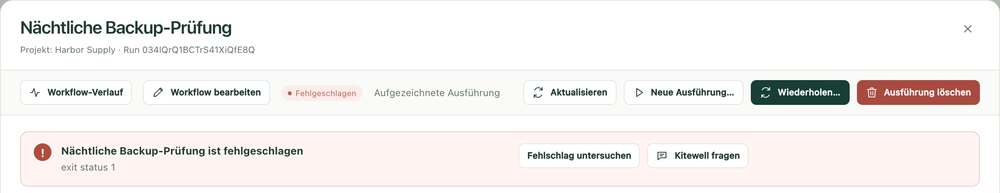
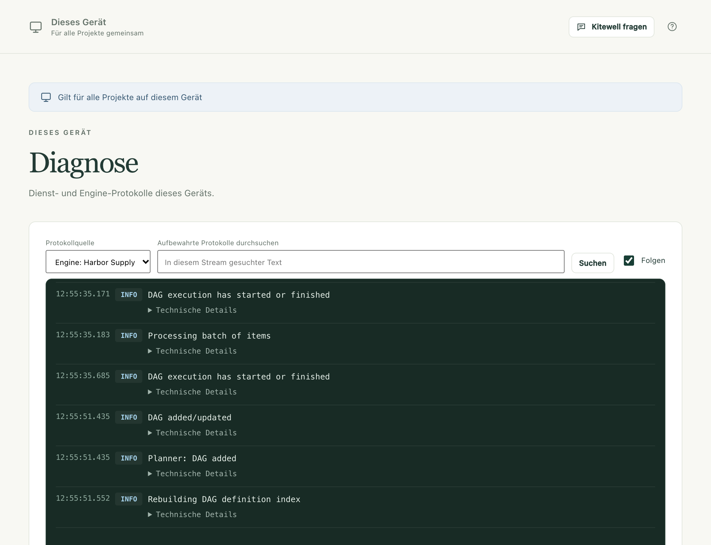

Suchen Sie, was schiefgegangen ist, und lesen Sie, was Sie dagegen tun können.
Passt nichts davon, [eröffnen Sie eine Support-Anfrage](/de/support/) mit Ihren
Versionen, dem, was Sie getan haben, und der Ausgabe ohne Passwörter.

## Eine Ausführung ist fehlgeschlagen

Öffnen Sie die Ausführung unter **Ausführungen & Logs**. Eine Zusammenfassung
oben nennt den fehlgeschlagenen Schritt und seine Meldung.

- **Fehlschlag untersuchen** zeigt diesen Schritt und sein Log.
- **Den Assistenten fragen** lässt den Assistenten der Sache für Sie nachgehen.
- **Im Editor beheben** öffnet den Workflow beim fehlgeschlagenen Schritt,
  damit Sie ihn korrigieren und die Ausführung ab einem Schritt Ihrer Wahl
  fortsetzen können. Es wird bei einer Ausführung angeboten, die aus dem
  eigenen Verlauf des Workflows geöffnet wurde: Wählen Sie in **Workflows**
  neben dem Workflow **Ausführungsverlauf ansehen**.

Ist die [Fehlerdiagnose](/de/docs/ai/#failure-diagnosis) eingeschaltet, sagt
die Ausführung außerdem, ob sich ein neuer Versuch lohnt, was Sie tun müssen
oder was zu ändern ist. Siehe
[Ausführungen und Logs](/de/docs/runs/#fix-a-failed-run).

## Ein Befehl funktioniert im Terminal, aber nicht in Kitewell

Die Umgebung von Kitewell ist nicht die, die Ihnen Ihr Terminal bietet. Geben
Sie das Programm mit vollständigem Pfad an, legen Sie im Schritt einen
Arbeitsordner fest und setzen Sie die Variablen, die es braucht, statt sich auf
die zu verlassen, die Ihre Shell für Sie gesetzt hat. Prüfen Sie auch, ob der
Befehl darauf wartet, dass jemand eine Antwort eintippt, oder Zugangsdaten
verwendet, die nur in Ihrer Terminalsitzung existieren.

## Ein geplanter Workflow ist nicht gelaufen

Öffnen Sie zuerst **Ausführungen & Logs**. Eine Zeile **Verpasst** zur geplanten
Zeit nennt den Grund: Das Gerät war im Ruhezustand, Kitewell lief nicht, die
Engine des Projekts lief nicht, oder es wurde keine Ausführung gestartet.

Öffnen Sie dann **Workflows**. Die Zeile unter dem nächsten Start des Workflows
sagt, was aus seiner Planung jetzt wird – **Wird laufen**,
**Läuft nur, während Sie angemeldet sind** oder **Wird nicht laufen** –, mit
dem Grund und einer Schaltfläche, die das behebt. Das Banner oben auf der Seite
sagt dasselbe für das ganze Projekt.

Sagt keines von beiden etwas, prüfen Sie, ob die **Planung** des Workflows mit
Häkchen bei **Gespeicherte Planungen aktivieren** gespeichert ist und ihre
Zeitzone die gewünschte ist.

Auf einem Mac muss der Computer zu dieser Zeit wach und Sie angemeldet sein.
Unter Windows mit Kitewell Team läuft geplante Arbeit auch, wenn niemand
angemeldet ist, sobald der Anmeldedienst eingeschaltet ist; siehe
[Planungen](/de/docs/scheduling/#run-with-nobody-signed-in-windows).

Ein verpasster Start wird nur dann später nachgeholt, wenn der Workflow das
vorsieht. Siehe seine **Planung → Versäumte Planungen**.

## Ein Website-Schritt schlägt fehl

Sehen Sie sich zuerst die Bildschirmfotos des Schritts in den Artefakten der
Ausführung an. Eine Anmeldeseite, ein Cookie-Banner oder eine Bot-Prüfung
erklärt es meist. Prüfen Sie dann:

- Chrome ist installiert, unter Windows alternativ Microsoft Edge, und
  **Browser prüfen** ist erfolgreich;
- die Hosts der Seite stehen in
  **Erlaubte Websites · eine pro Zeile (optional)**, falls Sie das Feld
  ausgefüllt haben;
- die Wartezeiten reichen für die Seite;
- keine Anweisung enthält ein Passwort; tragen Sie es unter
  **Werte, die der Browser eingibt** ein;
- für den Schritt oder den Workflow ist ein Modell gewählt.

Hat sich die Website geändert und eine wiederholte Aktion funktioniert nicht
mehr, leeren Sie sie unter **Projekteinstellungen → Speicher → Wiedergabe-Cache**.
Siehe [Eine Website automatisieren](/de/docs/browser/).

## Ein Tabellenschritt schlägt fehl

Die meisten Ablehnungen nennen Arbeitsmappe, Blatt und Zelle. **Prüfen** im
Schritt fragt die Engine, bevor irgendetwas läuft. Häufige Ursachen:

- Der Pfad ist nicht der vollständige Pfad zu einer `.xlsx`- oder
  `.xlsm`-Datei auf diesem Computer. Eine `.xls`- oder `.ods`-Datei muss
  zuerst in Excel als `.xlsx` gespeichert werden.
- Das Blatt oder eine Spalte, die der Schritt nennt, ist nicht mehr in der
  Arbeitsmappe. Die Meldung listet auf, was stattdessen da ist.
- Eine Zelle lässt sich nicht in den Typ umwandeln, auf den eine Spalte
  festgelegt ist, etwa eine in Worten ausgeschriebene Menge.
- Die Datei ist in Excel geöffnet, was einen Schreibvorgang aufhält, bis sie
  geschlossen wird.
- Eine verbundene Zelle überdeckt die Stelle, an die der Schritt schreiben
  würde. Die Meldung nennt den Bereich, dessen Verbund Sie aufheben müssen.

Ein Schreibvorgang in eine verknüpfte Arbeitsmappe lässt sich in der Tabelle
rückgängig machen, solange sich die Datei nicht geändert hat, seit Kitewell
hineingeschrieben hat. Siehe [Excel automatisieren](/de/docs/spreadsheets/).

## Ein Desktop-Schritt schlägt fehl

Sehen Sie sich zuerst die Bildschirmfotos des Schritts in den Artefakten der
Ausführung an. Prüfen Sie dann:

- **Geräteeinstellungen → Desktop-Automatisierung → Desktop-Zugriff prüfen**
  meldet jede Berechtigung als erteilt. Auf einem Mac braucht
  **Kitewell Agent** die Berechtigungen für Bildschirmaufnahme und
  Bedienungshilfen;
- der Bildschirm ist entsperrt und der Computer wach. Bei gesperrtem
  Bildschirm schlägt jeder Desktop-Schritt fehl;
- unter Windows läuft die App nicht als Administrator, während Kitewell es
  nicht tut;
- die Aufgabe passt in **Höchstzahl an Aktionen pro Aufgabe** oder ist in
  kleinere Aufgaben aufgeteilt;
- das Modell hat ein Werkzeug für Computer-Use, oder der Schritt verwendet
  **Einfache Werkzeuge, für jedes Vision-Modell**;
- keine Anweisung enthält ein Passwort; tragen Sie es unter
  **Werte, die der Schritt eingibt** ein.

Ein Schritt, der darauf wartete, dass der Desktop frei wird, wurde von Ihrer
eigenen Maus oder Tastatur angehalten. Auf einem Computer, an dem niemand
arbeitet, verkürzen Sie diese Wartezeit unter **Desktop-Einstellungen** oder
schalten sie aus. Hat sich eine App geändert und eine wiederholte Aufgabe
funktioniert nicht mehr, leeren Sie sie unter
**Projekteinstellungen → Speicher → Wiedergabe-Cache**. Siehe
[Eine Desktop-App automatisieren](/de/docs/desktop/).

## Google meldet, dass die App blockiert ist

Bis Google die Prüfung des Gmail-Zugriffs von Kitewell abgeschlossen hat,
blockiert es für die meisten Konten die Anmeldung von Kitewell im Browser, und
die Seite bietet keinen Weg daran vorbei. Schließen Sie sie, kehren Sie zu
Kitewell zurück und wählen Sie **Stattdessen ein App-Passwort verwenden**.
Siehe [E-Mails automatisieren](/de/docs/email/).

## Ein Postfach muss neu verbunden werden

Eine Ausführung, die ein Postfach nennt, bei dem sich dieser Computer nicht
anmelden kann, wird abgelehnt, und die **Übersicht** sagt, welche Adresse Sie
verbinden oder neu verbinden müssen. Öffnen Sie **E-Mail-Konten** und wählen Sie
**Neu verbinden**. Häufige Ursachen:

- Das Passwort des Kontos hat sich geändert, oder ein Administrator hat seine
  Sitzungen beendet.
- Eine Google-Anmeldung wurde sechs Monate nicht genutzt, oder eine
  Microsoft-Anmeldung wurde zuletzt vor mehr als 90 Tagen erneuert, weil der
  Computer aus war.
- Ein App-Passwort wurde auf der Website des Anbieters gelöscht.
- Ein Administrator von Microsoft 365 hat IMAP oder authentifiziertes SMTP
  abgeschaltet oder verlangt seine Zustimmung für Kitewell. Die Fehlermeldung
  enthält den Link, den Sie ihm schicken.
- Ein Administrator von Google Workspace blockiert Apps von Drittanbietern.

Ein Projekt, das von einem Teammitglied oder aus Dagu Cloud kam, führt seine
Postfächer als nicht verbunden, bis Sie sie hier verbinden. Siehe
[E-Mails automatisieren](/de/docs/email/).

## Eine KI-Aufgabe schlägt fehl

Prüfen Sie, ob der Agent installiert und angemeldet ist oder ob das gewählte
Modell funktionierende Zugangsdaten beim Anbieter hat. **Agent testen** und
**Modell testen** unter **Agenten und Modelle** prüfen beides vor einer
Ausführung. Sehen Sie sich dann den aufgezeichneten Prompt und die
Fehlerausgabe der Aufgabe an, und prüfen Sie, ob der Anbieter Sie wegen Limits
oder Abrechnung gesperrt hat. Lassen Sie echte Zugangsdaten aus allem heraus,
was Sie melden.

## Docker ist nicht verfügbar

Starten Sie Docker auf diesem Computer und verwenden Sie dann **Docker prüfen**
im Workflow-Editor. Kitewell installiert Docker nicht und startet es auch
nicht. Prüfen Sie außerdem, ob die Ordner und Dateien, die ein Container
einbindet, auf dem Rechner existieren, der ihn ausführt.

## Eine Ausführung fehlt im Verlauf

Ausführungen, die älter sind als die Aufbewahrung des Ausführungsverlaufs des
Projekts, werden automatisch entfernt, und jeder, der bearbeiten darf, kann
eine Ausführung löschen. Siehe
[Ausführungen und Logs](/de/docs/runs/#delete-runs).

## ChatGPT und Claude

### Die App meldet, dass Kitewell nicht erreichbar ist

Der Computer ist im Ruhezustand oder ausgeschaltet, oder Kitewell läuft nicht.
Direkt nachdem er in den Ruhezustand gegangen ist, kann es bis zu etwa 45
Sekunden dauern, bis ChatGPT oder Claude das bemerkt. Öffnen Sie Kitewell auf
diesem Computer, prüfen Sie, ob **Dieses Gerät → MCP** **Online** zeigt, und
versuchen Sie es erneut.

### Ein Aufruf wird abgelehnt, weil die Verbindung das nicht darf

Die Ablehnung nennt, was die Berechtigung der Verbindung erlaubt, etwa „This
connection is read-only“ oder „This connection can run workflows but not edit
them“, und wo Sie das ändern. Öffnen Sie
**Dieses Gerät → MCP → Verbundene Apps**. Die Änderung gilt ab dem nächsten
Aufruf der App.

### Die Zustimmungsseite meldet, der Computer sei offline oder habe keinen Platz

- „Open Kitewell on that computer to continue“: Der Computer ist im
  Ruhezustand oder ausgeschaltet, oder Kitewell läuft nicht. Öffnen Sie
  Kitewell, warten Sie, bis **Dieses Gerät → MCP** **Online** zeigt, und wählen
  Sie dann **Erneut versuchen**.
- Kein Platz: Die Testphase oder der Tarif dieses Computers ist abgelaufen,
  daher nimmt er keine neue Verbindung an. Schließen Sie ein Abo für Kitewell
  Personal oder Team ab, und verbinden Sie dann erneut.

### Die App verbindet sich, liest aber nur

ChatGPT kann in manchen Tarifen nur schreibgeschützte Werkzeuge verwenden,
unabhängig davon, welche Berechtigung Sie erteilt haben. Siehe
[ChatGPT](/de/docs/mcp/#chatgpt).

### Das Hinzufügen der Verbindung schlägt gleich fehl

Entfernen Sie Kitewell aus ChatGPT oder Claude und fügen Sie es erneut hinzu.
Siehe [ChatGPT oder Claude verbinden](/de/docs/mcp/#connect-chatgpt-or-claude).

## Windows zeigt einen SmartScreen-Hinweis

Windows warnt vor einem Installationsprogramm eines Herausgebers, den es selten
gesehen hat. Prüfen Sie, ob der SHA256-Wert der heruntergeladenen Datei mit dem
auf der [Download-Seite](/de/download/) übereinstimmt, und wählen Sie dann
**Weitere Informationen** und **Trotzdem ausführen**. Meldet Windows, die
Signatur des Installationsprogramms sei *ungültig*, brechen Sie ab und
[melden Sie es](/de/support/) stattdessen.

## Kitewell wurde installiert, startet aber nicht

Unter Windows öffnet Setup.exe am Ende Kitewell. Erscheint nichts – kein
Fenster, keine Meldung – und bekommt auch
`%LOCALAPPDATA%\Kitewell\logs\shell.log` keine neue Zeile, wurde Kitewell
gestoppt, bevor eigener Code lief.

Meist liegt das an der Anwendungssteuerung von Windows. Die intelligente
App-Steuerung, die eine Neuinstallation von Windows 11 einschaltet, verweigert
das Laden eines unsignierten Kitewell-Builds. Zwei Stellen bestätigen das:

- **Einstellungen → Datenschutz und Sicherheit → Windows-Sicherheit → App- und Browsersteuerung → Intelligente App-Steuerung**
  zeigt, ob sie eingeschaltet ist.
- **Ereignisanzeige → Windows-Protokolle → Anwendung** enthält eine
  .NET-Runtime-1026-`FileLoadException` für `Kitewell.dll`.

Installieren Sie ein signiertes Release von der
[Download-Seite](/de/download/). Ein selbst kompilierter Build ist nicht
signiert und läuft auf einem solchen PC nicht.

## Kitewell möchte WebView2 installieren

Das Fenster von Kitewell beruht auf der Microsoft Edge WebView2-Laufzeit. Fehlt
sie, bietet Kitewell beim Öffnen **WebView2 installieren** an. Damit wird die
Laufzeit von Microsoft heruntergeladen; das dauert etwa eine Minute.

## Kitewell kann seinen Hintergrunddienst nicht starten

Das Fenster bleibt auf dem Startbildschirm und zeigt dann, was der Dienst
gemeldet hat, mit **Erneut versuchen** und **Datenordner öffnen**. Für zwei
Ursachen gibt es eine Lösung, die Sie selbst anwenden können.

### Etwas anderes belegt den Port von Kitewell

Die Meldung endet mit `bind: address already in use` für `127.0.0.1:19741`.
Meist ist eine weitere Kopie von Kitewell schuld – eine zweite Installation
oder ein Entwicklungsbuild, der neben der installierten App läuft. Beenden Sie
sie und wählen Sie dann **Erneut versuchen**.

Dieselbe Meldung kann besagen, dass der Port auf diesem Gerät reserviert oder
blockiert ist, durch Hyper-V, WSL oder eine Firewall-Richtlinie. Dann muss die
Person, die den PC verwaltet, den Port freigeben.

### Der Pfad des Datenordners ist zu lang

Unter Windows verweigert der Dienst den Start, wenn der Pfad seines
Datenordners länger als 79 Zeichen ist, und nennt dabei die gefundene Länge.
Kitewell startet Programme in Ausführungsordnern unterhalb dieses Ordners, und
Windows startet kein Programm in einem Ordner, dessen Pfad zu lang ist. Jede
Ausführung jedes Workflows würde fehlschlagen und nur melden, dass ein
Verzeichnisname ungültig ist.

Die übliche Ursache ist ein umgeleitetes `%LOCALAPPDATA%`, das tiefer oder auf
ein Netzlaufwerk zeigt. Der Standardpfad `%LOCALAPPDATA%\Kitewell\data` hat
etwa 42 Zeichen. Bitten Sie die Person, die den PC verwaltet, `%LOCALAPPDATA%`
auf der lokalen Festplatte zu lassen.

## Kitewell MCP lauscht nicht

**Dieses Gerät → MCP** zeigt eine Warnung, wenn sein Listener nicht starten
konnte. Der häufigste Grund ist, dass ein anderes Programm den Port 19742
belegt, der auf jedem Gerät derselbe ist – oft eine zweite Kopie von Kitewell,
etwa ein Entwicklungsbuild neben der installierten App. Beenden Sie dieses
Programm und starten Sie Kitewell neu, oder geben Sie Kitewell eine andere
**Lauschadresse**.

## Eine Update-Prüfung schlägt fehl

Prüfen Sie Ihr Netzwerk und den [Release-Status](/de/releases/). Bis zum ersten
öffentlichen Release für Ihr System gibt es keinen Update-Feed, und eine
Prüfung, die keinen erreicht, ist eine fehlgeschlagene Prüfung und kein Beleg
dafür, dass Sie auf dem neuesten Stand sind. Melden Sie einen Fehler bei der
Prüfsumme oder bei der Verifizierung des Installationsprogramms, statt ihn zu
umgehen.

## Logs finden

Bei einem fehlgeschlagenen Schritt beginnen Sie in **Ausführungen & Logs**.

Für alles andere öffnen Sie **Dieses Gerät → Diagnose**. **Protokollquelle**
wählt zwischen der eigenen Ausgabe des Dienstes, seinen Fehlern und der Engine
jedes Projekts. Sie können das Gespeicherte durchsuchen und herunterladen.

## Details

- Jede Logdatei wird bei 10 MiB rotiert und behält drei ältere Kopien.
- Logdateien liegen auf dem Mac in
  `~/Library/Application Support/Kitewell/logs` und unter Windows in
  `%LOCALAPPDATA%\Kitewell\logs`. Unter Windows hält `shell.log` daneben fest,
  was die App selbst getan hat: Starts, Neustarts und Beenden.
- Die eigene Oberfläche von Kitewell lauscht auf `127.0.0.1:19741`. Kitewell
  MCP lauscht standardmäßig auf `127.0.0.1:19742`. Die Workflow-Engine jedes
  Projekts belegt einen eigenen Loopback-Port, der beim Start gewählt wird.
