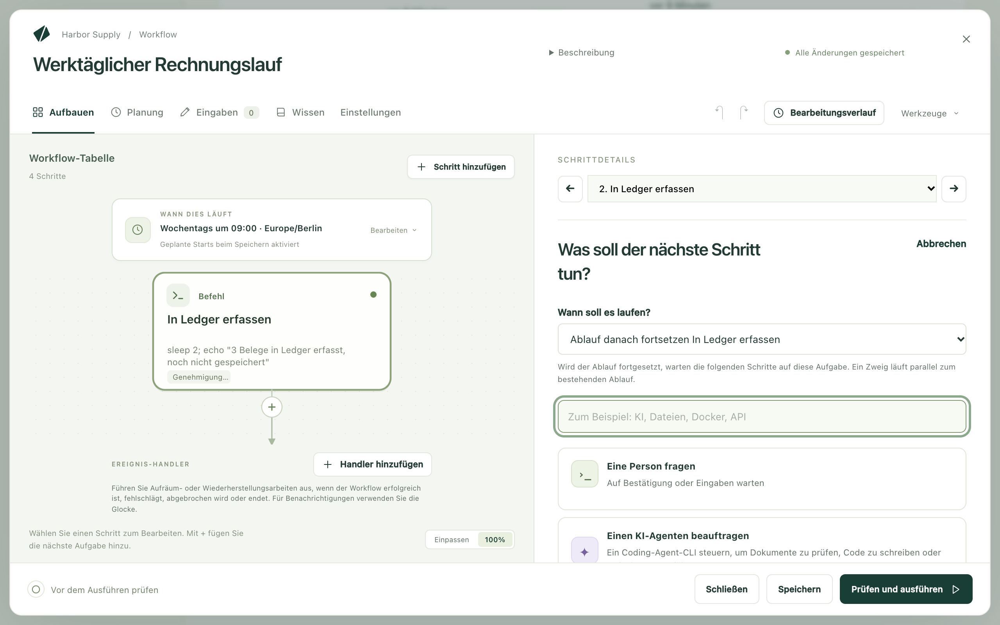
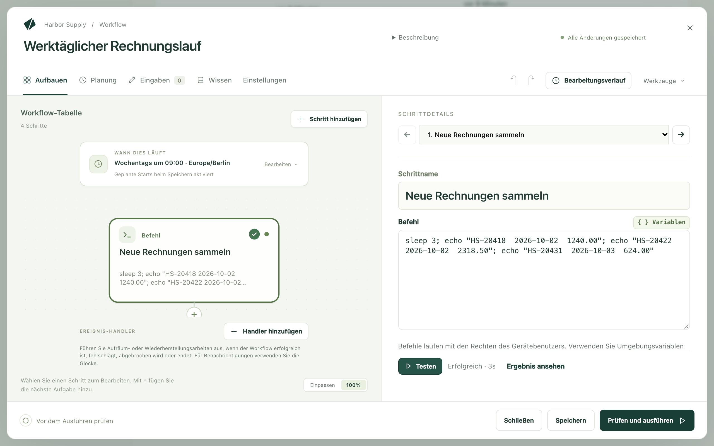
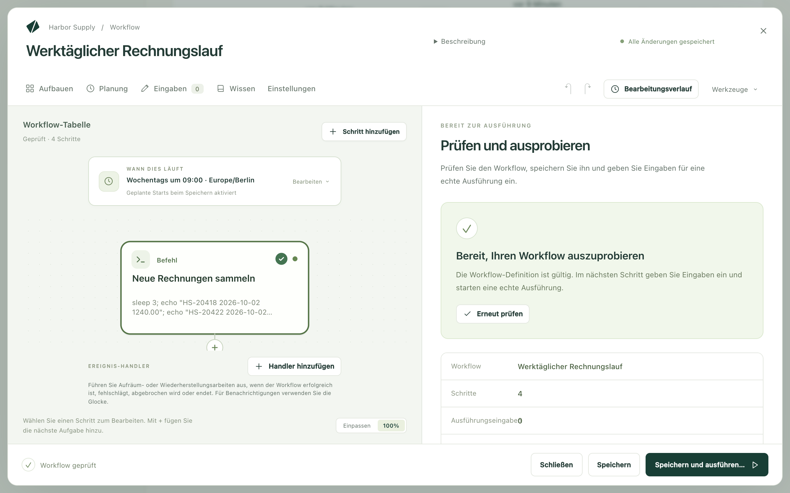
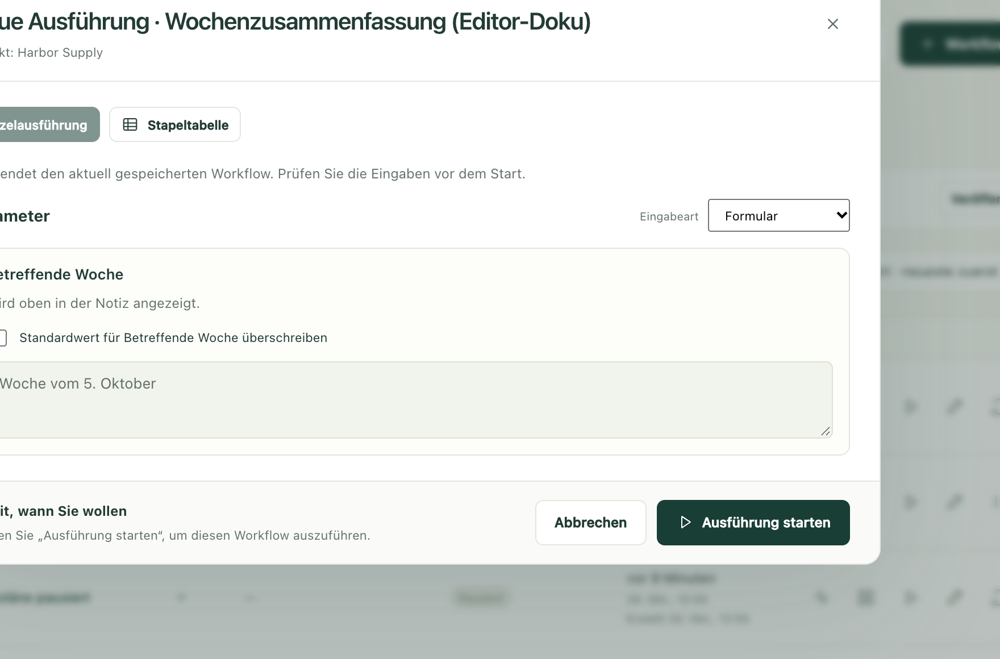

Ein Workflow ist eine Arbeit, die Sie sonst von Hand erledigen, einmal
aufgeschrieben, damit Kitewell sie für Sie übernehmen kann: die Rechnungen
sammeln, sie erfassen, eine Zusammenfassung per E-Mail schicken. Sie bauen ihn
Stück für Stück auf, probieren jedes Stück einzeln aus, führen dann das Ganze
aus und sehen zu, wie es arbeitet.

Jedes Stück ist ein Schritt. Ein Schritt tut genau eine Sache, etwa einen
Befehl ausführen, eine Website ausfüllen, ein Postfach lesen oder eine Person
fragen, und der nächste Schritt wartet auf ihn. Der Editor zeichnet die
Schritte als Ablaufdiagramm, sodass Sie die Reihenfolge auf einen Blick sehen.

## Was Sie brauchen

Ein Projekt, in dem der Workflow liegt. Das haben Sie bereits, wenn in der
Seitenleiste **Workflows** steht. Alles Weitere hängt von den Schritten ab, die
Sie wählen:

- Ein Befehl, ein Website-Schritt oder eine Wartezeit braucht nichts weiter.
- Ein KI-Schritt braucht ein Modell oder einen Agenten, eingerichtet unter
  **Agenten und Modelle**.
- Ein E-Mail-Schritt braucht ein Postfach, verbunden unter
  **Mehr → E-Mail-Konten**.
- Ein Passwort oder Schlüssel, den ein Schritt braucht, wird vorher unter
  **Mehr → Secrets** gespeichert, und zwar als Secret, damit der Wert nie in
  einem Log erscheint.

Ein Schritt, der nicht findet, was er braucht, meldet das vor der Ausführung.
Sie können also mit dem Aufbau beginnen, ohne all das vorher einzurichten.

## Schritt für Schritt aufbauen

1. Wählen Sie **Workflow erstellen** und geben Sie ihm einen Namen. Der Editor
   öffnet sich leer auf **Aufbauen** und fragt
   **Was möchten Sie automatisieren?**
2. Wählen Sie eine Aufgabe. Die Schritte, die Sie hinzufügen, erscheinen links
   unter **Workflow-Tabelle**. Der Schritt, an dem Sie gerade arbeiten, öffnet
   sich rechts unter **Schrittdetails**. Auf diesem Bildschirm heißen sie
   *Aufgaben*. Sobald eine im Ablaufdiagramm steht, ist sie ein Schritt.
3. Geben Sie unter **Schrittname** einen Namen in einfachen Worten ein, etwa
   `Neue Rechnungen sammeln`. Nach diesem Namen suchen Sie später in einem Log.
4. Füllen Sie aus, was die Aufgabe braucht. Ein Befehlsschritt hat ein
   einziges Feld, **Befehl**. Ein Website-Schritt braucht die Adresse und was
   dort zu tun ist.
5. Wählen Sie **Schritt hinzufügen** oder das + unter einem Schritt im
   Ablaufdiagramm, um den nächsten anzulegen. **Wann soll es laufen?**
   entscheidet, wohin er kommt:
   - **Ablauf danach fortsetzen**: Die Schritte, die bisher auf diesen Schritt
     folgten, warten nun auf den neuen.
   - **Zweig danach hinzufügen**: ein weiterer Pfad neben dem ersten.
   - **Unabhängig starten**: für Arbeit, die auf nichts wartet.
6. Machen Sie weiter, bis die Arbeit vollständig aufgeschrieben ist.
   **Duplizieren**, **Nach oben**, **Nach unten** und **Schritt entfernen**
   bringen die Reihenfolge hinterher in Ordnung.

Bei einem leeren Workflow sparen Sie sich mit zwei Abkürzungen das Tippen:
Beschreiben Sie die Arbeit unter
**Beschreiben Sie, was dieser Workflow tun soll** und wählen Sie
**Den Assistenten fragen**, oder wählen Sie eine Karte unter
**Oder mit einem Beispiel beginnen**. **Werkzeuge → Beispiele durchsehen**
öffnet die Beispiele später erneut.

## Die Aufgaben zur Auswahl

**Aufgabe suchen** durchsucht die Liste. Sie können also `E-Mail` oder `Excel`
eintippen, statt lange zu suchen. Mit diesen Aufgaben fangen die meisten an:

- **Einen Befehl oder ein Skript ausführen**: etwas auf diesem Computer
  ausführen.
- **Eine Website automatisieren**: eine Website öffnen und klicken, tippen,
  lesen oder herunterladen, in einfacher Sprache beschrieben. Siehe
  [Eine Website automatisieren](/de/docs/browser/).
- **Eine Desktop-App automatisieren**: eine App auf diesem Computer so
  bedienen, wie ein Mensch es tut. Siehe
  [Eine Desktop-App automatisieren](/de/docs/desktop/).
- **E-Mail senden**, **E-Mails finden**, **E-Mails ordnen**: in einem
  verbundenen Postfach schreiben, lesen und aufräumen. Siehe
  [E-Mails automatisieren](/de/docs/email/).
- **Ein Modell fragen**: einem Modell eine Frage stellen und seine Antwort
  behalten.
- **Einen KI-Agenten beauftragen**: Arbeit an einen Coding-Agenten übergeben,
  der auf diesem Computer installiert ist.
- **KI-Entscheidung treffen**: etwas einordnen, bewerten oder mit Ja oder Nein
  beantworten, in einer Form, die der nächste Schritt lesen kann.
- **Eine Person fragen**: anhalten und warten, bis jemand etwas bestätigt oder
  eingibt.
- **Warten**: eine Zeit lang pausieren, bis zu einem Zeitpunkt oder bis eine
  Datei da ist.
- **Wiederholen bis**: in Abständen etwas prüfen, bis es bereit ist, bis zu
  einer festen Zahl von Versuchen.
- **Für jedes Element**: Schritte einmal für jedes Element einer Liste
  ausführen und die Ergebnisse sammeln.
- **Nach Wert verzweigen**: die Arbeit auf den einen oder den anderen Pfad
  schicken.
- **Eine Textvorlage ausfüllen**: aus einer Vorlage und einigen Werten eine
  Nachricht oder eine Datei erstellen.
- **Einen anderen Workflow ausführen**: einen vorhandenen Workflow als einen
  Schritt wiederverwenden.

Die technischeren Aufgaben stehen weiter unten in derselben Liste:
**In Docker ausführen**, **Einen Webdienst aufrufen**,
**Eine API-Aktion verwenden**, **Auf einem anderen Rechner ausführen** und
**Dateien zu oder von einer Maschine kopieren**. Excel-Aufgaben sind am Ende
unter der Überschrift **Tabellen** zusammengefasst. Siehe
[Excel automatisieren](/de/docs/spreadsheets/).

## Einen Schritt testen, bevor Sie alles ausführen

Sie müssen nicht den ganzen Workflow ausführen, um herauszufinden, ob ein
Schritt funktioniert.

1. Wählen Sie den Schritt im Ablaufdiagramm aus.
2. Wählen Sie **Testen**, auf dem Mac mit ⌘↩, unter Windows mit
   Strg+Eingabetaste.
3. Behalten Sie die Leiste neben **Testen** im Blick: Sie zeigt, was der
   Schritt gerade tut, und dann, wie er geendet hat. Wählen Sie
   **Ergebnis ansehen**, um zu lesen, was zurückkam. **Ausgabe** enthält, was
   der Schritt ausgegeben hat, **Fehler (stderr)** alles, worüber er sich
   beschwert hat.

Der Test führt nur diesen einen Schritt aus, mit Ihren nicht gespeicherten
Änderungen, und er speichert den Workflow nicht. Frühere Schritte laufen
nicht: Ihre Werte stammen aus deren eigenem letzten erfolgreichen Test, oder Sie
geben sie selbst ein. **Werte und Eingaben** listet auf, was der Schritt liest,
und markiert, was noch fehlt.

Ein Test ist echte Arbeit. Kitewell sagt vor dem Start, was passieren wird,
etwa „Sendet eine echte E-Mail von me@example.com“ oder „Läuft auf diesem
Gerät“. Lesen Sie diese Zeile also zuerst und wählen Sie **Trotzdem testen**
nur, wenn Sie es wirklich so meinen.

Vier Arten von Schritten lassen sich noch nicht einzeln testen und sagen das,
statt zu laufen: **Eine Person fragen**, Schritte innerhalb einer Schleife
**Für jedes Element**, Ereignis-Handler und Schritte, die auf eine Gruppe von
Servern zielen.

## Was sich bei jeder Ausführung ändern kann

Braucht die Arbeit ein Datum, einen Ordner oder einen Titel, der sich von
Ausführung zu Ausführung unterscheidet, legen Sie ihn unter **Eingaben** an
statt im Schritt. Jede Eingabe wird zu einem Feld in dem Formular, das Sie beim
Start einer Ausführung ausfüllen.

Um eine Eingabe zu verwenden, tippen Sie `${` in ein Feld eines Schritts und
wählen sie aus der Liste. Dieselbe Liste bietet auch Secrets und Ergebnisse an,
die frühere Schritte gespeichert haben. Kitewell lässt den Schritt, der ein
Ergebnis verwendet, auf den Schritt warten, der es erzeugt.

## Prüfen, dann ausführen

**Speichern** sichert Ihre Arbeit. Nutzen Sie es, wann immer Sie vorerst
aufhören möchten. Die Planung des Workflows gilt, sobald Sie speichern.

**Prüfen und ausführen** ist der letzte Blick, bevor echte Arbeit passiert.
Dort sehen Sie den Namen, wie viele **Schritte** und **Ausführungseingaben**
der Workflow hat, und seine **Planung**. Unter **Bevor Sie ausführen** steht,
was Sie vorher beheben sollten. **Workflow prüfen** untersucht den Entwurf auf
Fehler.

Dann:

1. Wählen Sie **Speichern und ausführen…**. Der Workflow wird gespeichert, und
   das Ausführungsformular öffnet sich.
2. Füllen Sie die Felder unter **Parameter** aus, falls dieser Workflow welche
   hat. Ein Feld, das schon einen Wert hat, ist gesperrt, bis Sie das Kästchen
   anhaken, mit dem Sie seinen Standardwert überschreiben.
3. Wählen Sie **Ausführung starten**.

Die Ausführung öffnet sich und zeigt den Fortschritt Schritt für Schritt. Eine
Ausführung verwendet den Workflow so, wie er bei ihrem Start war. Spätere
Änderungen wirken sich also nicht auf eine Ausführung aus, die bereits läuft.
Was Sie mit dem Ergebnis tun können, steht unter
[Ausführungen und Logs](/de/docs/runs/). Wie Kitewell den Workflow für Sie
startet, steht unter [Planungen](/de/docs/scheduling/).

## Anhalten und eine Person fragen

Manche Arbeit sollte nicht fertig werden, ohne dass jemand draufgeschaut hat.

**Eine Person fragen** ist ein eigener Schritt. Schreiben Sie die Anweisungen
und fügen Sie ein Formular hinzu, wenn Sie eine Antwort brauchen, etwa eine
Auswahl, einen Kommentar oder eine Zahl. Die Ausführung wartet, bis jemand die
Aufgabe abschließt.

Damit jemand prüft, was ein automatischer Schritt getan hat, öffnen Sie den
Abschnitt **Genehmigung** dieses Schritts und schalten
**Nach diesem Schritt auf Genehmigung warten** ein. Geben Sie die Frage ein und
die Werte, die abgefragt werden sollen. **Zurückgeben führt erneut aus** legt
fest, welcher Schritt wiederholt wird, wenn die prüfende Person Änderungen
verlangt.

Eine Genehmigung hält *nach* ihrem Schritt an. Um eine Erlaubnis *vor* einer
Aktion zu verlangen, setzen Sie einen Schritt **Eine Person fragen** davor.

Auch die Aufgabe einer Person kann Arbeit zurückgeben: Schalten Sie unter
**Zur Überarbeitung zurückgeben** die Option
**Prüfer dürfen die Arbeit zurückgeben** ein und wählen Sie unter
**Arbeit zurückgeben an** einen Schritt, der vor diesem läuft. KI-Schritte und
Modell-Prompts, die erneut laufen, erhalten das Feedback. Ein Befehl liest
jeden Wert als Variable, die bei der ersten Ausführung leer ist.

Wartende Ausführungen finden Sie unter **Ausführungen & Logs → Wartet**, in
**Wartet auf Sie**. Die Aufgabe einer Person bietet **Aufgabe abschließen** an
und, wenn sie es erlaubt, **Zurückgeben…**. Eine Genehmigung bietet
**Genehmigen**, **Zurückgeben** oder **Ausführung ablehnen** an. Zurückgeben
wiederholt den gewählten Schritt und die Arbeit danach. Ablehnen beendet die
Ausführung.

## Eine Aufgabe ausführen, wenn der Workflow endet

Ereignis-Handler laufen neben den Schritten des Workflows statt im Ablauf: vor
dem ersten Schritt, während die Ausführung auf eine Person wartet, bei Erfolg,
bei einem Fehlschlag, bei einem Abbruch oder immer am Ende. Damit löschen Sie
zum Beispiel eine temporäre Datei, machen eine Änderung rückgängig oder rufen
einen Wiederherstellungsdienst auf.

Unter dem Ablaufdiagramm listet **Ereignis-Handler** die Handler dieses
Workflows auf. Wählen Sie **Handler hinzufügen** und legen Sie fest, wann er
läuft: **Vor den Schritten**, **Bei Genehmigungswartung**, **Bei Erfolg**,
**Bei Fehlschlag**, **Bei Abbruch** oder **Immer am Ende**. Der Handler öffnet
sich für sich allein. **Aufgabentyp** ändert, was er tut, und
**Zurück zum Workflow** führt zurück zum Ablaufdiagramm.
**Eine Person fragen**, **KI-Entscheidung treffen**, **Nach Wert verzweigen**,
**Für jedes Element**, **Warten** und **Wiederholen bis** können keine Handler
sein.

Ein Handler kann die Eingaben und Variablen des Workflows und den Status der
Ausführung lesen, aber nicht die Ergebnisse ihrer Schritte. In
**Ausführungen & Logs** listet eine Ausführung ihre Handler neben ihren
Schritten auf.

Um anderen mitzuteilen, dass ein Workflow fehlgeschlagen ist, verwenden Sie
[Benachrichtigungen](/de/docs/alerts/) statt eines Handlers.

## Einen KI-Agenten oder ein Modell fragen

Richten Sie zuerst unter **Agenten und Modelle** einen benannten Agenten oder
ein Modell ein und fügen Sie es dann dem Workflow hinzu:

- **Einen KI-Agenten beauftragen** führt einen Kommandozeilen-Agenten aus, der
  auf diesem Computer installiert ist. Wählen Sie den Agenten, schreiben Sie
  seinen Prompt und legen Sie unter **Agent-Einstellungen und Kontext** seinen
  Projektordner und eventuellen Kontext fest.
- **Ein Modell fragen** sendet einen Prompt an ein Modell, das Sie eingerichtet
  haben. Wählen Sie das Modell und beschreiben Sie die Antwort, die Sie
  brauchen.

Speichern Sie die Antwort als Variable, wenn ein späterer Schritt sie braucht.

**Werkzeuge → KI-Prompts prüfen** zeigt die Anweisungen, die jeder KI-Schritt
erhalten wird, bevor irgendetwas läuft. Werte werden erst zur Laufzeit
eingesetzt. Unter [KI-Agenten und Modelle](/de/docs/ai/) erfahren Sie mehr über
Schlüssel, Berechtigungen und das, was jeder Anbieter braucht.

## Eine importierte API verwenden

[Importieren Sie eine OpenAPI-Beschreibung in die API-Bibliothek](/de/docs/apis/)
und fügen Sie dann dem Workflow **Eine API-Aktion verwenden** hinzu. Wählen Sie
die API und die Operation. Kitewell erstellt die Anfragefelder aus der
Beschreibung, einschließlich der Pflichtparameter und des Anfrageinhalts.

Öffnen Sie in einem späteren Schritt **Variablen** und wählen Sie ein Feld aus
der Antwort des API-Schritts. Kitewell speichert den Wert und sorgt dafür, dass
die Anfrage abgeschlossen ist, bevor ihr Ergebnis verwendet wird.

## Ein Docker-Image ausführen

Starten Sie Docker auf diesem Computer. Wählen Sie in der Aufgabenliste
**In Docker ausführen**.

1. Wählen Sie ein **Image**, einschließlich seines Tags. Durchsuchen Sie die
   Vorschläge oder verwenden Sie **Images durchsuchen**. **Untersuchen** liest
   die Ports, den Ordner und die Variablen des Images aus und hilft Ihnen so,
   den Schritt auszufüllen.
2. Geben Sie den Befehl ein, der darin laufen soll. Verwenden Sie
   **Shell-Skript** für mehrere Zeilen, Pipes oder Shell-Variablen. Das Image
   muss dann `/bin/sh` enthalten.
3. Klappen Sie die Optionen auf, die Sie brauchen: Arbeitsordner, Mounts,
   Umgebung, veröffentlichte Ports, Netzwerk. Eine Datei, die in einem
   Container entsteht, braucht einen Mount, damit sie außerhalb erhalten
   bleibt.
4. **Docker prüfen** prüft die Verbindung. **Testen** führt Image und Befehl
   tatsächlich aus. Sehen Sie sich also vorher die Mounts und die Auswirkungen
   an.

Kitewell installiert oder startet Docker nicht. Container werden nach einer
Ausführung entfernt, sofern **Container nach der Ausführung behalten** nicht
eingeschaltet ist. Gemountete Dateien und Docker-Volumes brauchen eigene
Backups.

## Befehle auf einem anderen Rechner ausführen

Öffnen Sie **Mehr → Server**. Fügen Sie für jeden Server die Adresse, den
Benutzernamen und die Art der Anmeldung hinzu. Bewahren Sie Passwörter unter
[Secrets](/de/docs/secrets/) auf, oder verwenden Sie einen lokalen privaten
Schlüssel ohne Passphrase. Unter **Hostschlüssel-Prüfung** behalten Sie
entweder die Voreinstellung und bestätigen den Fingerabdruck über
**Verbindung testen**, verwenden **Die known_hosts dieses Geräts** oder wählen
**Nicht prüfen**. Über einen **Sprunghost** erreichen Sie einen Server, der
hinter einem anderen Rechner steht.

Eine Gruppe fasst mehrere Server unter einem Namen zusammen. Ordnen Sie die
Server in der gewünschten Reihenfolge an, legen Sie fest, wie viele
gleichzeitig laufen dürfen, und ob ein Fehlschlag das Ausrollen stoppt oder
weiterlaufen lässt.

Fügen Sie im Workflow **Auf einem anderen Rechner ausführen** hinzu. Wählen
Sie unter **Wo sie läuft** den Server oder die Gruppe und geben Sie dann den
Befehl ein. Eine Gruppe erzeugt für jeden Rechner einen eigenen Schritt. Jedes
Ergebnis erscheint also einzeln in **Ausführungen & Logs**.

Um alle Befehls- und Skriptschritte an denselben Ort zu schicken, verwenden Sie
die Einstellung **Einstellungen → Wo sie läuft** des Workflows. Eine Gruppe
führt hier den gesamten Workflow nacheinander auf jedem Rechner aus, als eigene
Ausführung pro Rechner. Docker-, KI-, Webdienst-, API- und
Sub-Workflow-Schritte laufen weiterhin auf dem Computer, auf dem Kitewell läuft.

## Wenn etwas nicht klappt

- **Ein Schritt schlägt fehl, sobald er startet.** Meist fehlt ein Programm,
  der Ordner stimmt nicht, oder ein Secret hat auf diesem Computer keinen Wert.
  Führen Sie für den Schritt einzeln **Testen** aus und lesen Sie
  **Fehler (stderr)**.
- **Ein Schritt liest einen leeren Wert.** Der Schritt, der den Wert erzeugt,
  muss zuerst laufen. Öffnen Sie **Verfügbare Werte** bei dem Schritt, der ihn
  liest, prüfen Sie, ob der Wert dort steht, und prüfen Sie dann
  **Danach ausführen**.
- **Der Editor lässt Sie ein Feld nicht ändern.** Manche erweiterten
  Einstellungen gibt es nur im Text des Workflows. Die Meldung sagt das, und
  **Werkzeuge → YAML bearbeiten** öffnet ihn.
- **Ein Befehl funktioniert im Terminal, aber nicht hier.** Ein Schritt läuft
  mit den Berechtigungen der Person, die Kitewell ausführt, im Ordner des
  Workflows und ohne Ihre eigene Shell-Konfiguration. Geben Sie das Programm
  mit vollständigem Pfad an.

Mehr dazu unter [Fehlerbehebung](/de/docs/troubleshooting/).

## Details

- **Werkzeuge** enthält **Visueller Editor** und **YAML bearbeiten**, zwei
  Ansichten desselben Workflows, außerdem **Beispiele durchsehen**,
  **KI-Prompts prüfen**, **Workflow prüfen** und
  **Editor-Vorschläge aktualisieren**. Letzteres lädt neu, was der Texteditor
  beim Tippen vorschlägt.
- **Werkzeuge → YAML bearbeiten** öffnet den Workflow als Text, unter der
  Bezeichnung **Workflow-YAML**. Alles, was der visuelle Editor tut, steht
  dort, dazu ein paar Dinge, die sich nur als Text ausdrücken lassen: eine
  einmalige Planung, ein ungewöhnlicher Executor, ein Kommentar.
  Strg+Leertaste zeigt Vorschläge an, die Tabulatortaste rückt ein. Kommentare
  und Einstellungen, die der visuelle Editor nicht zeigt, bleiben beim
  Zurückwechseln erhalten.
- Ein Schritt, der etwas ausgibt, kann es als Datei behalten: Füllen Sie
  **Artefaktname (optional)** aus, und die Datei erscheint bei der Ausführung
  unter **Artefakte**. Ein Schritt kann auch selbst Dateien in
  `$DAG_RUN_ARTIFACTS_DIR` schreiben.
- Ein Workflow behält seine letzten 50 Schritttests, und es läuft immer nur ein
  Test gleichzeitig. Die Werte, die ein Test anbietet, stammen aus dem letzten
  erfolgreichen Test.
- Tastenkürzel: ⌘S auf dem Mac und Strg+S unter Windows speichern den
  Workflow. ⌘↩ oder Strg+Eingabetaste testet den ausgewählten Schritt, solange
  im visuellen Editor **Aufbauen** geöffnet ist.
- Die Befehle, die ein Schritt ausführt, sind die des Systems: Unter Windows
  läuft ein Schritt in der PowerShell, auf dem Mac in der Shell. `echo "…"`,
  `sleep 2` und `exit 1` funktionieren auf beiden. `cat`, `ls`, `printf` und
  `&&` funktionieren unter Windows nicht.
- Im Text eines Workflows lassen sich die eigenen E-Mail-Einstellungen der
  Engine nicht festlegen: `mail_on`, `smtp`, `error_mail`, `info_mail`,
  `mail_on_error`. Steht so etwas darin, schlägt das Speichern fehl.
  [Benachrichtigungen](/de/docs/alerts/) richten Sie stattdessen in Kitewell
  ein.
