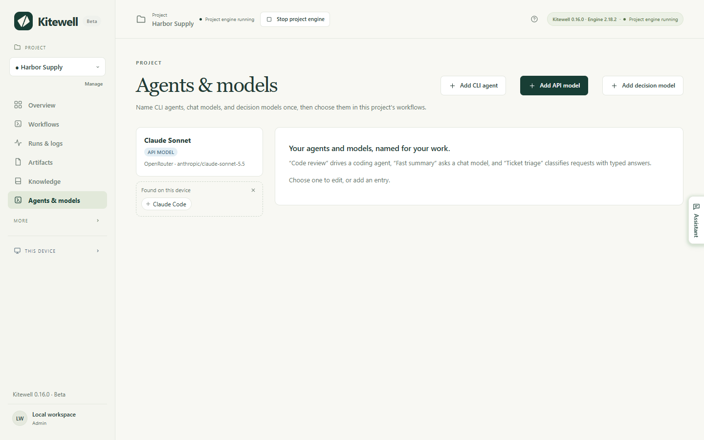

Kitewell's AI features need a model: one you add with a provider's API key,
a coding tool already installed on this computer, or Kitewell's included
model on a computer signed in to Dagu Cloud.

With one, Kitewell builds and fixes workflows with you in its chat, a failed
run can explain itself, a sheet can read a value out of each run, and a
workflow can ask a model a question in the middle of its work.

## What you need

- A provider's API key, for anything that calls a model over the internet. If
  the project already has one, **Agents & models** in the sidebar lists it.
  [Kitewell's included model](#use-kitewells-included-model) needs none.
- For a command-line coding agent, the tool installed on this computer and
  signed in there. Kitewell starts it; it never signs in for you.
- The **Agents & models** page is for administrators and editors. What the
  provider charges for a request is yours to pay.

## Add a model the project can use

1. Choose **Agents & models** in the sidebar, then **Add API model**.
2. Pick the **Provider**: Anthropic, OpenAI, Google Gemini, OpenRouter, Z.ai,
   OpenCode Zen, or Local server (Ollama, vLLM). A local server needs no key.
3. Under **API key**, choose the project [secret](/docs/secrets/) that holds
   the key — a secret is a password or key stored so it never shows in a log.
   An administrator can also choose **New key…** and **Paste the API key**
   here, which saves it as a secret in one step. The key is bound to each run
   that uses this model; the workflow itself never contains it.
4. Enter the **Model ID**. For OpenRouter, OpenCode Zen and a running local
   server this lists every model the provider offers, so you can type part of
   a name to search. For the others it suggests, and any ID your provider
   accepts works.
5. Give it a name of your own — "Fast summary", "Invoice reader" — and choose
   **Test model**. Before anything is sent, the panel shows the exact prompt,
   where it goes, which key it uses, and what is left behind.

The page holds three kinds of entry, chosen with **Kind**:

- **API model** asks a provider's model directly and returns its answer. It
  fills **Ask a model** tasks, the assistant, failure diagnosis, a sheet's
  result columns, and the **Automate a website** and
  **Automate a desktop app** tasks.
- **Decision model** classifies, scores, and answers yes-or-no questions, with
  a probability on each answer. **Add decision model** offers OpenRouter or
  TypeSafe. A **Make an AI decision** task uses it to sort or score something
  so a later step can branch on the answer, and a
  [sheet](/docs/batches/) uses it to judge yes-or-no, choice, and level
  columns.
- **CLI agent** drives a coding agent installed on this device.

An entry can fall back to another when it fails: its card then reads "Falls
back to" and names them. Each attempt is a fresh request, billed again.

## Use Kitewell's included model

On a computer signed in to [Dagu Cloud](/docs/cloud-sync/#sign-in),
**Agents & models** lists **Kitewell (included)**. It needs no API key: each
request goes through Dagu Cloud to OpenRouter and is paid from the
workspace's Dagu Cloud credits.

- Choose it as the **Model** of an **Ask a model** or **Automate a website**
  task, a sheet's result column, or failure diagnosis. In a workflow's YAML it
  is `kitewell-agent-included`.
- **Automate a desktop app** reads the screen with it on every plan, unless
  the project chooses another model under **Project settings → Screen steps**.
  For screenshots Dagu Cloud serves a vision model built for computer use.
  **Make an AI decision** cannot use it.
- Kitewell's chat answers with it until an administrator sets up a model
  under **Device settings → Kitewell's AI model**.

A free account gets 100 credits, once. Kitewell Personal and Team get 500
credits a month for each computer the plan pays for, shared by the workspace
and renewed on the first of each month (UTC). The assistant's web searches
spend the same credits.

An administrator sees what is left under **Dagu Cloud account** in
**Device settings**. When the credits run out, the included model is refused
until they are renewed, or on the free plan until you subscribe. A model of
your own keeps working.

Dagu Cloud asks OpenRouter to route these requests only to providers that
neither store nor train on them. It keeps no prompt text, only the workspace,
the device, the model, and the credits used.

## Use a coding agent on this computer

Install the tool and sign in to it first. Kitewell knows 15 tools — Aider,
Amp, Claude Code, Cline, Codex, Cursor, DeepSeek, Droid, Gemini, GitHub
Copilot, Goose, Kiro, OpenCode, Pi, and Qwen — and runs anything else as a
**Custom command**.
Tools it finds on this computer that no agent uses yet appear under **Found on
this device**, one click from their own entry.

1. Choose **Add CLI agent** and pick the **Harness**. The list says which are
   installed on this device and which are not.
2. For Claude Code, Codex and OpenCode, **Load models** fills in what that
   tool offers. The others take a model name you type.
3. Choose **Test agent**. The panel shows the prompt it will send, the folder
   it will work in — a new empty temporary folder it removes afterwards — and
   anything it would bypass, before it runs.
4. In a workflow, add an **Ask an AI agent** task, choose the **Agent**, and
   write **Prompt · describe the task**. Under **Agent settings and context**,
   set the **Project folder** it works in.

Kitewell runs the tool with the sign-in it already has on this computer. For
tools that take one, such as Claude Code, Codex, and GitHub Copilot,
**Reasoning effort** on the agent sets how much the tool reasons, and a step
can override it.

**If it fails** on the agent lists up to three other CLI agents, tried in
order when this one's tool exits with an error, such as a rate limit, a
missing sign-in, or a crash. A weak answer is not a failure. Each attempt runs
the prompt from the start, so the work is paid for again.

When a reviewer sends an agent step's work back, the agent runs again with the
reviewer's feedback added to its prompt. See
[Stop and ask a person](/docs/workflow-builder/#stop-and-ask-a-person).

A coding agent is a program running on this computer as you, with whatever
access you gave the tool itself. It can read and change files and run
commands. **Bypass permission prompts** on the agent turns off the tool's own
confirmations, and an agent with any set carries a **Bypasses approvals** mark
on its card. Never hand such an agent text that arrived from outside — the
workflow editor warns you when an email's text would reach one, because
whoever sent the email could then instruct it. Use **Ask a model** for that,
which cannot run anything.

## The assistant

Kitewell has one chat for this computer, across every project. Ask it to
build or fix a workflow, run something, or find out why a run failed. Open it
with **Ask Kitewell** at the top of the Kitewell window, or press ⌘J on a Mac,
Ctrl+J on Windows. It is for administrators and editors.

The chat opens docked on the right of the Kitewell window.
**Open in its own window** moves it out, **Keep in front** keeps that window
above the others, and **Dock in the Kitewell window** brings it back. On a
Mac, **Open Chat** in the menu bar menu shows it; on Windows, a click on the
tray icon shows or hides it.

It answers with **Kitewell's AI model**, set once in **Device settings** for
every project. Until an administrator sets one, a computer signed in to Dagu
Cloud uses [Kitewell's included model](#use-kitewells-included-model);
otherwise an administrator can set one up from the chat itself.

Work that takes more than a quick answer goes into a thread, tied to the
workflow or run it is about. Kitewell starts one when a request turns into
work, and **Reply in a thread** starts one from any message.
**Back to the main conversation** returns, **Mark done** closes a thread, and
**Reopen** opens it again. Several threads can work at once.

You can keep typing while Kitewell works: it reads a new message at its next
step, and **Cut in now** stops the work to answer that message first. When
the Kitewell window is open, the chat knows what it shows, so "this workflow"
means the one in the editor, unsaved edits included.

Nothing Kitewell proposes is saved, and nothing it does runs, until you press
the button on its card.

- A new or changed workflow comes as a card with its diagram and **Details**.
  Choose **Apply**, or **Reject**, which asks why. A schedule is offered on,
  with its next runs; untick **Turn on its schedule** to save it paused. After
  applying, **Open** opens the workflow and **Run now** runs it, and a change
  to an existing workflow can be undone with **Undo**.
- It proposes rows and columns for a [sheet](/docs/batches/) as a card.
  Applying can also start the runs it touched, and then it cannot be undone.
- It can run a workflow, approve, reject, or send back a waiting step, stop a
  run, and pause or resume a schedule. Each is a card with the workflow's
  diagram that acts only when you press its button, such as **Run** or
  **Approve**; **Not now** declines.
- It can run a draft for real to see whether it works. The first time in a
  thread it asks, with **Allow trial runs**. A trial runs commands, browser
  steps, reads, and model calls with the project's secrets. Anything that
  would send or change something elsewhere — a POST, an email, a command on
  another machine — only reports what it would have sent.
- After you choose **Allow**, it can work a site in its own browser to learn
  how a workflow should use it; you watch in the chat and can **Take over** at
  any time. It can read a public web page, though not an address on this
  device or its own network, and on a computer signed in to Dagu Cloud it can
  search the web.
- It can put up to six short questions to you as one card, answered with
  **Send answers** or passed with **Skip**. It can ask for a secret by name:
  you type the value into its card and choose **Save**, and the assistant
  never sees it. Only an administrator can add one this way, or list secret
  names.
- It reads the project's [knowledge](/docs/knowledge/) every message and
  writes down what it learns as you work. When you say how you want it to
  work, it remembers that at once, with **Undo**. Once the conversation has
  read a web page or a run's output, it
  [asks first](/docs/knowledge/#what-the-assistant-does).

Kitewell also posts cards of its own, on every plan. A run waiting for you
gets one, with **Approve**, **Reject**, or an answer right on the card. What
the notification settings send to this device gets one too: a failing
workflow, with **Retry**; a schedule that did not start, with **Run now**; and
a line for a run that succeeded, was cancelled, or is running long, or a sheet
that finished. Each also shows as a notification unless the chat is in front.

**Ask Kitewell** on a failed run asks it to find out why and propose a fix.

The conversation stays on this computer and is left out of backups.
**Delete** removes one message and **Delete thread** a whole thread;
**Delete every project's conversation**, under
**Device settings → Kitewell's AI model**,
removes everything. Workflows and other changes Kitewell saved stay.

## Why a run failed

Kitewell can read a failed run and say what to do about it.

1. Open **Project settings → Failure diagnosis** and turn on **Diagnose
   failed runs automatically**.
2. Choose the **Model** it should use.
3. Under **Workflows**, leave each workflow on **Project default**, or set it
   to **On** or **Off** on its own. Choose **Save diagnosis settings**.

Only the first failure of a run of failures is diagnosed, not every failed
run after it; a success ends the streak. The answer appears on the failed run
as one of **Try again**, **Needs you**, **Workflow change**, or **Unclear**,
with the cause and a next step. **Diagnose** asks for one on any failed run,
and **Diagnose again** asks for a fresh answer.

The model is sent the failed steps' results, the tail of their logs, what a
browser, desktop or agent step was doing when it stopped, the failures of a
child run, and the definition the run actually used. It is given no tools, so
nothing a run printed can act. Diagnoses stay on this device and are deleted
with their runs.

## What leaves this computer

Prompts and their context go to the provider or tool you chose, and that
provider's billing, retention and privacy rules then apply. A workspace that
lives on your computer does not mean every task stays on it.

- Before running, **Tools → Review AI prompts** in the workflow editor shows
  the instructions each AI task will receive. Runtime values are filled in
  when the run starts.
- After running, **Runs & logs** shows the prompt the run recorded and what
  came back.
- The chat sends the recent conversation, what the Kitewell window shows,
  including the workflow open in the editor, the project's workflows, models
  and knowledge, and what each tool it used returned. Secret values are never
  sent.
- When the chat's model is an OpenRouter model on OpenRouter's own address,
  its requests ask OpenRouter to route them only to providers that neither
  store nor train on what they receive.
- Kitewell's included model sends each request to Dagu Cloud, which passes it
  to OpenRouter.

See [What leaves your computer](/docs/data-flow/) for the whole picture.
