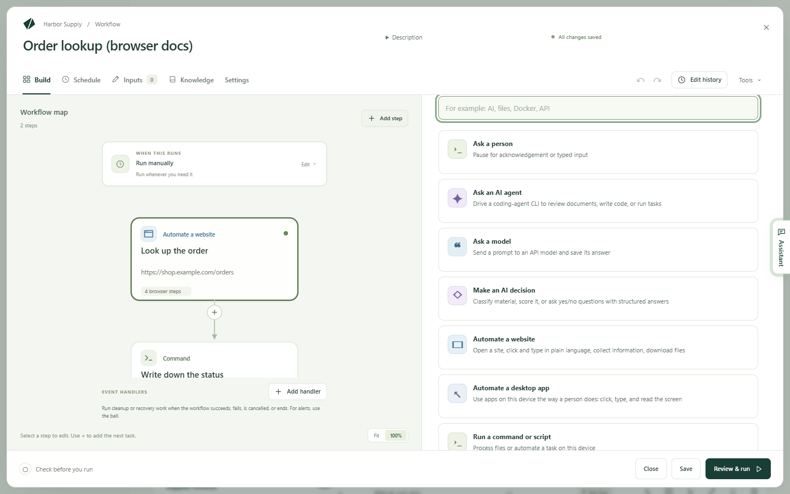
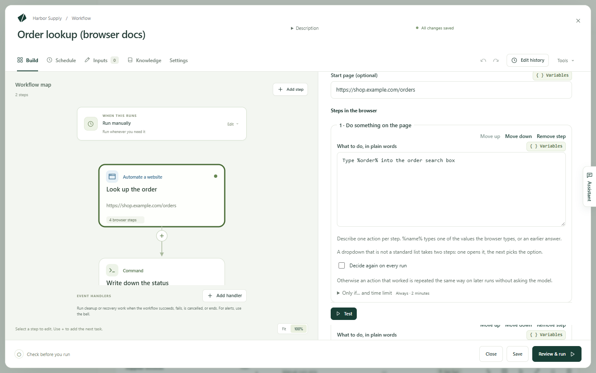

Kitewell can work a website for you: open pages, sign in, click and type,
upload files, read what a page shows, and pass what it found to the next step. You write
what to do in ordinary words, and a model works out how to do it on each
page. There is nothing to record and no selectors to write.

Work it takes off your hands:

- Download this month's invoices from a supplier portal.
- Upload the receipts an email brought into your accounting software.
- Look up the status of every order in a spreadsheet.
- Copy figures from a web dashboard into a daily report.
- Fill in the same web form for each row of a list.
- Check that a site's sign-in and checkout still work after a release.

The browser runs on your own computer, and a sign-in it makes stays on that
computer.

## What you need

A browser on this computer. On a Mac, install Google Chrome in
`/Applications`. On Windows, Kitewell uses the Chrome or Microsoft Edge that
is already installed. To use Chromium, Brave, Edge on a Mac, or a Chrome kept
somewhere else, give its full path in
**Device settings → Browser → Browser executable**. The step says whether a
browser was found, and which one it will open.

A model. A website step asks an API model what to do on each page.
[Add one](/docs/ai/) under **Agents & models**, then pick it in the step's
**Model** — or set one for the whole workflow in
**Settings → Execution & retries → Default model for browser and desktop steps**.
Use an Anthropic, OpenAI, or Gemini model. Small local models usually cannot
drive a browser.

Then choose **Check the browser**, on the step or in **Device settings**. It
opens the browser once from Kitewell's background service, the way a run
does, so a browser that cannot start turns up now instead of in the middle of
a scheduled run. On a Mac it also lets macOS ask its questions while you are
there to answer them.

## Build your first website step

This example looks up an order on a shop's site and hands its status to the
next step.

1. Open a workflow and choose **Add step**. The task picker opens.

   

2. Choose **Automate a website**. Give it a **Step name** such as
   `Look up the order`. Under **Technical settings**, **Step identifier** is
   the short name later steps use to read what this step collects; make it
   something plain, such as `order`.
3. Choose the **Model**, and set **Start page (optional)** to the page to
   begin on, such as `https://shop.example.com/orders`.
4. Under **Values the browser types**, choose **Add a value**, name it
   `order`, and set its **Value** to the order number. It can be typed text,
   a workflow input, or a secret — a password or key stored so it never shows
   in a log.
5. Under **Steps in the browser**, use **Add a browser step** to add, in
   order:
   - **Do something on the page**, with **What to do, in plain words** set to
     `Type %order% into the order search box`
   - **Do something on the page**, with `Click the Search button`
   - **Make sure that…**, with **The page should…** set to
     `The order's details are shown`
   - **Collect information**, with **What to look for** set to
     `The order's status and the expected delivery date`, and two values under
     **What to collect**: `status` and `delivery`, each with **Type** set to
     **Text**

   

6. Open **Browser settings**, turn on **Show the browser window**, then choose
   **Test** to watch the step work on its own.
7. Add a later step that uses what it collected, written as
   `${steps.order.outputs.status}`.

In a new workflow, **Or start from an example** offers two website examples to
copy instead: **Collect data from a website** and
**Sign in once, then collect**.

## Write instructions the model can follow

One instruction, one action. A **Do something on the page** step carries out
only its first action, so `Type the code and click Continue` stops after the
typing. Write two steps instead.

A dropdown that is not a plain list also takes two steps: one opens it, the
next picks the option.

Name what is on the page, the way you would to a colleague:

- `Click Download next to the latest invoice`
- `Type %customer% into the Customer field`
- `Open the Reports menu`

A step that collects describes what you want rather than an action:
`The order number and total on the confirmation page`. Say what the value is,
not where it sits on the screen.

## What a website step can do

The steps inside run in order, in one browser.

- **Open a page** goes to a **Web address**.
- **Do something on the page** does one thing, written under
  **What to do, in plain words**. `%name%` types one of the values the browser
  types, or an answer you gave earlier.
- **Upload files** gives files on this computer to the page. See
  [Upload files](#upload-files).
- **Collect information** reads **What to look for** and fills in the values
  under **What to collect**. Each value has a **Name**, a **Type** — **Text**,
  **Number**, **Yes or no**, **List**, or **List of items** — and a
  **Description (optional)** that tells the model what it is. A
  **List of items** sets out what **Each item holds**, such as a listing's
  `url`, `title`, and `price`. Later steps read each value as
  `${steps.<identifier>.outputs.<name>}`.
- **Make sure that…** fails the step when the page does not look right.
  **How to check** picks how. **In plain words (the model judges)** reads
  **The page should…** and asks the model.
  **Page contains the text**, **Address contains**, and
  **Element appears (CSS selector)** read the page themselves, with no model
  and the same answer on every run. **Keep checking for (optional)** gives the
  page time to get there.
- **Wait** waits **For a fixed time**, under **How long**, or
  **Until an element appears (CSS selector)**.
- **Take a screenshot** saves a PNG with the run's files, under the
  **Screenshot name** you give it.
- **Ask me for input** shows your **Question to show you** and pauses the run
  until you answer — for a one-time code, say. **Use the answer as** names the
  answer so later steps can type it.

Every step also has **Only if… and time limit**, which runs it only when a
condition holds and caps how long it may take. A step with neither set takes
at most two minutes.

## Keep passwords out of the model

**Values the browser types** holds whatever the step types: a customer number,
a workflow input, a password. The instructions name each one as `%name%`, and
the model only ever sees that name.

For anything sensitive, choose a secret as the value. It stays out of the
instructions, out of the model, and out of the logs. An instruction that
spells out a secret's value fails rather than send it, and **Review & run**
says so before you run.

## Upload files

**Upload files** puts files from this computer into a page's file field, the
way you would by choosing them in a file picker, such as receipts into an
accounting tool's file box or a signed form into a portal.

- **Files to upload · one per line** takes full paths, such as
  `~/Documents/invoice.pdf`; patterns, such as `~/Downloads/*.pdf`; or a
  result of an earlier step that lists files. An email step that finds
  messages with **Save attachments into the run's files** turned on lists
  their attachments, so
  writing `${steps.<identifier>.outputs.messages}` uploads what the emails
  brought.
- **Where to upload (optional)** names the file field, or the button or drop
  area that opens the file picker, in plain words: `The receipt drop area`.
  The model finds it once, and later runs reuse what it found. Leave it empty
  when the page has only one file field; then no model is asked at all.
- **Find it again on every run** asks the model each time instead, for a page
  whose upload area moves around.

The file picker never opens on screen, and the model never sees the files,
their names, or where they are. A site that takes one file at a time fails
the step when given several; upload them in separate steps, or run the step
once per file. Each file can be up to 50 MB. Sites send what they were given
in the background, so follow the upload with a **Make sure that…** check for
what the site shows when it is done, such as **Page contains the text**
`Uploaded`, with **Keep checking for (optional)** set to a minute.

When the assistant builds an upload, it tries it in its own browser first and
asks you before any file goes to a site, naming the site and each file. The
same goes for a trial of a workflow that uploads.

## Sign in once and stay signed in

Turn on **Stay signed in between runs** in **Browser settings**. Cookies and
sign-in state stay on this computer, so the next run opens the site already
signed in. The **Sign in once, then collect** example starts this way: its
first step shows the window and waits while you sign in yourself, and every
step and run after it reuses that sign-in.

**Project settings → Storage → Sign-ins** lists what is saved, which
workflows use each one, and **Forget sign-in…** to drop one. Backups do not
carry a sign-in, so a restored computer signs in again, as it asks for your
secrets again.

A loop that runs its items at the same time cannot share one sign-in. Set the
loop to one item at a time, or turn **Stay signed in between runs** off.

## Sites that ask for a certificate

Some sites, such as company or government portals, ask the browser for a
client certificate before they open. Add the certificate to Kitewell once, and
every website step and the assistant's browser on this computer present it to
the sites you name, without the system asking for its password.

1. Open **Device settings → Browser → Client certificates**.
2. Choose **Add from a file…** for a `.pfx` or `.p12` file and enter its
   **Password**. In the Kitewell app, **Add from this computer…** picks one
   from the macOS keychain or the Windows certificate store instead; the
   system may ask once to let Kitewell copy it.
3. Under **Use it for**, choose **Only these sites** and list them under
   **Sites, one per line**, such as `portal.example.com`, or `*.example.com`
   for every site under it. **Every site that asks for a certificate** gives
   it to any site that asks.
4. Choose **Add certificate**, then **Check a site** to open one with it.

A step needs no setting of its own. When a run fails because a site asked for
a certificate, the failed run offers an administrator a way to add one for
that site, or to use one already added, and then **Retry run**.

Only website steps and the assistant's browser present it. A
[desktop step](/docs/desktop/) works the browser on your screen, which asks
you to choose a certificate itself and waits for an answer, so automate such a
site with a website step.

Kitewell keeps the certificate on this computer under a password of its own,
never yours, and leaves it out of backups. Adding or changing one restarts the
project engines; runs in progress continue. Kitewell's chat warns a month and
a week before a certificate expires, and when it does.

## What a run looks like

Open the run under **Runs & logs**. **What the browser did** lists the steps
in order with the screenshots they took, beside the **Model** that was asked
and **Model usage**, the tokens that went in and out.

**Ran without AI** says how many of the step's operations ran without asking
the model: a replayed action, a check that reads the page itself, or an
operation such as opening a page. An action that worked once is remembered
and repeated the same way next time, and a replayed action sends nothing to
the model.

When the site changes and a remembered action no longer works, the model is
asked again. **Decide again on every run**, on one step, turns that off, and
**Project settings → Storage → Replay cache** clears what a workflow
remembers after a site is redesigned. **Collect information** and checks
written in plain words ask the model every run.

When a step reaches **Ask me for input**, the run waits. Open it under
**Runs & logs → Waiting**, or from the notification, type into
**Your answer**, and choose **Answer** — or **Reject** to fail the step. The
answer is kept with the run, so use it for codes that expire, not for
passwords. If the browser closed before you got there,
**Restart the browser step** runs the step again from its first step.

## Run it for many items

- A list in a spreadsheet: give the workflow an input such as the order
  number, then run it from a [batch sheet](/docs/batches/), one row per item.
  The sheet shows progress, failures, and time left.
- A list the site shows: collect a **List of items**, such as every result in
  a search, and [let it fill a sheet's rows](/docs/batches/#let-a-run-find-the-rows).
  Refreshing adds new ones and marks those that are gone.
- A list inside one run: put the step in a **For each item** loop.
- On a schedule: add a [schedule](/docs/scheduling/), leave
  **Show the browser window** off so Chrome does not open while you work, and
  let [alerts](/docs/alerts/) tell you when a run fails or waits for an answer.

## If something goes wrong

Look at the step's screenshots first: a sign-in wall, a cookie banner, or a
bot check explains most failures. Then:

- The step says nothing on the page matches the instruction. Reword it to name
  what is on the page, or split it in two.
- An upload says no file picker opened. Name the file field itself in
  **Where to upload (optional)**, or the button that opens the picker; when
  the upload sits behind a menu or a dialog, open it in a step before.
- The browser will not start. Run **Check the browser**, and if no browser was
  found, set **Device settings → Browser → Browser executable**.
- A site the step needs will not load. If you filled in
  **Allowed websites · one per line (optional)**, every host the site uses has
  to be listed, including its sign-in and image servers.

The rest is in [Troubleshooting](/docs/troubleshooting/#a-website-step-fails).

## Details

**Browser settings**, on the step, also holds **Save screenshots** —
**When a step fails**, **When a step fails, and at the end**,
**After every step**, or **Never** — and **Window width** and
**Window height** in pixels.
**Allowed websites · one per line (optional)** takes host names such as
`example.com` or `*.example.com`; local addresses, ports, and paths are
refused.

What reaches the model is the visible text and layout of the page, once for
each action it decides, billed by the provider you chose. Replayed actions
and checks that read the page directly send nothing, and neither do the
values the browser types, the files it uploads, or your secrets. Uploaded
files go to the site, as they would if you chose them yourself. See
[What leaves your computer](/docs/data-flow/).

Some sites refuse automated browsers. A saved sign-in and a start page past
the cookie banner get around the usual cases; CAPTCHAs are not solved. The
computer has to be awake for a scheduled run.

The workflow in [Build your first website step](#build-your-first-website-step)
is two steps: **Automate a website** with a start page, one value named
`order`, two **Do something on the page** steps, one **Make sure that…**
check, and one **Collect information** step that reads the status and the
delivery date; then a later step that uses those two values.
