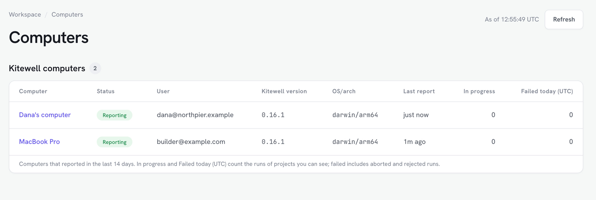

Dagu Console shows how the runs of your synced projects go, in any browser,
your phone's included, at [console.dagu.sh](https://console.dagu.sh). Your
computers still do the work. The console receives each run's status, never its
logs, outputs, or secret values.

## What you need

- A Dagu Cloud account and a [synced project](/docs/cloud-sync/). Every plan
  works, the free plan included. A project that is not synced is never
  reported.
- To follow more than one computer, Kitewell Team. A free account and Kitewell
  Personal each hold one computer.

Sign in to Dagu Console with the account your computers use. The workspace
owner sees every synced project. Anyone else in the workspace sees the runs of
the projects they have a role on, and the list of computers.

## Follow runs

The **Monitoring** pages cover Kitewell computers and Dagu servers alike:

- **Overview**: how many computers are reporting, today's failures, open
  alerts, and the computers that need attention.
- **Computers**: each computer with its **Status**, **Reporting** or
  **Not reporting**, its user, Kitewell version, system, last report, and its
  runs in progress and failed today. Choose a computer for its runs of the
  last 14 days.
- **Runs**: every run, by project, workflow, status, and time.
- **Insights**: runs, failures, success rate, and duration for each workflow,
  over 7, 30, or 90 days.

A computer reports every two minutes, or sooner when its runs in progress
change. A page shows what had arrived when it opened; choose **Refresh** for
the latest.

## Alerts from Dagu Console

Dagu Console opens two kinds of alert, on every plan:

- A workflow failed. A workflow has one alert however many computers run it.
  A later failure on any computer adds to it, and the next success on any
  computer resolves it. Aborted and rejected runs are counted but do not alert.
- A computer stopped reporting. After 10 minutes without a report the alert
  opens, and it resolves when the computer reports again. It is off by
  default, since a computer stops reporting whenever it sleeps.

To watch a computer meant to stay on, the workspace owner opens it under
**Computers**, ticks **Alert when this computer stops reporting**, and chooses
**Save changes**.

Emails go out when an alert opens and when it resolves:

- A computer that stopped reporting is emailed to the workspace owner.
- A failed workflow is emailed once the owner turns it on: in **Settings**,
  under **Alert emails**, tick **Kitewell** on the **Owners and admins** row
  and choose **Save changes**. It goes to the owner and to the project's
  admins.
- **Add a recipient** adds a **Member** or an **Outside address** with
  **Kitewell** ticked. Both hear about computers that stop reporting and about
  failed workflows: a member for the projects they can open, an outside
  address for every project once it is verified.

### Kitewell's alerts and Dagu Console's

[Kitewell's own alerts](/docs/alerts/) come from the computer. The two work
side by side:

| | Kitewell's alerts | Dagu Console's alerts |
| --- | --- | --- |
| Sent by | The computer | Dagu Cloud |
| Plan | Personal and Team | Every plan |
| Events | Fails, recovers, needs input, misses a schedule, runs long, is cancelled, succeeds, finishes a batch | A workflow failed; a computer stopped reporting |
| Channels | This device, email, Slack, Microsoft Teams, PagerDuty, webhook | Email |
| While the computer sleeps | Nothing is sent; missed schedules are reported when it wakes | The stopped-reporting alert opens |

## What Dagu Console keeps

- Each run's workflow, status, trigger, times, and failed step names, for 14
  days. A workspace keeps up to 500 finished runs a day (UTC); past that,
  **Device settings** says when its run history resumes.
- Each workflow's daily totals, for the insights, for 13 months.
- Alerts, for 90 days after they resolve.
- A computer that has not reported for 30 days is removed, with everything it
  reported.

To stop sending run status, the workspace owner turns it off, as
[Follow runs in Dagu Cloud](/docs/cloud-sync/#follow-runs-in-dagu-cloud)
describes. The computers then report only that they run.
