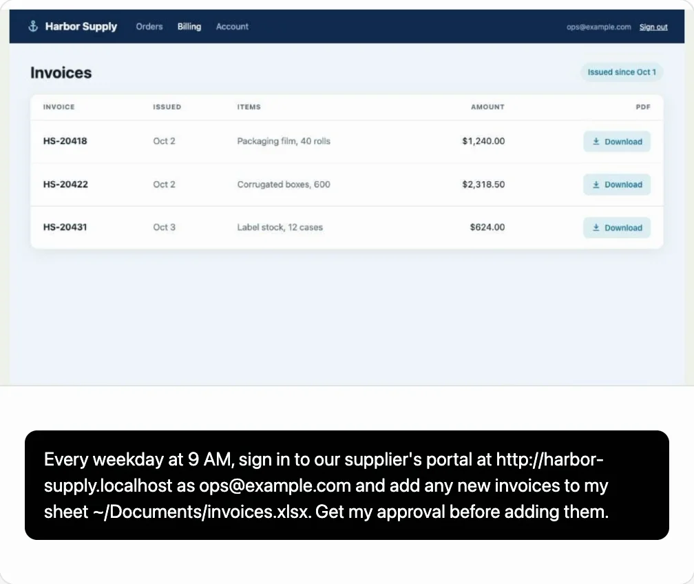
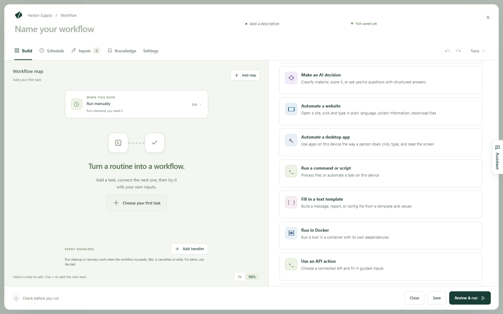
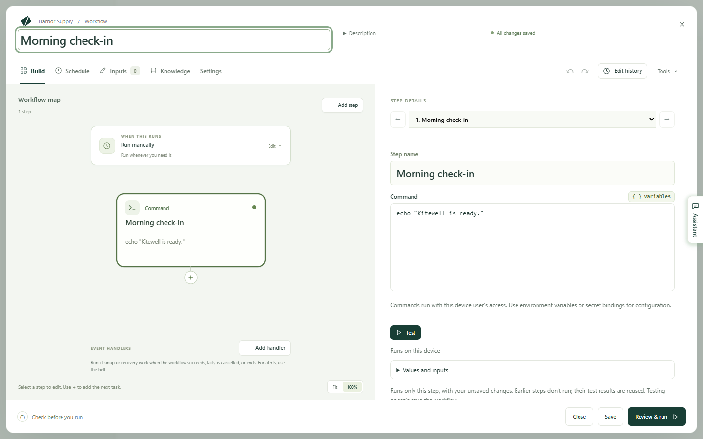
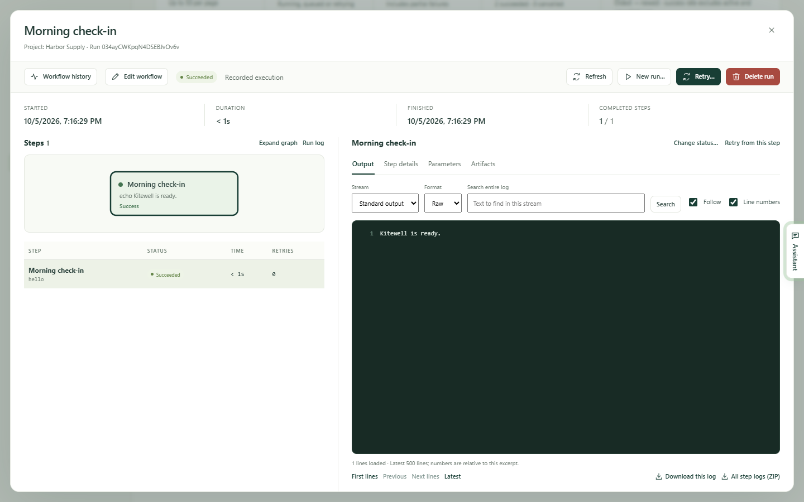

Tell Kitewell a chore in plain words. Its AI does the chore once while you
watch, then proposes a workflow that repeats it on a schedule. This page
walks through that first chore, from an empty chat to a run on its own.

## What you need

Kitewell, [installed](/docs/install/) and open. The first time it opens,
choose **Sign in to use Kitewell's AI**. Your browser opens Dagu Cloud with a
code to match, and Kitewell's included AI is ready with 100 free credits and
no API key. To use your own model instead, choose **Start on this device**
and connect it from the chat; see [AI agents and models](/docs/ai/).

A website chore also needs Google Chrome, or Microsoft Edge on Windows.

## Tell Kitewell the chore

1. Open the chat. While it is empty, it asks **What do you keep doing by
   hand?** and offers a few chores to start from.
2. Choose one, or write your own request: what to do, where, and when. For
   example:

   > Every weekday at 9:00, sign in to [the supplier portal's address] as
   > [your sign-in email] and add any new invoices to my sheet [the
   > workbook's path].

3. Send it.

Name the site, the file, and the time. Leave the password out: the
assistant asks for it in a card of its own.

## Watch it work

The assistant looks before it writes, and asks for what it needs in cards:

- **Allow** lets it open the site in Kitewell's browser, shown at the top
  of the chat. **Take over** lets you click and type there yourself, for a
  step only you can do.
- A password goes into a card that saves it as a secret. The assistant never
  sees it.
- Questions it cannot answer by looking come as a short form.

## Check it, then apply

The assistant proposes the workflow as a card, with its steps in order and
when it runs. Read it, then choose **Apply**. Nothing is saved, and nothing
runs, until you do.

What the assistant did in its browser comes with the workflow. Its clicks
are recorded, so the first run repeats them instead of working them out
again.

## Run it

Ask the chat to run it now, or open the workflow and choose **Run now**.
Then open **Runs & logs** and choose **View run**.

Select the browser step to see each operation the browser took:

- **Replayed**: a recorded click or keystroke, repeated without AI.
- **Recovered**: the page had changed, so AI found the new way and kept it
  for the next run.
- Reading values from a page, such as the new invoices, asks AI on every
  run.

The step's **Ran without AI** counts the operations that needed no model.

## On a schedule

A request that says when, such as every weekday at 9:00, comes with its
schedule. Kitewell runs the workflow at that time. Closing the window is
fine; it keeps going in the menu bar or the tray. Read
[Scheduling](/docs/scheduling/) before you rely on unattended runs.

## If something goes wrong

- The run failed. Open it from **Runs & logs**. The summary at the top names
  the step that failed and offers **Inspect failure**, which shows that
  step's log.
- The workflow does not match the site. Say in the chat what is different;
  the assistant changes the workflow and proposes it again.

## Without AI

A workflow can also be built by hand, one step at a time. The smallest is a
single command:

1. Choose **Create a workflow**, and type `Morning check-in` into
   **Workflow name**.
2. Choose **Choose your first task**, then **Run a command or script**.

   

3. In **Command**, type `echo "Kitewell is ready."`

   

4. Choose **Review & run**, then **Save and run…**, then **Start run**.

The finished run shows the line in its output.

[Build a workflow](/docs/workflow-builder/) covers every kind of step.

## Details

- Commands run with the permissions of the user account running Kitewell.
- `echo "…"` is one of the few commands that behaves the same in PowerShell
  on Windows and in a shell on a Mac. A command written for one system does
  not always run on the other.
