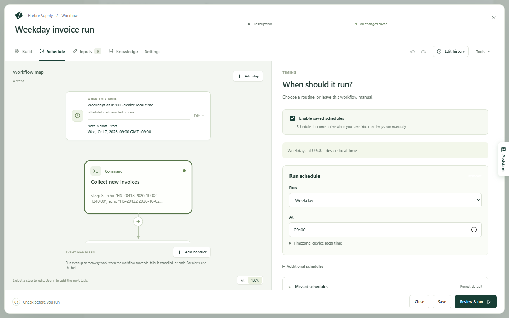

Kitewell can start a workflow for you: every weekday at nine, once an hour,
or when another service sends it a request. The work happens on this
computer. On Windows with Kitewell Team it happens whether or not you are
signed in; on a Mac, and on Kitewell Personal, it happens while you are.

## Set a schedule

1. Open the workflow and choose **Schedule**.
2. Make sure **Enable saved schedules** is ticked.
3. Under **Run**, choose how often: **Every day**, **Weekdays**,
   **Every week**, **Every hour**, or **Custom schedule**.
4. Set the time. A custom schedule takes a cron expression of five fields.
5. Open **Timezone** if the time belongs to a particular place. Left alone,
   the schedule follows this computer's clock, daylight saving included.
6. Choose **Save**.

**Next 5 scheduled events** below the form shows when the workflow would
actually run. Under it, a line says what the schedule comes to on this
computer: **Will run, signed in or not**, **Runs only while you're signed
in**, or **Won't run**, with the reason and the button that fixes it.

**Test the schedule now** runs the workflow once, exactly as the schedule
would, and opens the run. Use it before you trust a schedule to the night.

## Check that tonight's runs will happen

The **Workflows** list shows the same verdict under each workflow's next
start, and a banner at the top of the page says in one line what stands in
the way of tonight's runs, with the fix beside it. When nothing stands in the
way, there is no banner.

What the verdict looks at: whether the computer will be signed in, the
project and its engine, a paused or held workflow, a step that needs the
screen, a browser sign-in that needs your password, and a schedule written in
another timezone.

## Run with nobody signed in (Windows)

Running with nobody signed in needs Kitewell Team, or the trial. On Kitewell
Personal, schedules run only while you are signed in.

Turn on **Device settings → Run when nobody is signed in**. One
administrator prompt, with no password, sets up a small Windows service,
Kitewell sign-in, that starts the engine when the PC starts and runs your
schedules as you, signed in or not.

The card there shows the run account, the sign-in, the engine, the next
scheduled run, and sleep, and turns the service off again.

Two kinds of step still need you at the PC: a desktop step, and a website
step that shows its browser window. Their workflows say **Runs only while
you're signed in**. Everything else runs either way.

**Use my password…** on the card is optional. Add it when a workflow needs a
network share, or a website sign-in that Windows protects with your password.
**Forget password** takes it back out. A Microsoft or work account may need
the password for the sign-in itself; the card says so and asks.

## Keep Kitewell running

Closing the window stops nothing: Kitewell stays in the menu bar on a Mac and
in the notification area on Windows. **Open at Login** on a Mac and
**Start at login** on Windows open it when you sign in. **Quit Kitewell** stops the engines on a Mac; on Windows with the
service on, the engine keeps running without the window.

## Sleep, and the runs that were missed

On Windows with the service on, the PC stays awake around a scheduled run
and wakes from sleep for the next one, when the power plan allows wake
timers. On a Mac, a sleeping computer runs nothing; **Device settings →
Sleep protection** keeps it awake while work is running.

A scheduled time that went by without a run appears in **Runs & logs** as a
**Missed** row, with why: the device was asleep, Kitewell wasn't running,
the project engine wasn't running, or no run started. The row says whether
catch-up will make up for it, and links to the run that did.

Catch-up runs the starts that were missed once the computer is back, looking
back 24 hours by default. Change it under **Schedule → Missed schedules**.

## If something goes wrong

- **The time came and nothing ran.** Open **Runs & logs** and look for a
  **Missed** row: it names the reason. Then check the verdict under the
  workflow's next start.
- **It ran at the wrong time.** Check **Timezone** on the schedule and the
  times under **Next 5 scheduled events**.
- **Several runs started at once after the computer woke.** That is catch-up.
  Set **Missed schedule policy** to **Run only the latest missed
  occurrence**, or turn catch-up **Off**.
- **The verdict says Won't run.** Press the button beside it. It turns the
  service on, asks for a password, starts the engine, or opens the editor,
  whichever the reason calls for.

More in [Troubleshooting](/docs/troubleshooting/).

## More about schedules

[Schedule reference](/docs/reference/scheduling/) covers the rest: what each
verdict means, the Windows service and what it does and does not do,
catch-up settings and limits, queues, webhooks, and the menu items.
