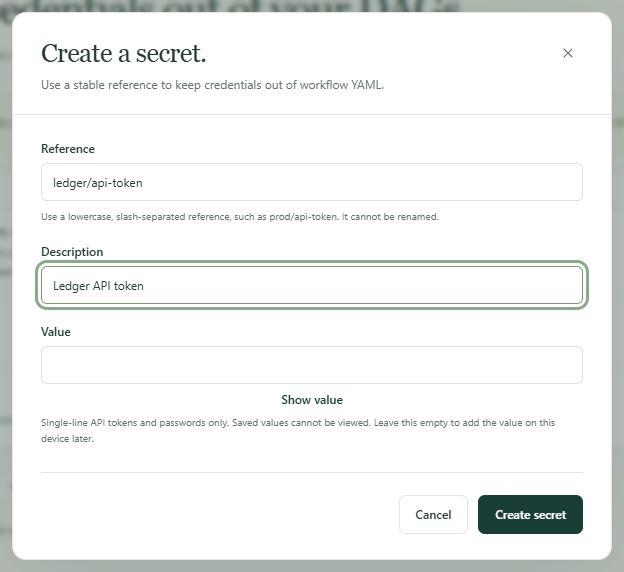
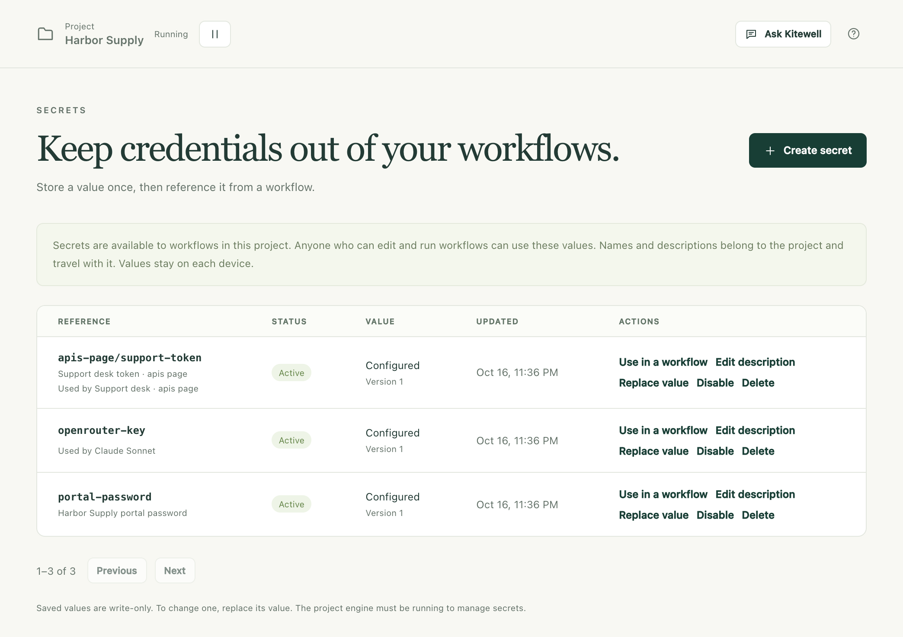

A workflow often needs a password, an API token, or a key. Store it once as a
secret — a credential Kitewell keeps for you — and the workflow reads it by
name. Nobody has to type it again, it never appears in a workflow definition,
and logs show `*******` where the value would be.

## What you need

- A project you can edit. **Secrets** is under **More** in the sidebar. In a
  project shared with you to view through Dagu Cloud, you can set this
  device's values but not create a secret.
- The project running. While it is paused, the page says
  **This project is paused**; choose **Resume**.

## Store a credential

1. Open **More → Secrets** and choose **Create secret**.
2. Type a **Reference** — the name the workflow will use, such as
   `services/api-token`. Use lowercase letters, digits, and hyphens, in parts
   separated by slashes. The reference cannot be renamed later.
3. Add a **Description** so the next person knows what it opens.
4. Type the credential into **Value**. **Show value** lets you check what you
   pasted. Leave it empty to add the value on this device later.
5. Choose **Create secret**.

The secret appears in the list as **Active**, its value **Configured**, with
**Version** 1. The value itself is never shown again, here or anywhere else.

## Use it in a workflow

In the workflow editor, type `${` in a step's field and choose the secret
under **Secrets**. Kitewell binds it to the workflow and puts its name in the
field; the value stays out.

Three other pages take a secret by name instead of a value:

- A model's API key, under **Agents & models**.
- A server's or jump host's password, under **Servers**.
- An imported API's credential or client secret, under **API library**.

To write the YAML yourself, choose **Use in a workflow** on the secret's row.
Kitewell shows a `secrets:` block to paste at the top level. It names the
environment variable the steps read the value from, such as
`SECRET_API_TOKEN` for `services/api-token`.

In a [website step](/docs/browser/) or a [desktop step](/docs/desktop/),
choose the secret under **Values the browser types** or
**Values the step types**. The instructions and the model see only the value's
name, written as `%name%`; the step types the value itself.

[The assistant](/docs/ai/#the-assistant) can ask for one as it builds a
workflow. A card appears asking to add a secret by that name; you type the
credential into **Value** and choose **Save**, and the assistant never sees
what you typed.

## When a device has no value yet

A secret's name and description belong to the project. Its value belongs to
the device you typed it on. A project that arrives by import or by
[sync](/docs/cloud-sync/) brings the names and needs the values.

- **Value needed** marks a secret the project uses with no value here. Choose
  **Set value**.
- **Overview** lists every secret this device still needs, with **Set value**
  beside each.
- **Only on this device** marks a secret this device holds that the project
  does not list. Choose **Declare** to add it to the project.
- A line beginning **Used by** names what needs each secret — a model, a
  workflow, a server, or an API — so you can tell which credential to go and
  find.

Until a value is set, Kitewell refuses the work rather than failing it
halfway. A run started by hand, by a webhook, by an AI agent, or by the
assistant stops before it starts, with "Set a value for … on the Secrets page,
then run again." So do retrying, rerunning, or continuing a run, starting a
batch, refreshing a sheet's rows, and testing one step. A sheet's schedule
starts nothing at that time and says why. A workflow's own schedule is not
refused: its run starts and fails.

## Change or remove one

- **Replace value** stores a new credential under the same reference. The
  **Version** number goes up, and nothing that uses the secret has to be
  edited.
- **Edit description** changes the description and nothing else.
- **Disable** stops the secret being read; the value stays. A run that needs
  it starts and fails. **Enable** puts it back.
- **Delete** removes the secret from the project and its value from this
  device. Other devices that sync the project lose the name. A device that
  held a value keeps it, listed as **Only on this device**, until it is
  deleted there too. A reference something still uses stays listed with
  **Used by**, and needs another secret.

## If something goes wrong

- **"Set a value for … on the Secrets page, then run again."** This device has
  no value for that secret. Open **Secrets**, choose **Set value**, and run
  again.
- **"This project is paused".** Choose **Resume**, then try again.
- **A value on more than one line is refused.** Only single-line tokens and
  passwords are supported. A key that spans lines has to reach the step
  another way, such as a file the step reads.
- **"already has a value on this device".** Creating a secret never writes
  over a stored value. Use **Replace value** instead.

## What this protects, and what it does not

Secrets are encrypted on disk by the project's engine. The key that deciphers
them is itself sealed under a device key that the operating system holds: on
Windows, a key only this PC can open, so a copy of the data folder reads as
nothing elsewhere. While a run lasts, every step in it receives the secrets
its workflow binds.

It is not a sandbox. Anyone who can edit and run this project's workflows can
write a step that reads its secrets, and a step runs with the permissions of
the person running Kitewell. Separate projects separate secrets; they do not
limit what a command can do.

Kitewell shows `*******` in place of a secret's exact value in logs, run
details, and outputs. A value a step encodes, trims, or transforms before
printing may not be masked, and neither is one a step writes to a file or an
artifact. Do not print credentials.

## Exports, sync, releases, and backups

| Where the project goes | Names and descriptions | Values |
| --- | --- | --- |
| A project [export](/docs/sharing/) | Included, references and all | Left out |
| [Dagu Cloud sync](/docs/cloud-sync/) | Synced with the project | Never sent |
| A [release](/docs/releases/) | Those its workflows read | Left out |
| A device [backup](/docs/backups/) | Included | Left out, with their keys |

Everyone who receives the project sees each secret as **Value needed** and
sets their own value.

Restoring a backup removes the values this device holds, even on the device
that made the backup. Enter the credentials again: the restore names up to
five for each project, and **Secrets** and **Overview** list every one still
needed. Keep a separate, protected record of the credentials you would need to
recover.

If Dagu Cloud does not accept a new secret for the project, the value is still
saved on this device, listed as **Only on this device**. Others who sync the
project do not see it until it is declared, unless something synced already
uses that name.

Exports and backups are not encrypted. A credential typed straight into a
workflow, an OpenAPI file, or a source URL stays in the archive as written.
Review an archive before sharing it, and encrypt it yourself before putting it
in shared storage.

## Details

- A reference matches `^[a-z0-9][a-z0-9-]*(/[a-z0-9][a-z0-9-]*)*$` and is at
  most 80 characters. A description is one line of at most 200 characters.
- Values are single-line only, because the engine's log masker works a line at
  a time.
- The store is Dagu's AES-256-GCM secret registry under
  `engines/<project>/data/secrets`. Its key is kept sealed in
  `engines/<project>/key.sealed` under the device key, `device.key`, which
  Windows seals for this PC alone; on a Mac the device key is a file only
  your user can read. None of them is in a backup.
- A device key is renewed once a year, and everything sealed under it is
  resealed; **Device settings → Stored secrets** shows when, and offers
  **Make a new key now**. If the key is ever lost, as after a Windows
  reinstall, the same section says so and every stored value asks to be
  entered again. Workflows and their data are untouched.
- The engine reads a run's secrets when the run starts and gives them to its
  steps as environment variables. Kitewell reads a value itself only to use it
  for you: a model's key for the assistant or a sheet, an API's client secret
  when you connect the API, a value the assistant's browser types, and the
  values it hides from what the assistant's trial runs report.
- The list shows 50 secrets a page, with **Previous** and **Next**.
- Sign-ins to container registries, mailboxes, and APIs are kept as
  engine-internal values and are not listed here. Manage them under
  **Project settings**, **Mail accounts**, and **API library**.
