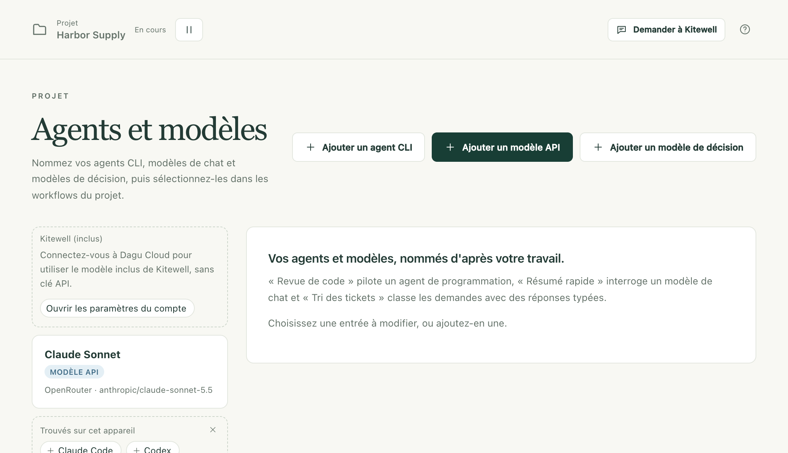

Les fonctions d’IA de Kitewell ont besoin d’un modèle : un modèle que vous ajoutez avec la clé API d’un fournisseur, un outil de codage déjà installé sur cet ordinateur, ou le modèle inclus de Kitewell sur un ordinateur connecté à Dagu Cloud.

Avec un modèle, Kitewell construit et corrige des workflows avec vous dans son chat, une exécution en échec peut expliquer ce qui s’est passé, une feuille peut extraire une valeur de chaque exécution, et un workflow peut poser une question à un modèle en cours de route.

## Ce qu’il vous faut

- La clé API d’un fournisseur, pour tout ce qui appelle un modèle par Internet. Si le projet en a déjà une, **Agents et modèles**, dans la barre latérale, la liste. [Le modèle inclus de Kitewell](#use-kitewells-included-model) n’en demande aucune.
- Pour un agent de codage en ligne de commande, l’outil installé sur cet ordinateur, et connecté à votre compte sur cet ordinateur. Kitewell le lance ; il ne s’y connecte jamais à votre place.
- La page **Agents et modèles** est réservée aux administrateurs et aux éditeurs. Ce que le fournisseur facture pour une requête est à votre charge.

## Ajouter un modèle utilisable par le projet

1. Choisissez **Agents et modèles** dans la barre latérale, puis **Ajouter un modèle API**.
2. Choisissez le **Fournisseur** : Anthropic, OpenAI, Google Gemini, OpenRouter, Z.ai, OpenCode Zen ou Local server (Ollama, vLLM). Un serveur local n’a pas besoin de clé.
3. Sous **Clé API**, choisissez le [secret](/fr/docs/secrets/) du projet qui contient la clé ; un secret est un mot de passe ou une clé stocké de façon à ne jamais apparaître dans un journal. Un administrateur peut aussi choisir **Nouvelle clé…** et coller la clé dans **Collez la clé d'API**, ce qui l’enregistre comme secret en une seule étape. La clé est liée à chaque exécution qui utilise ce modèle ; le workflow lui-même ne la contient jamais.
4. Saisissez l’**ID du modèle**. Pour OpenRouter, OpenCode Zen et un serveur local en marche, la liste propose tous les modèles du fournisseur : tapez une partie d’un nom pour chercher. Pour les autres, des suggestions s’affichent, et tout ID accepté par votre fournisseur fonctionne.
5. Donnez-lui un nom de votre choix (« Résumé rapide », « Lecteur de factures ») et choisissez **Tester le modèle**. Avant tout envoi, le panneau montre la consigne exacte, sa destination, la clé utilisée et ce qui en est conservé.

La page contient trois types d’entrées, à choisir avec **Type** :

- **Modèle API** interroge directement le modèle d’un fournisseur et renvoie sa réponse. Il sert aux tâches **Interroger un modèle**, à l’assistant, au diagnostic des échecs, aux colonnes de résultat d’une feuille, et aux tâches **Automatiser un site web** et **Automatiser une app de bureau**.
- **Modèle de décision** classe, note et répond par oui ou par non, avec une probabilité pour chaque réponse. **Ajouter un modèle de décision** propose OpenRouter ou TypeSafe. Une tâche **Demander une décision à l’IA** s’en sert pour trier ou noter quelque chose afin qu’une étape suivante bifurque selon la réponse, et une [feuille](/fr/docs/batches/) s’en sert pour juger les colonnes oui/non, choix et niveau.
- **Agent CLI** pilote un agent de codage installé sur cet appareil.

Une entrée peut passer la main à une autre en cas d’échec : sa carte affiche alors « Recours » suivi de leurs noms. Chaque tentative est une nouvelle requête, facturée à nouveau.

## Utiliser le modèle inclus de Kitewell

Sur un ordinateur connecté à [Dagu Cloud](/fr/docs/cloud-sync/#sign-in), **Agents et modèles** liste **Kitewell (inclus)**. Aucune clé API n’est nécessaire : chaque requête passe par Dagu Cloud jusqu’à OpenRouter et est payée sur les crédits Dagu Cloud de l’espace de travail.

- Choisissez-le comme **Modèle** d’une tâche **Interroger un modèle** ou **Automatiser un site web**, d’une colonne de résultat de feuille, ou du diagnostic des échecs. Dans le YAML d’un workflow, il s’écrit `kitewell-agent-included`.
- **Automatiser une app de bureau** lit l’écran avec lui quelle que soit
  l’offre, sauf si le projet choisit un autre modèle sous
  **Réglages du projet → Étapes d'écran**. Pour les captures d’écran, Dagu
  Cloud utilise un modèle de vision conçu pour l’utilisation de l’ordinateur.
  **Demander une décision à l’IA** ne peut pas l’utiliser.
- Le chat de Kitewell répond avec lui tant qu’un administrateur n’a pas configuré de modèle sous **Réglages de l’appareil → Modèle d'IA de Kitewell**.

L’essai comprend 100 crédits, une seule fois. Kitewell Personal et Team reçoivent 500 crédits par mois pour chaque ordinateur payé par l’offre, partagés par l’espace de travail et renouvelés le premier de chaque mois (UTC). Les recherches web de l’assistant consomment les mêmes crédits.

Avec Personal et Team, des packs de 1 000 crédits coûtent 12 $ dans [Dagu Console](https://console.dagu.sh/kitewell). Les crédits d’un pack n’expirent jamais et sont consommés une fois ceux du mois épuisés.

Un administrateur voit ce qu’il reste sous **Compte Dagu Cloud**, dans **Réglages de l’appareil**. Quand les crédits sont épuisés, le modèle inclus est refusé jusqu’à leur renouvellement ou l’achat d’un pack, ou, pendant l’essai, jusqu’à ce que vous vous abonniez. Un modèle à vous continue de fonctionner.

Dagu Cloud demande à OpenRouter de n’acheminer ces requêtes que vers des fournisseurs qui ne les stockent pas et ne s’en servent pas pour l’entraînement. Il ne conserve aucun texte de consigne : seulement l’espace de travail, l’appareil, le modèle et les crédits utilisés.

## Utiliser un agent de codage sur cet ordinateur

Installez d’abord l’outil et connectez-vous-y. Kitewell connaît 15 outils (Aider, Amp, Claude Code, Cline, Codex, Cursor, DeepSeek, Droid, Gemini, GitHub Copilot, Goose, Kiro, OpenCode, Pi et Qwen) et exécute tout autre outil comme **Commande personnalisée**. Les outils trouvés sur cet ordinateur qu’aucun agent n’utilise encore apparaissent sous **Trouvés sur cet appareil**, à un clic de leur propre entrée.

1. Choisissez **Ajouter un agent CLI** et sélectionnez le **Harnais**. La liste indique lesquels sont installés sur cet appareil et lesquels ne le sont pas.
2. Pour Claude Code, Codex et OpenCode, **Charger les modèles** remplit la liste avec ce que propose l’outil. Pour les autres, vous saisissez un nom de modèle.
3. Choisissez **Tester l'agent**. Avant l’exécution, le panneau montre la consigne qu’il enverra, le dossier dans lequel il travaillera (un nouveau dossier temporaire vide, supprimé ensuite) et tout ce qu’il contournerait.
4. Dans un workflow, ajoutez une tâche **Demander à un agent IA**, choisissez l’**Agent** et rédigez **Consigne · décrire la tâche**. Sous **Réglages et contexte de l’agent**, indiquez le **Dossier du projet** dans lequel il travaille.

Kitewell exécute l’outil avec la connexion dont celui-ci dispose déjà sur cet ordinateur. Pour les outils qui le permettent, comme Claude Code, Codex et GitHub Copilot, **Effort de raisonnement**, sur l’agent, règle l’intensité du raisonnement de l’outil, et une étape peut le remplacer.

**En cas d'échec**, sur l’agent, liste jusqu’à trois autres agents CLI, essayés dans l’ordre quand l’outil de celui-ci s’arrête sur une erreur : une limite de débit, une connexion manquante ou un plantage, par exemple. Une réponse médiocre n’est pas un échec. Chaque tentative reprend la consigne depuis le début : le travail est donc payé à nouveau.

Quand un relecteur renvoie le travail d’une étape d’agent, l’agent s’exécute à nouveau, avec les remarques du relecteur ajoutées à sa consigne. Voir [S’arrêter et demander à une personne](/fr/docs/workflow-builder/#stop-and-ask-a-person).

Un agent de codage est un programme qui s’exécute sur cet ordinateur sous votre compte, avec tous les accès que vous avez accordés à l’outil lui-même. Il peut lire et modifier des fichiers et exécuter des commandes. **Ignorer les demandes d'autorisation**, sur l’agent, désactive les confirmations propres à l’outil, et un agent qui en contourne au moins une porte la mention **Ignore les approbations** sur sa carte. Ne confiez jamais à un tel agent un texte venu de l’extérieur : l’éditeur de workflow vous avertit quand le texte d’un e-mail risque de lui parvenir, car l’expéditeur de l’e-mail pourrait alors lui donner des ordres. Utilisez plutôt **Interroger un modèle**, qui ne peut rien exécuter.

## L’assistant

Kitewell dispose d’un seul chat pour cet ordinateur, commun à tous les projets. Demandez-lui de construire ou de corriger un workflow, de lancer quelque chose, ou de trouver pourquoi une exécution a échoué. Ouvrez-le avec **Demander à Kitewell** en haut de la fenêtre Kitewell, ou appuyez sur ⌘J sur Mac, Ctrl+J sous Windows. Il est réservé aux administrateurs et aux éditeurs.

Le chat s’ouvre ancré à droite de la fenêtre Kitewell. **Ouvrir dans une fenêtre séparée** l’en détache, **Garder au premier plan** maintient cette fenêtre au-dessus des autres, et **Ancrer dans la fenêtre Kitewell** l’y ramène. Sur Mac, **Ouvrir le chat** dans le menu de la barre des menus l’affiche ; sous Windows, un clic sur l’icône de la zone de notification l’affiche ou le masque.

Il répond avec le **Modèle d'IA de Kitewell**, réglé une fois pour tous les projets dans **Réglages de l’appareil**. Tant qu’aucun administrateur n’en a réglé un, un ordinateur connecté à Dagu Cloud utilise [le modèle inclus de Kitewell](#use-kitewells-included-model) ; sinon, un administrateur peut en configurer un depuis le chat lui-même.

Un travail qui demande plus qu’une réponse rapide se poursuit dans un fil, rattaché au workflow ou à l’exécution qu’il concerne. Kitewell en ouvre un quand une demande se transforme en travail, et **Répondre dans un fil** en ouvre un à partir de n’importe quel message. **Revenir à la conversation principale** vous y ramène, **Marquer comme terminé** ferme un fil, et **Rouvrir** le rouvre. Plusieurs fils peuvent avancer en même temps.

Vous pouvez continuer à écrire pendant que Kitewell travaille : il lit un nouveau message à son étape suivante, et **Interrompre maintenant** arrête le travail pour répondre d’abord à ce message. Quand la fenêtre Kitewell est ouverte, le chat sait ce qu’elle affiche : « ce workflow » désigne donc celui qui est ouvert dans l’éditeur, modifications non enregistrées comprises.

Rien de ce que propose Kitewell n’est enregistré, et rien de ce qu’il fait ne s’exécute, tant que vous n’avez pas appuyé sur le bouton de sa carte.

- Un workflow nouveau ou modifié arrive sous forme de carte, avec son diagramme et **Détails**. Choisissez **Appliquer**, ou **Refuser**, qui vous demande pourquoi. Une planification est proposée activée, avec ses prochaines exécutions ; décochez **Activer sa planification** pour l’enregistrer en pause. Après l’application, **Ouvrir** ouvre le workflow et **Exécuter maintenant** l’exécute, et une modification d’un workflow existant peut être défaite avec **Annuler**.
- Il propose des lignes et des colonnes pour une [feuille](/fr/docs/batches/) sous forme de carte. L’application peut aussi lancer les exécutions des lignes concernées, et elle ne peut alors plus être annulée.
- Il peut exécuter un workflow, approuver, refuser ou renvoyer une étape en attente, arrêter une exécution, et mettre en pause ou reprendre une planification. Chaque action prend la forme d’une carte avec le diagramme du workflow, qui n’agit que lorsque vous appuyez sur son bouton, par exemple **Exécuter** ou **Approuver** ; **Pas maintenant** décline.
- Il peut exécuter un brouillon pour de vrai afin de voir s’il fonctionne. La première fois dans un fil, il vous le demande, avec **Autoriser les essais**. Un essai exécute les commandes, les étapes de navigateur, les lectures et les appels de modèle avec les secrets du projet. Tout ce qui enverrait ou modifierait quelque chose ailleurs (un POST, un e-mail, une commande sur une autre machine) se contente d’indiquer ce qui aurait été envoyé.
- Une fois que vous avez choisi **Autoriser**, il peut utiliser un site dans son propre navigateur pour apprendre comment un workflow doit s’en servir ; vous suivez dans le chat et pouvez **Prendre la main** à tout moment. Il peut lire une page web publique, mais pas une adresse sur cet appareil ou sur son propre réseau, et sur un ordinateur connecté à Dagu Cloud, il peut faire des recherches sur le web.
- Il peut vous poser jusqu’à six questions courtes sur une seule carte, auxquelles vous répondez avec **Envoyer les réponses** ou que vous passez avec **Passer**. Il peut demander un secret par son nom : vous saisissez la valeur dans sa carte et choisissez **Enregistrer**, et l’assistant ne la voit jamais. Seul un administrateur peut ajouter un secret de cette façon, ou lister les noms des secrets.
- Il lit les [connaissances](/fr/docs/knowledge/) du projet à chaque message et note ce qu’il apprend au fil du travail. Quand vous lui dites comment vous voulez qu’il travaille, il le retient aussitôt, avec **Annuler**. Une fois que la conversation a lu une page web ou la sortie d’une exécution, il [demande d’abord](/fr/docs/knowledge/#what-the-assistant-does).

Kitewell publie aussi ses propres cartes, avec toutes les offres. Une exécution qui vous attend en reçoit une, avec **Approuver**, **Refuser** ou une réponse directement sur la carte. Ce que les réglages de notification envoient vers cet appareil en reçoit une aussi : un workflow en échec, avec **Réessayer** ; une planification qui n’a pas démarré, avec **Exécuter maintenant** ; et une ligne pour une exécution qui a réussi, a été annulée ou dure trop longtemps, ou pour une feuille qui s’est terminée. Chacune s’affiche aussi en notification, sauf si le chat est au premier plan.

**Demander à Kitewell**, sur une exécution en échec, lui demande d’en trouver la cause et de proposer une correction.

La conversation reste sur cet ordinateur et n’est pas incluse dans les sauvegardes. **Supprimer** retire un message et **Supprimer le fil** un fil entier ; **Supprimer la conversation de chaque projet**, sous **Réglages de l’appareil → Modèle d'IA de Kitewell**, efface tout. Les workflows et les autres modifications enregistrés par Kitewell restent en place.

## Pourquoi une exécution a échoué

Kitewell peut lire une exécution en échec et dire quoi faire.

1. Ouvrez **Réglages du projet → Diagnostic des échecs** et activez **Diagnostiquer automatiquement les exécutions échouées**.
2. Choisissez le **Modèle** à utiliser.
3. Sous **Workflows**, laissez chaque workflow sur **Valeur par défaut du projet**, ou réglez-le individuellement sur **Activé** ou **Désactivé**. Choisissez **Enregistrer les paramètres de diagnostic**.

Seul le premier échec d’une série d’échecs est diagnostiqué, pas chaque exécution en échec qui suit ; une réussite met fin à la série. La réponse apparaît sur l’exécution en échec sous l’une des formes **Réessayer**, **Action requise**, **Modifier le workflow** ou **Incertain**, avec la cause et une prochaine étape. **Diagnostiquer** en demande un pour n’importe quelle exécution en échec, et **Diagnostiquer à nouveau** demande une nouvelle réponse.

Le modèle reçoit les résultats des étapes en échec, la fin de leurs journaux, ce que faisait une étape de navigateur, de bureau ou d’agent quand elle s’est arrêtée, les échecs d’une exécution enfant, et la définition réellement utilisée par l’exécution. Il ne reçoit aucun outil : rien de ce qu’une exécution a affiché ne peut donc agir. Les diagnostics restent sur cet appareil et sont supprimés avec leurs exécutions.

## Ce qui quitte cet ordinateur

Les consignes et leur contexte vont au fournisseur ou à l’outil que vous avez choisi, et ce sont alors les règles de facturation, de conservation et de confidentialité de ce fournisseur qui s’appliquent. Un espace de travail installé sur votre ordinateur ne signifie pas que chaque tâche y reste.

- Avant l’exécution, **Outils → Vérifier les consignes IA**, dans l’éditeur de workflow, montre les instructions que recevra chaque tâche d’IA. Les valeurs d’exécution sont renseignées au démarrage de l’exécution.
- Après l’exécution, **Exécutions et logs** montre la consigne enregistrée par l’exécution et ce qui est revenu.
- Le chat envoie la conversation récente, ce qu’affiche la fenêtre Kitewell (y compris le workflow ouvert dans l’éditeur), les workflows, modèles et connaissances du projet, et ce qu’a renvoyé chaque outil qu’il a utilisé. Les valeurs des secrets ne sont jamais envoyées.
- Quand le modèle du chat est un modèle OpenRouter à l’adresse propre d’OpenRouter, ses requêtes demandent à OpenRouter de ne les acheminer que vers des fournisseurs qui ne stockent pas ce qu’ils reçoivent et ne s’en servent pas pour l’entraînement.
- Le modèle inclus de Kitewell envoie chaque requête à Dagu Cloud, qui la transmet à OpenRouter.

Voir [Ce qui quitte votre ordinateur](/fr/docs/data-flow/) pour une vue d’ensemble.
