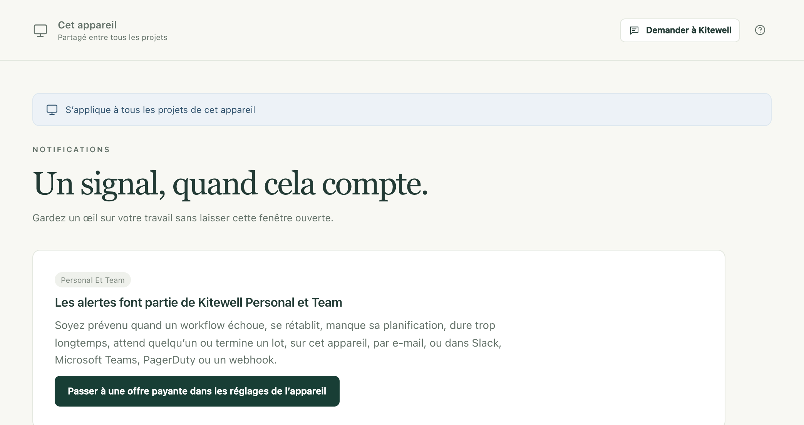

Une alerte vous prévient quand un workflow a besoin de vous (il a échoué, il attend que quelqu’un approuve quelque chose, il n’a pas démarré à l’heure prévue), pour que vous n’ayez pas à garder Kitewell ouvert pour le savoir.

## Ce qu’il vous faut

Les alertes font partie de Kitewell Personal et Team. Avec l’offre gratuite, la page **Notifications** propose de passer à une offre supérieure, et rien n’est envoyé : ni e-mail, ni message, pas même une notification sur cet ordinateur. Rien n’est mis de côté pour plus tard non plus : les alertes commencent dès que l’offre est en place.

Ces alertes partent de l’ordinateur. Quelle que soit l’offre, y compris l’offre gratuite, [Dagu Console](/fr/docs/console/#alerts-from-dagu-console) peut aussi vous envoyer un e-mail quand un workflow d’un projet synchronisé échoue ou qu’un ordinateur cesse de se signaler.

Un canal enregistré sous une offre précédente reste listé dans **Canaux enregistrés**, où vous pouvez le retirer. Il n’envoie rien tant que l’offre n’est pas rétablie.

## Choisir où arrivent les alertes

Ouvrez **Cet appareil → Notifications**. Un canal est un endroit où arrivent les alertes. Choisissez **Ajouter un canal**, sélectionnez son **Type**, donnez-lui un **Nom** et remplissez ce qu’il demande :

- **Cet appareil** affiche une notification sur cet ordinateur. Il est là dès le départ : activez **Notifier sur cet appareil** sous **Notifications de bureau**, et autorisez les notifications quand le système le demande. Il faut l’app Kitewell installée, pas seulement une fenêtre de navigateur.
- **E-mail** demande des **Destinataires**, une liste d’adresses. Le serveur par lequel passent les e-mails se règle une seule fois pour tout l’appareil, sous **Serveur de messagerie** : **Serveur SMTP**, **Port**, **Nom d’utilisateur**, **Mot de passe**, **Expéditeur** et **Sécurité de la connexion**, qui propose **STARTTLS (généralement port 587)** et **TLS (généralement port 465)**. Une connexion chiffrée est obligatoire. Utilisez un mot de passe d’application si votre fournisseur en exige un.
- **Slack** demande une **URL du webhook entrant**. Ajoutez un webhook entrant au canal dans Slack et collez son adresse.
- **Microsoft Teams** demande une **URL du workflow**. Dans Teams, créez un workflow à partir du modèle qui publie dans un canal à la réception d’une requête webhook, et collez son adresse.
- **PagerDuty** demande une **Clé d’intégration** issue d’une intégration Events API v2, et une **Région du service** : **États-Unis** ou **Union européenne**. Une alerte ouvre un incident, et son rétablissement le clôt.
- **Webhook** demande une **URL du destinataire** et y envoie du JSON signé, au format [Standard Webhooks](https://www.standardwebhooks.com/). Un **Secret de signature** est créé quand vous enregistrez le canal et ne s’affiche qu’une fois ; transmettez-le à la personne qui reçoit les messages.

**Envoyer un test** envoie une alerte d’exemple avec les valeurs que vous avez saisies, avant même de les enregistrer, pour qu’une erreur se voie tout de suite. Un test PagerDuty ouvre un incident puis le referme, pour que personne ne soit appelé.

Chaque canal indique si son dernier envoi est bien arrivé, et **Alertes récentes** liste ce qui a été envoyé et ce qui fait encore l’objet de nouvelles tentatives. **Envoyer les alertes de workflow** coupe toutes les alertes de cet appareil ; une fois réactivé, l’envoi repart de ce moment, sans revenir sur ce qui s’est passé pendant la coupure.

## Choisir ce qui vous est signalé

Des règles décident quels événements vont vers quels canaux, à trois niveaux :

1. **Règles d’alerte par défaut**, sur la page **Notifications**, s’appliquent à tout projet qui n’a pas ses propres règles. D’origine, elles envoient **Échoue**, **Attend une saisie**, **Manque une planification** et **Termine un lot** vers **Cet appareil**.
2. **Réglages du projet → Notifications** donne à un projet ses propres règles : choisissez **Utiliser des règles propres à ce projet** au lieu de **Suivre les règles par défaut de cet appareil**. Les règles d’un projet remplacent les règles par défaut au lieu de s’y ajouter.
3. La cloche d’un workflow, dans son éditeur ou dans la liste **Workflows**, ne concerne que ce workflow. Choisissez **Sourdine**, puis **Pendant 1 heure**, **Pendant 1 jour**, **Pendant 1 semaine** ou **Jusqu’à ce que je la réactive** ; donnez-lui ses propres règles avec **Utiliser des règles propres à ce workflow** ; ou réglez **Considéré comme trop long** sur **Automatiquement, d’après les exécutions récentes**, **Après une durée fixée** ou **Jamais**. Choisissez **Enregistrer les alertes**. Ces réglages s’appliquent immédiatement sur cet appareil et ne touchent pas au workflow lui-même : ils ne voyagent donc jamais avec lui.

**Manquée après**, dans les règles par défaut et dans celles des projets, indique combien de minutes de retard une exécution planifiée peut prendre avant d’être considérée comme manquée. La valeur de départ est 5.

## Ce que signifie chaque événement

- **Échoue** : l’exécution a échoué, après sa dernière reprise automatique. Vous êtes prévenu quand une série d’échecs commence, pas à chaque exécution en échec, puis de nouveau quand l’exécution suivante réussit : un rétablissement part toujours vers les mêmes canaux que l’échec.
- **Attend une saisie** : une tâche confiée à une personne ou une approbation attend quelqu’un. Une étape qui se remet en attente après avoir reçu une réponse est signalée à nouveau.
- **Manque une planification** : des exécutions planifiées n’ont pas démarré, avec leur nombre et la raison (l’ordinateur était en veille, Kitewell ne tournait pas, le moteur du projet était arrêté). Un second message suit quand le workflow s’exécute de nouveau à l’heure.
- **Dure trop longtemps** : l’exécution est toujours en cours bien au-delà du temps qu’ont pris ses réussites récentes, ou au-delà d’une limite fixée avec la cloche. Vous êtes prévenu une fois par exécution.
- **Est annulé** et **Réussit** : désactivés tant que vous ne les dirigez pas vers un canal.
- **Termine un lot** : toutes les lignes d’un [lot](/fr/docs/batches/) sont terminées et leurs valeurs ont été lues, avec le nombre de lignes qui n’ont pas réussi et ce qui a changé par colonne, par exemple « Price: 9 dropped, 3 rose ». Un lot que vous avez annulé n’est pas signalé, pas plus qu’un lot planifié dont toutes les lignes ont réussi sans que rien ne change. Un lot planifié qui n’a pas pu démarrer est signalé avec la raison. Les lignes d’un lot ne déclenchent pas une à une les autres événements.

PagerDuty n’accepte que **Échoue**, **Manque une planification** et **Dure trop longtemps** : un incident a besoin d’un événement qui le clôt ensuite, et ce sont les trois qui ont une fin.

## Ce que dit une alerte

Une alerte indique le projet, le workflow, ce qui a déclenché l’exécution, quand elle a commencé et combien de temps elle a duré et, en cas d’échec, quelle étape a échoué et comment, avec son code de sortie ou sa limite de temps. Elle ne contient jamais ce qu’une étape a affiché, ni les valeurs transmises à l’exécution : une alerte quitte cet ordinateur, et une sortie peut contenir n’importe quoi.

Son lien ouvre l’exécution dans Kitewell sur l’ordinateur qui l’a effectuée ; il sert donc à la personne qui se trouve devant. Une alerte de planification manquée ouvre la page **Workflows** du projet, et une alerte de lot ouvre sa feuille.

Les messages d’alerte eux-mêmes sont rédigés en anglais, quelle que soit la langue de Kitewell.

## Quand les alertes sont envoyées

Le service d’arrière-plan les envoie tant que l’ordinateur est éveillé et que Kitewell tourne. Une alerte qui ne peut pas être remise fait l’objet de nouvelles tentatives, de plus en plus espacées, pendant un jour au maximum. Quand l’ordinateur est en veille ou éteint, rien n’est envoyé, et les planifications manquées sont signalées à son réveil. Une exécution terminée depuis plus d’un jour n’est pas signalée quand Kitewell la découvre en retard. Pour être prévenu quand un ordinateur censé rester allumé ne donne plus signe de vie, activez son [alerte d’arrêt des signalements dans Dagu Console](/fr/docs/console/#alerts-from-dagu-console).

## Des alertes, pas des gestionnaires d’événements

Les [gestionnaires d’événements](/fr/docs/workflow-builder/#run-a-task-when-the-workflow-ends) sont des tâches qui s’exécutent quand un workflow réussit, échoue, est annulé ou se termine. Ils servent à faire le ménage et à remettre les choses en ordre. Pour prévenir des personnes, utilisez les alertes.

Un workflow ne peut envoyer d’e-mail à personne par lui-même : `mail_on`, `smtp`, `error_mail`, `info_mail` et `mail_on_error` sont refusés à l’enregistrement, car une alerte envoyée ainsi n’obéirait à aucune règle ni à aucune sourdine, et ne laisserait aucune trace d’envoi.

## En cas de problème

- **Rien n’arrive du tout.** Vérifiez l’offre, puis **Envoyer les alertes de workflow**, puis les règles : un projet qui a ses propres règles ne suit pas les règles par défaut.
- **Rien n’arrive sur cet ordinateur.** **Cet appareil** demande l’app Kitewell installée et l’autorisation du système d’afficher des notifications. Utilisez **Envoyer une notification de test** pour vérifier.
- **Un canal indique qu’il échoue.** Sa carte affiche l’erreur et depuis quand elle se produit. Choisissez **Modifier**, puis **Envoyer un test** pour essayer la correction avant d’enregistrer.
- **Un workflow ne donne plus de nouvelles.** Cherchez la cloche sur sa ligne dans **Workflows** : il est peut-être en sourdine, ou il a ses propres règles.

## Détails

- Ces alertes nécessitent Kitewell Personal ou Team ; celles de Dagu Console fonctionnent avec toutes les offres. Consulter la configuration et retirer un canal restent possibles avec n’importe quelle offre.
- Un appareil peut contenir jusqu’à 50 canaux.
- Une alerte non remise est retentée après une minute, puis deux, quatre, huit, seize et trente, et abandonnée au bout d’un jour. Une réponse indiquant que le message a été compris et refusé n’entraîne pas de nouvelle tentative.
- **Alertes récentes** conserve les 200 derniers envois et affiche les 20 plus récents.
- **Manquée après** accepte de 1 à 1 440 minutes. La limite d’exécution trop longue propre à un workflow va jusqu’à une semaine.
- « Dure trop longtemps » se calcule à partir des dernières exécutions réussies de ce workflow, et il lui en faut au moins cinq avant de se prononcer.
- Un canal webhook peut envoyer vers une adresse `http` comme vers une adresse `https`. Slack n’accepte que les adresses `hooks.slack.com`, et Teams que les adresses `https`.
