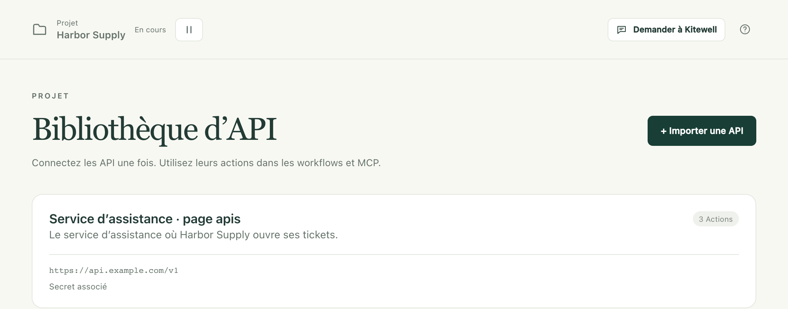
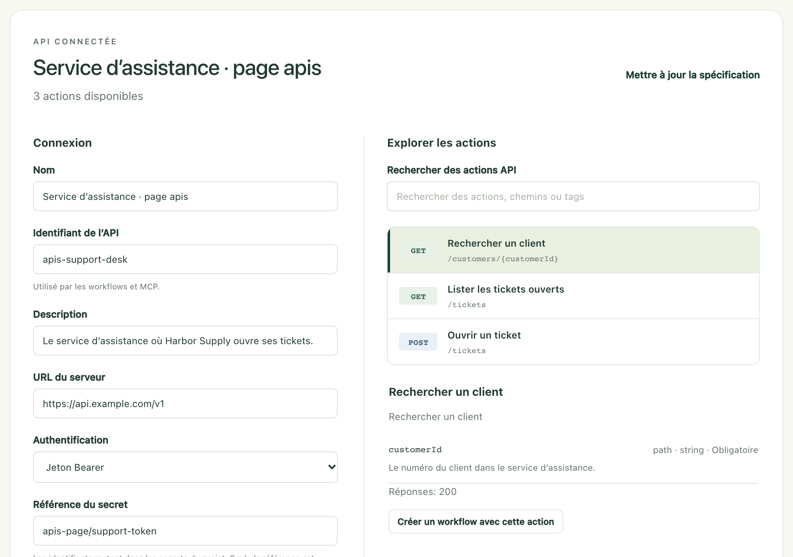

Transformez ce qu’un autre service sait déjà faire (rechercher un client, ouvrir un ticket, enregistrer une commande) en étapes à choisir dans une liste. Vous importez une fois la description du service, et Kitewell construit les formulaires : une étape de workflow se résume alors à quelques champs à remplir, au lieu d’une requête à écrire.

## Ce qu’il vous faut

- Un document OpenAPI pour le service : un fichier JSON ou YAML au format OpenAPI 3.0 ou 3.1. C’est l’éditeur du service qui le publie, souvent sous forme de lien sur sa page développeurs, intitulé « OpenAPI » ou « openapi.json ». Si vous ne le trouvez pas, demandez-le-lui.
- Le jeton, la clé ou le mot de passe qu’attend le service, s’il en demande un. Gardez-le sous la main, mais ne le saisissez pas dans un workflow : sa place est dans un [secret](/fr/docs/secrets/).
- Pour un service auquel vous vous connectez avec OAuth 2.0, comme de nombreux services de comptabilité et de CRM, il faut plutôt une app enregistrée sur sa page développeurs. Voir [Se connecter avec OAuth 2.0](#sign-in-with-oauth-20).

Une connexion appartient à un seul projet, et tous les workflows de ce projet peuvent l’utiliser.

## Importer un service

1. Dans la barre latérale du projet, ouvrez **Plus → Bibliothèque d’API** et choisissez **Importer une API**.
2. Choisissez comment le document parvient à Kitewell : **Importer un fichier**, **Depuis une URL** ou **Coller la spécification**.
3. Choisissez **Aperçu des actions**. Kitewell lit le document et ouvre **Vérifier et connecter**, qui liste tout ce que le service sait faire.
4. Sous **Explorer les actions**, cherchez par nom, chemin ou tag, et sélectionnez une action pour lire ses entrées et ses réponses. Une action que Kitewell ne peut pas exécuter comme étape en donne la raison, au même endroit.
5. Sous **Connexion**, vérifiez **Nom**, **Identifiant de l’API** et **URL du serveur**. Indiquez vous-même l’adresse du serveur si le document n’en contient pas.
6. Choisissez **Authentification** et associez un secret si le service en demande un. Voir [Associer des identifiants](#connect-credentials) ci-dessous, ou [Se connecter avec OAuth 2.0](#sign-in-with-oauth-20) pour un service auquel vous vous connectez.
7. Choisissez **Connecter l’API**.

La connexion apparaît ensuite sous forme de carte dans **Bibliothèque d’API**, avec le nombre de ses actions et l’indication qu’un secret y est associé ou, pour OAuth 2.0, que cet appareil est connecté.

Choisissez la carte pour revenir à tout moment sur le même écran : ses réglages à gauche, ses actions à droite.

**Identifiant de l’API** est le nom que les workflows utilisent pour trouver cette connexion : il ne change plus une fois enregistré. Le document lui-même est stocké dans le projet, même s’il provient d’une URL : rien n’est donc récupéré à nouveau au moment de l’exécution. L’aperçu et la connexion n’appellent jamais le service.

Si l’URL du document exige elle-même une connexion, téléchargez d’abord le fichier dans votre navigateur, puis utilisez **Importer un fichier** ou **Coller la spécification**.

## Associer des identifiants

Sous **Authentification**, choisissez ce qu’attend le service : **Sans authentification**, **Jeton Bearer**, **Clé API**, **Nom d’utilisateur et mot de passe** ou **Connexion OAuth 2.0**. Cette dernière a sa propre section, plus bas. Pour **Clé API**, indiquez aussi son **Nom de la clé** et choisissez **Envoyer la clé dans** : **En-tête**, **Paramètre de requête** ou **Cookie**.

Indiquez ensuite le secret qui contient la valeur. Saisissez ou choisissez une **Référence du secret** existante du même projet, par exemple `services/support-token`. Pour en créer un ici, ouvrez **Enregistrer un nouveau secret**, saisissez la valeur sous **Mot de passe ou jeton d'accès**, et choisissez **Enregistrer le secret**.

Pour un jeton Bearer ou une clé API, le secret contient le jeton ou la clé lui-même. Pour **Nom d’utilisateur et mot de passe**, saisissez le **Nom d’utilisateur** dans la connexion et gardez le mot de passe dans le secret.

La connexion ne stocke que la référence. Kitewell va chercher la valeur et l’ajoute à chaque requête qui utilise la connexion, et la valeur elle-même n’apparaît jamais dans un workflow ni dans un journal. Voir [Secrets](/fr/docs/secrets/) pour remplacer une valeur par la suite.

## Se connecter avec OAuth 2.0

Certains services vous demandent de vous connecter et d’autoriser l’accès plutôt que de fournir un jeton. Kitewell s’y connecte une fois sur chaque appareil et maintient ensuite l’accès à jour : un workflow ne manipule ainsi jamais de jeton.

1. Sur la page développeurs du service, enregistrez une app. Là où elle demande une URL de redirection (parfois appelée URL de rappel), indiquez l’**URL de redirection** que Kitewell affiche sous **Authentification**, par exemple `http://127.0.0.1:19741/oauth/callback`. Le service vous y renvoie une fois que vous êtes connecté. Notez l’ID client, et le secret client si le service en fournit un.
2. Sous **Authentification**, choisissez **Connexion OAuth 2.0**. Quand le document du service décrit sa connexion, Kitewell remplit **URL d'autorisation**, **URL du jeton** et **Portées**. Sinon, copiez-les depuis la page développeurs.
3. Saisissez l’**ID client**. Si le service a fourni un secret client, indiquez le secret qui le contient sous **Référence du secret client**, ou créez-en un avec **Enregistrer un nouveau secret**. Laissez le champ vide s’il n’y en a pas.
4. Choisissez **Connecter l’API**. Kitewell enregistre la connexion et vous invite à vous connecter au service : choisissez **Continuer dans le navigateur**, connectez-vous au service et autorisez Kitewell. De retour dans Kitewell, **Connexion sur cet appareil** affiche **Connectée depuis le**, suivi du moment où vous vous êtes connecté.

Kitewell renouvelle l’accès avant son expiration, y compris pour les services qui émettent un nouveau jeton d’actualisation à chaque fois. Si le service n’accepte plus la connexion OAuth, parce que quelqu’un l’a révoquée ou qu’elle est restée trop longtemps inutilisée, la carte de **Bibliothèque d’API** affiche **Reconnexion requise** et la connexion indique la raison donnée par le service. Choisissez **Reconnecter** et connectez-vous à nouveau.

La connexion OAuth appartient à l’appareil sur lequel elle a été établie. Chaque personne qui exécute ces workflows sur un autre appareil y choisit une fois **Connecter**. D’ici là, une exécution qui utilise l’API est refusée avant de démarrer, et la vue d’ensemble du projet indique l’API à connecter. Les sauvegardes et les exports de projet n’emportent pas la connexion OAuth. **Déconnecter** la retire de cet appareil. Enregistrer un autre ID client, d’autres points de terminaison ou d’autres portées y met fin également : reconnectez-vous ensuite.

## Utiliser une action dans un workflow

1. Ouvrez le workflow, allez dans **Construire** et choisissez **Ajouter une étape**.
2. Choisissez **Utiliser une action API**.
3. Choisissez une **API connectée**, puis cherchez sous **Rechercher une action API** et sélectionnez celle qu’il vous faut.
4. Remplissez les entrées générées par Kitewell. Les entrées obligatoires viennent en premier ; ouvrez **Paramètres facultatifs** pour les autres. Un formulaire **Corps de la requête** apparaît quand l’action en attend un. Pour un fichier que l’action envoie, indiquez son chemin complet sur cet appareil, par exemple `~/Documents/receipt.pdf`, ou choisissez la sortie d’une étape précédente qui en désigne un.
5. Utilisez **Variables**, à côté d’une entrée, pour insérer une entrée du workflow ou une valeur issue d’une étape précédente.
6. Choisissez **Outils → Vérifier le workflow**, puis enregistrez et exécutez le workflow, et lisez le résultat dans **Exécutions et logs**.

Vous pouvez aussi partir du service : ouvrez sa carte dans **Bibliothèque d’API**, sélectionnez une action sous **Explorer les actions**, et choisissez **Créer un workflow avec cette action**.

## Transmettre un résultat à l’étape suivante

Ouvrez **Champs de réponse** sur l’étape API pour voir les champs que décrit le document. Dans une étape suivante, ouvrez **Variables** à côté d’une entrée et choisissez l’un d’eux. Kitewell ajoute la correspondance et relie les deux étapes : l’étape suivante attend donc la fin de l’appel à l’API.

Une recherche de client peut par exemple transmettre son `id` à une étape qui ouvre un ticket. Les champs proposés dépendent de ce que le document dit du contenu de la réponse. S’il ne décrit rien en détail, la réponse entière est disponible sous forme d’une seule valeur.

## Mettre à jour la description d’un service

Kitewell conserve le document tel qu’il était au moment de l’import. Une modification à l’URL d’origine n’atteint pas le projet d’elle-même.

1. Ouvrez la connexion dans **Bibliothèque d’API** et choisissez **Mettre à jour la spécification**.
2. Importez, récupérez ou collez le nouveau document, puis choisissez **Aperçu des actions**.
3. Vérifiez les actions et choisissez **Enregistrer la connexion**.

Kitewell vérifie les workflows du projet avant d’enregistrer. Si le nouveau document casse un workflow enregistré (une action qu’il utilise a disparu, ou ses entrées ont changé), la mise à jour est refusée et l’ancienne connexion reste en place. Corrigez d’abord ces workflows, ou importez le nouveau document sous un autre **Identifiant de l’API** et faites passer les workflows sur la nouvelle connexion un par un.

Pour la même raison, une connexion ne peut pas être supprimée tant qu’un workflow enregistré l’utilise. **Supprimer l’API** indique le workflow qui la retient.

## Partager une connexion sans ses identifiants

Un [export de projet](/fr/docs/sharing/) emporte le document importé et les réglages de la connexion : l’adresse du serveur, le type d’authentification et le nom du secret. Les valeurs des secrets n’y figurent pas. Sur l’appareil qui le reçoit, le secret affiche **Valeur requise** dans **Secrets** jusqu’à ce que quelqu’un l’y renseigne, ou que vous fassiez pointer la connexion vers un autre secret de ce projet.

Une connexion OAuth 2.0 emporte son ID client, ses points de terminaison, ses portées et le nom du secret client, mais pas la connexion OAuth elle-même. Chaque appareil qui exécute ses workflows se connecte une fois.

L’export conserve aussi l’adresse d’où provient le document. Un identifiant saisi directement dans le document, dans une adresse de serveur ou dans une entrée de workflow n’est pas retiré pour vous. Relisez ces champs avant de partager le fichier.

## Ce que l’outil d’import accepte

- Un seul document JSON ou YAML, jusqu’à 8 Mio. Un document Swagger 2 doit d’abord être converti en OpenAPI 3.0 ou 3.1 ; Kitewell vous le signale si vous essayez.
- Les références doivent pointer à l’intérieur du même document. Regroupez les références externes dans le document avant l’import.
- Le corps d’une requête peut être du JSON, un formulaire encodé en URL, du texte ou un formulaire multipart. Un fichier envoyé par un formulaire multipart est désigné par son chemin sur cet appareil, jusqu’à 100 Mo. Les autres corps binaires ne sont pas disponibles comme étapes API ; utilisez pour cela une étape de service web.
- Une action qui demande deux identifiants à la fois, ou un schéma d’authentification que Kitewell ne gère pas, est signalée dans la liste des actions avec la raison.
- La pagination n’est pas automatique. Fournissez vous-même l’entrée de page ou de curseur, et répétez la requête dans le workflow.

Les mêmes actions et schémas importés sont aussi accessibles à un assistant IA disposant de l’accès en modification. Voir [MCP et accès API](/fr/docs/mcp/).
