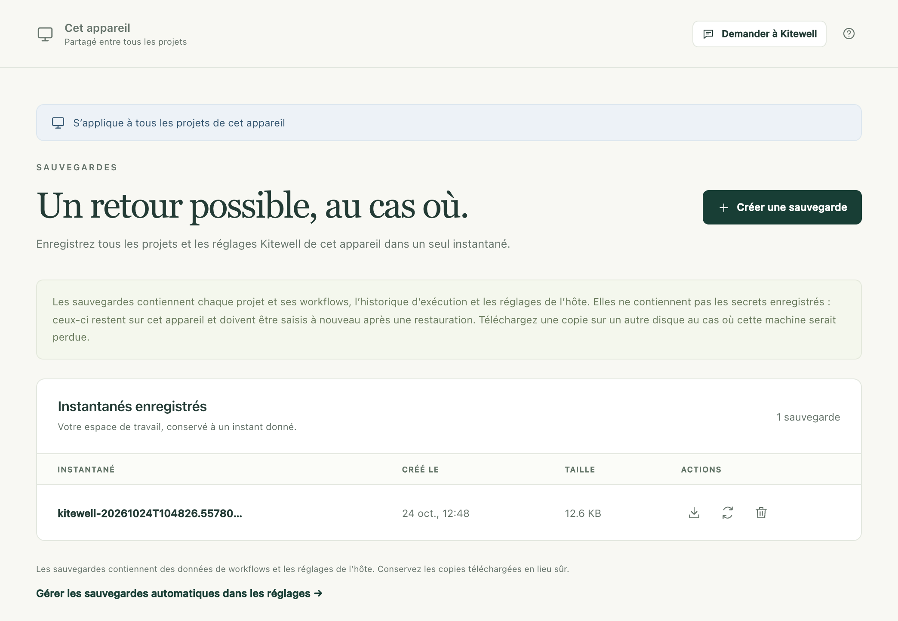
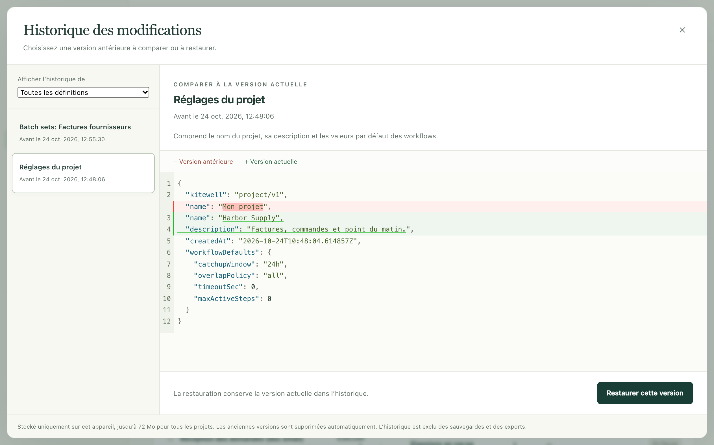

Un instantané réunit tous les projets de cet appareil (workflows, historique
d’exécution, réglages, feuilles et connaissances) dans un seul fichier, que
vous pouvez garder en lieu sûr et restaurer plus tard. Kitewell peut en
prendre un chaque nuit, tout seul. Il conserve aussi les versions antérieures
de tout ce que vous modifiez : une modification apportée à un workflow peut
donc être annulée sans tout restaurer.

## Ce qu’il vous faut

Un accès administrateur sur cet appareil. **Sauvegardes** apparaît sous
**Cet appareil** dans la barre latérale.

## Faire une sauvegarde maintenant

1. Ouvrez **Cet appareil → Sauvegardes** et choisissez **Créer une sauvegarde**.
2. Patientez un instant. Le moteur de chaque projet s’arrête pendant la prise
   de l’instantané, puis redémarre.
3. L’instantané apparaît sous **Instantanés enregistrés**, avec sa date de
   création (**Créé le**) et sa **Taille**.
4. Choisissez **Télécharger la sauvegarde**, la flèche à côté de l’instantané,
   et enregistrez le fichier dans un endroit que vous contrôlez.



Un instantané qui reste uniquement sur cet appareil sert à annuler une
modification. Il ne sert à rien si l’appareil lui-même est perdu ou volé :
gardez donc une copie téléchargée sur un autre disque ou dans un stockage que
votre équipe protège.

## Sauvegarder chaque jour

Activez **Réglages de l’appareil → Sauvegardes automatiques → Sauvegardes quotidiennes**
et choisissez l’**Heure de sauvegarde**. Kitewell prend alors un instantané
par jour, peu après cette heure, dans le fuseau horaire de cet appareil. Si
l’appareil est en veille à ce moment-là, l’instantané est pris après son
réveil.

Kitewell conserve les 10 instantanés automatiques les plus récents et
supprime les plus anciens. Un instantané que vous avez demandé vous-même,
ainsi que l’instantané de sécurité pris avant une restauration, restent
jusqu’à ce que vous les supprimiez.

Deux choses empêchent un instantané automatique. Un workflow en cours, en
file d’attente ou en attente, y compris en attente d’une approbation, le
retarde, et Kitewell réessaie toutes les 15 minutes. Et un appareil dont tous
les projets sont arrêtés n’en prend aucun, puisque rien ne tourne qu’il
faudrait protéger.

## Annuler plutôt une seule modification

Chaque fois que vous enregistrez un workflow, une feuille ou un réglage de
projet, Kitewell conserve la version que vous avez remplacée. Choisissez
**Historique des modifications** sur la page **Workflows**, dans
**Réglages du projet** ou dans la barre d’outils de l’éditeur de workflow.

1. Choisissez une version dans la liste. Chacune porte l’heure à laquelle
   vous l’avez remplacée.
2. Lisez la comparaison. **Version antérieure** est ce que vous regardez,
   **Version actuelle** est ce qui est enregistré maintenant.
3. Choisissez **Restaurer cette version**, puis **Restaurer** pour confirmer.



La restauration conserve la version actuelle dans l’historique : vous pouvez
donc revenir en arrière à nouveau. **Afficher l’historique de** restreint la
liste à un seul workflow ou réglage. Un workflow que vous avez supprimé s’y
trouve encore : le restaurer le rétablit, avec ses planifications en pause.

Cet historique n’existe que sur cet appareil. Il ne figure ni dans un
instantané ni dans une exportation de projet, et la restauration d’un
instantané l’efface.

## Tout restaurer à partir d’un instantané

1. Laissez le travail en cours se terminer. Une restauration est refusée tant
   qu’un workflow est en cours, en file d’attente ou en attente.
2. Ouvrez **Cet appareil → Sauvegardes** et choisissez
   **Restaurer la sauvegarde**, les flèches circulaires à côté de
   l’instantané.
3. Lisez l’avertissement et confirmez avec **Restaurer la sauvegarde**.
   Kitewell enregistre d’abord un instantané de sécurité, remplace tous les
   projets et les réglages de cet appareil, puis recharge.
4. Lisez ce que la restauration signale et traitez chaque point.

La restauration indique, pour chaque projet, les secrets à saisir de nouveau,
les boîtes mail à reconnecter et les étapes de site web qui se reconnecteront
à leur prochaine exécution. Les connexions aux registres de conteneurs sont
effacées : saisissez-les de nouveau, elles aussi.

Cet appareil conserve ce qui lui est propre : sa connexion, ses clés API et la
liste des projets qui étaient arrêtés. Aucun instantané ne peut vous bloquer
l’accès, et aucun instantané n’apporte les clés de quelqu’un d’autre sur
votre appareil.

Une restauration n’écrit jamais dans Dagu Cloud. Un
[projet synchronisé](/fr/docs/cloud-sync/) revient tel que l’instantané le
contenait, et sa prochaine mise à jour récupère la copie de Dagu Cloud.

## Ce que contient un instantané

| Dans l’instantané | Exclu |
| --- | --- |
| Réglages de l’appareil, canaux et règles d’alerte | Valeurs des secrets et clés qui les déchiffrent |
| Projets, définitions des workflows, valeurs par défaut des workflows | Mots de passe des canaux d’alerte, adresses et clés des webhooks |
| Fichiers OpenAPI importés et réglages des connexions d’API | Connexions aux boîtes mail |
| Feuilles de lot, versions publiées, pages de connaissances | Connexions enregistrées aux sites web et caches de relecture |
| Noms et descriptions des secrets | Ce que les étapes de bureau ont enregistré de l’écran |
| Historique d’exécution et artefacts | Journaux de sortie des exécutions |
| Conversations de l’assistant et diagnostics des échecs | Historique des modifications, historique des alertes |
| Copies d’un fichier Excel lié conservées pour l’annulation | Connexion et clés API de cet appareil |
| Ce que cet appareil a décidé pour chaque projet : hôtes SSH approuvés, chemins des clés, workflows exécutés ici | La connexion à Dagu Cloud, un fichier à la racine du dossier de données |

Ce qui est exclu l’est volontairement. Un instantané qui contiendrait à la
fois un secret et la clé qui le déchiffre contiendrait ce secret en clair :
un appareil restauré redemande donc les identifiants.

Le fichier n’est pas chiffré, et une partie de son contenu correspond à vos
propres données métier : la sortie et les artefacts d’une exécution, ce dont
l’assistant a discuté, et jusqu’à dix copies de chaque fichier Excel dans
lequel une feuille réécrit. Un identifiant saisi directement dans un
workflow, un fichier OpenAPI ou une URL source s’y trouve tel qu’il a été
écrit. Traitez un instantané téléchargé comme un fichier sensible, et
chiffrez-le vous-même avant de le placer dans un stockage partagé.

Kitewell ne sauvegarde que ce qu’il conserve lui-même. Les scripts que vos
étapes appellent, les fichiers qu’elles lisent, les volumes Docker, les
dossiers montés et les services que vos workflows contactent n’en font pas
partie. Sauvegardez-les comme vous sauvegardez le reste de l’ordinateur.

## En cas de problème

- **« has a workflow running, queued, or waiting ».** (Un workflow est en
  cours, en file d’attente ou en attente.) Quelque chose est encore en cours.
  Laissez-le se terminer, ou répondez à l’approbation qu’il attend, puis
  réessayez.
- **La sauvegarde échoue à cause de sa taille.** Un instantané contient au
  plus 2 Gio de données et 100 000 fichiers. Supprimez d’abord l’historique
  d’exécution dont vous n’avez plus besoin.
- **La restauration indique que la sauvegarde utilise une structure que cette version ne sait pas lire.**
  L’instantané provient d’une autre version de Kitewell. Installez la version
  qui l’a écrit, ou restaurez un instantané plus récent.
- **Un workflow revient bloqué après une restauration.** La définition est
  conservée et signalée pour que vous puissiez la corriger sur place ; les
  autres workflows s’exécutent.

Consultez la page [Dépannage](/fr/docs/troubleshooting/) pour tout autre
problème.

## Surveiller l’espace disque

**Réglages du projet → Stockage** indique l’espace qu’utilise le projet et
l’espace qu’il reste sur le disque, et vous avertit quand il vient à manquer.
On y trouve :

- l’historique d’exécution de chaque workflow, avec **Supprimer l’historique…**
- les connexions enregistrées aux sites web, avec **Oublier la connexion…**
- les caches de relecture que gardent les étapes de site web et de bureau,
  avec **Vider**
- tout le reste de ce que contient le projet, en un seul chiffre

Une fois par jour, à l’**Heure de sauvegarde**, Kitewell supprime
l’historique d’exécution plus ancien que
**Réglages de l’appareil → Conservation de l’historique d’exécution**, les
lancements de feuille terminés qui l’accompagnaient, et les fichiers
d’exécutions qui n’existent plus. Réduire la durée de conservation efface
l’ancien historique immédiatement, sans attendre la nuit.

Les journaux d’exécution n’ont pas de limite de taille qui leur soit propre.
Une seule exécution très bavarde peut remplir un disque avant que son
historique n’arrive à échéance.

## Où se trouvent les données

```text
macOS:    ~/Library/Application Support/Kitewell
Windows:  %LOCALAPPDATA%\Kitewell
```

`data` contient les projets et les réglages, `backups` les instantanés,
`runtime` les versions du moteur téléchargées, et `logs` ce que le service a
écrit. Quittez Kitewell avant d’en déplacer quoi que ce soit à la main, et ne
supprimez jamais ce dossier pour résoudre un problème d’installation sans
disposer d’un instantané téléchargé.

## Détails

- Les instantanés sont des fichiers `kitewell-<timestamp>.tar.gz` sous
  `backups`, au format tar compressé avec gzip, lisibles par leur seul
  propriétaire, avec `-auto` dans le nom pour ceux que Kitewell a pris de
  lui-même. Le nettoyage automatique ne compte que ceux-là.
- La limite est de 2 Gio de données non compressées et de 100 000 fichiers
  par archive.
- L’historique des modifications est plafonné à 64 Mo pour l’ensemble des
  projets, 1 000 versions au total et 100 versions par workflow ou réglage ;
  les plus anciennes partent en premier. Il se trouve dans
  `data/history/<project>`.
- Une sauvegarde exclut `credentials.json`, `state.json`, `mail.key`,
  `data/history`, le `mail.json` de chaque projet, tous les dossiers `logs`,
  ainsi que les dossiers `auth`, `secrets`, `browser` et `computer` sous le
  moteur de chaque projet. Lors d’une restauration, les trois fichiers propres
  à l’appareil sont reportés tels quels plutôt que repris de l’archive.
- Le nettoyage quotidien supprime aussi les diagnostics des échecs et demande
  au moteur de récupérer les artefacts qu’aucune exécution ne réclame plus. Un
  workflow peut fixer sa propre conservation de l’historique avec
  `hist_retention_days` ou `hist_retention_runs` dans son YAML, qui l’emporte
  sur le réglage de l’appareil. Le nettoyage n’a pas lieu tant qu’une mise à
  jour du moteur est en quarantaine.
- Une restauration remplace le service d’écoute MCP en cours par les réglages
  de l’archive. Les exécutions déjà en cours ne sont ni attendues ni
  arrêtées.
