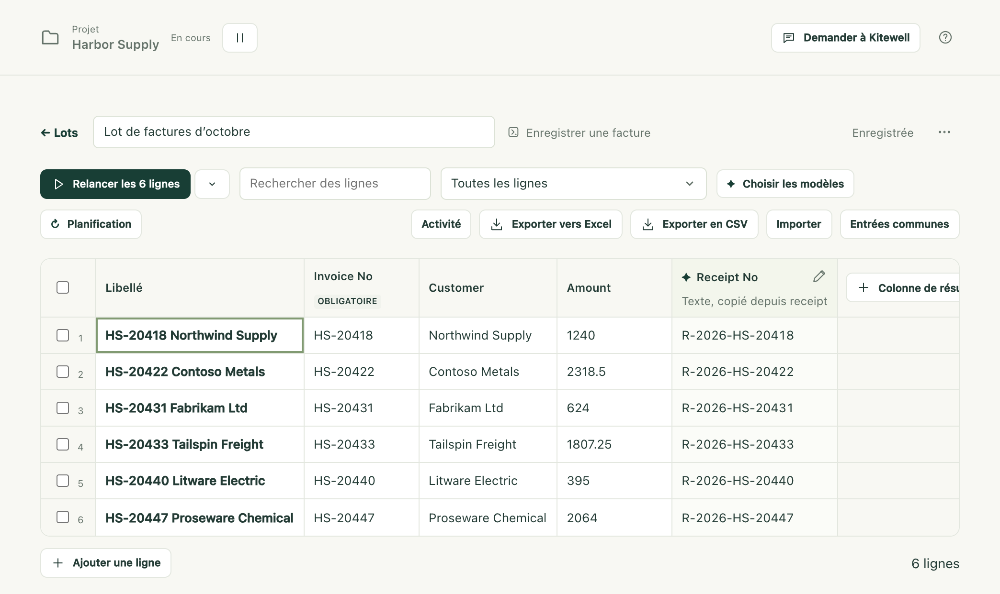

Vous avez une liste de choses à traiter (les factures du mois, une centaine de
fournisseurs à vérifier, toutes les annonces d’une recherche) et un workflow
qui en traite une. Une feuille range la liste en lignes et exécute ce workflow
une fois pour chaque ligne, avec les valeurs propres à cette ligne. Ce que
chaque exécution a trouvé revient dans des colonnes de résultat, à côté :
l’ensemble du travail se lit comme un tableau que vous pouvez trier, filtrer et
exporter.

Les lignes en échec peuvent être relancées seules. Les lignes déjà traitées
restent telles quelles. Personne n’a besoin de rester devant l’écran à
cliquer.

## Ce qu’il vous faut

- Un workflow qui fait le travail pour un élément, avec des entrées nommées
  pour ce qui change d’un élément à l’autre. Un workflow sans entrée peut tout
  de même s’exécuter sur une feuille, mais chaque ligne ferait alors la même
  chose.
- Rien d’autre, pour une feuille dont les colonnes recopient une valeur
  qu’une étape collecte déjà. Pour qu’un modèle lise plutôt quelque chose dans
  chaque exécution, le projet a besoin d’un modèle API dans
  [Agents et modèles](/fr/docs/ai/).

## Créez une feuille

1. Dans la barre latérale, ouvrez **Plus** et choisissez **Lots**, puis
   **Nouvelle feuille**.
2. Choisissez le **Workflow** et donnez à la feuille un **Nom de la feuille**,
   puis choisissez **Créer la feuille**.
3. La feuille s’ouvre avec une colonne par entrée du workflow, qui reprend son
   type, sa valeur par défaut et ses valeurs autorisées, plus **Libellé** à
   gauche. **Libellé** nomme une ligne pour vous et n’est jamais transmis au
   workflow.
4. Ajoutez les lignes (voir ci-dessous) et choisissez le bouton d’exécution.

Vous pouvez aussi partir du formulaire d’exécution d’un workflow : passez
d’**Exécution unique** à **Feuille de lot**, et ce que vous aviez saisi devient
les valeurs communes de la nouvelle feuille. Cette bascule n’existe que sur un
nouveau formulaire d’exécution, pas lors d’une relance.

Une feuille contient jusqu’à 5 000 lignes et 30 colonnes de résultat.

## Ajoutez les lignes

- Saisissez dans la grille, ou collez des cellules copiées depuis une feuille
  de calcul, à partir de la cellule où vous vous trouvez. Des lignes
  s’ajoutent au besoin. **Ajouter une ligne** en ajoute une à la main.
- Utilisez **Importer** pour charger un classeur Excel ou un fichier CSV,
  déposez-en un n’importe où sur la feuille, ou collez les lignes dans la zone
  **Lignes** du panneau et choisissez **Aperçu des colonnes**. L’aperçu montre
  les premières lignes, avec la ligne des noms de colonnes choisie pour vous ;
  choisissez-en une autre avec **Utiliser la ligne 3 comme noms de colonnes**,
  ou **Pas de noms de colonnes**. Associez ensuite chaque colonne à une
  entrée, à **Libellé** ou à **Ignorer la colonne**. Un sélecteur
  **Séparateur** gère les fichiers dont les valeurs ne sont pas séparées par
  des virgules.
- Les **Entrées communes** sont des valeurs que chaque ligne utilise, sauf si
  elle définit les siennes. Une cellule vide affiche, en italique gris, la
  valeur commune ou la valeur par défaut du workflow qu’elle utilisera.
- **Remplir les lignes depuis l’exécution d’un workflow** laisse une exécution
  trouver les éléments, comme les annonces que remonte une recherche, et tient
  les lignes à jour.
- **Lier un classeur sur cet appareil** conserve le lien avec un fichier Excel
  au lieu d’en copier les lignes, pour que le résultat de chaque ligne soit
  réécrit dans la ligne d’où il vient. Voir
  [Automatiser Excel](/fr/docs/spreadsheets/).
- L’assistant peut proposer des lignes et des colonnes, affichées dans la
  feuille ouverte jusqu’à ce que vous décidiez.

Les lignes situées au-dessus des noms de colonnes, les lignes vides et les
lignes de total comme 合計 ou Sous-total sont exclues de l’import et comptées
chacune, avec une case à cocher pour inclure malgré tout les totaux. Un
classeur s’ouvre sur la feuille qu’Excel ouvre, et propose ses autres
feuilles. Les lignes masquées sont importées, sauf si vous cochez la case qui
les exclut. L’import ne fait que lire le fichier ; il ne le modifie jamais.

Chaque valeur est lue selon le type de son entrée : le texte tel qu’il est
saisi, les nombres, `true` ou `false`, et les listes ou objets en JSON. Une
valeur qui ne convient pas est refusée à la saisie, ignorée au collage, et
conservée mais signalée quand elle vient d’un fichier. Une cellule signalée
porte un contour rouge et la raison, et rien ne démarre tant que vous ne l’avez
pas corrigée : une seule cellule non conforme dans les lignes que vous vous
apprêtez à exécuter bloque tout le lancement, en nommant la ligne.

Les cellules d’un classeur arrivent telles qu’Excel les affiche :

- les dates sous la forme `2026-10-01`, la date et l’heure sous la forme
  `2026-10-01 12:00:00`, les heures sous la forme `09:30:00` ;
- les nombres sans séparateurs ni symboles monétaires, et jamais en notation
  scientifique ; les pourcentages en fractions, si bien que 12 % devient
  `0.12` ;
- `TRUE` et `FALSE` (VRAI et FAUX dans un Excel en français) deviennent
  `true` et `false`, en minuscules, ce qu’attend une entrée oui ou non ;
- les codes comme `00123` gardent leurs zéros, que la cellule soit du texte ou
  un nombre formaté avec des zéros en tête ;
- une cellule fusionnée sur plusieurs lignes se répète sur chacune ; une
  fusion au sein d’une même ligne reste dans sa première cellule ;
- une formule donne le résultat qu’Excel a enregistré en dernier ;
- une cellule qui affiche une erreur Excel comme `#N/A` arrive vide, et elle
  est comptée.

Un ancien fichier `.xls` et un classeur protégé par mot de passe sont
refusés : enregistrez-le d’abord au format `.xlsx`, ou retirez le mot de
passe. Un fichier peut peser jusqu’à 16 Mio. Les fichiers `.csv`, `.tsv` et
`.txt` fonctionnent aussi.

La feuille s’enregistre au fil de vos modifications et indique **Enregistrée**.

## Exécutez les lignes

Le bouton d’exécution lance le groupe de lignes qui s’impose et indique
lequel. Si rien n’a encore été exécuté, il affiche
**Exécuter les 6 lignes pas encore exécutées** ; une fois que certaines ont
échoué, **Relancer les 2 lignes en échec ou arrêtées** ; à la fin, il propose
de toutes les relancer. Le chevron à côté ouvre **Autres façons d’exécuter**,
où vous choisissez vous-même le groupe. Les lignes marquées
**Plus dans la liste** sont exclues de tous les groupes, sauf d’une
sélection.

Chaque ligne devient sa propre exécution dans la file d’attente du workflow.
Le bandeau indique combien sont terminées, combien s’exécutent en même temps,
le nom de la file et, dès que trois lignes sont terminées, le temps restant
approximatif. La file **default** fait tourner 5 exécutions à la fois pour
l’ensemble du projet. Si un site rejette les rafales de requêtes, choisissez
**Modifier le nombre d'exécutions simultanées** dans le bandeau : la file
s’ouvre sur la page **Files d’attente**, où **Exécutions simultanées** est le
nombre à baisser.

Sur la file par défaut, les lignes rejoignent la file par paquets d’une
dizaine environ, et les autres affichent **En attente** jusqu’à ce qu’il y ait
de la place, puis **En file d’attente** une fois que le moteur les a prises en
charge. Une exécution planifiée d’un autre workflow qui partage la file
n’attend donc au plus qu’une vague de lignes, jamais toute la feuille.

- **Annuler les lignes en file d’attente** annule les lignes qui attendent
  encore. Les lignes en cours continuent.
- **Tout arrêter** arrête aussi les lignes en cours. Les résultats déjà
  obtenus restent.

Un lancement garde sa propre copie du workflow et des valeurs de chaque
ligne : modifier ensuite la feuille ou le workflow ne change pas les
exécutions déjà en file d’attente. Une ligne dont les entrées ont changé depuis
son exécution affiche **Modifiée**, et le filtre
**Modifiées depuis la dernière exécution** les liste. Modifier une entrée
commune marque toutes les lignes qui l’utilisent.

### Quand une ligne échoue

Sélectionnez la ligne pour voir l’étape où elle s’est arrêtée et l’erreur de
cette étape.
**Configurer les nouvelles tentatives de L’enregistrer sur le portail** ouvre
cette étape dans l’éditeur de workflow, avec **Nombre maximal de reprises**
prêt à régler : un site qui refuse une rafale laisse généralement passer une
tentative ultérieure. Les nouvelles règles de reprise s’appliquent quand les
lignes s’exécutent de nouveau, pas aux exécutions déjà en file d’attente.

## Récupérez un résultat de chaque exécution

Une colonne de résultat recueille une valeur de chaque exécution. Choisissez
comment sous **Provenance de la valeur** quand vous ajoutez la colonne.

**Une valeur publiée par le workflow** la recopie telle quelle depuis chaque
exécution : pas de modèle, aucun coût, et exactement ce que l’étape a trouvé,
dès la fin de l’exécution. Les lignes exécutées avant la création de la
colonne se remplissent aussi. Choisissez la valeur sous **Sortie**.

- Une nouvelle feuille dont le workflow publie des valeurs les propose,
  cochées, sous « Ce workflow publie ces valeurs. Les ajouter comme
  colonnes ? »
- **Colonne de résultat**, à droite de la grille, en ajoute une.
- Une valeur qui ne correspond pas au type de la colonne, comme `¥12,800` dans
  une colonne de nombres, s’affiche telle qu’elle a été publiée, et signalée.
  Ses détails proposent **Passer la colonne en texte** ou
  **Laisser un modèle la lire**.
- Une colonne dont le workflow ne publie plus la valeur est signalée dans son
  en-tête.

Seules les valeurs qui parviennent aux sorties d’une exécution peuvent être
recopiées : celles des extractions de site web et de bureau, des étapes
d’e-mail, et les résultats qu’une étape de commande déclare ; ni les réponses
d’une personne à un formulaire, ni les étapes à l’intérieur d’une boucle.
Quand deux étapes publient le même nom, c’est celle qui s’est exécutée en
dernier qui l’emporte.

**Un modèle lit l'exécution** couvre tout le reste. Nommez la colonne,
choisissez un type (**Texte**, **Nombre**, **Oui ou non**, **Choix** ou
**Niveau**) et, sous **Ce qu’il faut lire (consigne pour le modèle)**, décrivez
ce qu’il faut chercher, par exemple l’unité et la valeur à retenir quand il y
en a plusieurs. **Choix** et **Niveau** prennent leurs **Options** ou leurs
**Niveaux, du plus bas au plus haut**.

Ces colonnes sont remplies par des modèles API d’**Agents et modèles**,
choisis sous **Choisir les modèles** :

- Le **Modèle d’extraction** lit les colonnes de texte et de nombre, ainsi que
  les autres colonnes quand il n’y a pas de modèle de décision. Chaque valeur
  est accompagnée d’une citation, **Cité depuis l’exécution**, signalée quand
  la citation n’a pas été retrouvée mot pour mot dans ce qui a été envoyé.
- Un **Modèle de décision** est facultatif. Il juge les colonnes oui ou non,
  de choix et de niveau avec une probabilité, plus vite et à moindre coût,
  sans citation. **Marquer comme incertains les jugements sous** fixe le seuil
  de confiance en dessous duquel un jugement est signalé pour qu’une personne
  le vérifie ; 70 % par défaut.

Les valeurs sont lues après la réussite de chaque exécution, si la feuille
avait déjà une colonne et un modèle au lancement des lignes.
**Remplir 4 lignes**, dans le bandeau, lit les lignes terminées auxquelles il
manque des valeurs, et **Relire**, dans les détails d’une cellule, relit une
exécution. Aucun des deux ne réexécute le workflow. Une valeur lue avant que
vous changiez la définition de sa colonne est signalée comme périmée ; changer
de modèle ne signale rien.

Le modèle reçoit les entrées de la ligne, les résultats des étapes de
l’exécution, ses sorties publiées, jusqu’à cinq fichiers texte qu’elle a
produits, et la fin des journaux de quatre étapes au plus ; aucune capture
d’écran. Choisissez un fournisseur à qui vous confiez ces données.

## Laissez une exécution trouver les lignes

Les lignes peuvent provenir d’une liste que trouve l’exécution d’un
workflow : les nouveaux éléments deviennent des lignes sans que personne ne
les ajoute. Sous **Importer**, ou sous la ligne vide d’une nouvelle feuille,
choisissez **Remplir les lignes depuis l’exécution d’un workflow**.

1. Choisissez le **Workflow**, qui peut être celui de la feuille, et la
   **Liste** que publient ses exécutions : la **Liste d’éléments** d’une étape
   de [site web](/fr/docs/browser/) ou de [bureau](/fr/docs/desktop/), les
   e-mails que trouve une étape **Trouver des e-mails**, ou toute sortie
   qu’une étape publie sous forme de liste.
2. Vérifiez les premiers éléments de sa dernière exécution. Si le workflow n’a
   pas encore été exécuté, ou si ses champs ne sont connus qu’à partir d’une
   exécution, choisissez **Exécuter maintenant**.
3. Sous **Ce qui remplit chaque entrée**, chaque entrée prend le champ
   d’élément du même nom. Désignez celui qui distingue les éléments avec
   **Associer les lignes par ceci**, et réglez les entrées que prend
   l’exécution qui produit la liste.
4. Choisissez **Remplir les lignes**. Le workflow s’exécute une fois et ajoute
   une ligne par élément.

La barre d’outils indique ensuite d’où viennent les lignes, et
**Actualiser les lignes** exécute de nouveau le workflow. Quand l’exécution
réussit :

- Un élément remplit la ligne qui a la même clé. Une ligne que vous avez
  ajoutée à la main avec cette clé est reprise plutôt que dupliquée. Une clé
  est comparée comme du texte, sauf si elle se lit comme un nombre : elle est
  alors comparée comme un nombre.
- Un nouvel élément ajoute une ligne, marquée **Nouveau** jusqu’à son
  exécution.
- Une ligne dont l’élément a disparu reste, grisée et marquée
  **Plus dans la liste**, et revient quand son élément revient. Le filtre
  **Plus dans la liste** les affiche, avec un bouton pour toutes les supprimer
  d’un coup.
- Les éléments sans clé, ceux qui reprennent la clé d’un autre et ceux qui
  dépassent la limite de 5 000 lignes sont ignorés et comptés.

Une exécution en échec ne change rien et indique pourquoi. Il en va de même
pour une liste revenue vide, ou sans aucun élément doté d’une clé : une
exécution défaillante ne grise jamais toute la feuille. Une liste réellement
plus courte, elle, marque bien ses lignes manquantes.

Quand la source ne correspond plus (le workflow a été supprimé ou ne publie
plus la liste, une entrée qu’elle remplit a été renommée, ou les éléments de la
liste ont perdu un champ), la feuille le signale et la liste des lots la
marque. **Changer la source** ouvre le panneau avec l’association réajustée.

## Planifiez la feuille et voyez ce qui a changé

Pour suivre des valeurs dans le temps, comme des prix ou des annonces
vérifiés chaque matin, choisissez **Planification** dans la barre d’outils de
la feuille et réglez **Relancer chaque ligne** sur **Chaque heure**,
**Chaque jour**, **En semaine**, **Chaque semaine** ou une
**Planification personnalisée** au format cron ; **Désactivé** la supprime.
Une feuille s’exécute au plus une fois par heure. La barre d’outils et la
liste des feuilles indiquent la prochaine exécution.

- La planification appartient à cet appareil. Elle n’est jamais synchronisée
  avec la feuille : une feuille partagée par un collègue ne s’exécute que là
  où quelqu’un la planifie, et jamais sur deux ordinateurs par accident.
- Elle s’exécute tant que cet ordinateur n’est pas en veille et que le moteur
  de ce projet tourne. Pour une exécution manquée pendant que l’ordinateur
  était éteint ou en veille, choisissez ce qui se passe à son retour :
  **L'exécuter au retour, sauf si la suivante est plus proche**, le réglage
  par défaut, **Toujours l'exécuter au retour**, ou **L'ignorer**. Dans tous
  les cas, au plus une exécution manquée a lieu.
- Une échéance qui trouve la dernière exécution encore en cours est sautée, et
  le signale.
- Une feuille dont les lignes viennent de l’exécution d’un workflow les
  actualise d’abord : les nouveaux éléments s’exécutent comme de nouvelles
  lignes, et les lignes qui ne sont plus dans la liste sont exclues. Décochez
  **Actualiser d’abord les lignes depuis Trouver les nouvelles annonces** pour
  exécuter les lignes telles quelles.

Chaque ligne conserve les valeurs qu’a lues sa précédente exécution avec les
mêmes entrées. Un résultat qui a changé depuis est signalé dans sa cellule :
une flèche quand l’ancienne et la nouvelle valeur sont des nombres, un point
pour tout le reste, avec l’ancienne valeur au survol et dans les détails de la
cellule. Un bandeau compte les changements, et **Les afficher** applique le
filtre **Résultats modifiés**.

Seules les colonnes de texte ignorent les différences d’espacement et de
casse ; les autres types sont comparés à l’identique. Un modèle peut formuler
la même valeur différemment d’une exécution à l’autre : recopiez donc ce
qu’une étape publie chaque fois que c’est possible.

## Voyez ce que chaque exécution a changé

**Activité**, dans la barre d’outils de la feuille, liste les 50 derniers
lancements terminés de la feuille, du plus récent au plus ancien. Chacun
indique combien de lignes se sont exécutées et combien ont échoué, ce qui a
augmenté, baissé ou changé dans chaque colonne, quelles lignes sont nouvelles,
revenues dans la liste ou plus dans la liste, et jusqu’à 20 des valeurs qui ont
changé, avec leur valeur précédente. Sélectionnez une valeur modifiée pour
ouvrir sa ligne.

Sélectionnez une valeur : son **Historique** montre chaque moment où elle a
changé au cours de l’année écoulée, avec une courbe pour les nombres.

Cet historique reste sur l’appareil qui a exécuté la feuille : un fichier par
mois, compressé une fois le mois terminé et supprimé au bout de douze mois.

## Exporter, dupliquer et supprimer

- **Exporter vers Excel** et **Exporter en CSV** enregistrent les entrées, les
  valeurs, la probabilité de chaque jugement, la valeur précédente de chaque
  résultat modifié, ainsi que le **Statut**, l’**ID d’exécution** et
  l’**Erreur** de chaque ligne, dans un fichier nommé d’après la feuille et le
  jour. Le classeur s’ouvre avec un en-tête figé muni de filtres, des nombres
  et des dates sous forme de cellules qu’Excel peut trier, et le statut de
  chaque ligne en couleur. Le réimporter associe ses entrées automatiquement.
  Pour une feuille remplie depuis l’exécution d’un workflow, une colonne
  **Présence dans la liste** indique quelles lignes sont nouvelles ou ne sont
  plus dans la liste.
- Le menu de la feuille, **Actions de la feuille**, propose **Dupliquer**, une
  copie avec les mêmes lignes, entrées, colonnes de résultat et modèles, et
  **Dupliquer sans les lignes**, la même configuration avec une seule ligne
  vide. Les copies démarrent sans résultats, puisque les valeurs appartiennent
  aux exécutions qui les ont produites, et sans la planification.
- **Supprimer la feuille** supprime la feuille et les valeurs lues sur cet
  appareil. Les exécutions restent dans **Exécutions et logs**. Une feuille ne
  peut pas être supprimée tant que ses lignes s’exécutent encore.

## Détails

- L’[alerte](/fr/docs/alerts/) **Termine un lot** vous prévient une fois que
  toutes les lignes d’un lancement sont terminées et que leurs valeurs ont été
  lues : combien n’ont pas réussi et ce qui a changé par colonne, et, quand les
  lignes ont d’abord été actualisées, combien sont nouvelles, revenues dans la
  liste ou plus dans la liste. Une exécution planifiée dont toutes les lignes
  ont réussi sans que rien ne change reste silencieuse ; une exécution
  manuelle envoie quand même son rapport. Une exécution planifiée qui n’a pas
  pu démarrer indique pourquoi. Les lignes d’un lot ne déclenchent pas
  d’alertes d’exécution une par une, sauf quand une ligne attend une
  personne.
- Les [clients MCP](/fr/docs/mcp/) peuvent lister et lire les feuilles, avec ce
  que publie chaque workflow et la valeur précédente de chaque valeur
  modifiée ; les créer, les remplacer et les supprimer ; remplir leurs lignes
  depuis l’exécution d’un workflow et les actualiser ; les planifier sur cet
  appareil ; exécuter des lignes, relire des valeurs et annuler des
  exécutions ; et lier ou délier un classeur. Remplacer une feuille la remplace
  entièrement : une ligne ou une colonne omise est supprimée avec ses valeurs.
- La feuille elle-même appartient au projet : elle voyage avec les exports du
  projet et [se synchronise avec Dagu Cloud](/fr/docs/cloud-sync/), y compris
  les valeurs de ses lignes, l’origine de ses lignes et les lignes qui ne sont
  plus dans la liste. Les statuts des lignes, les valeurs lues dans les
  exécutions, leurs valeurs précédentes, la dernière actualisation,
  l’historique d’activité et de valeurs, et la planification de la feuille
  restent sur l’appareil qui les a exécutées.
