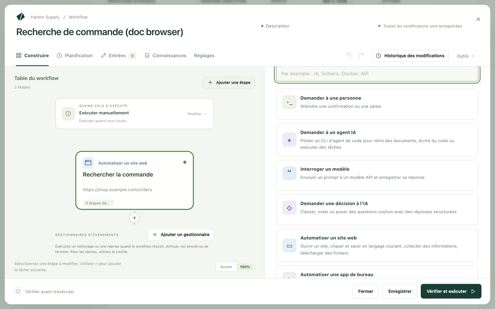
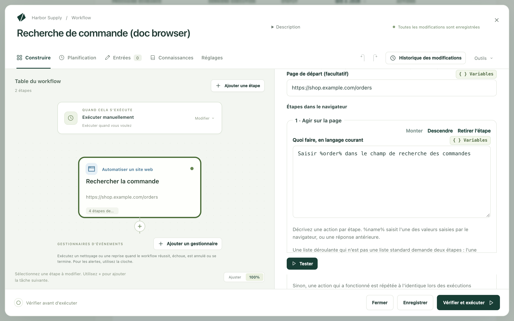

Kitewell peut utiliser un site web à votre place : ouvrir des pages, se
connecter, cliquer et saisir, téléverser des fichiers, lire ce qu’affiche une
page et transmettre ce qu’il a trouvé à l’étape suivante. Vous écrivez ce qu’il
faut faire avec des mots ordinaires, et un modèle trouve comment le faire sur
chaque page. Rien à enregistrer, aucun sélecteur à écrire.

Le travail dont il vous décharge :

- Télécharger les factures du mois sur un portail fournisseurs.
- Téléverser dans votre logiciel de comptabilité les reçus arrivés par e-mail.
- Vérifier le statut de chaque commande d’une feuille de calcul.
- Recopier les chiffres d’un tableau de bord web dans un rapport quotidien.
- Remplir le même formulaire web pour chaque ligne d’une liste.
- Vérifier, après une mise en production, que la connexion et le paiement d’un
  site fonctionnent toujours.

Le navigateur s’exécute sur votre propre ordinateur, et une connexion qu’il
établit reste sur cet ordinateur.

## Ce qu’il vous faut

Un navigateur sur cet ordinateur. Sur Mac, installez Google Chrome dans
`/Applications`. Sur Windows, Kitewell utilise le Chrome ou le Microsoft Edge
déjà installé. Pour utiliser Chromium, Brave, Edge sur Mac, ou un Chrome
installé ailleurs, indiquez son chemin complet dans
**Réglages de l’appareil → Navigateur → Exécutable du navigateur**. L’étape
indique si un navigateur a été trouvé, et lequel elle ouvrira.

Un modèle. Une étape de site web demande à un modèle API quoi faire sur chaque
page. [Ajoutez-en un](/fr/docs/ai/) dans **Agents et modèles**, puis
choisissez-le dans le champ **Modèle** de l’étape, ou définissez-en un pour
tout le workflow dans
**Réglages → Exécution et reprises → Modèle par défaut des étapes de navigateur et de bureau**.
Utilisez un modèle Anthropic, OpenAI ou Gemini. Les petits modèles locaux ne
savent généralement pas piloter un navigateur.

Choisissez ensuite **Vérifier le navigateur**, dans l’étape ou dans
**Réglages de l’appareil**. Le navigateur s’ouvre une fois depuis le service en
arrière-plan de Kitewell, comme lors d’une exécution : un navigateur qui ne
peut pas démarrer se révèle maintenant, et non au milieu d’une exécution
planifiée. Sur Mac, cela permet aussi à macOS de poser ses questions pendant
que vous êtes là pour y répondre.

## Créez votre première étape de site web

Cet exemple recherche une commande sur le site d’une boutique et transmet son
statut à l’étape suivante.

1. Ouvrez un workflow et choisissez **Ajouter une étape**. Le sélecteur de
   tâches s’ouvre.

   

2. Choisissez **Automatiser un site web**. Donnez-lui un **Nom de l’étape**,
   par exemple `Rechercher la commande`. Sous **Réglages techniques**,
   **Identifiant de l’étape** est le nom court qu’utilisent les étapes
   suivantes pour lire ce que celle-ci collecte ; choisissez quelque chose de
   simple, comme `order`.
3. Choisissez le **Modèle**, et réglez **Page de départ (facultatif)** sur la
   page par laquelle commencer, par exemple `https://shop.example.com/orders`.
4. Sous **Valeurs saisies par le navigateur**, choisissez
   **Ajouter une valeur**, nommez-la `order` et réglez sa **Valeur** sur le
   numéro de commande. Ce peut être un texte saisi, une entrée du workflow ou
   un secret, c’est-à-dire un mot de passe ou une clé conservés de façon à
   n’apparaître jamais dans un journal.
5. Sous **Étapes dans le navigateur**, utilisez
   **Ajouter une étape de navigateur** pour ajouter, dans l’ordre :
   - **Agir sur la page**, avec **Quoi faire, en langage courant** réglé sur
     `Saisir %order% dans le champ de recherche des commandes`
   - **Agir sur la page**, avec `Cliquer sur le bouton Rechercher`
   - **S'assurer que…**, avec **La page devrait…** réglé sur
     `Le détail de la commande s’affiche`
   - **Collecter des informations**, avec **Quoi chercher** réglé sur
     `Le statut de la commande et la date de livraison prévue`, et deux
     valeurs sous **Quoi collecter** : `status` et `delivery`, chacune avec
     **Type** réglé sur **Texte**

   

6. Ouvrez **Réglages du navigateur**, activez
   **Afficher la fenêtre du navigateur**, puis choisissez **Tester** pour voir
   l’étape travailler seule.
7. Ajoutez une étape ultérieure qui utilise ce qu’elle a collecté, sous la
   forme `${steps.order.outputs.status}`.

Dans un nouveau workflow, **Ou partez d'un exemple** propose deux exemples de
site web à copier : **Collecter des données d'un site web** et
**Se connecter une fois, puis collecter**.

## Rédigez des instructions que le modèle peut suivre

Une instruction, une action. Une étape **Agir sur la page** n’effectue que sa
première action : `Saisir le code et cliquer sur Continuer` s’arrête donc après
la saisie. Écrivez plutôt deux étapes.

Une liste déroulante qui n’est pas une simple liste demande aussi deux étapes :
l’une l’ouvre, la suivante choisit l’option.

Nommez ce qui figure sur la page, comme vous le feriez avec un collègue :

- `Cliquer sur Télécharger à côté de la dernière facture`
- `Saisir %customer% dans le champ Client`
- `Ouvrir le menu Rapports`

Une étape qui collecte décrit ce que vous voulez, et non une action :
`Le numéro de commande et le total sur la page de confirmation`. Dites ce
qu’est la valeur, pas où elle se trouve à l’écran.

## Ce que peut faire une étape de site web

Les étapes qu’elle contient s’exécutent dans l’ordre, dans un même navigateur.

- **Ouvrir une page** se rend à une **Adresse web**.
- **Agir sur la page** fait une seule chose, décrite sous
  **Quoi faire, en langage courant**. `%name%` saisit l’une des valeurs que
  saisit le navigateur, ou une réponse que vous avez donnée plus tôt.
- **Téléverser des fichiers** transmet à la page des fichiers de cet
  ordinateur. Voir [Téléverser des fichiers](#upload-files).
- **Collecter des informations** lit **Quoi chercher** et remplit les valeurs
  sous **Quoi collecter**. Chaque valeur a un **Nom**, un **Type** (**Texte**,
  **Nombre**, **Oui ou non**, **Liste** ou **Liste d’éléments**) et une
  **Description (facultatif)** qui explique au modèle de quoi il s’agit. Une
  **Liste d’éléments** définit ce que **Chaque élément contient**, par exemple
  l’`url`, le `title` et le `price` d’une annonce. Les étapes suivantes lisent
  chaque valeur sous la forme `${steps.<identifier>.outputs.<name>}`.
- **S'assurer que…** fait échouer l’étape quand la page n’a pas l’aspect
  attendu. **Méthode de vérification** choisit comment.
  **En langage courant (le modèle juge)** lit **La page devrait…** et interroge
  le modèle. **La page contient le texte**, **L'adresse contient** et
  **Un élément apparaît (sélecteur CSS)** lisent eux-mêmes la page, sans
  modèle, et donnent la même réponse à chaque exécution.
  **Continuer à vérifier pendant (facultatif)** laisse à la page le temps d’y
  arriver.
- **Attendre** attend **Pendant une durée fixe**, réglée sous **Durée**, ou
  **Jusqu'à ce qu'un élément apparaisse (sélecteur CSS)**.
- **Prendre une capture d'écran** enregistre un PNG avec les fichiers de
  l’exécution, sous le **Nom de la capture d'écran** que vous lui donnez.
- **Me demander une saisie** affiche votre **Question à vous afficher** et met
  l’exécution en pause jusqu’à votre réponse, par exemple pour un code à usage
  unique. **Utiliser la réponse comme** nomme la réponse pour que les étapes
  suivantes puissent la saisir.

Chaque étape dispose aussi de **Condition et limite de temps**, qui ne
l’exécute que si une condition est remplie et plafonne sa durée. Une étape
sans l’une ni l’autre dure au plus deux minutes.

## Tenez les mots de passe à l’écart du modèle

**Valeurs saisies par le navigateur** contient tout ce que l’étape saisit : un
numéro client, une entrée du workflow, un mot de passe. Les instructions
désignent chacune par `%name%`, et le modèle ne voit jamais que ce nom.

Pour toute donnée sensible, choisissez un secret comme valeur. Il reste hors
des instructions, hors du modèle et hors des journaux. Une instruction qui
écrit en clair la valeur d’un secret échoue plutôt que de l’envoyer, et
**Vérifier et exécuter** le signale avant l’exécution.

## Téléverser des fichiers

**Téléverser des fichiers** place des fichiers de cet ordinateur dans le champ
de fichier d’une page, comme si vous les choisissiez dans un sélecteur de
fichiers : des reçus dans la zone de dépôt d’un logiciel de comptabilité, ou un
formulaire signé sur un portail.

- **Fichiers à téléverser · un par ligne** accepte des chemins complets, comme
  `~/Documents/invoice.pdf` ; des motifs, comme `~/Downloads/*.pdf` ; ou le
  résultat d’une étape précédente qui liste des fichiers. Une étape d’e-mail
  qui trouve des messages avec
  **Enregistrer les pièces jointes dans les fichiers de l’exécution** activé
  liste leurs pièces jointes : écrire `${steps.<identifier>.outputs.messages}`
  téléverse donc ce que les e-mails ont apporté.
- **Où téléverser (facultatif)** nomme en langage courant le champ de fichier,
  ou le bouton ou la zone de dépôt qui ouvre le sélecteur de fichiers :
  `La zone de dépôt des reçus`. Le modèle le trouve une fois, et les
  exécutions suivantes réutilisent ce qu’il a trouvé. Laissez ce champ vide
  quand la page n’a qu’un seul champ de fichier ; aucun modèle n’est alors
  sollicité.
- **Le retrouver à chaque exécution** interroge plutôt le modèle à chaque fois,
  pour une page dont la zone de téléversement se déplace.

Le sélecteur de fichiers ne s’ouvre jamais à l’écran, et le modèle ne voit
jamais les fichiers, leurs noms ni leur emplacement. Un site qui n’accepte
qu’un fichier à la fois fait échouer l’étape si on lui en donne plusieurs ;
téléversez-les dans des étapes séparées, ou exécutez l’étape une fois par
fichier. Chaque fichier peut peser jusqu’à 50 Mo. Les sites envoient en
arrière-plan ce qu’ils ont reçu : faites donc suivre le téléversement d’une
vérification **S'assurer que…** portant sur ce que le site affiche une fois
l’envoi terminé, par exemple **La page contient le texte** `Envoyé`, avec
**Continuer à vérifier pendant (facultatif)** réglé sur une minute.

Quand l’assistant construit un téléversement, il l’essaie d’abord dans son
propre navigateur et vous demande votre accord avant qu’un fichier parte vers
un site, en nommant le site et chaque fichier. Il en va de même pour l’essai
d’un workflow qui téléverse.

## Connectez-vous une fois et restez connecté

Activez **Rester connecté entre les exécutions** dans
**Réglages du navigateur**. Les cookies et l’état de connexion restent sur cet
ordinateur : la prochaine exécution ouvre le site déjà connecté. L’exemple
**Se connecter une fois, puis collecter** commence ainsi : sa première étape
affiche la fenêtre et attend que vous vous connectiez vous-même, et toutes les
étapes et exécutions suivantes réutilisent cette connexion.

**Réglages du projet → Stockage → Connexions** liste ce qui est enregistré, les
workflows qui utilisent chaque connexion, et **Oublier la connexion…** pour en
supprimer une. Les sauvegardes n’emportent pas les connexions : un ordinateur
restauré se reconnecte, de même qu’il vous redemande vos secrets.

Une boucle qui traite ses éléments en même temps ne peut pas partager une
connexion. Réglez la boucle sur un élément à la fois, ou désactivez
**Rester connecté entre les exécutions**.

## Sites qui demandent un certificat

Certains sites, comme les portails d’entreprise ou de l’administration,
demandent au navigateur un certificat client avant de s’ouvrir. Ajoutez le
certificat à Kitewell une fois : toutes les étapes de site web et le
navigateur de l’assistant sur cet ordinateur le présentent aux sites que vous
indiquez, sans que le système demande son mot de passe.

1. Ouvrez **Réglages de l’appareil → Navigateur → Certificats client**.
2. Choisissez **Ajouter depuis un fichier…** pour un fichier `.pfx` ou `.p12`
   et saisissez son **Mot de passe**. Dans l’app Kitewell,
   **Ajouter depuis cet ordinateur…** en choisit plutôt un dans le trousseau
   macOS ou le magasin de certificats Windows ; le système peut demander une
   fois l’autorisation de laisser Kitewell le copier.
3. Sous **L’utiliser pour**, choisissez **Seulement ces sites** et listez-les
   sous **Sites, un par ligne**, par exemple `portal.example.com`, ou
   `*.example.com` pour tous les sites de ce domaine.
   **Tous les sites qui demandent un certificat** le présente à n’importe quel
   site qui le demande.
4. Choisissez **Ajouter le certificat**, puis **Vérifier un site** pour en
   ouvrir un avec ce certificat.

Une étape n’a besoin d’aucun réglage propre. Quand une exécution échoue parce
qu’un site a demandé un certificat, l’exécution en échec propose à un
administrateur d’en ajouter un pour ce site, ou d’utiliser un certificat déjà
ajouté, puis **Relancer l’exécution**.

Le certificat n’est présenté que par les étapes de site web et le navigateur
de l’assistant. Une [étape de bureau](/fr/docs/desktop/) pilote le navigateur affiché à
l’écran, qui vous demande lui-même de choisir un certificat et attend une
réponse : automatisez donc un tel site avec une étape de site web.

Kitewell conserve le certificat sur cet ordinateur, protégé par un mot de
passe qui lui est propre, jamais le vôtre, et l’exclut des sauvegardes.
Ajouter ou modifier un certificat redémarre les moteurs des projets ; les
exécutions en cours continuent. Le chat de Kitewell vous prévient un mois puis
une semaine avant l’expiration d’un certificat, puis au moment où il expire.

## À quoi ressemble une exécution

Ouvrez l’exécution dans **Exécutions et logs**.
**Ce que le navigateur a fait** liste les étapes dans l’ordre avec les
captures d’écran prises, à côté du **Modèle** interrogé et de
l’**Utilisation du modèle**, c’est-à-dire les tokens envoyés et reçus.

**Exécuté sans IA** indique combien d’opérations de l’étape se sont déroulées
sans interroger le modèle : une action rejouée, une vérification qui lit
elle-même la page, ou une opération comme l’ouverture d’une page. Une action
qui a fonctionné une fois est mémorisée et répétée de la même façon la fois
suivante, et une action rejouée n’envoie rien au modèle.

Quand le site change et qu’une action mémorisée ne fonctionne plus, le modèle
est de nouveau interrogé. **Décider à nouveau à chaque exécution**, sur une
étape, désactive ce mécanisme, et
**Réglages du projet → Stockage → Cache de relecture** efface ce qu’un
workflow a mémorisé après la refonte d’un site.
**Collecter des informations** et les vérifications rédigées en langage
courant interrogent le modèle à chaque exécution.

Quand une étape atteint **Me demander une saisie**, l’exécution attend.
Ouvrez-la dans **Exécutions et logs → En attente**, ou depuis la notification,
saisissez votre réponse dans **Votre réponse** et choisissez **Réponse**, ou
**Refuser** pour faire échouer l’étape. La réponse est conservée avec
l’exécution : réservez-la donc aux codes qui expirent, pas aux mots de passe.
Si le navigateur s’est fermé avant votre réponse,
**Redémarrer l'étape de navigateur** relance l’étape depuis sa première
étape.

## L’exécuter pour de nombreux éléments

- Une liste dans une feuille de calcul : donnez au workflow une entrée, comme
  le numéro de commande, puis exécutez-le depuis une
  [feuille de lot](/fr/docs/batches/), une ligne par élément. La feuille
  affiche la progression, les échecs et le temps restant.
- Une liste affichée par le site : collectez une **Liste d’éléments**, comme
  tous les résultats d’une recherche, et
  [laissez-la remplir les lignes d’une feuille](/fr/docs/batches/#let-a-run-find-the-rows).
  Chaque actualisation ajoute les nouveaux éléments et marque ceux qui ont
  disparu.
- Une liste au sein d’une même exécution : placez l’étape dans une boucle
  **Pour chaque élément**.
- Selon une planification : ajoutez une
  [planification](/fr/docs/scheduling/), laissez
  **Afficher la fenêtre du navigateur** désactivé pour que Chrome ne s’ouvre
  pas pendant que vous travaillez, et laissez les [alertes](/fr/docs/alerts/)
  vous prévenir quand une exécution échoue ou attend une réponse.

## En cas de problème

Regardez d’abord les captures d’écran de l’étape : une page de connexion, un
bandeau de cookies ou une vérification anti-robot expliquent la plupart des
échecs. Ensuite :

- L’étape indique que rien sur la page ne correspond à l’instruction.
  Reformulez-la en nommant ce qui figure sur la page, ou scindez-la en deux.
- Un téléversement indique qu’aucun sélecteur de fichiers ne s’est ouvert.
  Nommez le champ de fichier lui-même dans **Où téléverser (facultatif)**, ou
  le bouton qui ouvre le sélecteur ; si le téléversement se trouve derrière un
  menu ou une boîte de dialogue, ouvrez-le dans une étape précédente.
- Le navigateur ne démarre pas. Lancez **Vérifier le navigateur**, et si aucun
  navigateur n’a été trouvé, réglez
  **Réglages de l’appareil → Navigateur → Exécutable du navigateur**.
- Un site dont l’étape a besoin ne se charge pas. Si vous avez rempli
  **Sites autorisés · un par ligne (facultatif)**, chaque hôte utilisé par le
  site doit y figurer, y compris ses serveurs de connexion et d’images.

Le reste se trouve dans
[Dépannage](/fr/docs/troubleshooting/#a-website-step-fails).

## Détails

Les **Réglages du navigateur** de l’étape contiennent aussi
**Enregistrer des captures d'écran** (**Quand une étape échoue**,
**Quand une étape échoue, et à la fin**, **Après chaque étape** ou
**Jamais**), ainsi que **Largeur de la fenêtre** et **Hauteur de la fenêtre**,
en pixels. **Sites autorisés · un par ligne (facultatif)** accepte des noms
d’hôte comme `example.com` ou `*.example.com` ; les adresses locales, les
ports et les chemins sont refusés.

Ce qui parvient au modèle, c’est le texte visible et la mise en page de la
page, une fois pour chaque action qu’il décide, facturé par le fournisseur que
vous avez choisi. Les actions rejouées et les vérifications qui lisent
directement la page n’envoient rien, pas plus que les valeurs saisies par le
navigateur, les fichiers qu’il téléverse ou vos secrets. Les fichiers
téléversés partent vers le site, comme si vous les aviez choisis vous-même.
Voir [Ce qui quitte votre ordinateur](/fr/docs/data-flow/).

Certains sites refusent les navigateurs automatisés. Une connexion enregistrée
et une page de départ située après le bandeau de cookies règlent les cas
courants ; les CAPTCHA ne sont pas résolus. L’ordinateur ne doit pas être en
veille pour une exécution planifiée.

Le workflow de
[Créez votre première étape de site web](#build-your-first-website-step)
compte deux étapes : **Automatiser un site web** avec une page de départ, une
valeur nommée `order`, deux étapes **Agir sur la page**, une vérification
**S'assurer que…** et une étape **Collecter des informations** qui lit le
statut et la date de livraison ; puis une étape ultérieure qui utilise ces
deux valeurs.
