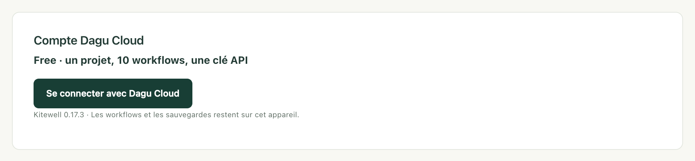

Modifiez un workflow sur votre portable, et l’ordinateur du bureau exécute la
nouvelle version, sans que vous ayez à envoyer de fichier à qui que ce soit.
[Dagu Cloud](https://console.dagu.sh) conserve les définitions du projet ;
chaque ordinateur continue d’effectuer le travail lui-même, avec ses propres
mots de passe, et les valeurs des secrets ne quittent jamais l’appareil sur
lequel elles ont été saisies.

La synchronisation se choisit projet par projet. Un projet reste sur son
ordinateur tant que vous ne le synchronisez pas, et rien n’arrive dans Dagu
Cloud avant que vous le fassiez.

## Ce qu’il vous faut

- Un compte Dagu Cloud. Il est gratuit, et vous connecter depuis Kitewell
  démarre un essai de 14 jours avec les fonctionnalités de Team sur
  3 ordinateurs au plus, sans carte bancaire.
- Pour partager avec d’autres personnes, Kitewell Team, à 99 $ par mois pour
  chaque ordinateur que l’espace de travail connecte, pour 25 personnes au
  plus ; abonnez-vous dans
  [Dagu Console](https://console.dagu.sh/kitewell). Une équipe plus grande choisit
  [Enterprise](/fr/pricing/#enterprise). Le propriétaire de l’équipe paie
  l’espace de travail, et les membres n’ont besoin d’aucun abonnement
  personnel. Kitewell Personal, à 20 $ par mois, est conçu pour le travail
  d’une seule personne sur un seul ordinateur et ne permet d’inviter
  personne. Voir les [tarifs](/fr/pricing/).

## Se connecter

1. Ouvrez **Cet appareil → Réglages de l’appareil** et repérez
   **Compte Dagu Cloud**. Cette section indique l’offre de cet ordinateur.
2. Choisissez **Se connecter avec Dagu Cloud**.
3. Kitewell affiche un code court et un bouton **Continuer dans le navigateur**.
   Ouvrez-le, connectez-vous, vérifiez que le code affiché dans le navigateur
   correspond à celui qu’affiche Kitewell, puis connectez l’ordinateur.

Un ordinateur se synchronise avec un seul espace de travail, dont le nom
apparaît dans **Compte Dagu Cloud** une fois la connexion établie. Un espace de
travail accueille autant d’ordinateurs que son offre le permet : un seul avec
Kitewell Personal, 3 au plus pendant l’essai, et le nombre acheté avec Kitewell
Team. Connecter un ordinateur de plus déconnecte votre propre ordinateur le
plus ancien dans l’espace de travail ; si tous les autres appartiennent à
d’autres personnes, la connexion est refusée tant que l’un d’eux n’est pas
déconnecté ou que l’offre n’en accepte pas davantage.

Se connecter, à soi seul, n’envoie rien. Un ordinateur connecté vérifie son
offre et communique sa version de Kitewell, ainsi que son propre nom et son
ID. Les workflows et l’état des exécutions ne partent que pour un projet que
vous synchronisez ; les journaux et les valeurs des secrets ne partent
jamais. La connexion permet aussi à l’ordinateur d’utiliser le
[modèle inclus de Kitewell](/fr/docs/ai/#use-kitewells-included-model), dont
les requêtes passent par Dagu Cloud.

## Synchroniser un projet

1. Ouvrez le sélecteur de projet et choisissez **Gérer**.
2. Dans **Gérer les projets**, choisissez **Synchroniser avec Dagu Cloud** à
   côté du projet, puis confirmez.

Le projet est envoyé et marqué **Synchronisé** ; désormais, chaque
enregistrement part d’abord vers Dagu Cloud.

:::caution
Le YAML des workflows, les entrées de lot et les adresses d’API sont partagés
tels qu’ils sont écrits. Retirez tout mot de passe que vous y auriez saisi
avant de synchroniser, et conservez-le plutôt dans un
[secret](/fr/docs/secrets/).
:::

Si un envoi est interrompu, le projet affiche **Envoi incomplet** et propose
**Reprendre l’envoi**. Les enregistrements attendent la fin de l’envoi.

Kitewell Personal synchronise jusqu’à cinq projets, et Kitewell Team et
l’essai jusqu’à 15, chacun avec 100 workflows au plus. Un espace de travail
accueille autant d’ordinateurs que son offre le permet : un seul avec
Kitewell Personal, 3 au plus pendant l’essai, et le nombre acheté avec
Kitewell Team. Connecter un ordinateur de plus déconnecte
votre propre ordinateur le plus ancien dans l’espace de travail ; si tous les
autres appartiennent à d’autres personnes, la connexion est refusée tant que
l’un d’eux n’est pas déconnecté ou que l’offre n’en accepte pas davantage. La
synchronisation d’un projet pour lequel l’offre n’a plus de place est
refusée, avec la raison. Les projets synchronisés comptent dans l’offre de
l’espace de travail, et non dans la limite de projets propre à l’ordinateur.

Pour passer de Personal à Team, ou pour modifier le nombre d’ordinateurs sur
Team, ouvrez la page **Kitewell** dans
[Dagu Console](https://console.dagu.sh/kitewell). Team est facturé au mois,
ou à l’année au prix de dix mois. Pour revenir à Personal, retirez
d’abord les autres personnes, révoquez leurs invitations et ne laissez qu’un
seul ordinateur connecté.

## Travailler sur le projet depuis un autre ordinateur

1. Connectez cet ordinateur au même espace de travail.
2. Ouvrez **Gérer les projets** et choisissez **Télécharger depuis Dagu Cloud**.
3. Dans **Projets dans Dagu Cloud**, choisissez **Téléchargement** à côté du
   projet.

La liste signale ce qui se trouve déjà **Sur cet appareil**, et marque
**Lecture seule** tout projet que votre rôle vous permet seulement de
consulter. Un projet dont le nom correspond à celui d’un projet déjà présent
sur l’ordinateur est refusé tant que vous n’avez pas renommé l’un des deux.

Les workflows téléchargés arrivent en pause. Exécutez-en un à la main, puis
activez ceux que cet ordinateur doit exécuter.

Un workflow qui traite une boîte mail fait exception : il ne s’exécute que
sur un ordinateur à la fois, car deux ordinateurs liraient deux fois le même
e-mail. Si vous activez un tel workflow alors qu’un autre ordinateur
l’exécute déjà, Kitewell vous le signale et propose **L’exécuter ici** pour
le déplacer.

## Rester à jour

Kitewell récupère les modifications faites ailleurs à son démarrage, quand
vous ouvrez le projet et quand vous ouvrez un workflow pour le modifier, en
interrogeant Dagu Cloud au plus une fois par minute. Un ordinateur
vérifie aussi de lui-même, environ toutes les cinq minutes : un ordinateur
devant lequel personne n’est assis récupère donc quand même une nouvelle
version.

Pour vérifier à un autre moment, choisissez **Mettre à jour depuis Dagu Cloud**
dans **Gérer les projets**. Un workflow ouvert dans l’éditeur reçoit la mise à
jour sur place, tant que vous n’avez rien saisi.

Récupérer une modification redémarre le moteur du projet. Les exécutions déjà
en cours se poursuivent avec la définition sous laquelle elles ont démarré. Un
workflow nouveau pour cet ordinateur arrive en pause ; un workflow déjà
présent conserve son état (activé ou non), l’endroit où il s’exécute et ses
alertes.

Si quelqu’un a enregistré le même élément depuis que vous l’avez ouvert,
votre enregistrement s’arrête et affiche **Modifié dans Dagu Cloud**.
Choisissez **Remplacer** pour remplacer sa modification par la vôtre, ou
**Annuler** pour garder votre modification sans l’enregistrer.

Kitewell gère les fichiers d’un projet synchronisé. Les modifications qui y
sont faites en dehors de Kitewell sont remplacées quand une modification
arrive de Dagu Cloud, ou la prochaine fois que l’élément est enregistré dans
Kitewell.

## Ce qui est synchronisé, et ce qui reste

Un projet synchronisé contient ce que contient une
[exportation de projet](/fr/docs/sharing/) : les définitions et les
planifications des workflows, les agents et les modèles, les connexions d’API
et leurs documents importés, les serveurs et les groupes de serveurs, les
files d’attente, les registres d’images, les feuilles de lot, les noms et les
descriptions des secrets, les valeurs par défaut des workflows du projet et
ses [connaissances](/fr/docs/knowledge/). Il contient aussi les
[versions publiées](/fr/docs/releases/) du projet, que les exportations
laissent de côté.

:::note[Les valeurs des secrets restent sur votre ordinateur]
Un projet synchronisé ne liste les secrets qu’il utilise que par leur nom.
Chaque ordinateur garde sa propre valeur, définie sur cet ordinateur ; tant
qu’elle ne l’est pas, **Secrets** affiche **Valeur requise**.
:::

Chaque ordinateur garde aussi pour lui ses connexions aux registres, ses clés
SSH et les clés d’hôte approuvées, ses dossiers de travail, la liste des
workflows activés, ses alertes, son historique d’exécution et ses journaux.
Rien de tout cela n’arrive dans Dagu Cloud, à part l’état de chaque
exécution, décrit ci-dessous.

## Suivre les exécutions dans Dagu Cloud

Un projet synchronisé indique comment se passent ses exécutions. Toutes les
deux minutes, ou plus tôt quand les exécutions en cours changent, chaque
ordinateur envoie à Dagu Cloud, pour chaque exécution, le workflow, l’état et
le déclencheur, les heures de mise en file d’attente, de démarrage et de fin,
ainsi que les noms des étapes en échec. Il y ajoute sa version de Kitewell,
son système et l’heure à laquelle il a démarré.

Les paramètres, les journaux, les sorties et les valeurs des feuilles restent
sur l’ordinateur, et un projet non synchronisé n’est jamais signalé. Les
membres de l’espace de travail voient dans Dagu Cloud les exécutions des
projets qu’ils peuvent ouvrir.

**Compte Dagu Cloud**, dans **Réglages de l’appareil**, indique ce qui
s’applique : **L’état des exécutions est partagé avec Dagu Console** ou
**Le partage de l’état des exécutions est désactivé pour cet espace de travail**.

Le propriétaire de l’espace de travail le désactive dans Dagu Cloud, sous
**Paramètres**, en décochant **Partager l’état des exécutions Kitewell** puis
en choisissant **Enregistrer les modifications**. Les ordinateurs signalent
alors seulement qu’ils fonctionnent, et les exécutions qui se terminent
entre-temps ne sont jamais envoyées.

[Dagu Console](/fr/docs/console/) décrit ce qu’affiche la console et les
alertes qu’elle envoie.

## Travailler en équipe

Le propriétaire de l’espace de travail gère l’équipe sur la page **Kitewell**
de Dagu Cloud :

- **Inviter** une personne par son adresse e-mail. L’invitation compte parmi
  les 25 personnes jusqu’à ce qu’elle soit acceptée, révoquée, ou qu’elle
  expire au bout de sept jours. La personne se connecte à Dagu Cloud avec
  cette adresse pour l’accepter.
- **Projets synchronisés** liste tous les projets que l’équipe synchronise et
  donne à chaque membre un rôle sur chacun d’eux :
  - **Lecteur** consulte et télécharge le projet.
  - **Éditeur** peut aussi y enregistrer des modifications.
  - **Administrateur** peut aussi le supprimer de Dagu Cloud.
  - **Aucun accès** le masque.

Le propriétaire peut ouvrir tous les projets. Un membre qui synchronise un
projet en devient l’administrateur. Un membre connecte un ordinateur de la
même façon que vous, en choisissant l’espace de travail de l’équipe quand
Dagu Cloud le lui demande.

:::caution
Une modification enregistrée par un éditeur s’exécute sur chaque ordinateur
qui synchronise le projet, dès que cet ordinateur récupère la mise à jour. Ne
donnez le rôle d’éditeur qu’à des personnes à qui vous confieriez
l’exécution de commandes sur les ordinateurs de votre équipe.
:::

Un projet où votre rôle est **Lecteur** affiche **Lecture seule** dans
l’en-tête de la page et dans la liste de téléchargement. Vous pouvez tout de
même exécuter ses workflows, définir les valeurs de ses secrets sur votre
ordinateur et activer les workflows que cet ordinateur doit exécuter.
Kitewell masque les modifications que Dagu Cloud refuserait : modifier des
workflows, publier ou appliquer des versions, et déclarer des secrets.

## Quand une offre prend fin

Quand l’essai prend fin, plus rien ne s’exécute tant que vous ne vous abonnez
pas. Chaque projet reste sur l’ordinateur : vous pouvez l’ouvrir, le modifier,
consulter son historique d’exécution et l’exporter.

Quand une offre payante prend fin, les alertes, les MCP Events et les
webhooks s’arrêtent. Tout le reste continue de fonctionner pendant 7 jours,
et un bandeau sur chaque page indique le jour où cela s’arrête ; ensuite, tout
se passe comme à la fin de l’essai. Rien n’est supprimé, et quand vous vous
abonnez à nouveau, tout s’exécute comme avant, avec ses planifications.

Passer à une offre aux limites plus basses, par exemple de Team à Personal,
laisse les mêmes 7 jours à tout ce qui dépasse la nouvelle offre :

- **Choisissez ce qui reste.** Dans le bandeau ou dans
  **Réglages de l’appareil**, choisissez les projets et les workflows qui
  restent actifs, dans les limites de l’offre. Si vous ne
  choisissez rien, ce qui a été exécuté ou utilisé le plus récemment reste
  actif.
- **Hors offre.** Tout ce qui dépasse les limites est marqué **Hors offre**.
  Ces éléments ne s’exécutent pas, ni par planification ni à la main, et ne
  peuvent pas être modifiés, mais vous pouvez toujours les ouvrir, consulter
  leur historique d’exécution, les exporter ou les supprimer. Les exécutions
  déjà en cours se terminent.

Un appareil qui ne peut pas joindre Dagu Cloud conserve sa dernière offre
payante jusqu’à l’expiration de cette licence, puis bénéficie des mêmes
7 jours.

## Arrêter la synchronisation

- **Arrêter la synchronisation**, dans **Gérer les projets**, garde le projet
  à la fois sur cet ordinateur et dans Dagu Cloud. Les enregistrements faits
  ensuite sur cet ordinateur restent locaux.
- **Supprimer de Dagu Cloud**, proposé dans la liste de téléchargement là où
  votre rôle est **Administrateur**, supprime un projet que cet ordinateur ne
  synchronise pas et libère sa place dans l’offre. Les copies présentes sur
  d’autres ordinateurs ne peuvent plus enregistrer dans Dagu Cloud.
- Un projet synchronisé avec un autre espace de travail affiche
  **Autre espace de travail** et ne propose que **Arrêter la synchronisation**.

Si un projet est supprimé de Dagu Cloud, ou si vous perdez l’accès à ce
projet, il reste sur votre ordinateur en tant que projet local.

Tant qu’un ordinateur est hors ligne, les enregistrements dans ses projets
synchronisés sont refusés. Les modifications qui restent sur l’ordinateur
fonctionnent toujours (activer un workflow, définir la valeur d’un secret),
et les workflows activés continuent de s’exécuter à partir de la copie
présente sur l’ordinateur. Si Dagu Cloud n’accepte plus la connexion de
l’ordinateur, choisissez **Reconnecter le compte** dans
**Réglages de l’appareil**.
