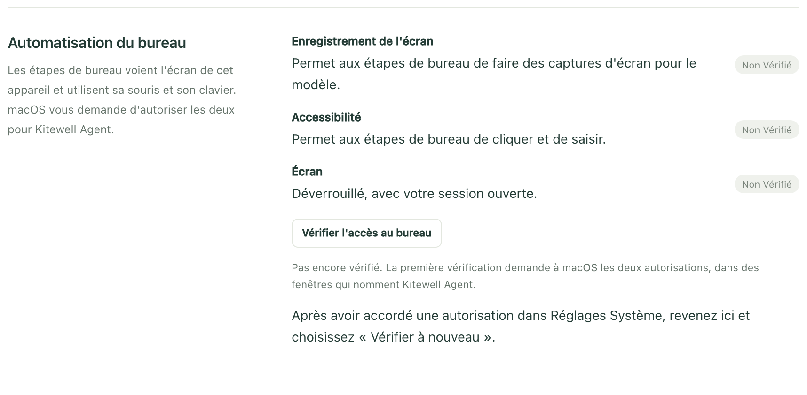
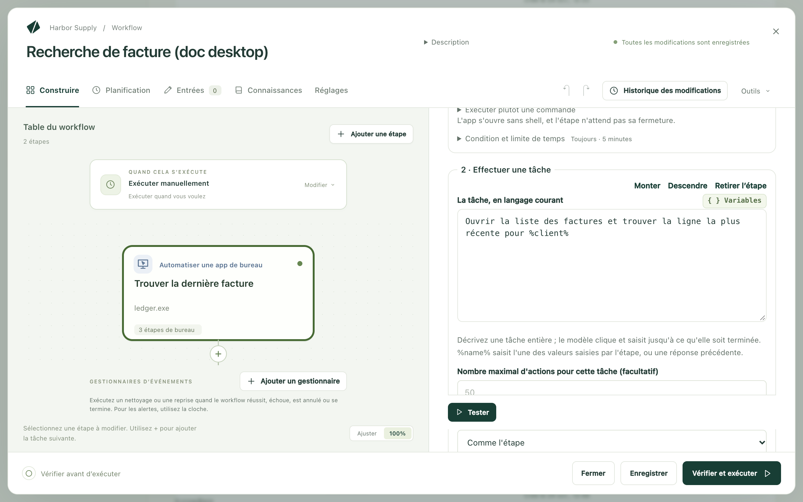

Kitewell peut utiliser les apps de votre ordinateur comme le fait une
personne : il regarde l’écran, puis clique et saisit. Vous décrivez la tâche
avec des mots ordinaires (« Créer une facture pour %client% et
l’enregistrer ») et un modèle travaille jusqu’à ce qu’elle soit terminée.

C’est le travail que font les outils de RPA pour le bureau (piloter une app
qui n’a pas d’API), sans rien enregistrer à la main ni aucun sélecteur à
maintenir. Un modèle trouve comment faire la tâche la première fois ; les
exécutions suivantes rejouent ce qu’il a fait, sans le modèle, tant que l’app
correspond toujours : d’après les éléments de l’app elle-même sous Windows, et
en comparant l’écran sous macOS. Quand l’app ne correspond plus, le modèle est
de nouveau interrogé sur ce qui a changé.

Kitewell atteint ainsi le logiciel de comptabilité ou le client d’ERP qui n’a
ni API ni version web :

- Recopier chaque ligne d’une feuille de calcul dans une app de comptabilité
  ou de vente.
- Lire un chiffre sur un tableau de bord de bureau et le transmettre à l’étape
  suivante.
- Exporter un rapport depuis une app qui n’exporte que par ses menus.
- Vérifier qu’une app affiche ce qu’elle doit après une mise à jour.

Cela fonctionne sur macOS et Windows, sur l’écran que vous avez devant vous.
Pendant l’exécution, Kitewell prend la souris et le clavier, et vous les rend
dès que vous y touchez.

## Ce qu’il vous faut

Un modèle capable de piloter un ordinateur, comme Gemini 3.6 Flash, Claude
Sonnet 5 ou GPT-5.4. [Ajoutez-en un](/fr/docs/ai/) dans **Agents et modèles**,
puis choisissez-le dans le champ **Modèle** de l’étape, ou définissez-en un
pour tout le workflow dans
**Réglages → Exécution et reprises → Modèle par défaut des étapes de navigateur et de bureau**.
Un autre modèle de vision capable d’appeler des outils fonctionne aussi. Avec
Kitewell Personal et Team, le
[modèle inclus de Kitewell](/fr/docs/ai/#use-kitewells-included-model)
fonctionne également ; avec l’offre gratuite, une étape de bureau a besoin de
votre propre modèle. **Comment le modèle utilise le bureau**, sous
**Réglages du bureau**, est normalement réglé sur **Automatique** ;
**Outils simples, pour tout modèle de vision** permet à un modèle dépourvu
d’outil d’utilisation de l’ordinateur de travailler avec de simples outils de
clic et de saisie, plus lentement et de façon moins fiable.

L’autorisation d’utiliser l’écran. Ouvrez
**Réglages de l’appareil → Automatisation du bureau**. Chaque ligne affiche
**Non vérifié** tant que vous n’avez pas choisi
**Vérifier l'accès au bureau**, puis **Prêt** ou **Demande attention**.

- Sur Mac, les lignes sont **Enregistrement de l'écran** et
  **Accessibilité**. La première vérification demande les deux à macOS, dans
  des boîtes de dialogue qui nomment **Kitewell Agent** : c’est le service en
  arrière-plan de Kitewell, celui qui pilote réellement l’écran. Autorisez-les ;
  **Ouvrir Réglages Système** vous amène au bon panneau si vous avez fermé une
  boîte de dialogue.
- Sur Windows, la ligne est **Session ouverte** : les étapes de bureau
  s’exécutent pendant que votre session est ouverte, sur votre écran. Avec
  **Exécuter quand personne n’est connecté** activé, le moteur tourne aussi en
  arrière-plan, mais une étape de bureau vous attend quand même ; son workflow
  indique **Ne s'exécute que lorsque vous êtes connecté**. Une étape de bureau
  ne peut pas non plus cliquer ni saisir dans une app exécutée en tant
  qu’administrateur, sauf si Kitewell l’est aussi.

Un écran déverrouillé, avec votre session ouverte. Les étapes de bureau
utilisent l’écran que vous voyez : un ordinateur verrouillé ou en veille ne
peut pas les exécuter, y compris selon une planification.

## Créez votre première étape de bureau

Cet exemple ouvre l’app de comptabilité, trouve la dernière facture d’un
client et transmet son numéro à l’étape suivante.

1. Ouvrez un workflow, choisissez **Ajouter une étape**, puis
   **Automatiser une app de bureau**. Donnez-lui un **Nom de l’étape**, par
   exemple `Trouver la dernière facture`. Sous **Réglages techniques**,
   **Identifiant de l’étape** est le nom court qu’utilisent les étapes
   suivantes pour lire ce que celle-ci lit ; choisissez quelque chose de
   simple, comme `invoice`.
2. Choisissez le **Modèle**.
3. Sous **Valeurs saisies par l'étape**, choisissez **Ajouter une valeur**,
   nommez-la `client` et réglez sa **Valeur** sur le nom du client. Ce peut
   être un texte saisi, une entrée du workflow ou un secret, c’est-à-dire un
   mot de passe ou une clé conservés de façon à n’apparaître jamais dans un
   journal.
4. Sous **Étapes sur le bureau**, utilisez **Ajouter une étape de bureau**
   pour ajouter, dans l’ordre :
   - **Ouvrir une app**. Sur Mac, remplissez **App**, ou choisissez-la avec
     **Choisir une app…**. Sur Windows, remplissez **Programme** avec le
     chemin du programme, ou choisissez-le avec **Choisir un programme…**.
   - **Effectuer une tâche**, avec **La tâche, en langage courant** réglé sur
     `Ouvrir la liste des factures et trouver la ligne la plus récente pour %client%`
   - **Lire à l'écran**, avec **Ce qu’il faut lire (consigne pour le modèle)**
     réglé sur `Le numéro de facture et le total de cette ligne`, et deux
     valeurs sous **Valeurs à lire** : `number` avec **Type** réglé sur
     **Texte**, et `total` avec **Type** réglé sur **Nombre**

   

5. Choisissez **Tester**, lâchez la souris et le clavier, et regardez.
6. Ajoutez une étape ultérieure qui utilise ce qu’elle a lu, sous la forme
   `${steps.invoice.outputs.number}`.

Dans un nouveau workflow, **Ou partez d'un exemple** propose
**Copier des données depuis une app de bureau**, qui ouvre une app déjà
présente sur cet ordinateur et lit ce qu’elle affiche.

## Rédigez une tâche que le modèle peut mener à bien

Une étape de site web effectue une action à la fois ; une étape de bureau
prend une tâche entière. Le modèle continue de cliquer et de saisir jusqu’à ce
que la tâche soit terminée : décrivez donc ce qui doit être accompli, et non
chaque clic :

- `Ouvrir la liste des factures et trouver la ligne la plus récente pour %client%`
- `Créer une nouvelle facture pour %client% d’un montant de %amount% et l’enregistrer comme brouillon`
- `Exporter le rapport des ventes du mois au format CSV dans le dossier Documents`

**Nombre maximal d'actions par tâche**, sous **Réglages du bureau**, plafonne
le nombre de clics et de frappes qu’une tâche peut effectuer. La valeur par
défaut est 50, et **Nombre maximal d'actions pour cette tâche (facultatif)**
fixe un plafond différent pour une tâche donnée. Une tâche qui en demande
davantage échoue : scindez-la ou relevez le plafond.

## Part des décisions prises par l’IA

Une étape de bureau n’a pas à interroger le modèle à chaque fois.
**Part des décisions prises par l'IA**, sous **Réglages du bureau**, règle ce
point pour toute l’étape, et une tâche peut avoir son propre réglage :

- **Rejouer ; l'IA corrige ce qui a changé** (par défaut) enregistre une tâche
  qui a fonctionné et la rejoue lors des exécutions suivantes. Quand un écran
  ne correspond plus à l’enregistrement, le modèle prend le relais à partir de
  là et l’enregistrement est réparé.
- **L'IA décide à chaque exécution** interroge le modèle pour chaque action.
  Ce mode s’adapte à tout ce que montre l’écran, et envoie une capture d’écran
  pour chaque action, à chaque exécution.
- **Rejouer seulement, sans IA** s’exécute à partir de l’enregistrement seul.
  Rien n’est envoyé à un fournisseur et aucun modèle n’est appelé ; une étape
  qui ne retrouve plus ce qu’elle a enregistré s’arrête et indique ce qui a
  changé, au lieu d’improviser.

Un enregistrement reste sur l’ordinateur qui l’a créé. Sous Windows,
**Épingler ces actions**, sur l’exécution qui a appris une tâche, l’écrit dans
l’étape, pour que tous les ordinateurs Windows puissent la rejouer.

Une étape qui utilise **Rejouer seulement, sans IA** de bout en bout, sans
aucune vérification rédigée sous forme de phrase, n’a besoin d’aucun modèle.
**Lire à l'écran** a besoin du modèle la première fois ; sous Windows, les
exécutions suivantes relisent les mêmes éléments sans lui quand c’est
possible. Sous macOS, cette étape interroge le modèle à chaque exécution : ne
la réglez donc pas sur **Rejouer seulement, sans IA** sur ce système.

## Ce que peut faire une étape de bureau

Les étapes qu’elle contient s’exécutent dans l’ordre, sur l’écran de cet
ordinateur.

- **Ouvrir une app** lance une app ou un programme. Elle n’attend pas sa
  fermeture. Sur Mac, **Exécuter plutôt une commande** accepte une **Commande** et
  des **Arguments · un par ligne (facultatif)**.
- **Effectuer une tâche** réalise **La tâche, en langage courant**. `%name%`
  saisit l’une des valeurs que saisit l’étape, ou une réponse que vous avez
  donnée plus tôt.
- **Lire à l'écran** lit **Ce qu’il faut lire (consigne pour le modèle)** et
  remplit les valeurs sous **Valeurs à lire**, chacune avec un **Nom**, un
  **Type** et une **Description (facultatif)** qui explique au modèle de quoi
  il s’agit. Les étapes suivantes lisent chaque valeur sous la forme
  `${steps.<identifier>.outputs.<name>}`.
- **S'assurer que…** fait échouer l’étape quand l’écran n’a pas l’aspect
  attendu. **Méthode de vérification** choisit comment.
  **L'IA juge une phrase** lit **L'écran devrait afficher…** et interroge le
  modèle à partir d’une capture d’écran. **Un texte est à l'écran**,
  **Un élément est présent** et **Le titre de la fenêtre contient** lisent les
  éléments de la fenêtre au premier plan sans modèle ; ils nécessitent
  Windows. **Continuer à vérifier pendant (facultatif)** laisse à l’app le
  temps d’y arriver.
- **Attendre** attend pendant la **Durée** que vous indiquez.
- **Prendre une capture d'écran** enregistre un PNG de tout l’écran avec les
  fichiers de l’exécution, sous le **Nom de la capture d'écran** que vous lui
  donnez.
- **Me demander une saisie** affiche votre **Question à vous afficher** et met
  en pause jusqu’à votre réponse. **Utiliser la réponse comme** nomme la
  réponse pour que les étapes suivantes puissent la saisir. D’autres étapes de
  bureau peuvent utiliser l’écran pendant cette attente.

Chaque étape dispose aussi de **Condition et limite de temps**, qui ne
l’exécute que si une condition est remplie et plafonne sa durée. Une étape
sans l’une ni l’autre dure au plus cinq minutes.

## Tenez les mots de passe à l’écart du modèle

**Valeurs saisies par l'étape** contient tout ce que l’étape saisit, désigné
dans la tâche par `%name%`. Le modèle ne voit jamais que ce nom.

Pour toute donnée sensible, choisissez un secret comme valeur. Il reste hors
de la tâche, hors du modèle et hors des journaux. Une tâche qui écrit en clair
la valeur d’un secret échoue plutôt que de l’envoyer, et
**Vérifier et exécuter** le signale avant l’exécution.

## Partager l’écran avec vous

Les étapes de bureau s’exécutent une par une : il n’y a qu’un écran, donc une
deuxième étape attend la première. C’est vrai aussi dans une boucle
**Pour chaque élément** et dans une [feuille de lot](/fr/docs/batches/) : les
éléments passent à tour de rôle au lieu de s’exécuter ensemble.

Avant de cliquer ou de saisir, une étape attend que personne n’ait touché à la
souris ni au clavier depuis cinq secondes, et elle se met en pause dès que vous
les utilisez de nouveau : elle ne vous retire jamais la main.
**Attendre que personne n'ait utilisé la souris ou le clavier depuis**, sous
**Réglages du bureau**, modifie ce délai ; `0` le désactive sur un ordinateur
où personne ne travaille.

Pendant qu’une étape de bureau s’exécute, l’icône de Kitewell dans la barre
des menus ou la zone de notification se transforme en pointeur, et le menu
commence par chaque étape en cours (qui utilise votre ordinateur, en pause
pendant que vous l’utilisez, ou en attente d’une autre étape de bureau), suivie
d’**Arrêter**, qui ne met fin qu’aux exécutions auxquelles appartiennent ces
étapes. Rien n’est dessiné par-dessus l’écran, car le modèle le verrait dans
ses captures et pourrait cliquer dessus.

## À quoi ressemble une exécution

Ouvrez l’exécution dans **Exécutions et logs**.
**Ce qui s'est passé sur le bureau** liste les étapes dans l’ordre avec leurs
captures d’écran, et indique où l’étape a attendu que vous lâchiez la souris et
le clavier, ou qu’une autre étape de bureau ait fini. À côté figurent le
**Modèle** interrogé et l’**Utilisation du modèle**, c’est-à-dire les tokens
envoyés et reçus.

**Exécuté sans IA** indique combien d’opérations de l’étape se sont déroulées
sans interroger le modèle : une tâche rejouée, une vérification qui lit
elle-même la fenêtre, ou une opération comme l’ouverture d’une app. Une action
rejouée n’envoie rien au modèle.

La façon dont une tâche est rejouée dépend du système :

- Sous Windows, une action qui portait sur un bouton, un champ ou un menu est
  rejouée sur cet élément, où qu’il se trouve désormais : une fenêtre déplacée
  ou un titre modifié ne l’arrêtent pas. Tout le reste est rejoué à partir de
  l’écran, comme sous macOS.
- Sous macOS, la relecture s’appuie sur l’écran lui-même : elle exige la même
  taille d’écran, et que chaque écran ait le même aspect qu’au moment où la
  tâche a été enregistrée.

Avant de considérer une relecture comme manquée, Kitewell attend qu’un élément
enregistré apparaisse, ou que l’écran corresponde, pendant la durée fixée par
**Attendre les éléments jusqu'à** sous **Réglages du bureau** : 10 secondes
si rien n’est réglé.

Quand une relecture échoue, le modèle prend le relais à partir de là ; avec
**Rejouer seulement, sans IA**, l’étape s’arrête et indique ce qui a changé.
**Réglages du projet → Stockage → Cache de relecture** efface ce qu’un
workflow a mémorisé après la refonte d’une app. Ce cache reste sur cet
ordinateur et n’est pas inclus dans les sauvegardes.

## Quand le fournisseur vous demande de confirmer

Certains fournisseurs de modèles s’arrêtent pour demander à une personne
d’approuver une action, comme un achat. L’étape s’arrête alors elle aussi.
**Quand le fournisseur du modèle demande de confirmer une action**, sous
**Réglages du bureau**, est réglé sur **Arrêter l'étape** ; **Continuer**
laisse ces actions s’exécuter sans approbation. Le plus sûr est de placer une
étape **Me demander une saisie** avant la tâche : la décision vous revient, et
elle est enregistrée avec l’exécution.

## En cas de problème

Regardez d’abord les captures d’écran de l’étape. Ensuite :

- L’étape indique qu’il lui manque une autorisation. Relancez
  **Vérifier l'accès au bureau** et autorisez ce que la ligne indique.
- L’écran était verrouillé, ou quelqu’un d’autre avait ouvert une session. Les
  étapes de bureau ont besoin de l’écran de cet ordinateur, déverrouillé, avec
  votre session ouverte.
- La tâche a épuisé ses actions. Scindez-la en deux tâches, ou relevez
  **Nombre maximal d'actions par tâche**.
- Quelqu’un a utilisé la souris ou le clavier pendant toute la limite de temps,
  si bien que l’étape n’a jamais eu l’écran. Exécutez-la quand l’ordinateur est
  libre, ou donnez à l’étape une limite de temps plus longue.
- Le navigateur vous demande de choisir un certificat. Une étape de bureau
  pilote le navigateur affiché à l’écran, que les certificats client ajoutés à
  Kitewell n’atteignent pas. Automatisez plutôt le site avec une
  [étape de site web](/fr/docs/browser/#sites-that-ask-for-a-certificate).

Le reste se trouve dans
[Dépannage](/fr/docs/troubleshooting/#a-desktop-step-fails).

## Détails

Chaque action décidée par le modèle envoie une capture de tout l’écran, autres
fenêtres ouvertes comprises, au fournisseur du modèle, qui la facture. Avant
une exécution, fermez ce qui ne doit pas être vu, ou utilisez un ordinateur sur
lequel personne d’autre ne travaille. Les actions rejouées de mémoire et les
vérifications qui lisent les éléments de la fenêtre n’envoient rien, pas plus
que les valeurs saisies par l’étape ou vos secrets. Les captures d’écran
enregistrées avec l’exécution restent sur cet ordinateur, selon la durée de
conservation des exécutions. Voir
[Ce qui quitte votre ordinateur](/fr/docs/data-flow/).

Les étapes de bureau ne fonctionnent que sous macOS et Windows, sur l’écran de
cet ordinateur. Une app qui bloque l’enregistrement de l’écran ne peut pas être
pilotée, pas plus qu’une app exécutée en tant qu’administrateur sous Windows
si Kitewell ne l’est pas.

Le workflow de
[Créez votre première étape de bureau](#build-your-first-desktop-step) compte
deux étapes : **Automatiser une app de bureau** avec une valeur nommée
`client`, une étape **Ouvrir une app** qui lance Numbers, une étape
**Effectuer une tâche** qui trouve la ligne la plus récente de ce client, et
une étape **Lire à l'écran** qui lit le numéro de facture et le total ; puis
une étape ultérieure qui utilise ces deux valeurs.

Sous Windows, **Ouvrir une app** prend plutôt le nom du programme, comme
`notepad.exe`, ou le programme et ce qu’il faut lui transmettre.
