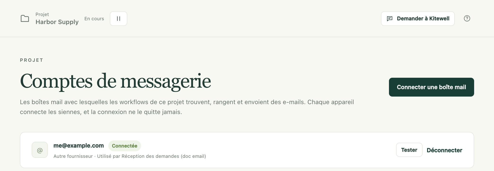
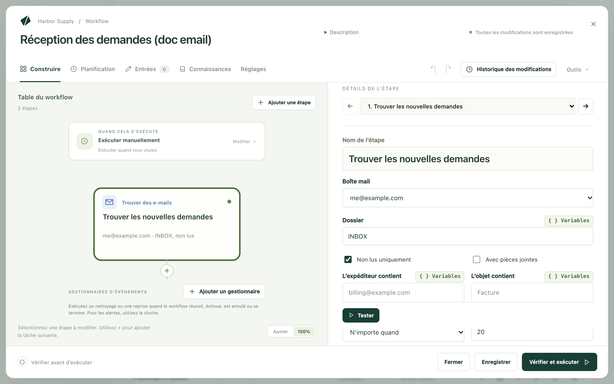

Kitewell peut gérer votre boîte de réception à votre place : trouver l’e-mail
qui compte, en faire quelque chose, puis le classer, ou bien rédiger et
envoyer ses propres messages. Il travaille dans une boîte mail que vous
connectez sur cet ordinateur, et la connexion ne quitte jamais l’ordinateur.

Les tâches qui commencent ou se terminent dans une boîte de réception :

- Classer la pièce jointe de chaque facture non lue et noter son montant.
- Transformer les demandes d’assistance en tickets via une API connectée.
- Résumer ce qui est arrivé ces dernières 24 heures et envoyer la synthèse.
- Trier le courrier entrant dans des dossiers, un modèle choisissant la
  destination de chaque message.
- Rédiger une réponse à chaque demande, la faire approuver par quelqu’un, puis
  l’envoyer.

## Ce qu’il vous faut

Une boîte mail connectée sur cet ordinateur : Gmail ou Google Workspace,
Microsoft 365 ou Outlook.com, iCloud, Yahoo, Fastmail, ou n’importe quelle
boîte IMAP. **Comptes de messagerie**, dans le projet, liste les boîtes mail
qu’utilisent les workflows du projet et l’état de chacune sur cet ordinateur.

Pour en ajouter une, choisissez **Connecter une boîte mail** sur cette page
(ou **Connecter une boîte mail…** dans le champ **Boîte mail** de n’importe
quelle tâche d’e-mail) et saisissez l’adresse. Kitewell déduit le fournisseur
de l’adresse, ou de la destination du courrier d’un domaine personnalisé, et la
liste **Fournisseur** permet de corriger une erreur.

| Fournisseur | Mode de connexion |
| --- | --- |
| Gmail, Google Workspace | Un mot de passe d’application, le temps que Google examine Kitewell |
| Microsoft 365, Outlook.com | Une connexion dans votre navigateur |
| iCloud, Yahoo, Fastmail | Un mot de passe d’application créé sur le site du fournisseur, vers lequel la boîte de dialogue renvoie ; les serveurs sont préremplis |
| Toute autre boîte mail | Serveur IMAP et SMTP, port, sécurité, nom d’utilisateur et mot de passe |

Une connexion par le navigateur ouvre la page du fournisseur, attend, puis
reprend d’elle-même une fois que vous avez donné votre accord. Kitewell se
connecte alors une fois, liste les dossiers et indique combien d’e-mails non
lus contient la boîte de réception, ou pourquoi la connexion a échoué. Rien
n’est enregistré tant que cette vérification n’a pas réussi.

Selon le fournisseur :

- Google bloque la connexion de Kitewell par le navigateur pour la plupart des
  comptes, tant qu’il n’a pas fini d’examiner l’accès de Kitewell à Gmail. Sa
  page indique « Cette application est bloquée » et ne propose aucun moyen de
  passer outre. D’ici là, la boîte de dialogue configure une boîte Gmail à
  partir d’un mot de passe d’application : activez la validation en deux
  étapes, créez un mot de passe d’application nommé Kitewell et collez-le. Une
  connexion par le navigateur qui fonctionne doit utiliser l’adresse que vous
  avez saisie et cocher la case Gmail. Un administrateur Google Workspace qui
  restreint les applications tierces doit autoriser Kitewell dans les
  contrôles des API.
- Une boîte Microsoft 365 nécessite qu’IMAP et le SMTP authentifié soient
  activés, ce que fait un administrateur dans le centre d’administration
  Microsoft 365, sous Courrier pour l’utilisateur concerné, puis Gérer les
  applications de messagerie. Une organisation qui n’autorise que les
  applications approuvées reçoit un lien permettant à son administrateur
  d’approuver Kitewell une fois pour toutes. Pour connecter une boîte
  partagée, connectez-vous en tant que membre autorisé à l’ouvrir.
- Un mot de passe d’application se crée sur le site du fournisseur et peut y
  être révoqué.

Une connexion dure jusqu’à ce que le fournisseur y mette fin : Kitewell
maintient à jour une connexion par le navigateur tant que l’ordinateur est
allumé. Une boîte mail dont la connexion ne fonctionne plus affiche
**Reconnecter** dans **Comptes de messagerie**, dans **Vue d’ensemble**, et à
côté de toute exécution qu’elle a fait échouer.

## Créez votre premier workflow d’e-mail

Cet exemple trouve les e-mails non lus d’une boîte d’assistance, crée un
ticket pour chacun via une API connectée, et marque chaque e-mail comme lu une
fois son ticket créé.

1. Ouvrez un workflow, choisissez **Ajouter une étape**, puis
   **Trouver des e-mails**. Choisissez la **Boîte mail**, laissez **Dossier**
   sur `INBOX` et **Non lus uniquement** activé, et donnez-lui un
   **Nom de l’étape**, par exemple `Trouver les nouvelles demandes`.
   Choisissez **Tester** pour voir quels e-mails correspondent ; un test ne
   marque jamais rien comme lu.

   

2. Choisissez **Pour chaque e-mail…**. Kitewell ajoute une boucle
   **Pour chaque élément** sur ce que l’étape a trouvé, qui se termine par une
   étape **Ranger des e-mails** marquant l’e-mail en cours comme lu.
3. Dans la boucle, avant cette étape, ajoutez **Utiliser une action API** avec
   l’opération « Create issue » du système de tickets. Dans ses champs, le
   sélecteur de variables propose l’expéditeur, l’objet, la date et le texte
   de l’e-mail en cours.
4. Ajoutez une [planification](/fr/docs/scheduling/), par exemple toutes les
   cinq minutes.

Dans un nouveau workflow, **Ou partez d'un exemple** propose
**Traiter chaque nouvel e-mail**, qui reprend cette structure en vous laissant
compléter le travail à faire.

## Ce que font les étapes d’e-mail

**Trouver des e-mails** liste les e-mails correspondants d’un **Dossier**, du
plus ancien au plus récent, avec l’expéditeur, l’objet, la date et le texte de
chacun. Affinez avec **Non lus uniquement**, **Avec pièces jointes**,
**L’expéditeur contient**, **L’objet contient** et **Reçus**
(**N’importe quand**, **Dernière heure**, **Dernières 24 heures**,
**Derniers 7 jours** ou **Derniers 30 jours**).
**Enregistrer les pièces jointes dans les fichiers de l’exécution** place les
fichiers avec les artefacts de l’exécution. Le champ
**Est inférieur ou égal à** fixe le nombre maximal d’e-mails pris, 20 par
défaut et 50 au plus : un arriéré se résorbe ainsi dans l’ordre, sur plusieurs
exécutions. La recherche ne marque jamais un e-mail comme lu. Les étapes
suivantes lisent la liste sous la forme
`${steps.<identifier>.outputs.messages}`.

**Ranger des e-mails** agit sur les **E-mails** que vous lui indiquez : ceux
qu’a trouvés une étape **Trouver des e-mails**, l’un d’eux, ou la réponse d’une
tâche d’IA qui nomme chaque e-mail et sa destination. **Marquer** propose
**Marquer comme lu**, **Marquer comme non lu**, **Signaler**,
**Retirer le signalement** ou **Laisser tel quel**. **Déplacer** propose
**Laisser en place**, **Déplacer vers un dossier** (nommé dans **Dossier**, et
créé si la boîte mail n’en a aucun de ce nom), **Archiver** ou
**Mettre à la corbeille**. Rien n’est jamais supprimé définitivement, et un
e-mail que quelqu’un a déjà déplacé est signalé comme introuvable sans faire
échouer l’étape. **Tester** ne fait que prévisualiser la modification.

**Envoyer un e-mail** envoie depuis la boîte mail indiquée dans
**Expéditeur**, avec **À**, **Objet**, **Message** et
**Pièces jointes · un chemin de fichier par ligne**. Dans une boucle sur des
e-mails trouvés, **Répondre à l’e-mail en cours** place la réponse dans le fil
de cet e-mail, adressée à son expéditeur, avec `Re:` suivi de son objet, sauf
si **À** et **Objet** indiquent autre chose. Gmail et Microsoft 365 conservent
une copie dans les éléments envoyés ; les autres fournisseurs ne le font pas
forcément.

## Traiter chaque e-mail une seule fois

Laissez **Non lus uniquement** activé, et marquez chaque e-mail comme lu (ou
déplacez-le) à l’intérieur de la boucle, juste après les étapes propres à cet
e-mail. Un e-mail dont le traitement a échoué reste alors non lu, et la
prochaine exécution ne réessaie que celui-là.

Marquer les e-mails après la boucle marquerait aussi l’e-mail en échec, car
les étapes qui suivent une boucle s’exécutent même quand certains éléments
échouent, et il ne serait plus jamais retraité. Pour un travail sur
l’ensemble du lot, comme une synthèse, une seule étape **Ranger des e-mails**
à la fin convient.

**Vérifier et exécuter** avertit quand des e-mails trouvés ne sont jamais
marqués, quand ils ne le sont qu’après la boucle, et quand le texte d’un
e-mail parvient à une commande ou à un agent IA capable d’exécuter des
commandes. Ce texte a été écrit par l’expéditeur de l’e-mail : traitez-le
comme venant de lui. Pour qu’un modèle lise des e-mails, utilisez une étape
**Interroger un modèle**, qui ne peut pas exécuter de commandes.

## L’utiliser en équipe

L’adresse d’une boîte mail voyage dans le workflow comme n’importe quel autre
texte ; une connexion, jamais. Un projet reçu d’un collègue ou de
[Dagu Cloud](/fr/docs/cloud-sync/) liste dans sa **Vue d’ensemble** les boîtes
mail à connecter, et une exécution qui en a besoin est refusée tant que la
boîte n’est pas connectée sur cet ordinateur.

Dans un projet synchronisé, un workflow planifié qui traite une boîte mail
s’exécute sur un seul ordinateur à la fois : deux ordinateurs ne traitent
jamais le même e-mail. L’activer là où un autre ordinateur l’exécute déjà vous
demande s’il faut le déplacer ici ; l’autre ordinateur le désactive à sa
prochaine synchronisation. La liste des workflows indique quel ordinateur
l’exécute.

## En cas de problème

- Une exécution est refusée parce qu’une boîte mail n’est pas connectée ici.
  Ouvrez **Comptes de messagerie** et choisissez **Connecter** ou
  **Reconnecter**. La boîte de dialogue indique ce que le fournisseur a
  refusé.
- Google affiche « Cette application est bloquée ». Fermez cette page, revenez
  dans Kitewell et choisissez
  **Utiliser plutôt un mot de passe d’application**.
- Chaque exécution retrouve les mêmes e-mails. Ces e-mails ne sont jamais
  marqués : ajoutez dans la boucle une étape **Ranger des e-mails** dont
  **Marquer** est réglé sur **Marquer comme lu**.

Le reste se trouve dans
[Dépannage](/fr/docs/troubleshooting/#a-mailbox-needs-reconnecting).

## Détails

Les identifiants sont exclus des sauvegardes, des exports et de la
synchronisation ; un ordinateur restauré vous demande de vous connecter de
nouveau. Un e-mail lu par une étape est stocké avec l’exécution sur cet
ordinateur, selon la durée de conservation des exécutions, et ne part que là
où votre workflow l’envoie, par exemple vers le modèle que vous choisissez
dans une tâche d’IA. Voir
[Ce qui quitte votre ordinateur](/fr/docs/data-flow/).

Une connexion Gmail par le navigateur demande l’autorisation de lire,
d’étiqueter, de mettre à la corbeille et d’envoyer des e-mails
(`gmail.modify`), jamais de les supprimer définitivement ; la page de
consentement et la [politique de confidentialité](/privacy/) le précisent. Un
mot de passe d’application, en revanche, donne un accès IMAP et SMTP à toute
la boîte mail.

Une étape **Trouver des e-mails** prend au plus 50 e-mails par exécution. Il
n’y a ni transfert, ni brouillons, ni déclencheur à l’arrivée d’un e-mail ;
une planification avec **Non lus uniquement** remplit ce rôle. Un tenant
Microsoft 365 où IMAP ou le SMTP authentifié est désactivé ne peut pas se
connecter du tout.

Le workflow de
[Créez votre premier workflow d’e-mail](#build-your-first-email-workflow)
compte trois étapes : **Trouver des e-mails** avec **Non lus uniquement**
activé, une boucle **Pour chaque élément** sur ce qu’elle a trouvé, avec
**Éléments simultanés** réglé sur 1, et, dans la boucle,
**Utiliser une action API** avec l’opération « Create issue » du système de
tickets, suivie de **Ranger des e-mails**, qui marque l’e-mail en cours comme
lu.
