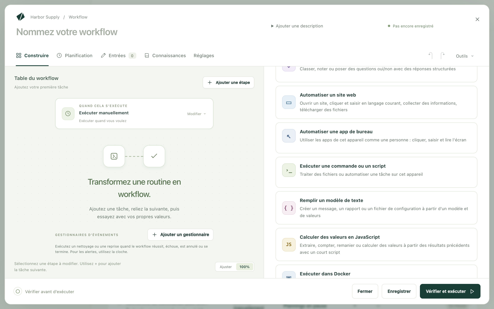
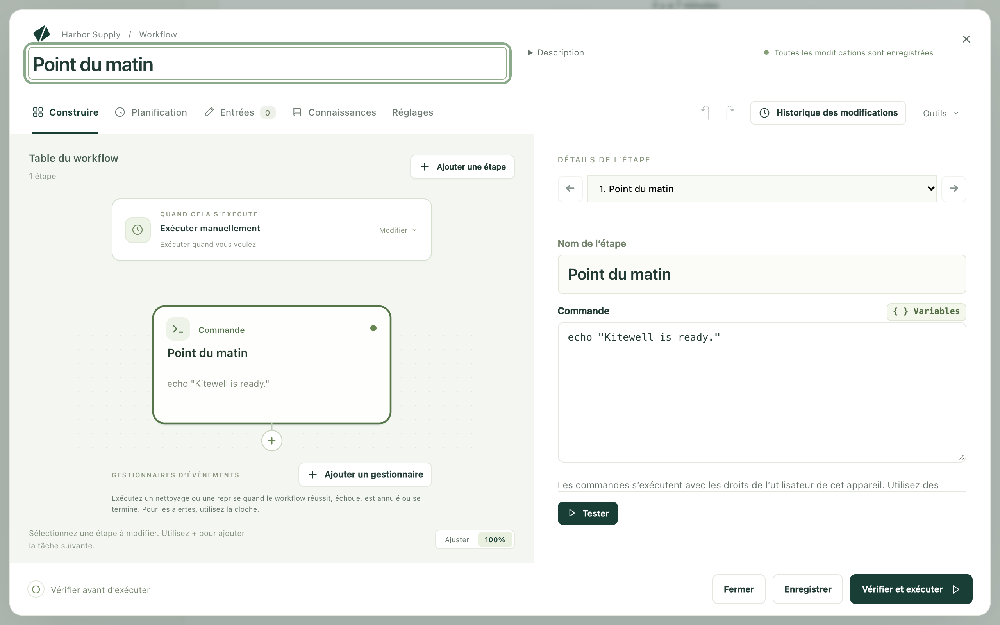
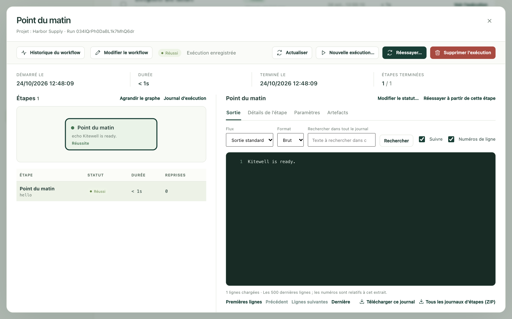

Décrivez une tâche à Kitewell avec vos propres mots. Son IA s’en charge une
première fois sous vos yeux, puis propose un workflow qui la répète selon une
planification. Cette page vous accompagne dans cette première tâche, du chat
vide jusqu’à une exécution qui se lance toute seule.

## Ce qu’il vous faut

Kitewell, [installé](/fr/docs/install/) et ouvert. À la première ouverture,
choisissez **Se connecter pour utiliser l'IA de Kitewell**. Votre navigateur
ouvre Dagu Cloud avec un code à vérifier, et l’IA incluse de Kitewell est
prête, avec 100 crédits offerts et sans clé API. Pour utiliser plutôt votre
propre modèle, choisissez **Commencer sur cet appareil** et connectez-le depuis
le chat ; voir [Agents IA et modèles](/fr/docs/ai/).

Une tâche sur un site web nécessite aussi Google Chrome, ou Microsoft Edge sur
Windows.

## Décrivez la tâche à Kitewell

1. Ouvrez le chat. Tant qu’il est vide, il demande
   **Que faites-vous encore à la main ?** et propose quelques tâches pour
   commencer.
2. Choisissez-en une, ou rédigez votre propre demande : quoi faire, où et
   quand. Par exemple :

   > Chaque jour ouvré à 9:00, connecte-toi à [l’adresse du portail
   > fournisseurs] avec [votre e-mail de connexion] et ajoute les nouvelles
   > factures à ma feuille [le chemin du classeur].

3. Envoyez-la.

Indiquez le site, le fichier et l’heure. N’écrivez pas le mot de passe :
l’assistant vous le demande dans une carte à part.

## Regardez-le travailler

L’assistant observe avant d’écrire, et vous demande ce dont il a besoin au
moyen de cartes :

- **Autoriser** lui permet d’ouvrir le site dans le navigateur de Kitewell,
  affiché en haut du chat. **Prendre la main** vous permet de cliquer et de
  saisir vous-même dans ce navigateur, pour une étape que vous seul pouvez
  faire.
- Un mot de passe se saisit dans une carte qui l’enregistre comme secret.
  L’assistant ne le voit jamais.
- Les questions auxquelles il ne peut pas répondre en regardant arrivent sous
  la forme d’un court formulaire.

## Vérifiez, puis appliquez

L’assistant propose le workflow sous forme de carte, avec ses étapes dans
l’ordre et le moment où il s’exécute. Lisez-la, puis choisissez **Appliquer**.
Rien n’est enregistré ni exécuté tant que vous ne l’avez pas fait.

Ce que l’assistant a fait dans son navigateur accompagne le workflow. Ses
clics sont enregistrés : la première exécution les rejoue au lieu de chercher
de nouveau comment faire.

## Exécutez-le

Demandez au chat de l’exécuter maintenant, ou ouvrez le workflow et choisissez
**Exécuter maintenant**. Ouvrez ensuite **Exécutions et logs** et choisissez
**Voir l’exécution**.

Sélectionnez l’étape de navigateur pour voir chaque opération effectuée par le
navigateur :

- **Rejoué** : un clic ou une frappe enregistrés, répétés sans IA.
- **Récupéré** : la page avait changé ; l’IA a trouvé la nouvelle façon de
  faire et l’a conservée pour la prochaine exécution.
- La lecture de valeurs sur une page, comme les nouvelles factures, fait appel
  à l’IA à chaque exécution.

Le compteur **Exécuté sans IA** de l’étape indique le nombre d’opérations qui
n’ont eu besoin d’aucun modèle.

## Sur planification

Une demande qui précise quand, par exemple chaque jour ouvré à 9:00, est
livrée avec sa planification. Kitewell exécute le workflow à cette heure-là.
Vous pouvez fermer la fenêtre : il continue de tourner dans la barre des menus
ou la zone de notification. Lisez [Planifications](/fr/docs/scheduling/) avant
de compter sur des exécutions sans surveillance.

## En cas de problème

- L’exécution a échoué. Ouvrez-la depuis **Exécutions et logs**. Le résumé en
  haut nomme l’étape en échec et propose **Examiner l’échec**, qui affiche le
  journal de cette étape.
- Le workflow ne correspond pas au site. Dites dans le chat ce qui diffère ;
  l’assistant modifie le workflow et le propose de nouveau.

## Sans IA

Un workflow peut aussi se construire à la main, une étape à la fois. Le plus
petit tient en une seule commande :

1. Choisissez **Créer un workflow**, et saisissez `Point du matin` dans
   **Nom du workflow**.
2. Cliquez sur **Choisissez votre première tâche**, puis sur
   **Exécuter une commande ou un script**.

   

3. Dans **Commande**, saisissez `echo "Kitewell is ready."`

   

4. Choisissez **Vérifier et exécuter**, puis **Enregistrer et exécuter…**, puis
   **Démarrer l’exécution**.

L’exécution terminée affiche la ligne dans sa sortie.

[Construire un workflow](/fr/docs/workflow-builder/) présente tous les types
d’étapes.

## Détails

- Les commandes s’exécutent avec les droits du compte utilisateur qui fait
  tourner Kitewell.
- `echo "…"` fait partie des rares commandes qui se comportent de la même façon
  dans PowerShell sous Windows et dans un shell sur Mac. Une commande écrite
  pour un système ne fonctionne pas toujours sur l’autre.
