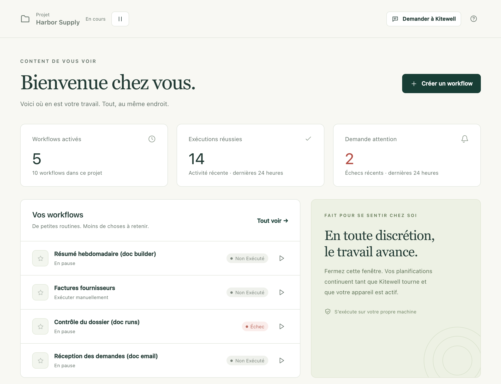

Kitewell prend en charge les tâches récurrentes que votre équipe fait à la
main. Vous décrivez une tâche une seule fois ; elle s’exécute ensuite sur votre
propre ordinateur, aux heures que vous choisissez, et chaque exécution est
conservée avec son résultat et sa sortie.

## Par où commencer

1. [Installez Kitewell](/fr/docs/install/) sur un Mac ou un PC Windows.
2. [Créez votre premier workflow](/fr/docs/getting-started/). Un workflow est
   une tâche récurrente, composée d’étapes.
3. [Définissez une planification](/fr/docs/scheduling/), et découvrez ce dont
   Kitewell a besoin pour s’exécuter sans surveillance.
4. [Partagez vos workflows avec votre équipe](/fr/docs/sharing/).

Aucun compte n’est nécessaire pour commencer.

## Ce qu’un workflow peut faire

- **[Le construire à partir d’étapes](/fr/docs/workflow-builder/)** : commandes
  et scripts, conteneurs, une autre machine via SSH, requêtes web, IA, et une
  pause le temps qu’une personne approuve.
- **[Le lancer depuis un webhook](/fr/docs/webhooks/)** : une exécution démarre
  quand GitHub, Stripe, un formulaire ou Zapier envoie une requête, sans port à
  ouvrir ni tunnel à configurer.
- **[Automatiser un site web](/fr/docs/browser/)**, une
  **[app de bureau](/fr/docs/desktop/)** ou **[vos e-mails](/fr/docs/email/)**,
  en les décrivant en langage courant plutôt qu’en code.
- **[Automatiser Excel](/fr/docs/spreadsheets/)** : lire les classeurs que
  votre bureau utilise déjà, et écrire chaque résultat dans la ligne d’où il
  vient.
- **[L’exécuter sur une feuille](/fr/docs/batches/)**, une fois par ligne, et
  rassembler ce que chaque exécution a trouvé.
- **[Demander à l’assistant](/fr/docs/ai/#the-assistant)** de rédiger un
  workflow ou d’en corriger un, et faire
  [diagnostiquer](/fr/docs/ai/#failure-diagnosis) une exécution en échec.
- **[Importer une description OpenAPI](/fr/docs/apis/)** et remplir les
  formulaires de requête que Kitewell en tire.
- **[Partager un projet](/fr/docs/sharing/)** avec un collègue, ou
  **[le synchroniser avec Dagu Cloud](/fr/docs/cloud-sync/)** pour que toutes
  les copies restent identiques. Chaque appareil fournit ses propres
  identifiants et n’active que ce qu’il doit exécuter.

:::note[Premières versions]
Kitewell est récent : ses fonctionnalités et ses limites peuvent encore
évoluer. Les programmes d’installation publics sont destinés à macOS et
Windows. Linux est prévu. Consultez [Téléchargements](/fr/download/) pour voir
ce qui est disponible aujourd’hui.
:::

## Tarifs

Un projet, jusqu’à 10 workflows dans ce projet, et une clé API ou une app
connectée sont gratuits, sans compte Kitewell. Chaque projet a ses propres
workflows, son historique et ses secrets.

Kitewell Personal coûte 20 $ par mois pour une personne sur un ordinateur :
cinq projets de 100 workflows chacun, un nombre illimité de clés API et d’apps
connectées, les [alertes](/fr/docs/alerts/) et les
[webhooks](/fr/docs/webhooks/). Kitewell Team s’adresse aux organisations de
25 personnes au plus, sur devis selon le nombre d’ordinateurs : 15 projets et
une équipe qui les synchronise. Voir les [tarifs](/fr/pricing/).

## Ce qui s’exécute où

Vos projets restent sur votre appareil, sauf si vous
[en synchronisez un avec Dagu Cloud](/fr/docs/cloud-sync/). Les valeurs des
secrets ne quittent jamais l’appareil. Les conversations avec l’assistant, les
diagnostics d’échec et les valeurs lues dans les feuilles y restent aussi.

Les étapes d’IA envoient ce qu’elles lisent au fournisseur de modèle que vous
choisissez : sortie d’exécution, définitions de workflow, texte d’une page.
[Ce qui quitte votre ordinateur](/fr/docs/data-flow/) liste toutes les
destinations.

Fermer la fenêtre n’arrête rien. Kitewell continue de tourner dans la barre
des menus sur Mac et dans la zone de notification sur Windows, et vos
planifications continuent de se déclencher. C’est **Quitter Kitewell**, dans ce
menu, qui arrête le service et les moteurs de workflow.

Sur Mac, le travail planifié ne s’exécute que si votre ordinateur n’est pas en
veille et que votre session est ouverte. Sur Windows, le travail planifié
s’exécute même quand personne n’est connecté, une fois activé le service de
connexion que propose le programme d’installation, et le PC sort de veille
pour l’exécuter. Kitewell ne fournit pas de machine dans le cloud. Les
fournisseurs d’IA, les serveurs distants, les conteneurs et les services
externes ont leurs propres exigences et leurs propres coûts.

## Détails

Kitewell exécute un moteur de workflow Dagu local pour chaque projet. Chaque
moteur a son propre répertoire de données, son propre planificateur et sa
propre clé de chiffrement. Les étapes s’exécutent avec les droits du compte
utilisateur qui fait tourner Kitewell : n’exécutez donc que des définitions de
workflow et des commandes en lesquelles vous avez confiance.
