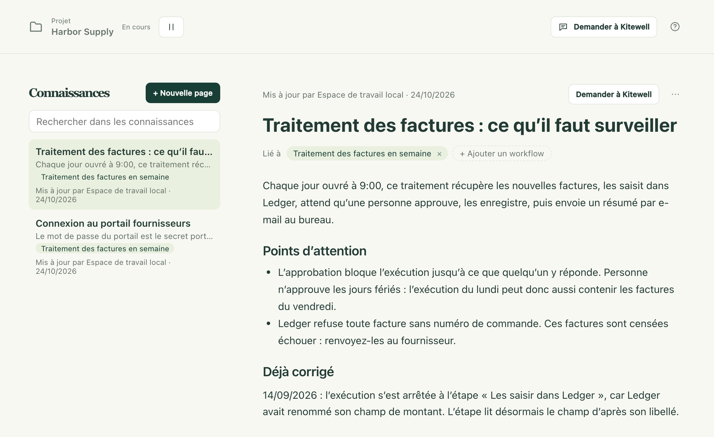

Chaque équipe sait des choses qu’elle ne met jamais par écrit : pourquoi le portail demande un code en début de mois, quelles factures sont censées échouer, ce qui a cassé en septembre dernier et comment on l’a réparé. Les connaissances sont l’endroit où un projet garde ces notes. L’assistant les lit avant de vous répondre, et les complète au fil du travail : la prochaine conversation, comme le prochain collègue, part de ce que l’équipe sait déjà.

Une page dit ce que la définition d’un workflow ne peut pas dire. Les étapes, la planification et les entrées restent dans le workflow ; la page explique pourquoi.

## Rédiger une page

1. Choisissez **Connaissances** dans la barre latérale. Les pages du projet sont listées des plus récentes aux plus anciennes, et celle que vous ouvrez s’affiche à côté.
2. Choisissez **Nouvelle page** et saisissez un titre. La page est créée dès qu’elle en a un.
3. Rédigez la note. Tapez `/` pour insérer des titres, des listes, des listes de cases à cocher, des citations, du code, des tableaux et des séparateurs, ou sélectionnez du texte pour faire apparaître une petite barre d’outils avec **Gras**, **Italique**, **Barré**, **Code** et **Lien**. Pendant la saisie, `## ` commence un titre, `- ` une liste, `1. ` une liste numérotée.
4. Choisissez **Ajouter un workflow** et sélectionnez le workflow dont parle la page. Son nom apparaît alors sous **Lié à**, et un clic dessus ouvre le workflow. Une page qui ne concerne aucun workflow (le site web d’un fournisseur, une règle d’équipe) a aussi sa place.
5. Il n’y a rien à enregistrer. Un instant après que vous avez cessé de taper, la ligne au-dessus de la page affiche **Enregistrement…** puis **Enregistrée**. ⌘S sur Mac, Ctrl+S sous Windows, enregistre immédiatement, et quitter la page l’enregistre aussi.

Chaque page de la liste affiche sa première ligne, les workflows qu’elle concerne et la dernière personne qui l’a modifiée. Une page rédigée par l’assistant porte une marque IA. **Rechercher dans les connaissances** trouve une page d’après n’importe quel mot de son titre ou de son texte, que vous le tapiez en caractères pleine chasse ou demi-chasse.

Ces mêmes pages viennent à vous là où elles sont utiles :

- L’onglet **Connaissances** de l’éditeur de workflow affiche les pages qui concernent ce workflow, et **Ajouter une page** en crée une déjà liée à lui.
- Une exécution en échec affiche **Connaissances associées** sous son erreur. Ce qui a déjà cassé, et comment on l’a réparé, s’y trouve souvent.

## Ce que fait l’assistant

L’assistant lit les connaissances du projet avant chaque message : un résumé d’une ligne de chaque page et, en entier, la page que vous avez ouverte ainsi que jusqu’à trois pages sur le workflow que vous regardez. Il peut lire n’importe quelle autre page, ou les parcourir toutes par une recherche, quand il en a besoin.

Il les rédige aussi. Quand vous lui donnez un fait durable, une règle ou une correction, quand il modifie un workflow pour une raison que la définition ne montre pas, ou quand un échec est corrigé, il l’enregistre aussitôt dans une page et affiche une confirmation dans son panneau (« Connaissances ajoutées » pour une nouvelle page, « Connaissances mises à jour » pour une modification), avec **Annuler** et **Ouvrir**. Quand il crée un workflow, la page qui le concerne arrive sur la même carte, et **Appliquer** enregistre les deux.

Si la page est ouverte pendant qu’il écrit, les passages qu’il a modifiés sont marqués, avec **Annuler** et **Garder** au-dessus. Les marques disparaissent dès que vous commencez à taper.

Deux règles permettent de laisser cette fonction active en toute sécurité :

- Il demande d’abord dès qu’une conversation a lu quoi que ce soit venant de l’extérieur. Une fois que l’assistant a récupéré une page web, ou lu le journal d’une exécution, un artefact ou une feuille, il cesse d’enregistrer de lui-même : la modification devient une carte qui montre exactement ce qu’il ajouterait, et rien n’est enregistré tant que vous n’avez pas choisi **Appliquer**. Le texte d’une page web ou d’un journal ne peut pas se glisser sans être vu dans les connaissances de toute l’équipe.
- Il n’écrit que ce qui est vrai. Il écrit ce que vous avez dit ou décidé, ou ce qu’une exécution a prouvé, dans la langue dans laquelle vous écrivez. Quand une page contredit le workflow lui-même, c’est le workflow qui l’emporte, et l’assistant corrige la page.

Les pages parviennent à l’assistant comme documentation de référence. Rien de ce qui est écrit sur une page n’est traité comme une instruction qui lui est adressée.

## Quand quelqu’un d’autre modifie la même page

Si un collègue, un autre appareil ou l’assistant modifie une page pendant que vous y tapez, rien de ce que vous avez tapé n’est perdu. La page indique qui l’a modifiée et propose **Garder ma version** ou **Utiliser leur version** ; adopter la leur peut être annulé avec ⌘Z sur Mac, Ctrl+Z sous Windows. Si la page a été supprimée pendant que vous y étiez, le choix est **La garder comme nouvelle page** ou **Abandonner mes modifications**.

## En cas de problème

- Le statut indique **Non enregistrée**. La page n’a pas de titre, ou elle dépasse 2 000 caractères. Corrigez cela et choisissez **Réessayer**. Les modifications qui n’ont pas pu être enregistrées restent sur la page et reviennent si vous la rouvrez tant que Kitewell tourne encore ; elles ne sont pas conservées après un redémarrage.
- La page s’ouvre en Markdown. Elle contient une image, du HTML ou un lien qui ne commence pas par `https://`, que l’éditeur mis en forme ne peut pas afficher sans le perdre. Modifiez-la dans ce mode, ou sortez ce passage de la page.

## Détails

- Une page contient un titre de 60 caractères au plus et 2 000 caractères de texte, et cite jusqu’à 20 workflows ; un projet conserve jusqu’à 100 pages. À partir de 1 800 caractères, un compteur apparaît au-dessus de la page ; au-delà de la limite, la page refuse d’enregistrer et vous invite à déplacer le reste dans une page à part.
- **⋯** → **Modifier en Markdown** affiche le Markdown de la page pour qui le préfère, et **Modifier en texte mis en forme** revient au texte mis en forme. **⋯** → **Supprimer la page** la supprime pour tout le projet, après confirmation.
- Le collage conserve ce qu’une page peut contenir : un tableau copié depuis un tableur reste un tableau, avec sa première ligne en en-tête, et du texte Markdown devient du texte mis en forme. Seuls les liens `https://` sont conservés.
- Les pages appartiennent à un seul projet. Tous ses membres les lisent ; les éditeurs et l’assistant les modifient. Elles se [synchronisent avec Dagu Cloud](/fr/docs/cloud-sync/) et voyagent dans les [exports de projet](/fr/docs/sharing/). Elles ne font pas partie des [versions publiées](/fr/docs/releases/), qui n’emportent que les workflows et les noms des secrets.
- Les [clients MCP](/fr/docs/mcp/) lisent les pages avec `read` et `target: "knowledge"` : l’index complet, une page par son ID, ou une recherche. Avec l’autorisation **Modifier et exécuter**, ils les écrivent aussi avec `change` et un type `upsert_knowledge` ou `delete_knowledge`. Lire un workflow renvoie aussi les pages qui le concernent.
