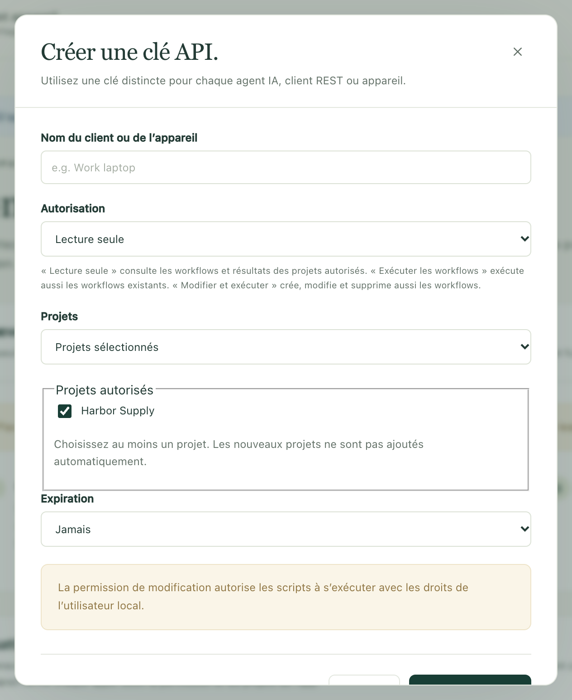
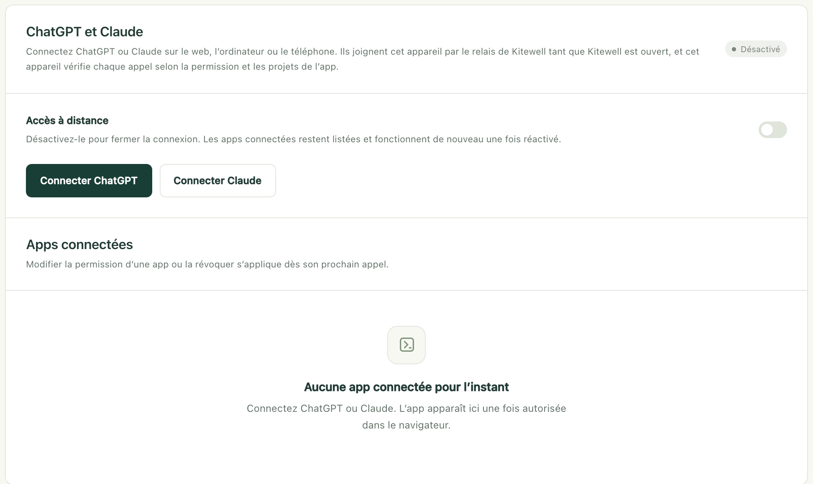

Demandez à ChatGPT, Claude ou Claude Code d’exécuter l’un de vos workflows, de lire ce qu’a fait une exécution, ou de vous écrire un nouveau workflow. Le travail se fait toujours sur votre propre ordinateur, dans les projets que vous autorisez, et vous pouvez retirer cet accès quand vous le souhaitez.

## Ce qu’il vous faut

- Kitewell ouvert sur l’ordinateur qui contient les workflows, et cet ordinateur éveillé. Aucun appel n’atteint un ordinateur en veille.
- Pour un assistant sur le même ordinateur, comme Claude Code ou Codex, rien d’autre. Kitewell est déjà à l’écoute sur `http://127.0.0.1:19742/mcp`.
- Pour ChatGPT ou Claude sur le web, sur ordinateur ou sur téléphone, un compte Dagu Cloud, avec cet ordinateur [connecté](/fr/docs/cloud-sync/#sign-in) à ce compte. Ils appellent depuis leurs propres clouds : ils atteignent donc votre ordinateur par le relais de Kitewell plutôt que par cette adresse.

Tout se trouve sur une seule page : **Cet appareil → MCP**. Le badge à côté de **Kitewell MCP** indique **À l’écoute** quand la connexion est prête, et l’**URL de Kitewell MCP**, en dessous, est l’adresse à donner à un client.


L’offre gratuite permet une clé API ou une app connectée au total. Kitewell Personal et Team n’ont pas de limite. Révoquer une clé ou une app libère la place pour une autre. Quand une offre payante prend fin, les clés et les apps au-delà de l’offre gratuite cessent de fonctionner 7 jours plus tard, et vous choisissez celle qui reste ; voir [Quand une offre prend fin](/fr/docs/cloud-sync/#when-a-plan-ends).

## Connecter un assistant sur cet ordinateur

C’est la méthode pour Claude Code, Codex et tout autre client que vous exécutez vous-même. Elle utilise une clé : un long secret que le client envoie avec chaque appel.

1. Ouvrez **Cet appareil → MCP** et choisissez **Connecter un agent IA**.
2. Renseignez **Nom du client ou de l’appareil**, par exemple Claude Code sur le portable du bureau. Ce nom sert seulement à le reconnaître plus tard.
3. Choisissez une **Autorisation** : **Lecture seule**, **Exécuter les workflows** ou **Modifier et exécuter**. La section suivante indique ce que permet chacune.
4. Choisissez les **Projets**. **Projets sélectionnés** autorise ceux que vous cochez sous **Projets autorisés**, et rien d’autre ; **Tous les projets actuels et futurs** couvre aussi les projets que vous créerez plus tard.
5. Choisissez **Expiration** : **Jamais**, **30 jours**, **90 jours** ou **Date et heure personnalisées**.
6. Choisissez **Créer une clé API**.



Kitewell affiche alors la clé une seule fois, sous **Clé API**, avec trois façons de la transmettre :

- **URL de Kitewell MCP** est l’adresse à laquelle le client se connecte.
- **Configuration du client Kitewell MCP** donne la même chose sous forme d’un bloc de réglages que de nombreux clients acceptent tel quel.
- **Consigne pour un agent IA** est une demande à coller dans Claude Code ou Codex, qui ajoute alors la connexion lui-même. Elle contient la clé : ne la collez que dans un assistant de confiance.

Copiez ce dont vous avez besoin avant de fermer la boîte de dialogue. La clé ne sera plus jamais affichée. Si vous la perdez, révoquez-la et créez-en une autre.

Un client configuré à la main a besoin de l’URL, du transport Streamable HTTP et de l’en-tête `Authorization: Bearer <votre clé>`. Le client doit accepter un identifiant que vous saisissez vous-même. ChatGPT et Claude ne le permettent pas ; ils passent plutôt par une connexion à votre compte, décrite plus bas.

De retour sur la page, **Ce que vous pouvez demander** propose trois demandes à copier dans un assistant connecté pour l’essayer : **Planifier une commande**, **Planifier une étape d’agent IA** et **Examiner un échec**. Chacune nomme le projet que vous avez ouvert, et demande à l’assistant de vérifier le workflow et de laisser sa planification désactivée jusqu’à ce que vous l’ayez lu.

## Ce que permet chaque autorisation

| Autorisation | Ce que l’assistant peut faire |
| --- | --- |
| **Lecture seule** | Consulter vos projets, vos workflows, vos exécutions, leurs journaux, les fichiers laissés par une exécution et les connaissances du projet. Il ne modifie rien. |
| **Exécuter les workflows** | Tout ce qui précède, plus lancer, réessayer, relancer ou annuler une exécution ; approuver, refuser, renvoyer ou terminer une étape qui attend une personne ; répondre à une étape de site web ou de bureau en attente ; et exécuter les lignes d’une feuille. |
| **Modifier et exécuter** | Tout ce qui précède, plus créer, modifier ou supprimer des workflows, des agents et modèles, des serveurs, des files d’attente, des valeurs par défaut de workflow, des connexions API, des feuilles et des pages de connaissances. |

Commencez par le minimum qui fait l’affaire. **Lecture seule** suffit pour demander ce qui a échoué cette nuit. **Exécuter les workflows** suffit pour demander une exécution. Seul **Modifier et exécuter** permet à un assistant d’écrire un workflow, et les commandes d’un workflow s’exécutent sous votre compte sur cet ordinateur : elles peuvent modifier des fichiers et atteindre d’autres services. N’accordez **Modifier et exécuter** qu’à un assistant auquel vous confieriez vous-même l’exécution de commandes sur cet ordinateur.

Une autorisation ne s’applique qu’à l’intérieur des projets autorisés. Ce n’est pas un verrou sur le reste de l’ordinateur.

Une connexion voit tout ce que contiennent ses projets : le texte des commandes des workflows, les journaux de leurs exécutions et les valeurs transmises à une exécution. Elle ne voit pas les valeurs de vos secrets, les mots de passe de vos boîtes mail, votre connexion Dagu Cloud, les autres clés API, ni quoi que ce soit dans un projet qui ne lui a pas été confié. Un secret reste sur l’appareil, et un workflow le lit par son nom pendant son exécution.

<a id="connect-chatgpt-or-claude"></a>

## Connecter ChatGPT ou Claude

ChatGPT et Claude atteignent votre ordinateur à l’adresse `https://mcp.kitewell.app/mcp`, par une connexion que votre ordinateur ouvre lui-même. Aucun port de votre réseau n’est ouvert, et votre ordinateur vérifie chaque appel au regard de l’autorisation et des projets que vous avez approuvés, exactement comme pour une clé.

1. Dans Kitewell, ouvrez **Cet appareil → MCP** et choisissez **Connecter ChatGPT** ou **Connecter Claude**. Un ordinateur qui n’est pas encore connecté à Dagu Cloud s’y connecte d’abord, et **Accès à distance** s’active.
2. Choisissez l’**Autorisation** et les **Projets**, puis **Enregistrer et afficher les étapes**. Kitewell affiche l’URL et les étapes pour cette app, et garde votre choix pour la prochaine fois que vous la connecterez.
3. Ajoutez Kitewell dans l’app avec cette URL, comme décrit plus bas pour [Claude](#claude) ou [ChatGPT](#chatgpt).
4. L’app ouvre Dagu Cloud. Connectez-vous avec le compte auquel cet ordinateur est connecté.
5. La page de consentement s’ouvre avec votre choix déjà rempli. Vérifiez l’ordinateur, l’autorisation et les projets, modifiez ce que vous voulez, puis choisissez **Autoriser**.



L’app apparaît ensuite sous **Apps connectées**, avec son **Autorisation**, ses **Projets**, la date de sa connexion et celle de son dernier appel.

### Claude

1. Dans Claude, ouvrez **Customize → Connectors**, choisissez **+ Add**, puis **Add custom connector**.
2. Nommez-le Kitewell, collez l’URL et choisissez **Continue**. Gardez les réglages de connexion proposés et choisissez **Add**.
3. Connectez-vous à Dagu Cloud, vérifiez l’autorisation et les projets, et choisissez **Autoriser**.

Avec les offres Team et Enterprise, un propriétaire ajoute d’abord Kitewell sous **Organization settings → Connectors** ; les membres choisissent ensuite **Connect** sur ce connecteur. L’offre Free de Claude permet un seul connecteur personnalisé.

### ChatGPT

ChatGPT ne se connecte que sur le web, via le mode développeur. Pour donner à l’entrée l’icône de Kitewell,
<a href="/kitewell-icon-256.png" download>téléchargez l’icône de Kitewell (PNG)</a>
au préalable. Elle mesure 256 × 256 px, sous la limite de 10 Ko fixée par ChatGPT.

1. Dans ChatGPT sur le web, ouvrez **Plugins**, choisissez **Add**, puis **Create custom MCP server**. Si cette option n’apparaît pas, activez d’abord **Developer mode** dans **Settings → Security and login**, ou, avec Business, Enterprise et Edu, dans **Settings → Apps → Advanced settings**.
2. Nommez-le Kitewell, ajoutez l’icône de Kitewell si vous le souhaitez, collez l’URL sous **Server URL**, gardez **OAuth**, cochez **I understand and want to continue**, et choisissez **Create as a plugin**.
3. Choisissez **Proceed to Kitewell**, connectez-vous à Dagu Cloud, vérifiez l’autorisation et les projets, et choisissez **Autoriser**.
4. Choisissez **Try in chat**. Dans toute conversation ultérieure, vous pouvez aussi taper **@** et choisir Kitewell, ou le sélectionner dans le menu d’outils **+**.

Kitewell apparaît alors sous **Plugins → Personal → Created by you**, et sa page indique le compte avec lequel il s’est connecté.

Deux limites relèvent ici de ChatGPT lui-même, pas de Kitewell :

- Avec Plus et Pro, ChatGPT n’utilise que les outils en lecture seule de Kitewell. Lancer des exécutions et modifier des workflows nécessitent ChatGPT Business, Enterprise ou Edu.
- Avec Business, seuls les administrateurs et les propriétaires peuvent utiliser le mode développeur. Avec Enterprise et Edu, un administrateur doit d’abord l’accorder.

ChatGPT avertit aussi qu’un serveur MCP personnalisé présente un risque. Kitewell ne reçoit que l’autorisation et les projets que vous approuvez.

### Si un appel indique que l’ordinateur est injoignable

L’ordinateur doit être allumé, éveillé, et Kitewell doit y tourner. Sinon, l’app liste toujours les outils de Kitewell, mais chaque appel répond que Kitewell est injoignable sur cet ordinateur, en indiquant quand il a été vu pour la dernière fois. Ouvrez Kitewell sur cet ordinateur et reposez la question. Si cela échoue encore, voir [Dépannage](/fr/docs/troubleshooting/#chatgpt-and-claude).

## Modifier ou retirer un accès

- Une clé : **Modifier**, dans **Clés API**, change son nom, son autorisation, ses projets ou son expiration sans remplacer le secret. **Révoquer** y met fin.
- Une app connectée : **Modifier** et **Révoquer**, sous **Apps connectées**. Une connexion révoquée dans ChatGPT ou Claude eux-mêmes est prise en compte par votre ordinateur en moins de cinq minutes.
- ChatGPT et Claude à la fois : désactivez **Accès à distance**. La connexion se ferme ; les apps connectées restent listées et fonctionnent de nouveau quand l’accès est réactivé. Les clés de cet ordinateur ne sont pas concernées.

Les modifications, la révocation et l’expiration s’appliquent à l’appel suivant. Une exécution déjà lancée continue. Une clé expirée fonctionne de nouveau si vous prolongez ou supprimez son expiration.

Le webhook d’un workflow utilise le même relais mais a sa propre URL, et continue de fonctionner quand **Accès à distance** est désactivé. Voir [Démarrer un workflow depuis un autre service](/fr/docs/webhooks/) à ce sujet.

## Prévenir ChatGPT quand il se passe quelque chose

Une app qui prend en charge MCP Events peut être prévenue au lieu de redemander sans cesse :

- `run.finished` : une exécution s’est terminée. L’abonnement peut viser une exécution précise, ou les résultats à signaler.
- `run.needs_input` : une exécution attend à une approbation, à une tâche confiée à une personne ou à une question.
- `batch.finished` : un [lot](/fr/docs/batches/) de lignes d’une feuille s’est terminé.
- `schedule.missed` : une exécution planifiée a été manquée.

Les abonnements de chaque app sont listés sous elle dans **Apps connectées**, avec la date de leur dernier envoi, et **Retirer** met fin à l’un d’eux. Révoquer l’app les arrête tous. Ils sont suspendus quand **Accès à distance** est désactivé, et durent jusqu’à une semaine, sauf si l’app les renouvelle. C’est votre ordinateur qui détecte les événements et les envoie : ils n’arrivent donc que lorsque Kitewell tourne. MCP Events fait partie de Kitewell Personal et Team, comme les [alertes](/fr/docs/alerts/).

## Détails

### Les outils que voit une connexion

Une connexion ne liste que les outils que son autorisation permet : une connexion en lecture seule ne voit donc jamais un outil qui écrit.

| Outil | Autorisation | Ce qu’il fait |
| --- | --- | --- |
| `read` | **Lecture seule** | Lit les projets, les workflows et leur schéma, les exécutions avec leurs journaux et leurs artefacts, les agents et les modèles API, les serveurs, les files d’attente, les boîtes mail, les valeurs par défaut des workflows, les API importées, les [feuilles de lot](/fr/docs/batches/) et leurs valeurs, et les [connaissances](/fr/docs/knowledge/) du projet. Une exécution en échec comporte son [diagnostic d’échec](/fr/docs/ai/#failure-diagnosis) quand il existe. `target: "reference"` renvoie le guide d’utilisation. **Exécuter les workflows** ajoute un aperçu des étapes qu’une relance peut réutiliser ; **Modifier et exécuter** ajoute la vérification du YAML d’un workflow sans l’enregistrer, et l’ouverture d’un classeur Excel sur cet ordinateur. |
| `show` | **Lecture seule** | Dessine le graphe de dépendances d’un workflow et, avec une exécution, l’état de chaque étape. ChatGPT et Claude l’affichent sous forme d’une vue qui suit une exécution en cours ; les autres clients reçoivent les étapes dans l’ordre, sous forme de texte. |
| `execute` | **Exécuter les workflows** | `start`, `retry`, `rerun`, `cancel`, `approve`, `reject`, `push_back`, `complete`, `answer`, `restart`, `resume`, `run_sheet`, `read_sheet_values` et `cancel_sheet`. **Modifier et exécuter** ajoute `refresh_sheet`, `link_workbook` et `unlink_workbook`. |
| `change` | **Modifier et exécuter** | Crée, remplace et supprime des workflows, des agents, des serveurs et groupes de serveurs, des files d’attente, des valeurs par défaut de workflow, des connexions API, des feuilles et la planification selon laquelle une feuille s’exécute sur cet appareil, et des pages de connaissances. |
| `preview_api` | **Modifier et exécuter** | Lit un document OpenAPI que vous lui donnez, ou en récupère un depuis une URL, et liste ses opérations. Il n’enregistre rien, mais récupérer une URL implique de sortir de votre ordinateur. |

Un appel que l’autorisation ne permet pas, par exemple issu d’une liste d’outils qu’un client a gardée d’une autorisation précédente, est refusé et indique où, dans Kitewell, modifier l’autorisation.

Tout remplacement ou toute suppression nécessite la `version` issue de la dernière lecture : un client n’écrase ainsi jamais une modification qu’il n’a pas vue. En cas de conflit, relisez, vérifiez, et renvoyez la demande en connaissance de cause.

Pour suivre une exécution sans redemander sans cesse, passez `wait`, jusqu’à 60 secondes, à `execute` pour un lancement, une reprise ou une relance, ou à `read` avec `target: "run"`. L’appel répond dès que l’exécution se termine ou s’arrête à une étape qui attend une personne. Si le délai expire avant, il répond avec l’exécution dans son état du moment.

L’écriture de résultats dans un classeur lié, et l’annulation d’une telle écriture, ne sont ouvertes à aucune connexion. C’est une personne qui fait l’une et l’autre dans l’app.

### Choisir le projet

`read` avec `target: "projects"` ne liste que les projets qu’une connexion peut atteindre, et n’a besoin d’aucun projet. Tout autre appel nomme son projet avec `projectId`, ou `?projectId=<id>` sur une route REST. Une connexion qui atteint exactement un projet peut l’omettre ; une connexion qui en atteint plusieurs doit en nommer un. Demandez d’abord la liste des projets, puis transmettez l’ID dont le nom correspond à la demande.

Les agents, les serveurs, les files d’attente et les valeurs par défaut des workflows appartiennent à un projet : la même clé modifie donc des éléments différents selon le projet qu’elle nomme.

### Les API importées via MCP

Un assistant disposant de **Modifier et exécuter** peut importer un document OpenAPI et construire des workflows à partir de ses opérations :

1. Prévisualisez avec `preview_api` et soit `spec`, le document sous forme de texte JSON ou YAML, soit `url`. Rien n’est enregistré et aucune opération n’est appelée.
2. Enregistrez avec `change`, `type: "upsert_api"`, un `id` et une définition `api`. Fournissez `api.spec`, ou omettez-le pour récupérer `api.sourceUrl` une fois. Réglez `api.auth.type` sur `none`, `bearer`, `apiKey` ou `basic`, et nommez un secret existant du projet avec `api.auth.secretRef`. Les valeurs des secrets se créent et se remplacent dans l’app, jamais via MCP.
3. Trouvez les opérations avec `read` : `target: "apis"` liste les connexions, `target: "api_operations"` cherche dans l’une d’elles par `id` et une `query` facultative, et `target: "api_operation"` avec `id` et `operationId` renvoie ses entrées, ses réponses et une étape de workflow de départ.
4. Ajoutez des étapes `api.request`, puis vérifiez, enregistrez et exécutez le workflow avec les outils habituels. L’étape renvoyée est un modèle : vérifiez ses exemples et remplacez les espaces réservés avant de l’exécuter.

`upsert_api` remplace la connexion entière : lisez donc d’abord `target: "api"`, gardez les champs que vous voulez conserver, et transmettez sa `definitionVersion` comme `version`. `change` avec `type: "delete_api"` ne supprime une connexion que si aucun workflow enregistré ne l’utilise. Voir [Importer une API](/fr/docs/apis/) pour ce que l’outil d’import accepte.

### REST pour les scripts

Les mêmes clés fonctionnent avec une interface HTTP simple, pour les scripts et les autres intégrations. Son adresse de base est l’origine de l’URL MCP suivie de `/api`. Chaque requête nécessite `Authorization: Bearer <votre clé>`, même sur cet ordinateur ; la connexion propre au navigateur n’est pas une clé.

```http
GET /api/jobs HTTP/1.1
Host: your-host
Authorization: Bearer <Kitewell API key>
```

| Route | Autorisation minimale |
| --- | --- |
| `GET /api/projects`, `/api/jobs`, `/api/runs`, `/api/queues` | **Lecture seule** |
| `GET /api/runs/{jobId}/{id}`, `/api/jobs/{id}/graph` | **Lecture seule** |
| `GET /api/runs/{jobId}/{id}/logs` et `/logs/download` | **Lecture seule** |
| `GET /api/dags/schema`, `/api/harnesses`, `/api/data/usage` | **Lecture seule** |
| `POST /api/jobs/{id}/run` | **Exécuter les workflows** |
| `POST /api/runs/{jobId}/{id}/resume` | **Exécuter les workflows** |
| `POST /api/runs/{jobId}/{id}/approvals/{stepId}/approve`, `/reject`, `/push-back` | **Exécuter les workflows** |
| `POST /api/runs/{jobId}/{id}/human-tasks/{stepId}/complete` | **Exécuter les workflows** |
| `POST /api/jobs`, `PUT` et `DELETE /api/jobs/{id}` | **Modifier et exécuter** |
| `POST /api/jobs/{id}/pause`, `POST /api/dags/validate` | **Modifier et exécuter** |
| `POST /api/runs/delete`, `DELETE /api/run-history/{jobId}` | **Modifier et exécuter** |

Les lectures de journaux acceptent `stepId`, `stream=stdout`, `stderr` ou `run`, `tail=500` ou `offset` et `limit` jusqu’à 500 lignes, et `query=<text>` pour chercher. Les requêtes d’exécution acceptent un corps comme `{"params":{"region":"west"}}`.

REST couvre les workflows et les feuilles de lot. Les réglages de l’appareil, les secrets, la gestion des clés API, le compte Dagu Cloud, les sauvegardes et les commandes du moteur restent dans l’app et ne sont pas exposés. Les API importées se gèrent dans l’app ou avec l’outil MCP `change`.

### Le client d’un autre ordinateur

L’écouteur n’accepte que les connexions locales, sur `127.0.0.1:19742`. ChatGPT et Claude passent plutôt par le relais et n’ont besoin de rien de ce qui suit.

Un client sur un autre ordinateur a besoin d’une adresse qu’il peut joindre en HTTPS, que vous mettez en place et gérez vous-même. Sous **Connexion Kitewell MCP**, laissez **Activer Kitewell MCP** activé, ouvrez **TLS et connexions distantes**, et renseignez **URL publique de Kitewell MCP**, qui se termine par `/mcp`. Ensuite, soit vous gardez **Adresse d’écoute** sur `127.0.0.1:19742` et y faites pointer votre propre proxy HTTPS, en transmettant `/mcp` et `/api/` avec l’en-tête `Authorization`, soit vous réglez l’adresse sur `0.0.0.0:19742` et indiquez des chemins absolus pour **Fichier de certificat** et **Fichier de clé privée**. Choisissez **Enregistrer la connexion**.

Une adresse que d’autres ordinateurs peuvent joindre amène le pare-feu à demander si Kitewell peut accepter des connexions, et un refus à ce moment-là laisse tous les clients en attente. Kitewell ne configure ni DNS, ni certificats, ni redirection de ports sur le routeur, et ne fournit pas d’ordinateur pour exécuter vos workflows. Ne publiez jamais sur Internet un écouteur HTTP non protégé.

Si le badge indique **Indisponible** et que la page signale qu’un autre programme utilise le port 19742, il s’agit généralement d’une seconde copie de Kitewell, comme une version de développement qui tourne à côté de l’app installée. Quittez ce programme, puis redémarrez Kitewell.

Les clés sont stockées sous forme de hachages, jamais en clair. Restaurer une [sauvegarde](/fr/docs/backups/) conserve les clés de cet ordinateur : passez-les en revue, et révoquez celles qui ne devraient plus avoir accès. [Contactez l’assistance](/fr/support/) si les réglages d’identification d’un client ne sont pas clairs.
