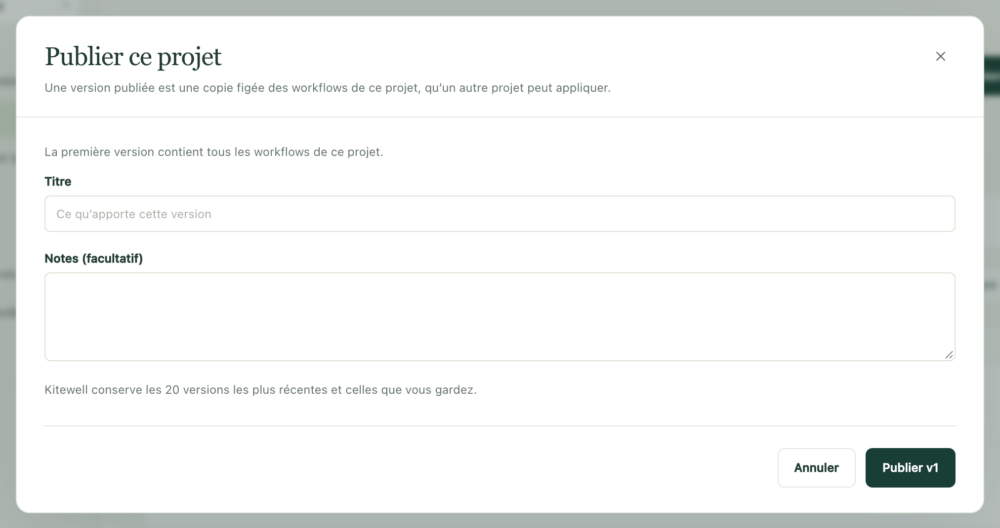

Essayez une modification dans un endroit sûr avant qu’elle ne touche le
travail qui compte. Gardez un projet pour construire et un autre pour
exécuter en conditions réelles, figez les workflows qui vous conviennent dans
une version numérotée, et transmettez cette version à l’autre projet quand
vous êtes prêt.

Chaque projet garde ses propres serveurs, modèles, connexions d’API, files
d’attente et valeurs de secrets : le même workflow s’adresse ainsi au système
de test dans l’un et au système réel dans l’autre.

## Ce qu’il vous faut

Au moins deux projets sur le même ordinateur, nommés comme vous le souhaitez ;
**Dev**, **Staging** et **Prod** est la combinaison habituelle. Kitewell Personal
accueille jusqu’à cinq projets sur un ordinateur et Team en accueille 15 : les
deux ont donc la place nécessaire. Publier et appliquer une version demande l’accès en
modification au projet.

## Publier une version

1. Ouvrez **Workflows** dans le projet où vous construisez. La ligne
   au-dessus de la liste indique la dernière version publiée et le nombre de
   workflows modifiés depuis.
2. Choisissez **Publier…**. La première version contient tous les workflows
   du projet, et la boîte de dialogue le précise ; pour les suivantes, elle
   liste ce qui a changé, avec **Comparer** à côté de chaque workflow.
3. Remplissez **Titre**, ajoutez des **Notes (facultatif)** si elles sont
   utiles, et choisissez le bouton qui porte le numéro suivant :
   **Publier v1** pour la première.

Une version publiée est une copie figée des workflows du projet et des noms
des secrets qu’ils lisent. Elle ne change jamais : tout ce que vous modifiez
ensuite attend la suivante. Si rien n’a changé depuis la dernière version,
aucune version n’est créée et Kitewell vous le signale.

Kitewell conserve les 20 versions les plus récentes et supprime les plus
anciennes. **Supprimer** en retire une plus tôt, sauf la plus récente, qui sert
à numéroter la suivante. Les projets qui ont déjà reçu une version supprimée
gardent ses workflows ; elle ne peut simplement plus être appliquée.

Pour conserver une version de confiance, quel que soit le nombre de versions
qui la suivent, choisissez **Garder** à côté d’elle dans **Versions publiées**.
Une version gardée n’est jamais retirée, ni sur un ordinateur ni dans Dagu
Cloud, et ne peut pas être supprimée tant que personne n’a choisi
**Ne plus garder**. Vous pouvez garder jusqu’à 20 versions.

Dans un [projet synchronisé](/fr/docs/cloud-sync/), les versions publiées se
synchronisent comme tout le reste : chaque membre de l’équipe peut appliquer
la même. Les versions publiées sont exclues des
[exportations de projet](/fr/docs/sharing/), mais conservées dans les
[sauvegardes](/fr/docs/backups/).

## Appliquer une version

1. Choisissez **Versions publiées**, puis **Appliquer à…** à côté de la
   version voulue.
2. Sous **Appliquer à**, choisissez le projet de destination : un autre projet
   de cet ordinateur. Un projet que vous pouvez seulement consulter ne peut
   pas être choisi.
3. Lisez l’aperçu. Pour chaque workflow, **Ce qui se passe** indique s’il est
   **Nouveau · arrive en pause**, **Mis à jour**, **Conservé** parce qu’il a
   été modifié dans ce projet et que la version ne l’a pas changé, ou
   **Inchangé**. **Comparer** montre la différence. Lorsqu’un choix est
   possible, cochez **Conserver la version de Prod** (le nom du projet de
   destination) pour laisser sa propre copie intacte.

   L’aperçu vous avertit aussi quand un workflow ne s’exécuterait pas dans ce
   projet, appelle un workflow ou utilise une file d’attente que le projet n’a
   pas, porte un nom qu’un autre workflow du projet utilise déjà, ou modifie
   une planification qui prend effet dès que vous appliquez la version.
4. Choisissez le bouton qui indique combien de changements il applique, par
   exemple **Appliquer 3 changements**.

Seuls les workflows sont transférés. L’autre projet garde ses propres
serveurs, modèles, files d’attente et valeurs de secrets. Il reçoit en
revanche les noms des secrets que lit la version ; définissez leurs valeurs
sur chacun de ses ordinateurs depuis **Secrets** ou la **Vue d’ensemble**.

Les nouveaux workflows arrivent en pause. Activez ceux que ce projet doit
exécuter. Un workflow déjà présent conserve son état (activé ou non),
l’endroit où il s’exécute, ses alertes et son choix de diagnostic des échecs.

Si le projet a changé depuis l’affichage de l’aperçu, Kitewell vous demande
de le consulter à nouveau. Si l’application s’arrête en cours de route, par
exemple à la limite de workflows de l’offre, l’aperçu indique ce qui n’a pas
encore été appliqué ; appliquez de nouveau la version pour terminer.

Si la version n’a aucune destination, Kitewell vous invite à créer ou à
télécharger d’abord le projet auquel elle est destinée.

## Voir ce qui tourne, et où

Un projet qui a reçu une version indique sa provenance au-dessus de ses
workflows, par exemple **v13 de Dev**, et chaque workflow affiche la version
par laquelle il est arrivé. Cette information apparaît sur chaque ordinateur
qui synchronise le projet.

Si vous modifiez ensuite un workflow dans ce projet, il est marqué
**modifié ici**. La version suivante conserve cette modification par défaut
lorsqu’elle ne touche pas le même workflow. Si elle le touche, l’aperçu vous
avertit et vous permet de garder la version propre au projet.

Un workflow modifié dans le projet de construction depuis la dernière version
publiée est marqué **Non publié** : vous voyez d’un coup d’œil ce que
contiendrait la prochaine version.

## Revenir en arrière

Appliquez une version plus ancienne de la même manière. Deux choses
diffèrent :

- Les workflows ajoutés par une version plus récente sont listés à part, sous
  un titre qui nomme la version dont ils sont absents. Ils ne sont retirés que
  si vous les cochez.
- Chaque workflow que la version plus ancienne remplace reste aussi dans
  l’historique des modifications du projet sur cet ordinateur : vous pouvez
  donc en rétablir un seul, indépendamment des autres.

Vous pouvez aussi partir du projet qui exécute la version. À côté de
**v13 de Dev**, choisissez **Versions publiées de Dev…** pour voir les
versions de ce projet, celle qui tourne ici étant marquée **En place ici**,
puis choisissez **Appliquer ici** sur celle que vous voulez. Cela fonctionne
tant que l’autre projet se trouve sur le même ordinateur.
