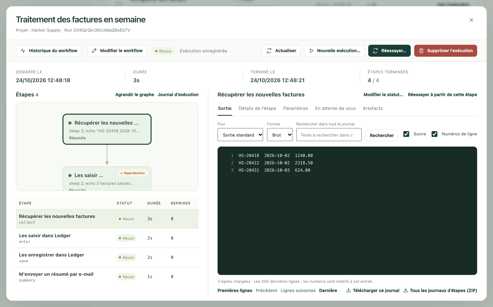
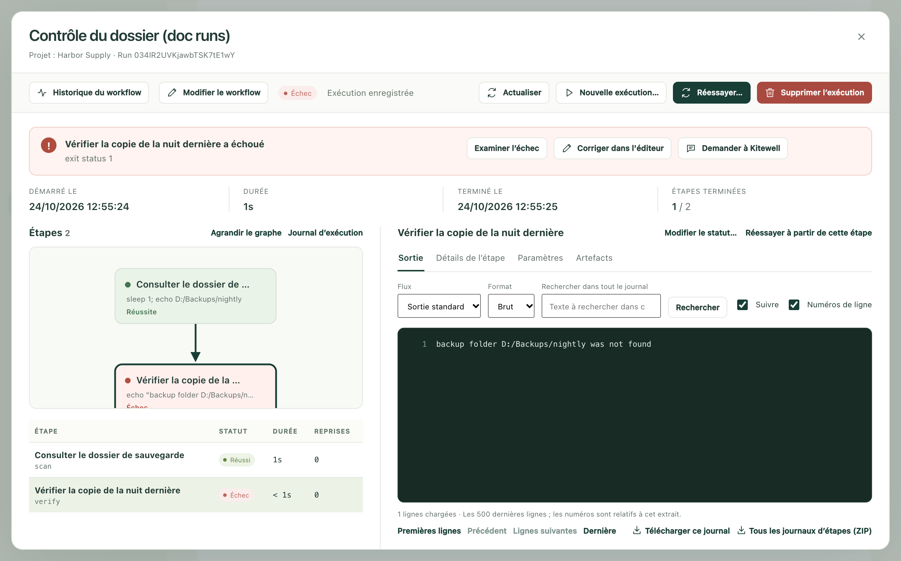

À chaque exécution d’un workflow, Kitewell note ce qui s’est passé : quelles étapes ont tourné, ce que chacune a affiché, quels fichiers elle a produits et comment tout s’est terminé. Quand une exécution a réussi, vous avez rarement besoin d’y jeter un œil. Quand elle a échoué, c’est ici que vous trouvez pourquoi et que vous corrigez le problème.

**Exécutions et logs**, dans la barre latérale, ouvre cet historique, sous le titre **Historique d’exécution**.

## Trouver l’exécution recherchée

Les exécutions les plus récentes sont en haut. Quand il y en a trop, affinez la liste :

- **Workflow** ne garde que les exécutions d’un workflow. **Tous les workflows** les affiche toutes.
- **Créé dans** fixe la période. Elle s’ouvre sur **Derniers 7 jours** ; les autres choix vont jusqu’à **Depuis le début**.
- **ID d’exécution** retrouve une exécution précise quand vous avez son identifiant : le code court affiché sous le nom du workflow dans la liste, que vous pouvez copier à cet endroit.
- Choisissez **Appliquer les filtres** pour les appliquer, ou **Réinitialiser** pour les effacer. La réinitialisation élargit la période à **Depuis le début**.

En haut de la liste, **Toutes les exécutions**, **En cours / en file d’attente**, **En attente**, **Échec**, **Manquée**, **Réussi** et **Annulé** permettent de passer d’un type de résultat à l’autre. Une ligne **Manquée** n’est pas une exécution : elle signale une heure planifiée passée sans exécution, et en donne la raison. Voir [Planifications](/fr/docs/scheduling/#sleep-and-the-runs-that-were-missed). Au-dessus, **Cette page**, **En cours**, **Exécutions en échec** et **Taux de réussite** font le compte de ce que contient cette page d’exécutions.

Chaque ligne indique quel workflow s’est exécuté, comment il s’est terminé, ce qui l’a déclenché, quand, et combien de temps il a duré. Le déclencheur est l’un des suivants : manuel, planifié, test de planification, rattrapage, reprise, API, webhook ou sous-workflow.

Cette page offre aussi :

- **Files d’attente** indique, pour chaque file, combien d’exécutions sont en cours et combien attendent, et permet d’en retirer une exécution en attente.
- **Mettre les mises à jour en pause** arrête l’actualisation de la liste pendant votre lecture ; le bouton devient alors **Reprendre les mises à jour**.
- **Exporter la page** enregistre les lignes affichées dans un fichier de tableur. Les exécutions des autres pages ne sont pas exportées.
- **Lots** ouvre les [feuilles de lot](/fr/docs/batches/).

## Lire une exécution

Choisissez **Voir l’exécution** au bout d’une ligne, ou **Examiner l’échec** si l’exécution a échoué.

L’exécution s’ouvre dans sa propre vue. En haut figurent **Démarré le**, **Durée**, **Terminé le** et **Étapes terminées** : l’heure de début, la durée, l’heure de fin et le nombre d’étapes menées à bien.

À gauche, **Étapes** représente l’exécution sous forme de carte, puis liste chaque étape avec son **Statut**, son **Heure** et ses **Reprises**. **Agrandir le graphe** donne plus de place à la carte, et **Journal d’exécution** affiche le journal de l’exécution elle-même plutôt que celui d’une étape.

À droite s’affiche ce que vous avez sélectionné. Choisissez une étape :

- **Sortie** montre ce qu’elle a affiché. **Flux** bascule entre **Sortie standard** et **Erreurs (stderr)** ; une étape en échec s’ouvre sur ses erreurs. Le **Journal d’exécution** affiche à la place les **Événements d’exécution**.
- **Détails de l’étape** montre comment l’étape s’est terminée et ce qu’on lui avait demandé de faire.
- **Paramètres** montre les valeurs transmises à cette exécution.
- **Artefacts** contient les fichiers enregistrés par l’exécution.
- **Éléments** apparaît pour une étape qui a traité une liste, avec une ligne par élément.
- **En attente de vous** apparaît quand quelqu’un doit répondre.

## Rechercher dans un journal, ou le conserver

Les journaux peuvent être longs, et le panneau en affiche la partie la plus récente.

- **Rechercher dans tout le journal** parcourt le fichier entier, pas seulement ce qui est à l’écran, pour le flux que vous consultez. Saisissez le texte et choisissez **Rechercher**. Dans un long journal, **Poursuivre la recherche** apparaît quand il reste une partie à parcourir.
- **Premières lignes**, **Précédent**, **Lignes suivantes** et **Dernière** permettent de s’y déplacer. **Suivre** garde les dernières lignes à l’écran pendant qu’une exécution tourne ; **Numéros de ligne** numérote les lignes.
- **Télécharger ce journal** enregistre le flux que vous lisez. **Tous les journaux d’étapes (ZIP)** enregistre ceux de toutes les étapes, dans un seul fichier.

## Quand quelqu’un doit agir

Une exécution qui attend une personne l’indique en haut, avec le nombre d’étapes concernées et **Examiner les étapes** pour s’y rendre directement. Ces mêmes exécutions figurent sous l’onglet **En attente** de la liste.

**En attente de vous** contient une carte par étape en attente. Une tâche confiée à une personne propose **Terminer la tâche** ; une approbation propose **Approuver**, **Renvoyer** ou **Rejeter l’exécution** ; une étape automatique qui a posé une question attend **Votre réponse**. Voir [Construire un workflow](/fr/docs/workflow-builder/#stop-and-ask-a-person).

## Corriger une exécution en échec

Une exécution en échec s’ouvre avec l’échec en haut : quelle étape a échoué, et comment.

À partir de là :

- **Examiner l’échec** sélectionne l’étape en échec pour que vous puissiez lire sa sortie.
- **Corriger dans l'éditeur** ouvre le workflow tel qu’il était lors de cette exécution, avec les entrées de l’exécution et les valeurs recueillies par ses étapes précédentes déjà en place. Corrigez l’étape, choisissez **Enregistrer et continuer…**, indiquez l’étape de départ dans **Commencer à**, et Kitewell lance à partir de là une nouvelle exécution, avec les mêmes entrées et les mêmes fichiers. L’exécution en échec reste dans l’historique.
- **Demander à l'assistant** confie l’échec à [l’assistant](/fr/docs/ai/#the-assistant), qui en cherche la cause et propose une correction.
- Si le [diagnostic des échecs](/fr/docs/ai/#failure-diagnosis) est activé, l’exécution indique aussi ce que l’échec demande de faire et quelle étape examiner.

## L’exécuter à nouveau

- **Réessayer…** poursuit la même exécution, sous le même ID d’exécution, avec le workflow et les entrées enregistrés pour elle. **Portée de la reprise** propose **Étapes en échec et inachevées** ou **Une étape sélectionnée**. Choisissez **Lancer la reprise**. Les tentatives précédentes restent rattachées à l’exécution.
- **Réessayer à partir de cette étape**, au-dessus de la sortie d’une étape, ouvre le même formulaire sur cette étape, avec **Réessayer aussi les étapes suivantes** pour le travail qui en dépend.
- **Nouvelle exécution…** lance une exécution distincte, avec un nouvel ID. Les entrées enregistrées sont préremplies et modifiables, et **Exécuter avec** permet de choisir entre le workflow tel qu’il est enregistré aujourd’hui et le workflow tel que cette exécution l’a enregistré. Choisissez **Démarrer la nouvelle exécution**. L’exécution d’origine reste dans l’historique.
- **Annuler l’exécution** arrête une exécution encore en cours ou en file d’attente.
- **Modifier le statut…**, au-dessus de la sortie d’une étape, enregistre une étape comme **Réussi** ou **Échec** sans l’exécuter, pour le cas où vous avez réparé son effet à la main. Le résultat de l’exécution elle-même est alors recalculé. Cette option est proposée une fois l’exécution terminée, s’il ne reste aucune reprise automatique à effectuer.

## Supprimer des exécutions

**Supprimer l’exécution** supprime une exécution terminée, avec ses journaux, ses sorties et ses fichiers. Dans la liste, cochez-en plusieurs et choisissez **Supprimer…**. Une exécution encore en cours, ou terminée il y a quelques instants, est conservée, et Kitewell vous le signale.

Inutile de faire le ménage à la main. Une fois par jour, Kitewell supprime les exécutions plus anciennes que la durée réglée dans **Réglages de l’appareil → Conservation de l’historique d’exécution → Conserver l’historique d’exécution pendant**, fixée à 30 jours au départ. **Réglages du projet → Stockage** indique la place occupée par l’historique de chaque workflow, avec **Supprimer l’historique…** pour chacun.

## Les fichiers produits par une exécution

**Artefacts**, dans la barre latérale, liste les fichiers enregistrés par toutes les exécutions terminées du projet, les plus récents en premier. Une étape enregistre un fichier en l’écrivant dans `$DAG_RUN_ARTIFACTS_DIR`, ou quand le champ **Nom de l’artefact (facultatif)** est rempli dans l’éditeur d’étape.

Filtrez par **Workflow**, par **Créé dans** ou par **Nom de fichier**, et par type : **Tous les fichiers**, **Markdown**, **Images**, **Données**, **Texte et journaux**. Sélectionnez un fichier pour en voir l’aperçu, **Plein écran** pour qu’il occupe toute la fenêtre, et **Ouvrir l'exécution →** pour aller à l’exécution qui l’a produit. **Afficher des fichiers plus anciens** remonte plus loin dans le temps. Les fichiers sont supprimés avec leurs exécutions et sont inclus dans les [sauvegardes](/fr/docs/backups/).

## En cas de problème

- **L’exécution voulue n’est pas dans la liste.** La période démarre sur les 7 derniers jours. Élargissez **Créé dans**, ou effacez les filtres avec **Réinitialiser**.
- **Un bouton attendu est absent.** Réessayer, annuler, répondre à une étape en attente et modifier un statut demandent l’autorisation d’exécuter les workflows ; supprimer une exécution, **Corriger dans l'éditeur** et **Demander à l'assistant** demandent l’autorisation de modifier.
- **Une ancienne exécution a disparu.** Les exécutions plus anciennes que la durée de conservation sont supprimées une fois par jour, et supprimer un workflow peut emporter son historique avec lui.

## Détails

- La liste affiche jusqu’à 50 exécutions par page, les plus récemment créées en premier. Les périodes et l’ordre reposent sur l’heure de création d’une exécution, qu’une reprise conserve.
- Une exécution ouverte se recharge toutes les 3 secondes tant qu’elle est en cours.
- Un panneau de journal charge 500 lignes à la fois, et une exécution s’ouvre sur les 500 dernières lignes d’une étape et les 200 derniers événements de l’exécution elle-même. Une recherche renvoie jusqu’à 100 lignes correspondantes à la fois et s’arrête au bout de 30 secondes, en indiquant où reprendre.
- **Tous les journaux d’étapes (ZIP)** contient la sortie standard et les erreurs de chaque étape. Le journal des événements de l’exécution elle-même n’y figure pas : téléchargez-le séparément.
- **Modifier le statut…** s’applique à une étape, jamais à une exécution entière, et seulement pour la marquer **Réussi** ou **Échec**.
