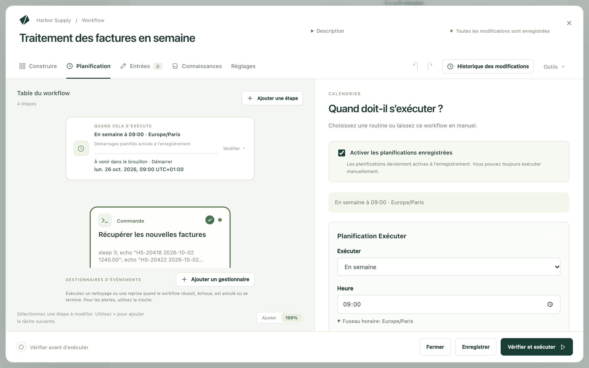

Kitewell peut lancer un workflow pour vous : chaque jour ouvré à 9:00, une fois par heure, ou quand un autre service lui envoie une requête. Le travail se fait sur cet ordinateur. Sous Windows avec Kitewell Team, il a lieu que vous soyez connecté ou non ; sur Mac, et avec Kitewell Personal, il a lieu pendant que vous êtes connecté.

## Définir une planification

1. Ouvrez le workflow et choisissez **Planification**.
2. Vérifiez que **Activer les planifications enregistrées** est coché.
3. Sous **Exécuter**, choisissez la fréquence : **Chaque jour**, **En semaine**, **Chaque semaine**, **Chaque heure** ou **Planification personnalisée**.
4. Réglez l’heure. Une planification personnalisée accepte une expression cron à cinq champs.
5. Ouvrez **Fuseau horaire** si l’heure se rapporte à un lieu précis. Sans réglage, la planification suit l’horloge de cet ordinateur, heure d’été comprise.
6. Choisissez **Enregistrer**.

**5 prochains événements planifiés**, sous le formulaire, montre quand le workflow s’exécuterait réellement. En dessous, une ligne indique ce que donne la planification sur cet ordinateur : **S'exécutera, connecté ou non**, **Ne s'exécute que lorsque vous êtes connecté** ou **Ne s'exécutera pas**, avec la raison et le bouton qui règle le problème.

**Tester la planification maintenant** exécute le workflow une fois, exactement comme le ferait la planification, et ouvre l’exécution. Servez-vous-en avant de confier une planification à la nuit.

## Vérifier que les exécutions de cette nuit auront lieu

La liste **Workflows** affiche le même verdict sous le prochain démarrage de chaque workflow, et un bandeau en haut de la page résume en une ligne ce qui empêche les exécutions de cette nuit, avec la solution à côté. Quand rien ne fait obstacle, aucun bandeau n’apparaît.

Ce que le verdict examine : si une session sera ouverte sur l’ordinateur, le projet et son moteur, un workflow en pause ou suspendu, une étape qui a besoin de l’écran, une connexion de navigateur qui demande votre mot de passe, et une planification écrite dans un autre fuseau horaire.

## Exécuter sans personne de connecté (Windows)

Exécuter sans personne de connecté nécessite Kitewell Team, ou l’essai. Avec Kitewell Personal, les planifications ne s’exécutent que lorsque vous êtes connecté.

Activez **Réglages de l’appareil → Exécuter quand personne n’est connecté**. Une seule demande d’autorisation administrateur, sans mot de passe, installe un petit service Windows, Kitewell sign-in, qui démarre le moteur au démarrage du PC et exécute vos planifications sous votre compte, que vous soyez connecté ou non.

La carte affichée à cet endroit présente le compte d’exécution, la connexion, le moteur, la prochaine exécution planifiée et la mise en veille, et permet de désactiver à nouveau le service.

Deux types d’étapes ont encore besoin de vous devant le PC : une étape de bureau, et une étape de site web qui affiche la fenêtre de son navigateur. Leurs workflows indiquent **Ne s'exécute que lorsque vous êtes connecté**. Tout le reste s’exécute dans les deux cas.

**Utiliser mon mot de passe…**, sur la carte, est facultatif. Ajoutez-le quand un workflow a besoin d’un partage réseau, ou d’une connexion à un site web que Windows protège avec votre mot de passe. **Oublier le mot de passe** le retire. Un compte Microsoft ou professionnel peut avoir besoin du mot de passe pour la connexion elle-même ; la carte le signale et vous le demande.

## Garder Kitewell en marche

Fermer la fenêtre n’arrête rien : Kitewell reste dans la barre des menus sur Mac et dans la zone de notification sous Windows. **Ouvrir à l’ouverture de session** sur Mac et **Démarrer à la connexion** sous Windows l’ouvrent quand vous vous connectez. **Quitter Kitewell** arrête les moteurs sur Mac ; sous Windows, avec le service activé, le moteur continue de tourner sans la fenêtre.

## La veille et les exécutions manquées

Sous Windows, avec le service activé, le PC reste éveillé autour d’une exécution planifiée et sort de veille pour la suivante, si le mode de gestion de l’alimentation autorise les minuteurs de réveil. Sur Mac, un ordinateur en veille n’exécute rien ; **Réglages de l’appareil → Protection contre la veille** le garde éveillé tant que du travail est en cours.

Une heure planifiée passée sans exécution apparaît dans **Exécutions et logs** sous forme de ligne **Manquée**, avec la raison : l’appareil était en veille, Kitewell ne tournait pas, le moteur du projet ne tournait pas, ou aucune exécution n’a démarré. La ligne indique si le rattrapage compensera ce manque, et renvoie vers l’exécution qui l’a fait.

Le rattrapage exécute les démarrages manqués une fois l’ordinateur de retour, en remontant 24 heures en arrière par défaut. Modifiez ce réglage dans **Planification → Planifications manquées**.

## En cas de problème

- **L’heure est venue et rien ne s’est exécuté.** Ouvrez **Exécutions et logs** et cherchez une ligne **Manquée** : elle donne la raison. Vérifiez ensuite le verdict sous le prochain démarrage du workflow.
- **L’exécution a eu lieu à la mauvaise heure.** Vérifiez le **Fuseau horaire** de la planification et les heures sous **5 prochains événements planifiés**.
- **Plusieurs exécutions ont démarré d’un coup au réveil de l’ordinateur.** C’est le rattrapage. Réglez **Politique pour les planifications manquées** sur **N’exécuter que la dernière occurrence manquée**, ou passez le rattrapage sur **Désactivé**.
- **Le verdict indique « Ne s’exécutera pas ».** Appuyez sur le bouton à côté. Selon la raison, il active le service, demande un mot de passe, démarre le moteur ou ouvre l’éditeur.

D’autres cas sont traités dans [Dépannage](/fr/docs/troubleshooting/).

## En savoir plus sur les planifications

[La référence des planifications](/fr/docs/reference/scheduling/) couvre le reste : le sens de chaque verdict, le service Windows, ce qu’il fait et ce qu’il ne fait pas, les réglages et les limites du rattrapage, les files d’attente, les webhooks et les éléments de menu.
