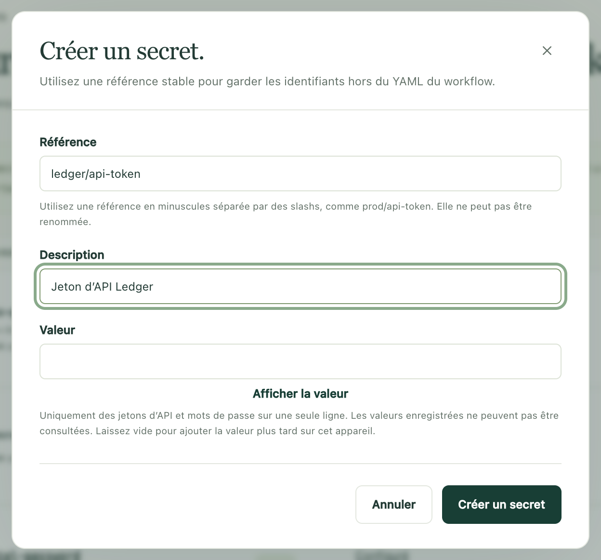
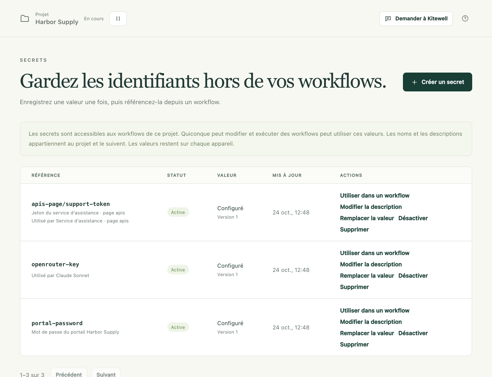

Un workflow a souvent besoin d’un mot de passe, d’un jeton d’API ou d’une
clé. Enregistrez-le une fois comme secret, c’est-à-dire comme un identifiant
que Kitewell conserve pour vous, et le workflow le lit par son nom. Personne
n’a plus à le saisir, il n’apparaît jamais dans une définition de workflow,
et les journaux affichent `*******` à la place de la valeur.

## Ce qu’il vous faut

- Un projet que vous pouvez modifier. **Secrets** se trouve sous **Plus** dans
  la barre latérale. Dans un projet partagé avec vous en consultation via Dagu
  Cloud, vous pouvez définir les valeurs de cet appareil, mais pas créer de
  secret.
- Le projet en marche. Tant qu’il est en pause, la page affiche
  **Ce projet est en pause** ; choisissez **Reprendre**.

## Enregistrer un identifiant

1. Ouvrez **Plus → Secrets** et choisissez **Créer un secret**.
2. Saisissez une **Référence**, le nom que le workflow utilisera, par exemple
   `services/api-token`. Utilisez des lettres minuscules, des chiffres et des
   traits d’union, en parties séparées par des barres obliques. La référence
   ne pourra pas être renommée par la suite.
3. Ajoutez une **Description** pour que la personne suivante sache à quoi il
   donne accès.
4. Saisissez l’identifiant dans **Valeur**. **Afficher la valeur** vous permet
   de vérifier ce que vous avez collé. Laissez le champ vide pour ajouter la
   valeur plus tard sur cet appareil.
5. Choisissez **Créer un secret**.

Le secret apparaît dans la liste avec l’état **Active**, sa valeur marquée
**Configuré** et la **Version** 1. La valeur elle-même n’est plus jamais
affichée, ni ici ni ailleurs.

## L’utiliser dans un workflow

Dans l’éditeur de workflow, tapez `${` dans un champ d’une étape et choisissez
le secret sous **Secrets**. Kitewell le lie au workflow et place son nom dans
le champ ; la valeur, elle, n’y figure pas.

Trois autres pages prennent un secret par son nom plutôt qu’une valeur :

- la clé API d’un modèle, sous **Agents et modèles** ;
- le mot de passe d’un serveur ou d’un hôte de rebond, sous **Serveurs** ;
- l’identifiant ou le secret client d’une API importée, sous
  **Bibliothèque d’API**.

Pour écrire le YAML vous-même, choisissez **Utiliser dans un workflow** sur la
ligne du secret. Kitewell affiche un bloc `secrets:` à coller au premier
niveau. Il nomme la variable d’environnement dans laquelle les étapes lisent
la valeur, par exemple `SECRET_API_TOKEN` pour `services/api-token`.

Dans une [étape de site web](/fr/docs/browser/) ou une
[étape de bureau](/fr/docs/desktop/), choisissez le secret sous
**Valeurs saisies par le navigateur** ou **Valeurs saisies par l'étape**. Les
instructions et le modèle ne voient que le nom de la valeur, écrit `%name%` ;
c’est l’étape qui saisit la valeur elle-même.

[L’assistant](/fr/docs/ai/#the-assistant) peut vous en demander un pendant
qu’il construit un workflow. Une carte apparaît pour vous proposer d’ajouter
un secret portant ce nom ; vous saisissez l’identifiant dans **Valeur** et
choisissez **Enregistrer**, et l’assistant ne voit jamais ce que vous avez
saisi.

## Quand un appareil n’a pas encore de valeur

Le nom et la description d’un secret appartiennent au projet. Sa valeur
appartient à l’appareil sur lequel vous l’avez saisie. Un projet arrivé par
importation ou par [synchronisation](/fr/docs/cloud-sync/) apporte les noms
et attend les valeurs.

- **Valeur requise** signale un secret que le projet utilise sans avoir de
  valeur ici. Choisissez **Définir la valeur**.
- **Vue d’ensemble** liste tous les secrets dont cet appareil a encore besoin,
  avec **Définir la valeur** à côté de chacun.
- **Uniquement sur cet appareil** signale un secret que cet appareil détient
  mais que le projet ne liste pas. Choisissez **Déclarer** pour l’ajouter au
  projet.
- Une ligne commençant par **Utilisé par** nomme ce qui a besoin de chaque
  secret (un modèle, un workflow, un serveur ou une API), pour que vous
  sachiez quel identifiant aller chercher.

Tant qu’aucune valeur n’est définie, Kitewell refuse le travail plutôt que de
le laisser échouer à mi-chemin. Une exécution lancée à la main, par un
webhook, par un agent IA ou par l’assistant s’arrête avant de démarrer, avec
le message « Définissez une valeur pour … sur la page Secrets, puis
relancez. » Il en va de même pour réessayer, relancer ou poursuivre une
exécution, démarrer un lot, actualiser les lignes d’une feuille et tester une
étape. La planification d’une feuille ne démarre rien à l’heure prévue et en
indique la raison. La planification propre d’un workflow, elle, n’est pas
refusée : son exécution démarre, puis échoue.

## En modifier ou en retirer un

- **Remplacer la valeur** enregistre un nouvel identifiant sous la même
  référence. Le numéro de **Version** augmente, et rien de ce qui utilise le
  secret n’a besoin d’être modifié.
- **Modifier la description** change la description, et rien d’autre.
- **Désactiver** empêche la lecture du secret ; la valeur reste. Une exécution
  qui en a besoin démarre, puis échoue. **Activer** le rétablit.
- **Supprimer** retire le secret du projet, et sa valeur de cet appareil. Les
  autres appareils qui synchronisent le projet perdent le nom. Un appareil qui
  détenait une valeur la garde, listée comme **Uniquement sur cet appareil**,
  jusqu’à ce qu’elle y soit supprimée aussi. Une référence que quelque chose
  utilise encore reste listée avec **Utilisé par**, et il lui faut un autre
  secret.

## En cas de problème

- **« Définissez une valeur pour … sur la page Secrets, puis relancez. »**
  Cet appareil n’a pas de valeur pour ce secret. Ouvrez **Secrets**,
  choisissez **Définir la valeur** et relancez.
- **« Ce projet est en pause ».** Choisissez **Reprendre**, puis réessayez.
- **Une valeur sur plusieurs lignes est refusée.** Seuls les jetons et les
  mots de passe tenant sur une seule ligne sont pris en charge. Une clé qui
  s’étend sur plusieurs lignes doit parvenir à l’étape autrement, par exemple
  par un fichier que l’étape lit.
- **« already has a value on this device ».** (Le secret a déjà une valeur
  sur cet appareil.) La création d’un secret n’écrase jamais une valeur déjà
  enregistrée. Utilisez plutôt **Remplacer la valeur**.

## Ce que cela protège, et ce que cela ne protège pas

Les secrets sont chiffrés sur le disque par le moteur du projet. La clé qui
les déchiffre est elle-même scellée par une clé d’appareil que détient le
système d’exploitation : sous Windows, une clé que seul ce PC peut ouvrir, si
bien qu’une copie du dossier de données est illisible ailleurs. Pendant toute
la durée d’une exécution, chacune de ses étapes reçoit les secrets que son
workflow lie.

Ce n’est pas un bac à sable. Toute personne qui peut modifier et exécuter les
workflows de ce projet peut écrire une étape qui lit ses secrets, et une étape
s’exécute avec les autorisations de la personne qui fait tourner Kitewell.
Séparer les projets sépare les secrets ; cela ne limite pas ce qu’une
commande peut faire.

Kitewell affiche `*******` à la place de la valeur exacte d’un secret dans les
journaux, les détails des exécutions et les sorties. Une valeur qu’une étape
encode, tronque ou transforme avant de l’afficher peut ne pas être masquée,
pas plus qu’une valeur qu’une étape écrit dans un fichier ou un artefact.
N’affichez pas d’identifiants.

## Exportations, synchronisation, versions publiées et sauvegardes

| Où va le projet | Noms et descriptions | Valeurs |
| --- | --- | --- |
| Une [exportation](/fr/docs/sharing/) de projet | Inclus, références comprises | Exclues |
| La [synchronisation avec Dagu Cloud](/fr/docs/cloud-sync/) | Synchronisés avec le projet | Jamais envoyées |
| Une [version publiée](/fr/docs/releases/) | Ceux que lisent ses workflows | Exclues |
| Une [sauvegarde](/fr/docs/backups/) de l’appareil | Inclus | Exclues, avec leurs clés |

Toute personne qui reçoit le projet voit chaque secret marqué
**Valeur requise** et définit sa propre valeur.

Restaurer une sauvegarde supprime les valeurs que détient cet appareil, même
sur l’appareil qui a créé la sauvegarde. Saisissez de nouveau les
identifiants : la restauration en nomme jusqu’à cinq par projet, et
**Secrets** et **Vue d’ensemble** listent tous ceux qui manquent encore.
Gardez à part, dans un endroit protégé, une trace des identifiants dont vous
auriez besoin pour une restauration.

Si Dagu Cloud n’accepte pas un nouveau secret pour le projet, la valeur est
tout de même enregistrée sur cet appareil, listée comme
**Uniquement sur cet appareil**. Les autres personnes qui synchronisent le
projet ne la voient pas tant que le secret n’est pas déclaré, sauf si un
élément synchronisé utilise déjà ce nom.

Les exportations et les sauvegardes ne sont pas chiffrées. Un identifiant
saisi directement dans un workflow, un fichier OpenAPI ou une URL source
reste dans l’archive tel qu’il a été écrit. Vérifiez une archive avant de la
partager, et chiffrez-la vous-même avant de la placer dans un stockage
partagé.

## Détails

- Une référence correspond à `^[a-z0-9][a-z0-9-]*(/[a-z0-9][a-z0-9-]*)*$` et
  compte au plus 80 caractères. Une description tient sur une ligne d’au plus
  200 caractères.
- Les valeurs tiennent sur une seule ligne, car le masquage des journaux du
  moteur traite une ligne à la fois.
- Le stockage est le registre de secrets AES-256-GCM de Dagu, sous
  `engines/<project>/data/secrets`. Sa clé est conservée scellée dans
  `engines/<project>/key.sealed` par la clé d’appareil, `device.key`, que
  Windows scelle pour ce seul PC ; sur un Mac, la clé d’appareil est un
  fichier que seul votre utilisateur peut lire. Aucun de ces fichiers ne
  figure dans une sauvegarde.
- Une clé d’appareil est renouvelée une fois par an, et tout ce qu’elle scelle
  est scellé à nouveau ; **Réglages de l’appareil → Secrets stockés** indique
  quand, et propose **Créer une nouvelle clé maintenant**. Si la clé vient à
  être perdue, par exemple après une réinstallation de Windows, la même
  section le signale et chaque valeur enregistrée demande à être saisie de
  nouveau. Les workflows et leurs données ne sont pas touchés.
- Le moteur lit les secrets d’une exécution au démarrage de celle-ci et les
  transmet à ses étapes sous forme de variables d’environnement. Kitewell ne
  lit lui-même une valeur que pour s’en servir pour vous : la clé d’un modèle
  pour l’assistant ou une feuille, le secret client d’une API quand vous
  connectez cette API, une valeur que saisit le navigateur de l’assistant, et
  les valeurs qu’il masque dans les comptes rendus des exécutions d’essai de
  l’assistant.
- La liste affiche 50 secrets par page, avec **Précédent** et **Suivant**.
- Les connexions aux registres de conteneurs, aux boîtes mail et aux API sont
  conservées comme valeurs internes au moteur et ne sont pas listées ici.
  Gérez-les sous **Réglages du projet**, **Comptes de messagerie** et
  **Bibliothèque d’API**.
