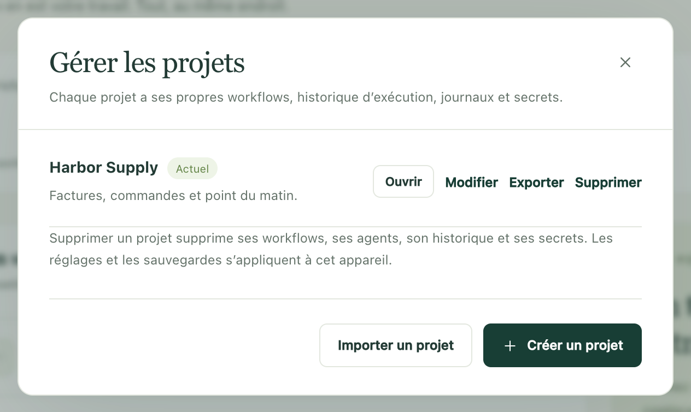

Construisez une routine une fois et confiez le projet entier à un collègue, ou à votre deuxième ordinateur. Il reçoit les workflows, les noms des réglages dont ces workflows ont besoin, et rien de ce qui doit rester chez vous : ni mots de passe, ni historique d’exécution, ni connexions de boîtes mail.

Pour que toutes les copies restent identiques à mesure que les workflows évoluent, [synchronisez plutôt le projet avec Dagu Cloud](/fr/docs/cloud-sync/). Un export est un instantané : il n’est plus à jour dès que vous modifiez quelque chose.

## Envoyer un projet sur un autre ordinateur

1. Ouvrez le sélecteur de projet en haut de la barre latérale et choisissez **Gérer**.
2. Dans **Gérer les projets**, choisissez **Exporter** à côté du projet. Kitewell télécharge un seul fichier, `kitewell-project-harbor-supply-20261005T091500.tgz`, dont le nom contient celui du projet et l’heure.
3. Envoyez le fichier par le moyen habituel de votre équipe.
4. Sur l’ordinateur qui le reçoit, ouvrez **Gérer les projets**, choisissez **Importer un projet** et sélectionnez le fichier.
5. Kitewell affiche « Cet appareil doit fournir le reste » et liste ce qui manque : chaque secret qui a besoin d’une valeur, une boîte mail à connecter, une machine dont personne n’a encore approuvé la clé d’hôte, une commande personnalisée, et les workflows arrivés en pause. Choisissez **Ouvrir** et traitez cette liste point par point.



L’import crée toujours un nouveau projet ; il ne remplace jamais un projet existant. Si un projet du même nom existe déjà, Kitewell demande un autre nom.

Le nouveau projet compte dans la limite de cet ordinateur : jusqu’à cinq projets avec Kitewell Personal, et jusqu’à 15 avec Team et pendant l’essai. Un projet qui contient plus de 100 workflows ne peut pas être importé du tout. Le fichier lui-même peut peser jusqu’à 16 Mio.

## Ce qui voyage, et ce qui ne voyage pas

Le fichier contient le projet sous forme d’un ensemble de documents en texte brut :

- les définitions des workflows, avec leurs planifications ;
- les agents et modèles nommés ;
- les documents OpenAPI importés et les réglages de leurs connexions API ;
- les adresses des serveurs et les groupes de serveurs, les files d’attente et les registres d’images ;
- les feuilles de lot ;
- les noms et descriptions des secrets, mais jamais leurs valeurs ;
- les valeurs par défaut des workflows du projet et ses [connaissances](/fr/docs/knowledge/) ;
- la dernière version publiée que le projet a reprise.

L’ordinateur qui le reçoit fournit lui-même le reste :

- les valeurs des secrets et les mots de passe des registres ;
- les chemins des clés privées SSH et les clés d’hôte approuvées ;
- les commandes d’agents personnalisées, les outils installés et les connexions des agents ;
- les connexions de boîtes mail ;
- les scripts externes, les fichiers d’entrée et les données montées dans Docker.

Entièrement exclus : l’historique d’exécution, les journaux, les artefacts, les versions publiées, l’historique local des modifications, les règles d’alerte du projet, les réglages du diagnostic des échecs, les connexions aux sites web, les réglages de l’appareil et les clés API de cet ordinateur.

:::caution
Le fichier n’est pas chiffré. Tout ce qui est saisi directement dans une commande de workflow, un document OpenAPI, une adresse de serveur ou un autre réglage du projet voyage tel quel. Relisez ces champs avant d’envoyer le fichier, et gardez les identifiants dans des [secrets](/fr/docs/secrets/) pour qu’ils restent sur place.
:::

## Décider quel ordinateur exécute les planifications

Les workflows importés arrivent en pause, à dessein. Exécutez-en d’abord un à la main, vérifiez ce qu’il a fait, puis activez les planifications que cet ordinateur doit assurer.

Deux ordinateurs qui activent tous les deux la même planification l’exécutent tous les deux, chacun de son côté. Pour une routine qui ne doit avoir lieu qu’une fois, choisissez un ordinateur pour l’exécuter et laissez les autres copies en pause. Cet ordinateur doit être allumé et éveillé à l’heure prévue. Voir [Planifications et fonctionnement en arrière-plan](/fr/docs/scheduling/).

## Laisser un collègue piloter les workflows d’un ordinateur

Parfois, le travail doit rester sur une seule machine, et vos collègues ont seulement besoin de le lancer, de le suivre ou de le modifier. Donnez à chacun une clé plutôt qu’une copie du projet.

1. Sur cet ordinateur, ouvrez **Cet appareil → MCP**.
2. Choisissez **Connecter un agent IA** et créez une clé par personne ou par client, avec l’**Autorisation** dont son rôle a besoin : **Lecture seule** pour consulter, **Exécuter les workflows** pour lancer le travail, **Modifier et exécuter** pour modifier les workflows.
3. Limitez chaque clé aux projets dont la personne a besoin, sous **Projets autorisés**.

Vos collègues utilisent ensuite n’importe quel client MCP, ou de simples requêtes HTTP, sur cet ordinateur. Toutes les offres permettent un nombre illimité de clés API et d’apps connectées. Quand les membres d’une organisation partagent ainsi un ordinateur, il faut Kitewell Team ; voir les [tarifs](/fr/pricing/). Chaque exécution a toujours lieu sous l’utilisateur de cet ordinateur : une clé limite donc les projets qu’une personne atteint, pas ce qu’un workflow peut faire une fois lancé. La connexion facultative à l’app elle-même est distincte : ces clés ne créent pas d’identifiants pour elle.

Un client sur un autre ordinateur a besoin d’une adresse qu’il peut joindre en HTTPS, que vous mettez en place. Voir [MCP et accès API](/fr/docs/mcp/) à ce sujet et pour le détail des autorisations.

## Garder les définitions sous contrôle de version

Les documents d’un projet sont des fichiers JSON et YAML ordinaires : une équipe peut donc les relire et les versionner dans son propre dépôt Git. Kitewell ne fait ni push, ni pull, ni merge de ce dépôt à votre place.

Les fichiers se trouvent sous le dossier de données de Kitewell, à savoir `~/Library/Application Support/Kitewell` sur Mac et `%LOCALAPPDATA%\Kitewell` sous Windows.

```text
data/workspace/project-<id>/
  project.json
  workflows/
  batch-sets/
  knowledge/
  agents/  apis/  queues/  registries/  secrets/  server-groups/  servers/
  releases/
```

`project.json` contient le nom du projet, sa description, les valeurs par défaut des workflows et la dernière version publiée reprise. `workflows` contient un fichier YAML par workflow, `batch-sets` un fichier par feuille de lot, `knowledge` un par page de connaissances, `releases` un par version publiée, et chacun des autres dossiers un fichier JSON par agent, connexion API, file d’attente, registre, nom de secret, groupe de serveurs ou serveur. Versionnez le dossier `project-<id>` entier ; repérez le bon d’après le nom inscrit dans son `project.json`. Gardez tels quels l’organisation des fichiers et les ID des documents.

Quittez Kitewell avant de remplacer des fichiers ou d’appliquer des modifications venant du dépôt, résolvez les conflits, puis rouvrez Kitewell et passez le projet en revue avant d’exécuter quoi que ce soit. Quitter interrompt les exécutions en cours : attendez donc d’abord qu’elles se terminent. Ne gérez pas un [projet synchronisé](/fr/docs/cloud-sync/) de cette façon : Kitewell gère lui-même ces fichiers et les remplace quand une modification arrive de Dagu Cloud.

Partagez ce seul dossier plutôt que tout le dossier de données. Les identifiants de l’appareil, les valeurs des secrets et les données d’exécution appartiennent à chaque ordinateur. Pour une nouvelle personne, mieux vaut **Importer un projet** avec un export relu.

## Exporter un registre des robots

Beaucoup d’équipes tiennent un registre des robots : une ligne par automatisation, qui indique ce qu’elle fait, ce qu’elle atteint et qui s’en occupe. Sur la page **Workflows**, **Exporter le registre** en télécharge un sous forme de classeur Excel, avec une ligne par workflow et les colonnes dans l’ordre où le Center for Financial Industry Information Systems (FISC) énumère les éléments de gestion d’un robot.

Kitewell remplit ce qu’il peut lire dans chaque workflow et dans ses [connaissances](/fr/docs/knowledge/), sans interroger de modèle : **Nom du robot** et **ID du robot**, **Périodicité** et **Statut**, **Conditions de suite** pour les workflows qu’il lance, **Description de l'activité**, **Données d'entrée et de sortie** pour les classeurs qu’il ouvre, **Systèmes connectés** pour les sites, API, serveurs, boîtes mail et modèles qu’il atteint, et **Documents**, qui reprend ses pages de connaissances en entier.

Six colonnes restent vides, à remplir par vous : **Responsable de la gestion**, **Sous-traitant**, **Conduite en cas d'erreur**, **Importance pour l'activité**, **Impact sur les clients** et **Impact légal et réglementaire**. Les noms des colonnes suivent la langue d’affichage de Kitewell.
