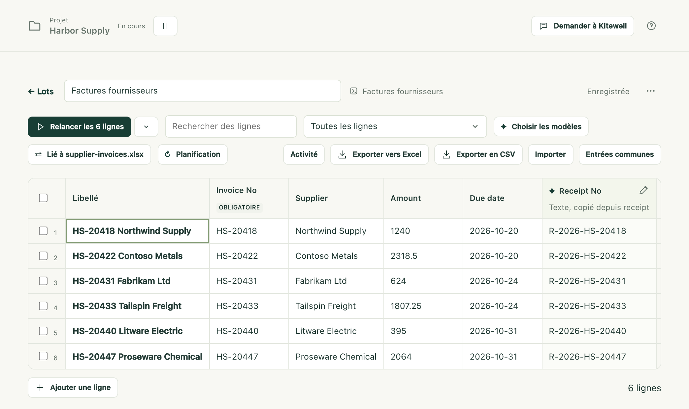
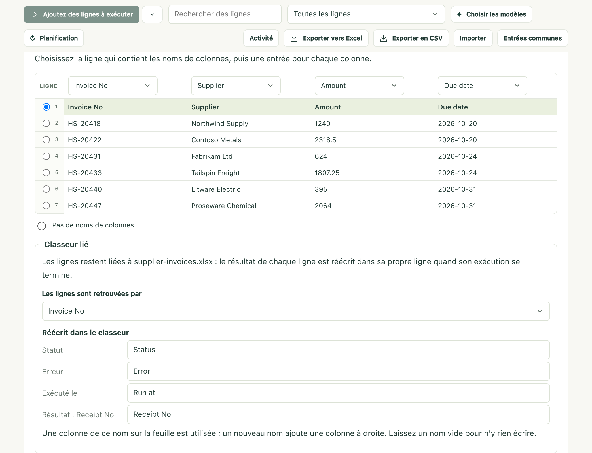

Vous avez une liste dans Excel (les factures du mois, une par ligne) et
quelque chose à faire pour chacune. Kitewell exécute votre workflow une fois
pour chaque ligne et écrit chaque résultat dans la ligne d’où il vient.
Rouvrez ensuite le même fichier : les numéros d’accusé de réception figurent à
côté des factures.

Excel ne s’ouvre jamais. Kitewell lit et écrit directement le fichier
`.xlsx` : il continue donc de travailler la nuit, écran verrouillé.

## Liez votre classeur

Il vous faut l’app Kitewell sur l’ordinateur où se trouve le fichier. Un
navigateur ne peut pas atteindre le fichier : il ne propose donc pas cette
option.

1. Créez une feuille pour le workflow qui doit s’exécuter une fois par ligne,
   comme l’explique [Exécuter un workflow sur une feuille](/fr/docs/batches/).
2. Choisissez **Importer** dans la barre d’outils de la feuille, puis
   **Lier un classeur sur cet appareil**, et choisissez le fichier `.xlsx`.
   Déposer le fichier sur la fenêtre de Kitewell revient au même.
3. Vérifiez ce que Kitewell a trouvé : la **Feuille**, la ligne qui contient
   les noms de colonnes, et quelle colonne remplit quelle entrée. Les colonnes
   dont le nom correspond à une entrée sont associées automatiquement.
4. Sous **Les lignes sont retrouvées par**, choisissez la colonne qui
   distingue les lignes, comme le numéro de facture.
5. Sous **Réécrit dans le classeur**, voyez les colonnes qui reçoivent les
   résultats : **Statut**, **Erreur**, **Exécuté le**, et une par résultat.
   Renommez celles que vous voulez, ou videz un nom pour ne rien écrire dans
   cette colonne.
6. Choisissez **Lier et ajouter 6 lignes**.

La feuille affiche maintenant les lignes du classeur, et la barre d’outils
indique **Lié à** suivi du nom du fichier.

## Exécutez les lignes

Exécutez-les comme pour n’importe quelle feuille. Une cellule qui ne peut pas
devenir ce qu’attend son entrée (« douze » dans une colonne de montants) est
entourée, et sa ligne attend que vous la corrigiez.

Quand des lignes se terminent, Kitewell écrit de lui-même leurs résultats dans
le classeur, en une demi-minute environ. **Écrire les résultats maintenant**
n’attend pas.

| Colonne | Contenu |
| --- | --- |
| Status | Done, Partly failed, Failed, Stopped ou Rejected |
| Error | La raison de l’échec de la ligne, en une ligne |
| Run at | Le moment où la ligne s’est exécutée |
| Une par résultat | Une valeur produite par l’exécution, comme un numéro d’accusé de réception |

Ces mots sont écrits en anglais. Un classeur dont les en-têtes sont en
japonais reçoit des mots japonais : 状態, エラー, 実行日時, et 済 pour Done. Des
en-têtes en chinois ou en coréen reçoivent de même des mots chinois ou coréens.

## Si le fichier est ouvert dans Excel

Sous Windows, rien n’échoue. La feuille indique que les résultats sont prêts
et qu’ils seront écrits à la fermeture du fichier dans Excel, puis les écrit
dès que vous le fermez. **Enregistrer les résultats dans une copie** écrit
plutôt `supplier-invoices (results).xlsx` à côté du fichier.

Sur Mac, Excel ne verrouille pas le fichier : Kitewell ne peut donc pas savoir
qu’il est ouvert, et écrit quand même les résultats. Fermez le classeur dans
Excel avant que les lignes se terminent : l’enregistrer ensuite depuis Excel
peut écraser les résultats.

## Chaque matin

Donnez une [planification](/fr/docs/scheduling/) à la feuille. Elle pose
alors deux questions de plus : **Lire supplier-invoices.xlsx d'abord**, et
**Quelles lignes s'exécutent** (**Chaque ligne**, ou
**Seulement les lignes que le classeur a ajoutées ou changées**).

Avec la seconde option, chaque matin, Kitewell lit le fichier, exécute ce qui
est nouveau, réécrit les résultats, et ne lance rien si rien n’a changé.
Planifiez la feuille sur l’ordinateur où se trouve le fichier ; un autre
ordinateur ne peut pas l’exécuter.

## En cas de problème

- **Quelqu’un a trié ou filtré la feuille.** Kitewell relit le fichier avant
  chaque écriture et suit chaque ligne grâce à sa clé. Une ligne qui a bougé
  est laissée de côté et nommée ; les autres sont écrites.
- **Un résultat a été écrit alors qu’il n’aurait pas dû l’être.** **Annuler**
  remet le fichier dans son état précédent. Kitewell garde une copie d’avant
  chacune des dix dernières écritures. Dans cette version, l’écriture
  suivante remet les mêmes résultats.
- **Le classeur a changé sur le disque.** La feuille propose
  **Relire le classeur**, qui intègre les lignes nouvelles et modifiées, et
  marque **Plus dans la liste** les lignes que le classeur ne contient plus.
- **Une étape échoue.** Voir
  [Dépannage](/fr/docs/troubleshooting/#a-spreadsheet-step-fails).

## En savoir plus sur Excel

La [référence Excel](/fr/docs/reference/spreadsheets/) couvre le reste : lire
un devis ou une commande présentés sous forme de formulaire, les dix étapes de
feuille de calcul qu’un workflow peut utiliser, construire la même tâche avec
des étapes plutôt qu’avec une feuille, ce qui reste sur votre ordinateur, et
les limites.
