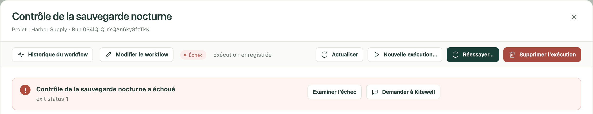
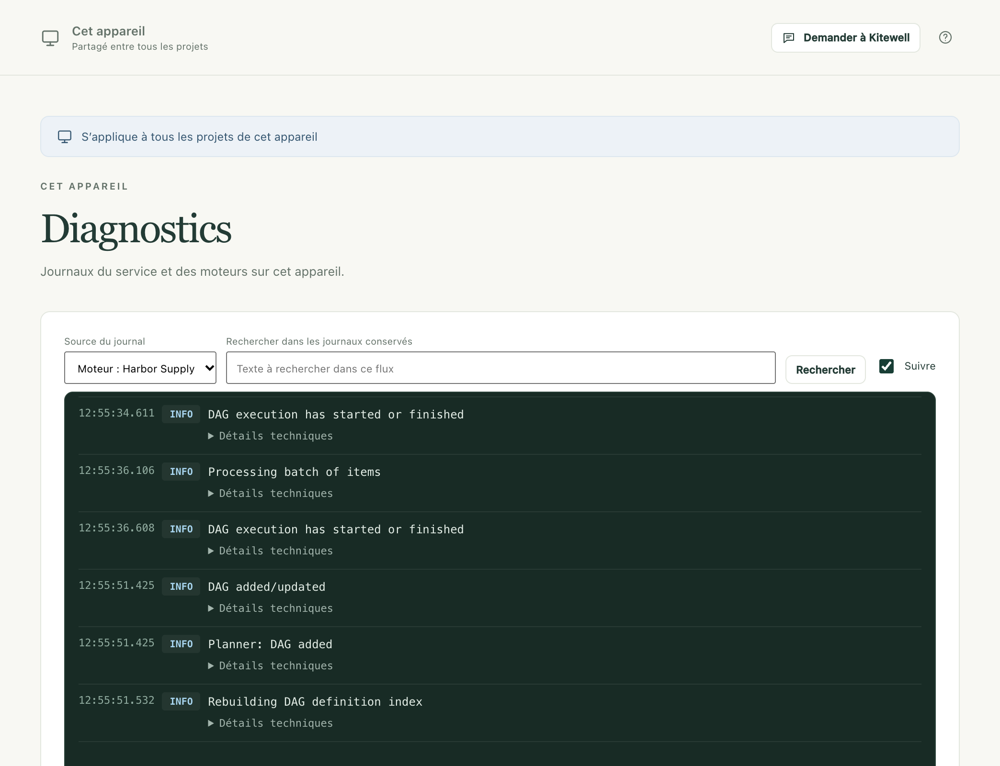

Trouvez ce qui n’a pas fonctionné, et ce qu’il faut faire. Si aucun de ces
cas ne correspond, [ouvrez une demande d’assistance](/fr/support/) en
indiquant vos versions, ce que vous avez fait et la sortie obtenue, après en
avoir retiré tout mot de passe.

## Une exécution a échoué

Ouvrez l’exécution depuis **Exécutions et logs**. Un résumé en haut nomme
l’étape qui a échoué et ce qu’elle a renvoyé.

- **Examiner l’échec** affiche cette étape et son journal.
- **Demander à l'assistant** examine le problème pour vous.
- **Corriger dans l'éditeur** ouvre le workflow sur l’étape en échec : vous
  pouvez la corriger et poursuivre l’exécution à partir de l’étape de votre
  choix. Cette option est proposée sur une exécution ouverte depuis
  l’historique du workflow lui-même : dans **Workflows**, choisissez
  **Voir l’historique d’exécution** à côté du workflow.

Avec le [diagnostic des échecs](/fr/docs/ai/#failure-diagnosis) activé,
l’exécution indique aussi s’il faut réessayer, ce qui demande votre
intervention ou ce qu’il faut changer. Voir
[Exécutions et logs](/fr/docs/runs/#fix-a-failed-run).

## Une commande fonctionne dans un terminal mais échoue dans Kitewell

L’environnement de Kitewell n’est pas celui que vous fournit votre terminal.
Donnez au programme son chemin complet, définissez un dossier de travail sur
l’étape et définissez les variables dont il a besoin, au lieu de compter sur
celles que votre shell définit pour vous. Vérifiez aussi si la commande
attend qu’une personne tape une réponse, ou si elle utilise un identifiant
qui n’existe que dans votre session de terminal.

## Un workflow planifié ne s’est pas exécuté

Ouvrez d’abord **Exécutions et logs**. Une ligne **Manquée** à l’heure prévue
en donne la raison : l’appareil était en veille, Kitewell ne tournait pas, le
moteur du projet ne tournait pas, ou aucune exécution n’a démarré.

Ouvrez ensuite **Workflows**. La ligne sous le prochain démarrage du workflow
indique ce que donne désormais sa planification, **S'exécutera**,
**Ne s'exécute que lorsque vous êtes connecté** ou **Ne s'exécutera pas**,
avec la raison et un bouton qui corrige le problème. Le bandeau en haut de la
page indique la même chose pour l’ensemble du projet.

Si ni l’un ni l’autre n’indique quoi que ce soit, vérifiez que la
**Planification** du workflow est enregistrée avec
**Activer les planifications enregistrées** coché, et que son fuseau horaire
est bien celui que vous vouliez.

Sur Mac, l’ordinateur doit être sorti de veille et votre session ouverte à
cette heure-là. Sous Windows avec Kitewell Team, le travail planifié s’exécute sans que personne
n’ait ouvert de session une fois le service de connexion activé ; voir
[Planifications](/fr/docs/scheduling/#run-with-nobody-signed-in-windows).

Un démarrage manqué n’est rattrapé plus tard que si le workflow le demande.
Voir sa **Planification → Planifications manquées**.

## Une étape de site web échoue

Regardez d’abord les captures d’écran de l’étape dans les artefacts de
l’exécution. Une page de connexion, un bandeau de cookies ou une vérification
anti-robot l’explique généralement. Vérifiez ensuite que :

- Chrome est installé (ou Microsoft Edge sous Windows), et que
  **Vérifier le navigateur** réussit ;
- les hôtes de la page figurent dans
  **Sites autorisés · un par ligne (facultatif)**, si vous avez rempli ce
  champ ;
- les délais d’attente sont assez longs pour la page ;
- aucune instruction ne contient de mot de passe ; placez-le dans
  **Valeurs saisies par le navigateur** ;
- un modèle est choisi pour l’étape ou pour le workflow.

Si le site a changé et qu’une action rejouée ne fonctionne plus, videz-la sous
**Réglages du projet → Stockage → Cache de relecture**. Voir
[Automatiser un site web](/fr/docs/browser/).

## Une étape de feuille de calcul échoue

La plupart des refus nomment le classeur, la feuille et la cellule.
**Vérifier**, dans l’étape, interroge le moteur avant toute exécution. Causes
fréquentes :

- le chemin n’est pas le chemin complet d’un fichier `.xlsx` ou `.xlsm` sur
  cet ordinateur. Un fichier `.xls` ou `.ods` doit d’abord être enregistré au
  format `.xlsx` dans Excel ;
- la feuille ou une colonne que l’étape nomme n’est plus dans le classeur. Le
  message liste ce qui s’y trouve à la place ;
- une cellule ne peut pas être convertie dans le type auquel une colonne est
  fixée, par exemple une quantité écrite en toutes lettres ;
- le fichier est ouvert dans Excel, ce qui bloque une écriture jusqu’à sa
  fermeture ;
- une cellule fusionnée recouvre l’endroit où l’étape écrirait. Le message
  nomme la plage à défusionner.

Une écriture dans un classeur lié peut être annulée depuis la feuille, tant
que le fichier n’a pas changé depuis que Kitewell y a écrit. Voir
[Automatiser Excel](/fr/docs/spreadsheets/).

## Une étape de bureau échoue

Regardez d’abord les captures d’écran de l’étape dans les artefacts de
l’exécution. Vérifiez ensuite que :

- **Réglages de l’appareil → Automatisation du bureau → Vérifier l'accès au bureau**
  indique que chaque autorisation est accordée. Sur Mac, c’est
  **Kitewell Agent** qui a besoin des autorisations Enregistrement de l’écran
  et Accessibilité ;
- l’écran est déverrouillé et l’ordinateur sorti de veille. Un écran
  verrouillé fait échouer toutes les étapes de bureau ;
- sous Windows, l’app ne s’exécute pas en tant qu’administrateur alors que
  Kitewell ne l’est pas ;
- la tâche tient dans **Nombre maximal d'actions par tâche**, ou elle est
  découpée en tâches plus petites ;
- le modèle dispose d’un outil d’utilisation de l’ordinateur, ou l’étape
  utilise **Outils simples, pour tout modèle de vision** ;
- aucune instruction ne contient de mot de passe ; placez-le dans
  **Valeurs saisies par l'étape**.

Une étape qui attendait que le bureau soit libre a été mise en pause par
votre propre souris ou votre clavier. Sur un ordinateur où personne ne
travaille, raccourcissez ou désactivez cette attente sous
**Réglages du bureau**. Si une app a changé et qu’une tâche rejouée ne
fonctionne plus, videz-la sous
**Réglages du projet → Stockage → Cache de relecture**. Voir
[Automatiser une app de bureau](/fr/docs/desktop/).

## Google affiche « Cette appli est bloquée »

Tant que Google n’a pas fini d’examiner l’accès de Kitewell à Gmail, il
bloque la connexion de Kitewell par le navigateur pour la plupart des
comptes, et la page n’offre aucun moyen de passer outre. Fermez-la, revenez à
Kitewell et choisissez **Utiliser plutôt un mot de passe d’application**. Voir
[Automatiser les e-mails](/fr/docs/email/).

## Une boîte mail doit être reconnectée

Une exécution qui nomme une boîte mail à laquelle cet ordinateur ne peut pas
se connecter est refusée, et **Vue d’ensemble** indique quelle adresse
connecter ou reconnecter. Ouvrez **Comptes de messagerie** et choisissez
**Reconnecter**. Causes fréquentes :

- le mot de passe du compte a changé, ou un administrateur a mis fin à ses
  sessions ;
- une connexion Google est restée inutilisée pendant six mois, ou une
  connexion Microsoft a été actualisée pour la dernière fois il y a plus de
  90 jours parce que l’ordinateur était éteint ;
- un mot de passe d’application a été supprimé sur le site du fournisseur ;
- un administrateur Microsoft 365 a désactivé IMAP ou le SMTP authentifié, ou
  exige son approbation pour Kitewell. L’erreur contient le lien à lui
  envoyer ;
- un administrateur Google Workspace bloque les applications tierces.

Un projet reçu d’un collègue ou de Dagu Cloud liste ses boîtes mail comme non
connectées tant que vous ne les avez pas connectées ici. Voir
[Automatiser les e-mails](/fr/docs/email/).

## Une tâche d’IA échoue

Vérifiez que l’agent est installé et connecté, ou que le modèle choisi
dispose d’un identifiant valide auprès de son fournisseur. **Tester l'agent**
et **Tester le modèle**, dans **Agents et modèles**, vérifient l’un et l’autre
avant une exécution. Examinez ensuite la consigne enregistrée, la sortie
d’erreur de la tâche, et si le fournisseur vous a coupé l’accès pour cause de
limites ou de facturation. Ne mettez aucun véritable identifiant dans ce que
vous signalez.

## Docker est indisponible

Démarrez Docker sur cet ordinateur, puis utilisez **Vérifier Docker** dans
l’éditeur de workflow. Kitewell n’installe ni ne démarre Docker. Vérifiez
aussi que les dossiers et les fichiers qu’un conteneur monte existent sur la
machine qui l’exécute.

## Une exécution manque dans l’historique

Les exécutions plus anciennes que la durée de conservation de l’historique
d’exécution du projet sont supprimées automatiquement, et toute personne qui
peut modifier le projet peut supprimer une exécution. Voir
[Exécutions et logs](/fr/docs/runs/#delete-runs).

## ChatGPT et Claude

### L’app indique que Kitewell est injoignable

L’ordinateur est en veille, éteint, ou Kitewell n’y tourne pas. Juste après
la mise en veille, ChatGPT ou Claude peut mettre jusqu’à 45 secondes environ
à s’en apercevoir. Ouvrez Kitewell sur cet ordinateur, vérifiez que
**Cet appareil → MCP** affiche **En ligne**, et réessayez.

### Un appel est refusé parce que la connexion n’y est pas autorisée

Le refus indique ce que permet l’autorisation de la connexion, par exemple
« This connection is read-only » (la connexion est en lecture seule) ou
« This connection can run workflows but not edit them » (la connexion peut
exécuter des workflows, mais pas les modifier), et où la changer. Ouvrez
**Cet appareil → MCP → Apps connectées**. Le changement s’applique au
prochain appel de l’app.

### La page de consentement indique que l’ordinateur est hors ligne, ou qu’il n’y a plus de place

- « Ouvrez Kitewell sur cet ordinateur pour continuer. » : l’ordinateur est en
  veille, éteint, ou Kitewell n’y tourne pas. Ouvrez Kitewell, attendez que
  **Cet appareil → MCP** affiche **En ligne**, puis choisissez **Réessayer**.
- Plus de place : l’essai ou l’offre de cet ordinateur a pris fin, il
  n’accepte donc aucune nouvelle connexion. Abonnez-vous à Kitewell Personal
  ou Team, puis connectez-vous à nouveau.

### L’app se connecte, mais ne fait que lire

Avec certaines offres, ChatGPT ne peut utiliser que des outils en lecture
seule, quelle que soit l’autorisation que vous avez accordée. Voir
[ChatGPT](/fr/docs/mcp/#chatgpt).

### L’ajout de la connexion échoue d’emblée

Retirez Kitewell de ChatGPT ou de Claude, puis ajoutez-le de nouveau. Voir
[Connecter ChatGPT ou Claude](/fr/docs/mcp/#connect-chatgpt-or-claude).

## Windows affiche un avertissement SmartScreen

Windows met en garde contre un programme d’installation dont il a rarement vu
l’éditeur. Vérifiez que le SHA256 du fichier téléchargé correspond à celui de
la [page de téléchargement](/fr/download/), puis choisissez
**Informations complémentaires** et **Exécuter quand même**. Si Windows
indique que la signature du programme d’installation est *non valide*,
arrêtez-vous et [signalez-le](/fr/support/) plutôt.

## Kitewell a été installé mais n’a pas démarré

Sous Windows, Setup.exe ouvre Kitewell à la fin de l’installation. Si rien
n’apparaît, ni fenêtre ni message, et que
`%LOCALAPPDATA%\Kitewell\logs\shell.log` ne gagne aucune ligne non plus,
Kitewell a été arrêté avant même que son propre code ne s’exécute.

Le contrôle des applications de Windows en est la cause habituelle. Le
Contrôle intelligent des applications, qu’une installation neuve de
Windows 11 active, refuse de charger une version non signée de Kitewell. Deux
endroits le confirment :

- **Paramètres → Confidentialité et sécurité → Sécurité Windows → Contrôle des applications et du navigateur → Contrôle intelligent des applications**
  indique s’il est activé.
- **Observateur d’événements → Journaux Windows → Application** contient une
  erreur .NET Runtime 1026 `FileLoadException` pour `Kitewell.dll`.

Installez une version signée depuis la [page de téléchargement](/fr/download/).
Une version que vous avez compilée vous-même n’est pas signée, et ne
s’exécutera pas sur un tel PC.

## Kitewell demande d’installer WebView2

La fenêtre de Kitewell repose sur le runtime Microsoft Edge WebView2. S’il est
absent, Kitewell propose **Installer WebView2** à l’ouverture. Le runtime est
alors téléchargé auprès de Microsoft, ce qui prend environ une minute.

## Kitewell ne parvient pas à démarrer son service d’arrière-plan

La fenêtre reste sur l’écran de démarrage, puis affiche ce qu’a renvoyé le
service, avec **Réessayer** et **Ouvrir le dossier de données**. Deux causes ont une
solution que vous pouvez appliquer vous-même.

### Un autre programme utilise le port de Kitewell

Le message se termine par `bind: address already in use` pour
`127.0.0.1:19741`. Une autre copie de Kitewell en est généralement la cause :
une deuxième installation, ou une version de développement qui tourne à côté
de l’app installée. Quittez-la, puis choisissez **Réessayer**.

Le même message peut indiquer que le port est réservé ou bloqué sur cet
appareil, par Hyper-V, WSL ou une stratégie de pare-feu. La personne qui
administre le PC doit alors libérer ce port.

### Le chemin du dossier de données est trop long

Sous Windows, le service refuse de démarrer quand le chemin de son dossier de
données dépasse 79 caractères, et l’indique avec la longueur trouvée. Kitewell
lance des programmes dans des dossiers d’exécution situés sous celui-ci, et
Windows ne lance pas de programme dans un dossier dont le chemin est trop
long. Chaque exécution de chaque workflow échouerait, avec pour seul message
qu’un nom de répertoire n’est pas valide.

La cause habituelle est un `%LOCALAPPDATA%` redirigé vers un emplacement plus
profond ou vers un lecteur réseau. Le chemin par défaut,
`%LOCALAPPDATA%\Kitewell\data`, compte environ 42 caractères. Demandez à la
personne qui administre le PC de laisser `%LOCALAPPDATA%` sur le disque local.

## Kitewell MCP n’écoute pas

**Cet appareil → MCP** affiche un avertissement quand son service d’écoute n’a
pas pu démarrer. La cause la plus fréquente est qu’un autre programme occupe
le port 19742, le même sur tous les appareils : souvent une deuxième copie de
Kitewell, comme une version de développement à côté de l’app installée.
Quittez ce programme et redémarrez Kitewell, ou donnez à Kitewell une autre
**Adresse d’écoute**.

## Une vérification des mises à jour échoue

Vérifiez votre réseau et l’[état des versions](/fr/releases/). Tant que la
première version publique pour votre système n’est pas sortie, il n’existe
aucun flux de mises à jour à lire, et une vérification qui ne peut pas en
joindre un est une vérification échouée, et non la preuve que vous êtes à
jour. Signalez un échec de somme de contrôle ou de vérification du programme
d’installation au lieu de le contourner.

## Trouver les journaux

Pour une étape en échec, commencez par **Exécutions et logs**.

Pour tout le reste, ouvrez **Cet appareil → Diagnostics**. **Source du journal**
permet de choisir entre la sortie propre du service, ses erreurs et le moteur
de chaque projet. Vous pouvez rechercher dans ce qui est conservé et le
télécharger.

## Détails

- Chaque fichier journal fait l’objet d’une rotation à 10 Mio et conserve
  trois copies plus anciennes.
- Les fichiers journaux se trouvent dans
  `~/Library/Application Support/Kitewell/logs` sur Mac et
  `%LOCALAPPDATA%\Kitewell\logs` sous Windows. Sous Windows, `shell.log`, à
  côté, enregistre ce que l’app elle-même a fait : démarrages, redémarrages et
  fermetures.
- L’interface de Kitewell écoute sur `127.0.0.1:19741`. Kitewell MCP écoute
  par défaut sur `127.0.0.1:19742`. Le moteur de workflows de chaque projet
  prend son propre port de bouclage, choisi à son démarrage.
