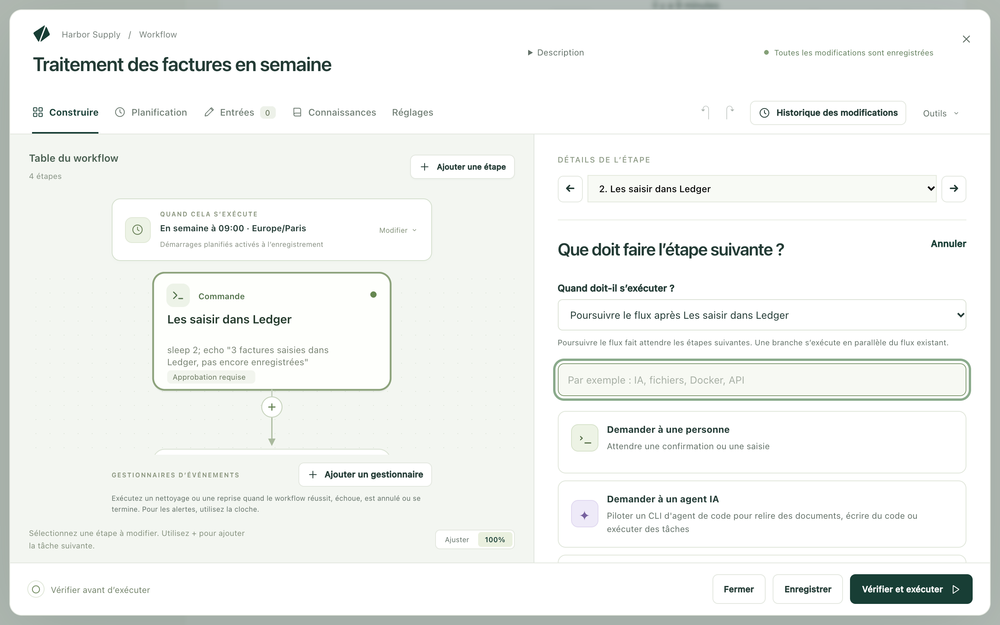
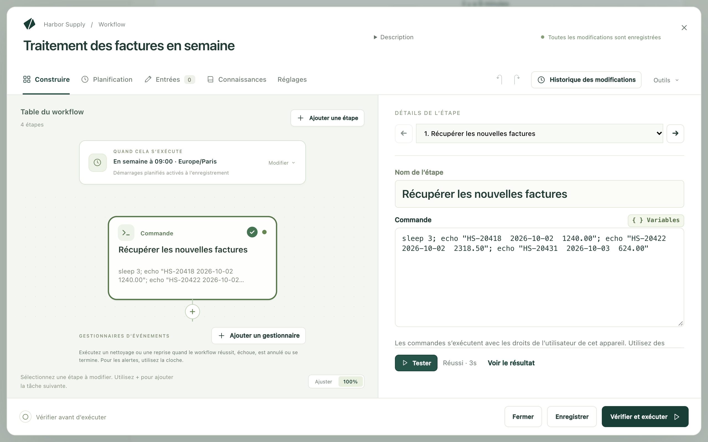
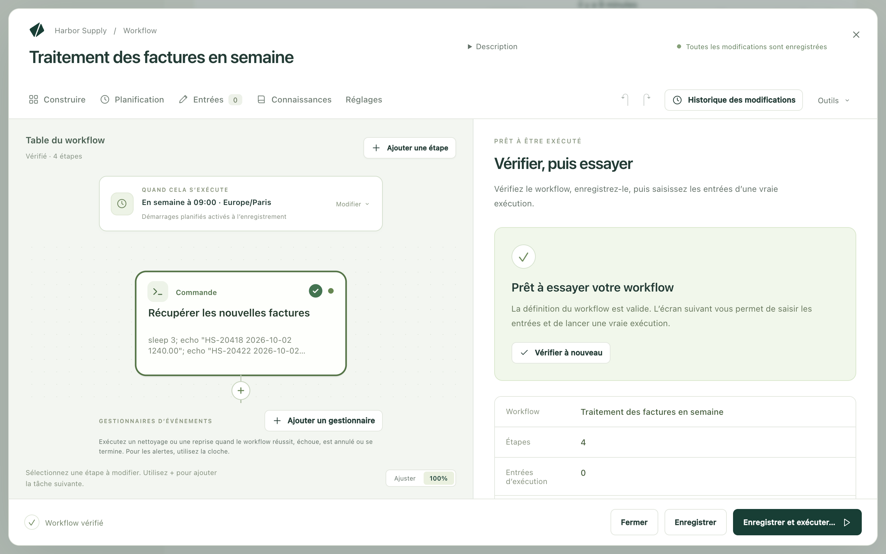
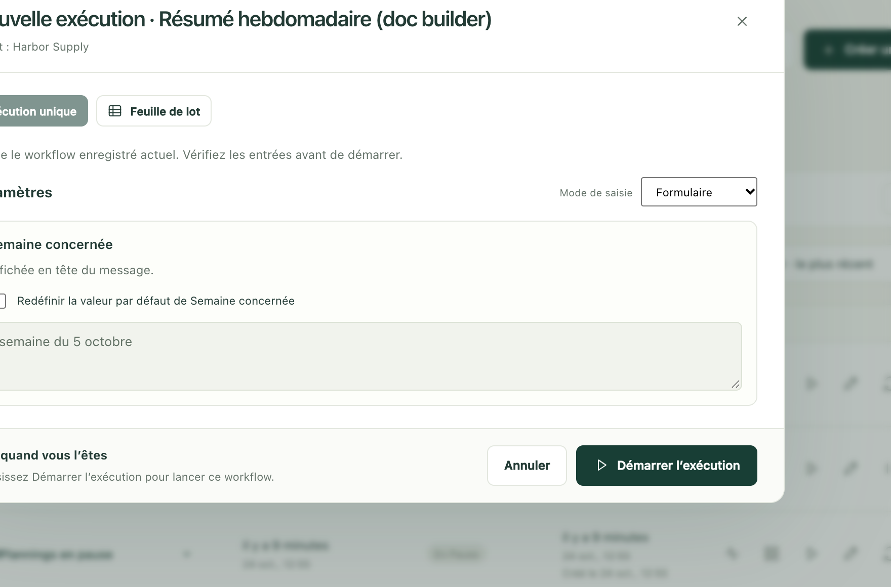

Un workflow, c’est une tâche que vous faites à la main, décrite une fois pour
toutes afin que Kitewell puisse la faire à votre place : récupérer les
factures, les saisir, envoyer un résumé par e-mail. Vous le construisez
morceau par morceau, vous testez chaque morceau séparément, puis vous exécutez
l’ensemble et le regardez travailler.

Chaque morceau est une étape. Une étape fait une seule chose (exécuter une
commande, remplir un site web, lire une boîte mail, demander à une personne)
et l’étape suivante l’attend. L’éditeur dessine les étapes sous forme de
schéma, pour que vous voyiez l’ordre d’un coup d’œil.

## Ce qu’il vous faut

Un projet où ranger le workflow ; vous en avez déjà un si **Workflows** figure
dans la barre latérale. Pour le reste, tout dépend des étapes que vous
choisissez :

- Une commande, une étape de site web ou une attente n’ont besoin de rien
  d’autre.
- Une étape d’IA a besoin d’un modèle ou d’un agent configuré dans
  **Agents et modèles**.
- Une étape d’e-mail a besoin d’une boîte mail connectée dans
  **Plus → Comptes de messagerie**.
- Un mot de passe ou une clé dont une étape a besoin s’enregistre d’abord dans
  **Plus → Secrets**, en tant que secret, pour que sa valeur n’apparaisse
  jamais dans un journal.

Une étape qui ne trouve pas ce dont elle a besoin le signale avant
l’exécution : vous pouvez donc commencer à construire sans avoir tout
configuré.

## Construisez-le, une étape à la fois

1. Choisissez **Créer un workflow** et donnez-lui un nom. L’éditeur s’ouvre
   sur **Construire**, vide, et demande **Que souhaitez-vous automatiser ?**
2. Choisissez une tâche. Les étapes que vous ajoutez apparaissent à gauche,
   sous **Table du workflow** ; celle sur laquelle vous travaillez s’ouvre à
   droite, sous **Détails de l’étape**. Cet écran parle de *tâches* ; une fois
   placée dans le schéma, une tâche devient une étape.
3. Saisissez un nom dans **Nom de l’étape**, en mots simples, par exemple
   `Récupérer les nouvelles factures`. C’est le nom que vous chercherez plus
   tard dans un journal.
4. Renseignez ce dont la tâche a besoin. Une étape de commande n’a qu’un champ,
   **Commande** ; une étape de site web demande l’adresse et ce qu’il faut y
   faire.
5. Choisissez **Ajouter une étape**, ou le + sous une étape du schéma, pour la
   suivante. **Quand doit-il s’exécuter ?** détermine où elle se place :
   - **Poursuivre le flux après** cette étape : les étapes qui venaient après
     attendent désormais la nouvelle ;
   - **Ajouter une branche après** cette étape : un autre chemin, en parallèle
     du premier ;
   - **Démarrer indépendamment** : pour un travail qui n’attend rien.
6. Continuez jusqu’à ce que toute la tâche soit décrite. **Dupliquer**,
   **Monter**, **Descendre** et **Retirer l’étape** permettent ensuite de
   remettre de l’ordre.

Deux raccourcis vous évitent de tout saisir dans un workflow vide : décrivez
la tâche sous **Décrivez ce que ce workflow doit faire** et choisissez
**Demander à l'assistant**, ou choisissez une carte sous
**Ou partez d'un exemple**. **Outils → Parcourir les exemples** rouvre les
exemples plus tard.

## Les tâches disponibles

**Rechercher une tâche** filtre la liste : vous pouvez taper `e-mail` ou
`Excel` au lieu de chercher à l’œil. Voici celles par lesquelles la plupart
des gens commencent :

- **Exécuter une commande ou un script** : exécuter quelque chose sur cet
  ordinateur.
- **Automatiser un site web** : ouvrir un site et cliquer, saisir, lire ou
  télécharger, le tout décrit en langage courant. Voir
  [Automatiser un site web](/fr/docs/browser/).
- **Automatiser une app de bureau** : utiliser une app de cet ordinateur comme
  le ferait une personne. Voir
  [Automatiser une app de bureau](/fr/docs/desktop/).
- **Envoyer un e-mail**, **Trouver des e-mails**, **Ranger des e-mails** :
  rédiger, lire et ranger les messages d’une boîte mail connectée. Voir
  [Automatiser les e-mails](/fr/docs/email/).
- **Interroger un modèle** : envoyer une question à un modèle et conserver sa
  réponse.
- **Demander à un agent IA** : confier un travail à un agent de code installé
  sur cet ordinateur.
- **Demander une décision à l’IA** : classer quelque chose, lui attribuer une
  note ou répondre par oui ou non, sous une forme que l’étape suivante peut
  lire.
- **Demander à une personne** : s’arrêter et attendre que quelqu’un confirme
  ou saisisse quelque chose.
- **Attendre** : marquer une pause pendant une durée donnée, jusqu’à un moment
  précis, ou jusqu’à ce qu’un fichier soit là.
- **Répéter jusqu’à** : vérifier quelque chose à intervalles réguliers jusqu’à
  ce que ce soit prêt, dans la limite d’un nombre de tentatives.
- **Pour chaque élément** : exécuter des étapes une fois pour chaque élément
  d’une liste, et rassembler les résultats.
- **Brancher selon une valeur** : envoyer le travail sur un chemin ou sur un
  autre.
- **Remplir un modèle de texte** : composer un message ou un fichier à partir
  d’un modèle et de quelques valeurs.
- **Exécuter un autre workflow** : réutiliser un workflow existant comme une
  seule étape.

Les tâches plus techniques se trouvent dans la même liste, plus bas :
**Exécuter dans Docker**, **Appeler un service web**,
**Utiliser une action API**, **Exécuter sur une autre machine** et
**Copier des fichiers vers ou depuis une machine**. Les tâches Excel sont
regroupées à la fin, sous l’intitulé **Feuilles de calcul** ; voir
[Automatiser Excel](/fr/docs/spreadsheets/).

## Testez une étape avant de tout exécuter

Inutile d’exécuter tout le workflow pour savoir si une étape fonctionne.

1. Sélectionnez l’étape dans le schéma.
2. Choisissez **Tester** (⌘↩ sur Mac, Ctrl+Entrée sur Windows).
3. Observez la barre à côté de **Tester** : elle indique ce que fait l’étape,
   puis comment elle s’est terminée. Choisissez **Voir le résultat** pour lire
   ce qui est revenu : **Sortie** contient ce que l’étape a affiché, et
   **Erreurs (stderr)** ce dont elle s’est plainte.

Le test exécute cette étape et rien d’autre, avec vos modifications non
enregistrées, et il n’enregistre pas le workflow. Les étapes précédentes ne
s’exécutent pas : leurs valeurs proviennent de leur dernier test réussi, ou
c’est vous qui les saisissez. **Valeurs et entrées** liste ce que l’étape lit
et signale ce qui manque encore.

Un test, c’est du vrai travail. Kitewell annonce ce qu’il va faire avant de
commencer (« Envoie un vrai e-mail depuis me@example.com », « S’exécute sur
cet appareil ») : lisez donc d’abord cette ligne, et ne choisissez
**Tester quand même** que si c’est bien votre intention.

Quatre types d’étapes ne peuvent pas encore être testés seuls, et le signalent
au lieu de s’exécuter : **Demander à une personne**, les étapes situées dans
une boucle **Pour chaque élément**, les gestionnaires d’événements, et les
étapes destinées à un groupe de serveurs.

## Ce qui peut changer à chaque fois

Quand la tâche a besoin d’une date, d’un dossier ou d’un titre qui change d’une
exécution à l’autre, placez-le dans **Entrées** plutôt que dans l’étape.
Chaque entrée devient un champ du formulaire que vous remplissez au démarrage
d’une exécution.

Pour en utiliser une, tapez `${` dans un champ d’une étape et choisissez
l’entrée dans la liste. La même liste propose les secrets et les résultats
enregistrés par les étapes précédentes, et Kitewell fait en sorte que l’étape
qui utilise un résultat attende celle qui le produit.

## Vérifiez, puis exécutez

**Enregistrer** conserve votre travail. Utilisez-le chaque fois que vous
voulez vous arrêter ; la planification du workflow s’applique dès
l’enregistrement.

**Vérifier et exécuter** est le dernier coup d’œil avant que le vrai travail
commence. Cette vue réunit le nom, le nombre d’**Étapes** et
d’**Entrées d’exécution** du workflow, et sa **Planification**, et liste sous
**Avant d’exécuter** ce qu’il vaut mieux corriger d’abord.
**Vérifier le workflow** recherche les erreurs dans le brouillon.

Ensuite :

1. Choisissez **Enregistrer et exécuter…**. Le workflow est enregistré et le
   formulaire d’exécution s’ouvre.
2. Remplissez les champs sous **Paramètres**, si ce workflow en a. Un champ qui
   a déjà une valeur reste verrouillé tant que vous ne cochez pas la case
   proposant de remplacer sa valeur par défaut.
3. Choisissez **Démarrer l’exécution**.

L’exécution s’affiche au fur et à mesure, étape par étape. Une exécution
utilise le workflow tel qu’il était à son démarrage : le modifier ensuite ne
change pas une exécution déjà en cours. Voir
[Exécutions et logs](/fr/docs/runs/) pour savoir quoi faire du résultat, et
[Planifications](/fr/docs/scheduling/) pour que Kitewell le lance à votre
place.

## S’arrêter pour demander à une personne

Certains travaux ne devraient pas se terminer sans que quelqu’un y jette un
œil.

**Demander à une personne** est une étape à part entière. Rédigez les
instructions, et ajoutez un formulaire quand vous avez besoin d’une réponse :
un choix, un commentaire, un nombre. L’exécution attend que quelqu’un le
remplisse.

Pour faire vérifier par quelqu’un ce qu’une étape automatique a fait, ouvrez
la section **Approbation** de cette étape et activez
**Attendre une approbation après cette étape**. Saisissez la question et les
éventuelles valeurs à recueillir. **Le renvoi relance** choisit l’étape à
répéter si le relecteur demande des modifications.

Une approbation met l’exécution en pause *après* son étape. Pour exiger une
autorisation *avant* que quelque chose se produise, placez une étape
**Demander à une personne** devant.

La tâche d’une personne peut aussi renvoyer le travail : sous
**Renvoyer pour modification**, activez
**Permettre au relecteur de renvoyer le travail** et choisissez
**Renvoyer le travail à**, une étape qui s’exécute avant celle-ci. Les étapes
d’IA et les consignes de modèle qui s’exécutent de nouveau reçoivent le
retour ; une commande lit chaque valeur comme une variable, vide à la première
exécution.

Les exécutions en attente se trouvent dans **Exécutions et logs → En attente**,
sous **En attente de vous**. La tâche d’une personne propose
**Terminer la tâche**, et **Renvoyer…** quand elle le permet. Une approbation
propose **Approuver**, **Renvoyer** ou **Rejeter l’exécution**. Renvoyer
répète l’étape choisie et le travail qui suit ; rejeter met fin à l’exécution.

## Exécuter une tâche à la fin du workflow

Les gestionnaires d’événements s’exécutent à côté des étapes du workflow
plutôt que dans le flux : avant la première étape, pendant que l’exécution
attend une personne, en cas de réussite, en cas d’échec, en cas d’annulation,
ou toujours à la fin. Utilisez-en un pour supprimer un fichier temporaire,
annuler une modification ou appeler un service de reprise.

Sous le schéma, **Gestionnaires d’événements** liste ceux de ce workflow.
Choisissez **Ajouter un gestionnaire** et indiquez quand il s’exécute :
**Avant les étapes**, **En attente d’approbation**, **En cas de réussite**,
**En cas d’échec**, **En cas d’annulation** ou **Toujours à la fin**. Le
gestionnaire s’ouvre seul ; **Type de tâche** change ce qu’il fait, et
**Retour au workflow** ramène au schéma. **Demander à une personne**,
**Demander une décision à l’IA**, **Brancher selon une valeur**,
**Pour chaque élément**, **Attendre** et **Répéter jusqu’à** ne peuvent pas
servir de gestionnaires.

Un gestionnaire peut lire les entrées et les variables du workflow ainsi que
le statut de l’exécution, mais pas les résultats de ses étapes. Dans
**Exécutions et logs**, une exécution liste ses gestionnaires à côté de ses
étapes.

Pour prévenir les gens qu’un workflow a échoué, utilisez les
[alertes](/fr/docs/alerts/) plutôt qu’un gestionnaire.

## Demander à un agent IA ou à un modèle

Configurez d’abord un agent ou un modèle nommé dans **Agents et modèles**,
puis ajoutez-le au workflow :

- **Demander à un agent IA** exécute un agent en ligne de commande installé sur
  cet ordinateur. Sélectionnez l’agent, rédigez sa consigne, et utilisez
  **Réglages et contexte de l’agent** pour définir son dossier de projet et
  l’éventuel contexte.
- **Interroger un modèle** envoie une consigne à un modèle que vous avez
  configuré. Sélectionnez le modèle et décrivez la réponse attendue.

Enregistrez la réponse dans une variable quand une étape ultérieure en a
besoin.

**Outils → Vérifier les consignes IA** affiche les instructions que chaque
étape d’IA recevra, avant toute exécution. Les valeurs sont remplies au moment
de l’exécution. Voir [Agents IA et modèles](/fr/docs/ai/) pour les clés, les
autorisations et ce dont chaque fournisseur a besoin.

## Utiliser une API importée

[Importez une description OpenAPI dans la bibliothèque d’API](/fr/docs/apis/),
puis ajoutez **Utiliser une action API** au workflow. Choisissez l’API et
l’opération. Kitewell construit les champs de la requête à partir de la
description, paramètres obligatoires et corps de requête compris.

Dans une étape ultérieure, ouvrez **Variables** et choisissez un champ de la
réponse de l’étape d’API. Kitewell enregistre la valeur et fait en sorte que
la requête se termine avant que son résultat soit utilisé.

## Exécuter une image Docker

Démarrez Docker sur cet ordinateur. Dans la liste des tâches, choisissez
**Exécuter dans Docker**.

1. Choisissez une **Image**, avec son tag. Cherchez parmi les suggestions ou
   utilisez **Parcourir les images**. **Inspecter** lit les ports, le dossier
   et les variables de l’image pour vous aider à remplir l’étape.
2. Saisissez la commande à exécuter à l’intérieur. Utilisez **Script shell**
   pour plusieurs lignes, des pipes ou des variables shell ; l’image doit
   alors contenir `/bin/sh`.
3. Développez les options dont vous avez besoin : dossier de travail,
   montages, environnement, ports publiés, réseau. Un fichier créé dans un
   conteneur a besoin d’un montage pour subsister en dehors.
4. **Vérifier Docker** vérifie la connexion. **Tester** exécute réellement
   l’image et la commande : examinez donc d’abord ses montages et ses effets.

Kitewell n’installe pas Docker et ne le démarre pas. Les conteneurs sont
supprimés après une exécution, sauf si
**Conserver le conteneur après l’exécution** est activé. Les fichiers montés
et les volumes Docker doivent être sauvegardés à part.

## Exécuter des commandes sur une autre machine

Ouvrez **Plus → Serveurs**. Ajoutez l’adresse de chaque serveur, le nom
d’utilisateur et la méthode de connexion. Gardez les mots de passe dans
[Secrets](/fr/docs/secrets/), ou utilisez une clé privée locale sans phrase de
passe. Sous **Vérification de la clé d'hôte**, gardez le réglage par défaut et
approuvez l’empreinte avec **Tester la connexion**, utilisez
**Les known_hosts de cet appareil**, ou choisissez **Ne pas vérifier**. Un
**Hôte de rebond** permet d’atteindre un serveur situé derrière une autre
machine.

Un groupe donne un seul nom à plusieurs serveurs. Placez-les dans l’ordre
voulu, choisissez combien peuvent s’exécuter en même temps, et décidez si un
échec arrête le déploiement ou le laisse continuer.

Dans le workflow, ajoutez **Exécuter sur une autre machine**. Choisissez le
serveur ou le groupe dans **Où elle s'exécute**, puis saisissez la commande.
Un groupe crée une étape distincte par machine : chaque résultat apparaît
séparément dans **Exécutions et logs**.

Pour envoyer toutes les étapes de commande et de script au même endroit,
utilisez **Réglages → Où elle s'exécute** dans le workflow. Un groupe indiqué
ici exécute tout le workflow sur chaque machine à tour de rôle, avec une
exécution distincte par machine. Les étapes Docker, IA, service web, API
importée et sous-workflow s’exécutent toujours sur l’ordinateur où tourne
Kitewell.

## En cas de problème

- **Une étape échoue dès son démarrage.** Le plus souvent : un programme
  manquant, le mauvais dossier, ou un secret sans valeur sur cet ordinateur.
  Lancez **Tester** sur l’étape seule et lisez **Erreurs (stderr)**.
- **Une étape lit une valeur vide.** L’étape qui la produit doit s’exécuter
  d’abord. Ouvrez **Valeurs disponibles** dans l’étape qui la lit, vérifiez
  que la valeur y figure, puis vérifiez **Exécuter après**.
- **L’éditeur ne vous laisse pas modifier un champ.** Certains réglages
  avancés n’existent que dans le texte du workflow. Le message le précise, et
  **Outils → Modifier le YAML** l’ouvre.
- **Une commande fonctionne dans le Terminal, mais pas ici.** Une étape
  s’exécute avec les droits de la personne qui fait tourner Kitewell, depuis
  le dossier du workflow, et sans votre propre configuration de shell.
  Indiquez le chemin complet du programme.

Plus d’informations dans [Dépannage](/fr/docs/troubleshooting/).

## Détails

- **Outils** contient **Éditeur visuel** et **Modifier le YAML**, deux vues du
  même workflow ; **Parcourir les exemples** ; **Vérifier les consignes IA** ;
  **Vérifier le workflow** ; et **Actualiser les suggestions de l’éditeur**,
  qui recharge ce que l’éditeur de texte propose pendant la saisie.
- **Outils → Modifier le YAML** ouvre le workflow sous forme de texte, sous
  l’intitulé **YAML du workflow**. Tout ce que fait l’éditeur visuel y est
  écrit, ainsi que quelques éléments que seul le texte peut exprimer : une
  planification ponctuelle, un exécuteur inhabituel, un commentaire.
  Ctrl+Espace affiche des suggestions et Tab indente. Les commentaires, et les
  réglages que l’éditeur visuel n’affiche pas, sont conservés au retour.
- Une étape qui affiche quelque chose peut le conserver dans un fichier :
  remplissez **Nom de l’artefact (facultatif)**, et le fichier apparaît parmi
  les **Artefacts** de l’exécution. Une étape peut aussi écrire des fichiers
  dans `$DAG_RUN_ARTIFACTS_DIR`.
- Un workflow conserve ses 50 derniers tests d’étape, et un seul test
  s’exécute à la fois. Les valeurs que propose un test viennent du dernier
  test réussi.
- Raccourcis : ⌘S sur Mac, ou Ctrl+S sur Windows, enregistre le workflow. ⌘↩,
  ou Ctrl+Entrée, teste l’étape sélectionnée quand **Construire** est ouvert
  dans l’éditeur visuel.
- Les commandes qu’exécute une étape sont celles du système : sous Windows,
  une étape s’exécute dans PowerShell ; sur Mac, dans le shell. `echo "…"`,
  `sleep 2` et `exit 1` fonctionnent sur les deux ; `cat`, `ls`, `printf` et
  `&&` ne fonctionnent pas sous Windows.
- Le texte d’un workflow ne peut pas définir les réglages de messagerie propres
  au moteur : `mail_on`, `smtp`, `error_mail`, `info_mail`, `mail_on_error`.
  L’enregistrement échoue s’il le fait ; les [alertes](/fr/docs/alerts/) se
  configurent plutôt dans Kitewell.
